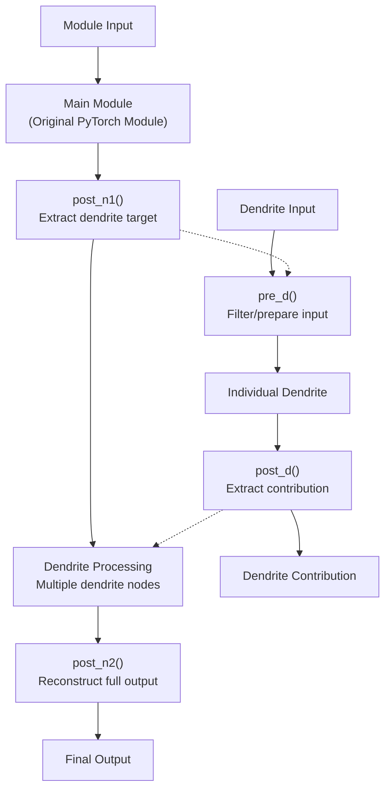
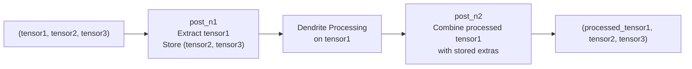
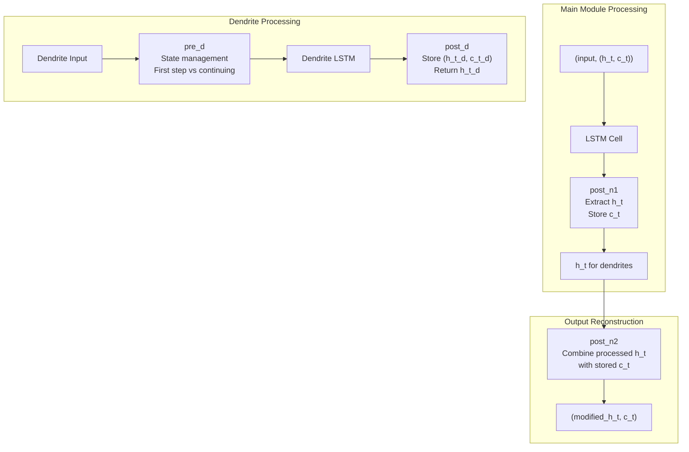
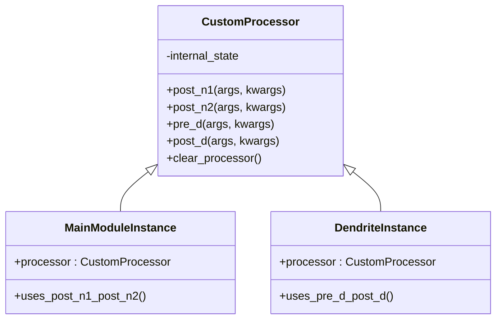
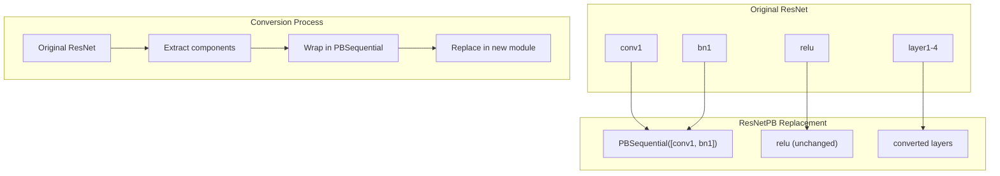
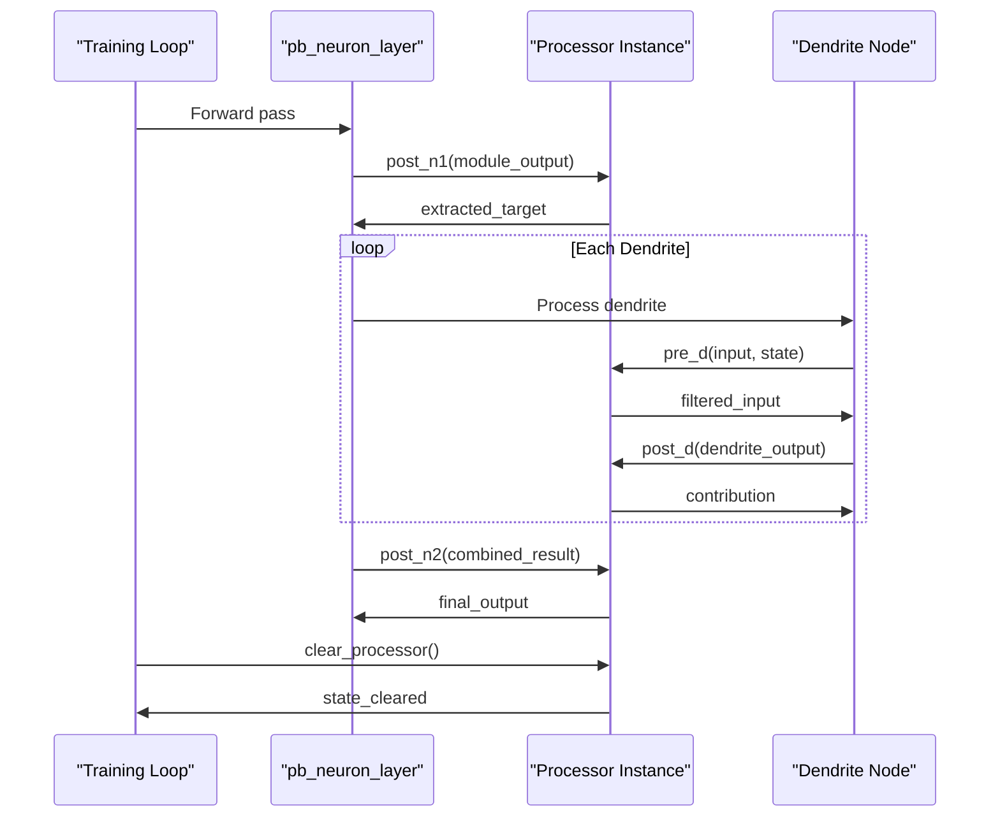

<!-- source: DeepWiki mcp.deepwiki.com · repo PerforatedAI/PerforatedAI · page 3.6 Model Processors · fetched 2026-10-21 -->

# Model Processors

<details>
<summary>Relevant source files</summary>

The following files were used as context for generating this wiki page:

- [perforatedai/pb_models.py](perforatedai/pb_models.py)

</details>


Model processors in PerforatedAI enable dendrite integration with complex PyTorch modules that have non-standard input/output patterns. While basic modules accept one tensor and return one tensor, many real-world modules return multiple outputs, maintain internal state, or require special handling during dendrite processing.

This document covers the processor system that handles these complex modules. For basic module conversion and wrapping, see [Utilities and Conversion](#3.5). For understanding how processors fit into the overall layer system, see [Layer System](#3.3).

## Processor Architecture Overview

The processor system separates the forward pass into distinct phases, allowing dendrites to operate on the appropriate parts of complex module outputs while preserving other components.

### Processing Pipeline



**Sources:** [perforatedai/pb_models.py:13-20]()

### Processor Method Roles

| Method | Phase | Purpose | Input | Output |
|--------|--------|---------|-------|--------|
| `post_n1` | After main module | Extract dendrite target from complex output | Module output | Dendrite processing input |
| `post_n2` | Before final output | Reconstruct complete module output | Processed dendrite result | Final module output |
| `pre_d` | Before each dendrite | Filter/prepare dendrite input | Original module input + state | Dendrite-specific input |
| `post_d` | After each dendrite | Extract dendrite contribution | Dendrite output | Contribution to add |
| `clear_processor` | Between batches/epochs | Clean up internal state | None | None |

**Sources:** [perforatedai/pb_models.py:49-94]()

## Built-in Processors

### multiOutputProcesser

The `multiOutputProcesser` handles modules that return tuples or multiple outputs where only the first output should be processed by dendrites.



#### Implementation Details

- **post_n1**: Extracts first element `args[0][0]`, stores remaining elements as `self.extraOut`
- **post_n2**: Reconstructs tuple with processed first element and stored extras
- **pre_d/post_d**: Pass-through operations for individual dendrites
- **clear_processor**: Removes stored `extraOut` attribute

**Sources:** [perforatedai/pb_models.py:23-42]()

### LSTMCellProcessor

The `LSTMCellProcessor` demonstrates complex state management for recurrent modules that maintain hidden and cell states.



#### State Management Logic

The processor handles the complexity of LSTM state:
- **Initial step detection**: Checks if `h_t.sum() == 0` to identify first timestep
- **State isolation**: Each dendrite maintains separate `h_t_d` and `c_t_d` states
- **Output filtering**: Only hidden state `h_t` participates in dendrite processing

**Sources:** [perforatedai/pb_models.py:45-94]()

## Custom Processors

### Creating Custom Processors

Custom processors must implement all five required methods. The processor class is instantiated once for the main module and separately for each dendrite.



#### Design Guidelines

1. **State Management**: Store temporary state as instance attributes
2. **Input/Output Consistency**: Ensure `pre_d` and `post_d` maintain proper tensor flow
3. **Cleanup**: Always implement `clear_processor` to prevent memory leaks
4. **Error Handling**: Consider edge cases like first timesteps or empty inputs

**Sources:** [perforatedai/pb_models.py:18-19]()

### ResNetPB Module Replacement

For complex architectures, sometimes entire modules need replacement rather than processing. The `ResNetPB` class demonstrates module replacement for ResNet architectures.



The `ResNetPB` constructor demonstrates:
- **Component preservation**: Copy unchanged attributes directly
- **Sequential wrapping**: Combine related modules in `PBSequential`
- **Layer conversion**: Process each layer block appropriately

**Sources:** [perforatedai/pb_models.py:99-156]()

## Integration Examples

### Processor Assignment

Processors are typically assigned during module conversion in the layer system:

```python
# Example processor usage pattern
module.processor = multiOutputProcesser()
```

The processor instance is shared between the main module's `post_n1`/`post_n2` calls and each dendrite's `pre_d`/`post_d` calls.

### State Lifecycle



**Sources:** [perforatedai/pb_models.py:18-20](), [perforatedai/pb_models.py:87-94]()

The processor system enables seamless dendrite integration with complex PyTorch modules while maintaining the original module's interface and behavior. Custom processors can handle any module architecture by implementing the five-method interface and managing internal state appropriately.

---

