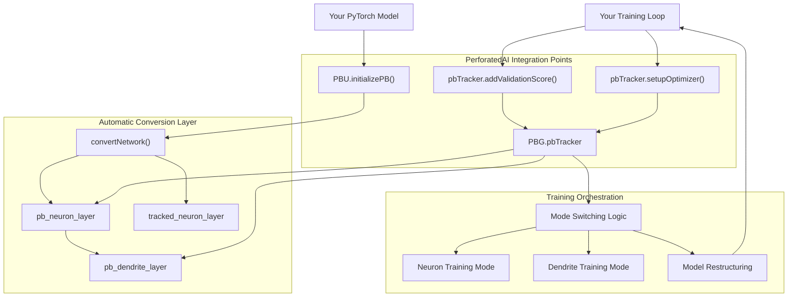
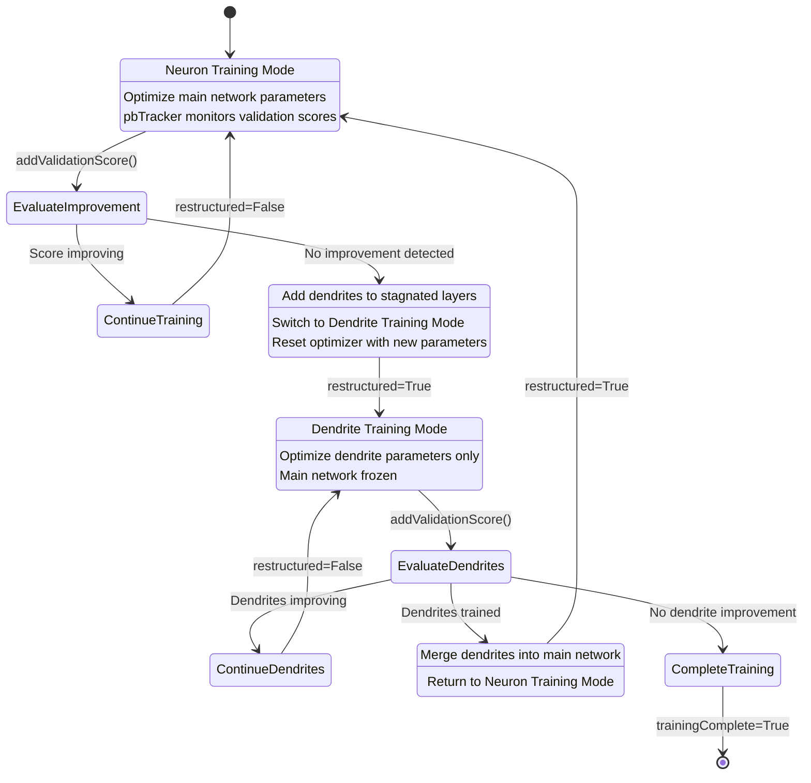
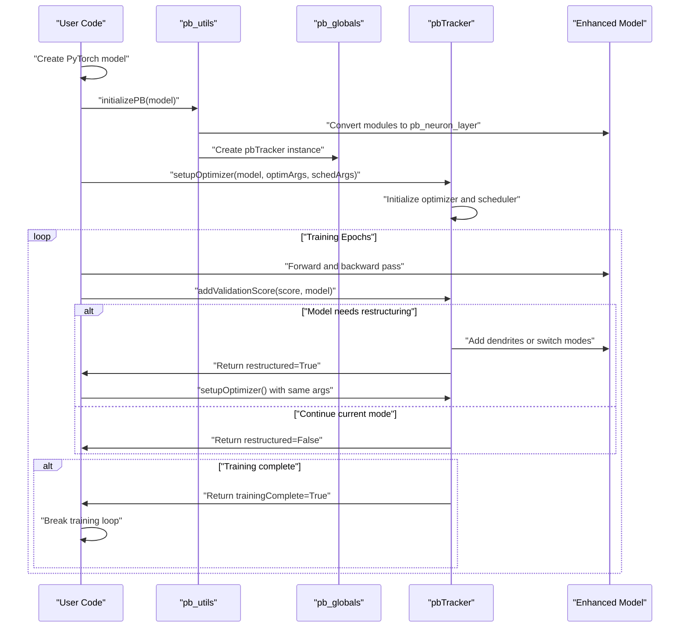

<!-- source: DeepWiki mcp.deepwiki.com · repo PerforatedAI/PerforatedAI · page 4 User Guide · fetched 2026-10-21 -->

# User Guide

<details>
<summary>Relevant source files</summary>

The following files were used as context for generating this wiki page:

- [API/README.md](API/README.md)

</details>


## Purpose and Scope

This guide provides practical instructions for integrating the PerforatedAI library into your PyTorch projects to add artificial dendrites to neural networks. It covers the essential workflow, key API components, and integration patterns needed to get started with dendrite-enhanced training.

For step-by-step integration instructions, see [Getting Started](#4.1). For advanced configuration options and module conversion rules, see [Advanced Customization](#4.2). For troubleshooting common issues, see [Debugging and Troubleshooting](#4.3). For understanding the output files and graphs generated by the system, see [Understanding Output](#4.4).

For detailed technical documentation of the core library components, see [Core Library Reference](#3). For working examples with different architectures, see [Examples and Tutorials](#5).

## Core Concepts and Workflow

PerforatedAI transforms your existing PyTorch models by wrapping key layers with dendrite-capable equivalents and managing the training process through an automated orchestrator. The system operates in two primary modes: **neuron training** (optimizing main network parameters) and **dendrite training** (optimizing dendrite-specific parameters).

### System Architecture and User Integration Points



**Sources:** [API/README.md:1-117]()

### Training Mode Management



**Sources:** [API/README.md:70-96](), [API/README.md:109-114]()

## Integration Patterns

The PerforatedAI library requires minimal changes to existing PyTorch training code. The integration follows a consistent pattern across different architectures and training setups.

### Required Code Integration Points

| Integration Point | Purpose | Required Action |
|------------------|---------|-----------------|
| **Model Initialization** | Convert PyTorch modules to dendrite-capable layers | Call `PBU.initializePB(model)` after model creation |
| **Optimizer Setup** | Enable automatic learning rate management | Use `pbTracker.setupOptimizer()` or `pbTracker.setOptimizerInstance()` |
| **Validation Loop** | Trigger dendrite addition and mode switching | Call `pbTracker.addValidationScore()` with validation metrics |
| **Training Loop** | Handle model restructuring events | Check `restructured` flag and reinitialize optimizer when needed |
| **Score Tracking** | Monitor training and test performance | Optional calls to `addExtraScore()` and `addTestScore()` |

### Core API Components

The library's functionality is accessed through three main modules imported as aliases:

```python
from perforatedai import pb_globals as PBG
from perforatedai import pb_models as PBM  
from perforatedai import pb_utils as PBU
```

#### Key Components and Their Roles

| Component | Location | Primary Functions |
|-----------|----------|-------------------|
| **`pbTracker`** | `PBG.pbTracker` | Central orchestrator managing training lifecycle, mode switching, and dendrite addition |
| **`initializePB()`** | `PBU.initializePB()` | Converts PyTorch model to dendrite-capable version by wrapping modules |
| **`setupOptimizer()`** | `pbTracker.setupOptimizer()` | Creates optimizer with automatic learning rate sweeping for dendrite phases |
| **`addValidationScore()`** | `pbTracker.addValidationScore()` | Triggers evaluation of training progress and potential restructuring |
| **`convertNetwork()`** | Internal conversion logic | Automatically wraps compatible modules with `pb_neuron_layer` or `tracked_neuron_layer` |

**Sources:** [API/README.md:11-17](), [API/README.md:18-27](), [API/README.md:28-48]()

## Typical Usage Workflow

### Basic Integration Sequence



**Sources:** [API/README.md:70-96]()

### Essential Integration Steps

1. **Import Required Modules**: Import `pb_globals`, `pb_utils`, and `pb_models` with standard aliases
2. **Initialize Model**: Call `PBU.initializePB(model)` immediately after model creation, before CUDA/parallel setup
3. **Setup Optimizer**: Use `pbTracker.setupOptimizer()` with optimizer class and arguments for automatic learning rate management
4. **Modify Validation**: Add `pbTracker.addValidationScore()` call at end of validation loop
5. **Handle Restructuring**: Check `restructured` flag and reinitialize optimizer when `True`
6. **Monitor Completion**: Break training loop when `trainingComplete` returns `True`

### Configuration and Testing

The system includes a built-in testing mode accessed through `PBG.testingDendriteCapacity`. When set to `True` (default), the system performs a limited dendrite capacity test to verify GPU memory and integration correctness. After receiving the completion message, set this to `False` for full experiments.

**Sources:** [API/README.md:113-116]()

## Next Steps

- **Start Here**: For detailed step-by-step integration instructions with code examples, see [Getting Started](#4.1)
- **Customize**: For advanced configuration options, module conversion rules, and custom processors, see [Advanced Customization](#4.2)  
- **Troubleshoot**: For common error messages and debugging techniques, see [Debugging and Troubleshooting](#4.3)
- **Understand Results**: For interpreting output graphs, CSV files, and model statistics, see [Understanding Output](#4.4)
- **See Examples**: For complete working examples with different architectures, see [Examples and Tutorials](#5)

**Sources:** [API/README.md:1-117]()

---

