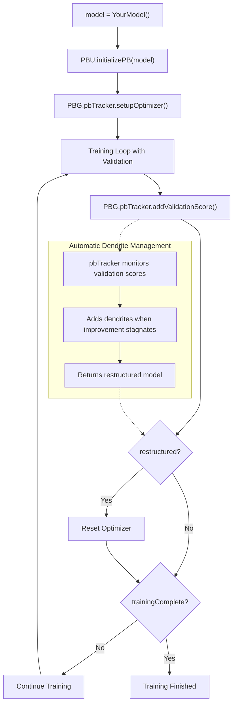
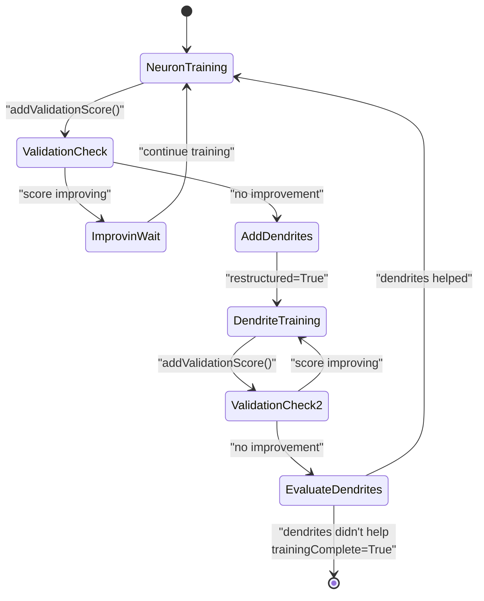
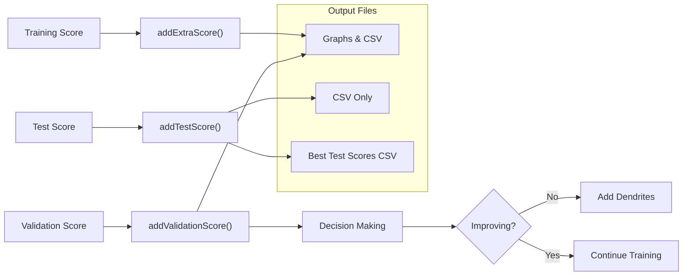

<!-- source: DeepWiki mcp.deepwiki.com · repo PerforatedAI/PerforatedAI · page 4.1 Getting Started · fetched 2026-10-21 -->

# Getting Started

<details>
<summary>Relevant source files</summary>

The following files were used as context for generating this wiki page:

- [API/README.md](API/README.md)

</details>


This page provides the essential steps for integrating PerforatedAI dendrites into your PyTorch models. It covers the basic API usage patterns and the minimal code changes required to enable automatic dendrite addition during training.

For advanced configuration options and custom module handling, see [Advanced Customization](#4.2). For troubleshooting integration issues, see [Debugging and Troubleshooting](#4.3). For understanding the system's output files and graphs, see [Understanding Output](#4.4).

## Installation

Install PerforatedAI from the repository root directory:

```bash
pip install -e .
```

Sources: [API/README.md:7-9]()

## Required Imports

Add these imports to your training script:

```python
from perforatedai import pb_globals as PBG
from perforatedai import pb_models as PBM
from perforatedai import pb_utils as PBU
```

Sources: [API/README.md:11-16]()

## Basic Integration Workflow

The integration process involves four key steps: model conversion, optimizer setup, training loop modification, and validation handling.

### Integration Steps Overview



Sources: [API/README.md:18-116]()

### Step 1: Model Conversion

Convert your PyTorch model immediately after initialization, before moving to GPU or applying DataParallel:

```python
model = YourModel()
model = PBU.initializePB(model)
# Now move to GPU or apply DataParallel
model.to(device)
```

The `initializePB` function automatically wraps compatible modules with dendrite-enabled layers and creates a `pbTracker` instance to manage the training process.

Sources: [API/README.md:22-26]()

### Step 2: Optimizer Setup

Configure the optimizer through the `pbTracker` system. The recommended approach uses `setupOptimizer()` which enables automatic learning rate adjustment when dendrites are added:

```python
PBG.pbTracker.setOptimizer(torch.optim.Adam)
PBG.pbTracker.setScheduler(torch.optim.lr_scheduler.ReduceLROnPlateau)
optimArgs = {'params': model.parameters(), 'lr': learning_rate}
schedArgs = {'mode': 'max', 'patience': 5}
optimizer, scheduler = PBG.pbTracker.setupOptimizer(model, optimArgs, schedArgs)
```

Alternative approach for frameworks that manage optimizers internally:

```python
PBG.pbTracker.setOptimizerInstance(optimizer)
```

Sources: [API/README.md:28-47]()

### Step 3: Training Loop Integration

The training loop requires minimal modification. The core change is calling `addValidationScore()` after validation and handling the returned flags:

```python
while True:  # Or use a high epoch count
    # Training phase - no changes needed
    train_one_epoch(model, optimizer)
    
    # Validation phase
    validation_score = validate(model, val_loader)
    
    # Core PerforatedAI integration point
    model, restructured, trainingComplete = PBG.pbTracker.addValidationScore(
        validation_score, model
    )
    model.to(device)  # Reapply device settings
    
    if trainingComplete:
        break
    elif restructured:
        # Reset optimizer for new model structure
        optimizer, scheduler = PBG.pbTracker.setupOptimizer(model, optimArgs, schedArgs)
```

Sources: [API/README.md:70-96](), [API/README.md:109-112]()

## Training Loop State Management

The `pbTracker` manages the training lifecycle through a state machine that alternates between neuron training and dendrite addition phases.

### Training State Flow



Sources: [API/README.md:70-96]()

### Key Return Values

The `addValidationScore()` method returns three values that control training flow:

| Return Value | Type | Description |
|--------------|------|-------------|
| `model` | `torch.nn.Module` | Updated model (may be restructured with new dendrites) |
| `restructured` | `bool` | `True` if model structure changed, requiring optimizer reset |
| `trainingComplete` | `bool` | `True` if training should stop (dendrites didn't improve performance) |

Sources: [API/README.md:87-96]()

## Score Tracking

The system tracks multiple score types to monitor training progress and make dendrite addition decisions:

### Essential Score Types

```python
# Validation score (required) - used for dendrite addition decisions
model, restructured, trainingComplete = PBG.pbTracker.addValidationScore(val_score, model)

# Training score (optional) - for monitoring only
PBG.pbTracker.addExtraScore(train_score, 'Train')

# Test score (optional) - tracked but not used for decisions
PBG.pbTracker.addTestScore(test_score, 'Test Accuracy')
```

### Score Management Flow



Sources: [API/README.md:49-68]()

## Initial Testing Mode

PerforatedAI includes a built-in testing mode to verify your setup before running full experiments:

```python
# Default setting - automatically enabled
PBG.testingDendriteCapacity = True  # Tests with 3 dendrite sets
# After successful test, set to False for real experiments
PBG.testingDendriteCapacity = False
```

The testing mode adds three sets of dendrites to verify GPU memory capacity and configuration correctness. Warnings will indicate any required customization.

Sources: [API/README.md:113-116]()

## Next Steps

After completing basic integration:

1. Run your model with `PBG.testingDendriteCapacity = True` to verify setup
2. Check for warnings indicating customization needs - see [Advanced Customization](#4.2)
3. Review generated graphs and CSV files - see [Understanding Output](#4.4) 
4. If issues arise, consult [Debugging and Troubleshooting](#4.3)
5. Explore the [MNIST Tutorial](#5.1) for a complete working example

Sources: [API/README.md:113-117]()

---

