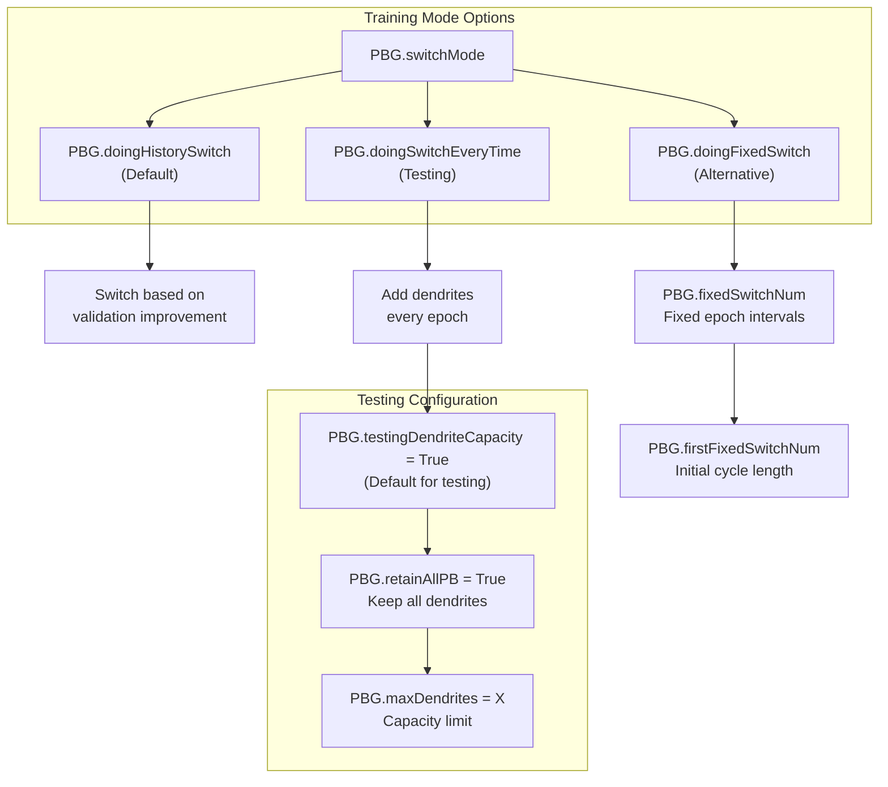
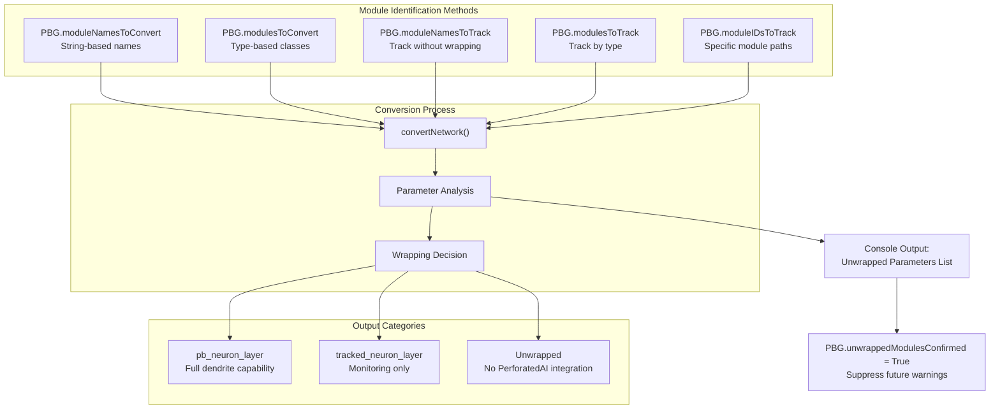
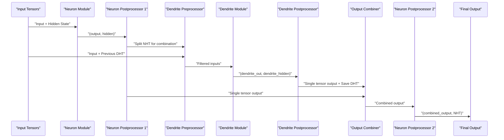
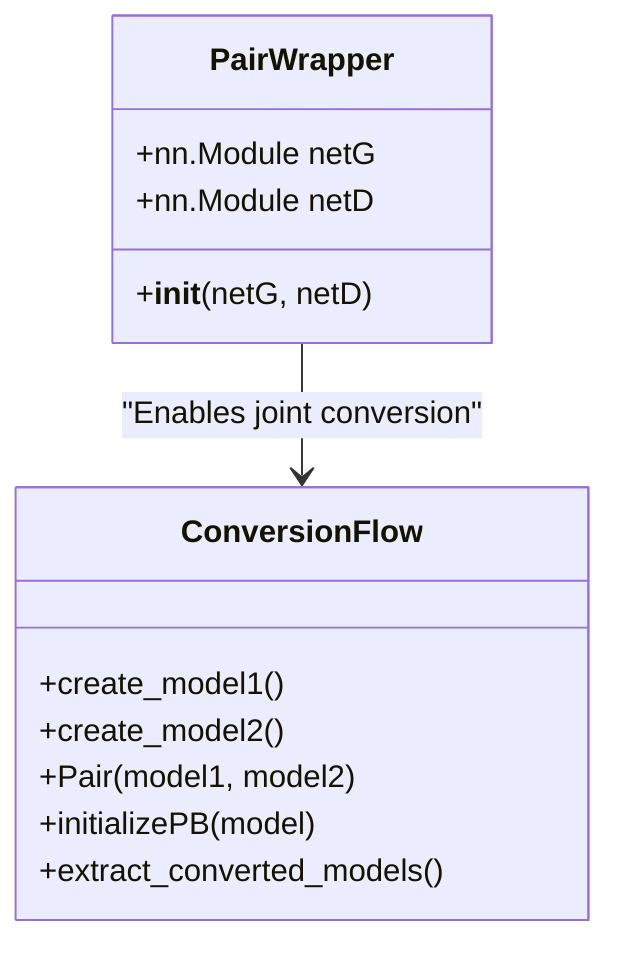
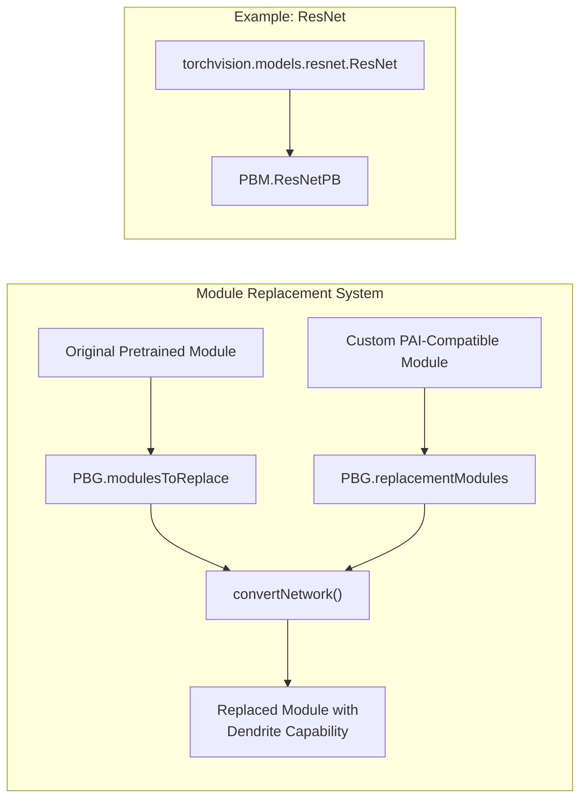
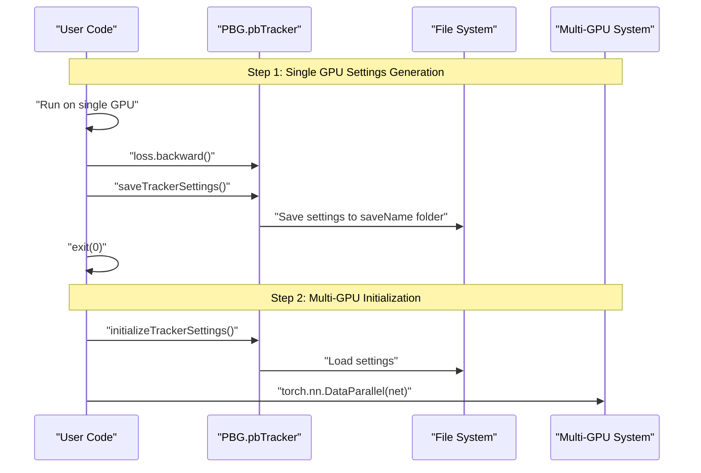

<!-- source: DeepWiki mcp.deepwiki.com · repo PerforatedAI/PerforatedAI · page 4.2 Advanced Customization · fetched 2026-10-21 -->

# Advanced Customization

<details>
<summary>Relevant source files</summary>

The following files were used as context for generating this wiki page:

- [API/customization.md](API/customization.md)

</details>


This page covers advanced configuration options, custom module conversion rules, and processing functions for complex architectures in the PerforatedAI library. For basic integration patterns, see [Getting Started](#4.1). For debugging specific issues, see [Debugging and Troubleshooting](#4.3).

## Configuration System

The PerforatedAI library provides extensive configuration options through the `pb_globals` module. These settings control training modes, dendrite addition strategies, and network conversion behavior.

### Training Mode Configuration

The library supports two primary training modes controlled through `PBG.switchMode`:



**Training Mode Configuration Options**
Sources: [API/customization.md:10-32]()

### Initialization Parameters

The `initializePB` function accepts several configuration parameters beyond the basic model:

| Parameter | Type | Default | Description |
|-----------|------|---------|-------------|
| `doingPB` | bool | True | Enable dendrite addition |
| `saveName` | str | 'PB' | Output folder name |
| `makingGraphs` | bool | True | Generate performance graphs |
| `maximizingScore` | bool | True | False for loss minimization |

Sources: [API/customization.md:34-46]()

## Module Conversion System

The most complex aspect of PerforatedAI integration involves configuring which modules to convert for dendrite learning. The system provides multiple approaches for specifying conversion rules.



**Module Conversion Control Flow**
Sources: [API/customization.md:66-108]()

### Module Selection Strategies

The system automatically converts basic layers (`nn.Linear`, `nn.Conv2d`) but requires explicit configuration for complex modules:

**Name-based Conversion:**
```python
PBG.moduleNamesToConvert += ['moduleName']
```

**Type-based Conversion:**
```python
PBG.modulesToConvert += [moduleType]
```

**Tracking Without Wrapping:**
```python
PBG.moduleNamesToTrack += ['moduleToTrack']
PBG.moduleIDsToTrack += ['.layer1.0.conv1']
```

Sources: [API/customization.md:68-105]()

## Processing Functions

Complex modules with multiple inputs/outputs require custom processing functions to handle dendrite integration properly.



**GRU Processing Function Flow**
Sources: [API/customization.md:134-147]()

### Processing Function Registration

Processing functions must be registered before network conversion:

```python
PBG.moduleNamesWithProcessing += ['GRU']
PBG.moduleByNameProcessingClasses += [PBM.GRUProcessor]

# Simple multi-output handler
PBG.moduleNamesWithProcessing += ['ModuleWithMultipleOutputs'] 
PBG.moduleByNameProcessingClasses += [PBM.multiOutputProcesser]
```

Sources: [API/customization.md:117-126]()

## Advanced Integration Patterns

### Multi-Module Systems

For systems with multiple separate models (e.g., GANs), create a wrapper module:



**Multi-Module Integration Pattern**
Sources: [API/customization.md:157-177]()

### Input Dimension Configuration

Different module types require specific neuron dimension specifications:

| Architecture Type | Input Dimensions | Example |
|-------------------|------------------|---------|
| Convolutional | `[-1, 0, -1, -1]` | `[batch, neurons, x, y]` |
| Recurrent | `[-1, -1, 0]` | `[batch, sequence, neurons]` |
| Fully Connected | `[-1, 0]` | `[batch, neurons]` |
| 3D Convolutional | `[-1, -1, 0, -1, -1]` | `[batch, seq, neurons, x, y]` |

**Module-Specific Dimension Setting:**
```python
model.onlyRecurrentModule.setThisInputDimensions([-1, -1, 0])
model.fullyConnectedOutputLayer.setThisInputDimensions([-1, 0])
```

Sources: [API/customization.md:179-196]()

### Pretrained Network Integration

For pretrained models requiring architectural changes, use module replacement:



**Pretrained Module Replacement Flow**
Sources: [API/customization.md:200-209]()

## Parallel Processing Configuration

### DataParallel Setup

DataParallel requires a two-step initialization process:



**DataParallel Setup Sequence**
Sources: [API/customization.md:213-226]()

## Optimization and Troubleshooting

### Common Issues and Solutions

**Overfitting Problems:**
- Reduce network width/depth
- Add dropout layers
- Use regularization techniques

**Learning Problems:**
- Verify optimizer reinitialization after restructuring
- Check scheduler restart behavior
- Ensure proper module wrapping (avoid wrapping final activation layers)

**Module-Specific Issues:**
- Avoid wrapping modules with specific output requirements (e.g., Softmax before NLLLoss)
- Create separate module instances instead of reusing modules
- Group non-module operations into custom modules

Sources: [API/customization.md:249-283]()

### Validation Data Considerations

PerforatedAI uses validation scores for dendrite addition decisions, making proper data splitting critical:

```python
test_dataset = torchvision.datasets.MNIST(root='./data', train=False, download=True, transform=transform)
test_set, val_set = torch.utils.data.random_split(test_dataset, [5000, 5000])
```

Sources: [API/customization.md:284-291]()

---

