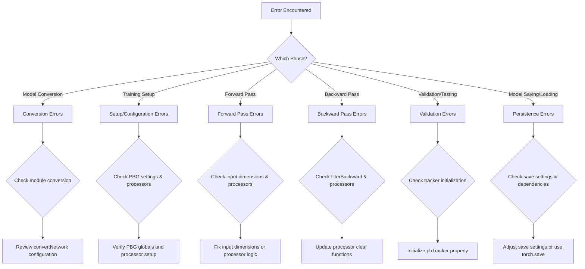
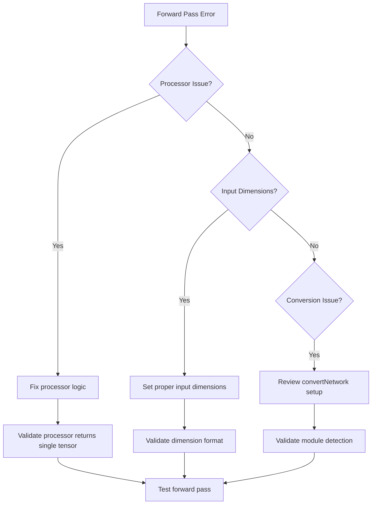
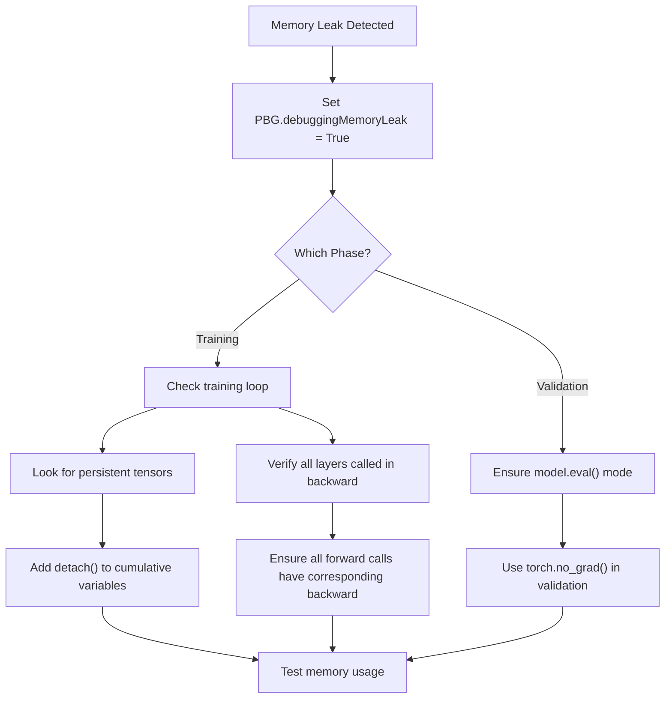
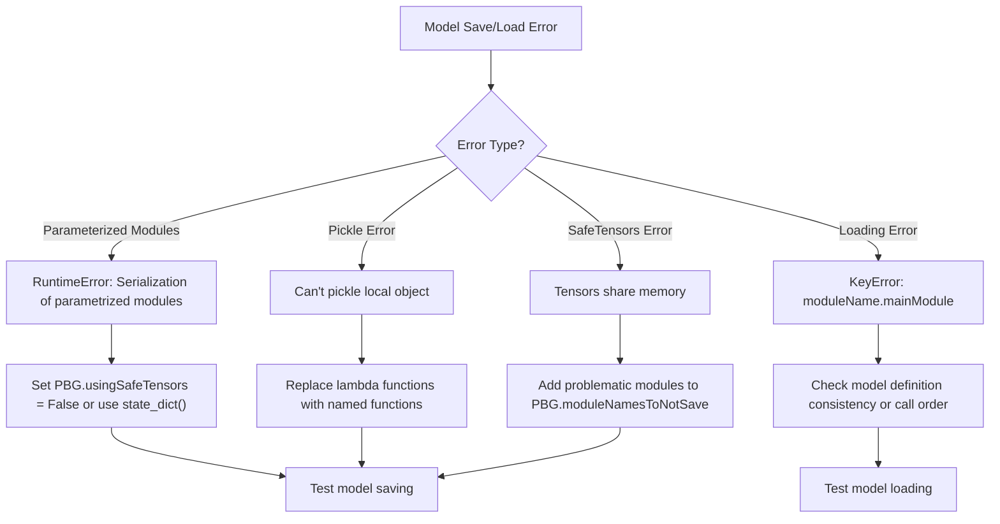

<!-- source: DeepWiki mcp.deepwiki.com · repo PerforatedAI/PerforatedAI · page 4.3 Debugging and Troubleshooting · fetched 2026-10-21 -->

# Debugging and Troubleshooting

<details>
<summary>Relevant source files</summary>

The following files were used as context for generating this wiki page:

- [API/debugging.md](API/debugging.md)

</details>


This page provides comprehensive guidance for diagnosing and resolving common issues when using the PerforatedAI library. It covers error messages, debugging techniques, and solutions for integration problems that may arise during model conversion, training, and deployment.

For basic integration patterns, see [Getting Started](#4.1). For advanced configuration options that may prevent errors, see [Advanced Customization](#4.2). For understanding the system outputs during debugging, see [Understanding Output](#4.4).

## Error Classification and Resolution

### Error Categories Overview

The PerforatedAI system can encounter errors in several distinct phases of operation. Understanding which phase an error occurs in helps narrow down the root cause and appropriate solution.



Sources: [API/debugging.md:1-264]()

### Configuration and Setup Errors

These errors typically occur during initial model setup and configuration, often involving incorrect `pb_globals` settings or processor configuration.

#### Input Dimension Errors

| Error Message | Root Cause | Solution |
|---------------|------------|----------|
| `'pbValueTracker' object has no attribute 'out_channels'` | Input dimensions not set properly | Set input dimensions using `setInputDimensions` method |
| `Need exactly one 0 in the input dimensions` | Incorrect input dimension format | Use single 0 with -1s in proper format |
| `output with shape [X] doesn't match the broadcast shape [Y]` | Input dimensions mismatch actual tensor shapes | Debug with `pdb` to identify layer and fix dimensions |

Common input dimension setup pattern:
```python
# Correct format: single 0 indicating batch dimension
layer.setInputDimensions([-1, 0, -1, -1])  # For 4D tensor with batch at index 1
```

Sources: [API/debugging.md:23-38]()

#### Processor Configuration Errors

| Error Message | Root Cause | Solution |
|---------------|------------|----------|
| `AttributeError: 'tuple' object has no attribute 'requires_grad'` | Processor returning tuple instead of single tensor | Update processor to handle multiple outputs properly |
| `IndexError: list index out of range` | Mismatched processor arrays | Ensure `moduleNamesWithProcessing` and `moduleByNameProcessingClasses` align |

The processor setup must occur before network conversion:
```python
# Must be called before convertNetwork
PBG.modulesWithProcessing.setup_before_conversion()
```

Sources: [API/debugging.md:41-48](), [API/debugging.md:122-126]()

### Training and Runtime Errors

#### Forward Pass Issues



Sources: [API/debugging.md:40-48]()

#### Backward Pass Issues

The `filterBackward` function is a critical component that can fail for several reasons:

| Error Type | Symptom | Solution |
|------------|---------|----------|
| Processor Setup | `'NoneType' object has no attribute 'detach'` | Fix processor to use correct tensor output |
| Tracker Initialization | `'pbValueTracker' object has no attribute 'normalPassAverageD'` | Ensure proper tracker setup or check multi-GPU configuration |
| Unused Layers | Tracker not initialized | Verify all converted layers are used in forward/backward pass |

Critical considerations for multi-GPU setups:
- Use `saveTrackerSettings` and `initializeTrackerSettings` functions
- Ensure all `pbValueTracker` instances are properly initialized
- Avoid adding dendrites during initial validation epochs

Sources: [API/debugging.md:49-61]()

### Memory and Performance Issues

#### Memory Leak Diagnosis

Memory leaks manifest as out-of-memory errors that occur progressively during training, not immediately.



Common memory leak patterns:
- Cumulative loss tracking without `detach()`
- Forward passes without corresponding backward passes
- Validation loops not in `eval()` mode
- Persistent tensor references in training loop

Sources: [API/debugging.md:152-172]()

### Data Type and Device Compatibility

#### Device Configuration Issues

| Error Pattern | Cause | Solution |
|---------------|-------|----------|
| `Expected all tensors to be on the same device, but found at least two devices` | Mixed device placement | Set `PBG.device = 'cpu'` or ensure consistent device usage |
| `(was torch.cuda.HalfTensor got torch.cuda.FloatTensor)` | Data type mismatch | Set `PBG.dType = torch.double` or appropriate type |

Device configuration should be set early in the initialization:
```python
# For specific device control
PBG.device = 'cpu'  # or specific CUDA device
PBG.dType = torch.double  # for non-float data
```

Sources: [API/debugging.md:62-82]()

### Model Persistence and Loading

#### Save/Load Error Resolution



Default modules excluded from saving:
```python
PBG.moduleNamesToNotSave = ['.base_model']  # Default exclusion
```

Sources: [API/debugging.md:193-241]()

## Systematic Debugging Process

### Step-by-Step Troubleshooting

When encountering an error, follow this systematic approach:

1. **Identify the Error Phase**: Determine if error occurs during conversion, training setup, forward pass, backward pass, or persistence
2. **Check Configuration**: Verify `pb_globals` settings, processor setup, and input dimensions
3. **Validate Conversion**: Ensure all required modules were properly converted
4. **Test Components**: Isolate the problematic component using targeted debugging
5. **Apply Specific Solutions**: Use error-specific fixes documented above

### Component Access After Conversion

After conversion, module attributes are accessed differently:
```python
# Before conversion
model.yourModule.SOMEVARIABLE

# After conversion  
model.yourModule.mainModule.SOMEVARIABLE
```

Sources: [API/debugging.md:83-91]()

### Advanced Debugging Techniques

#### Memory Leak Investigation

Enable memory debugging:
```python
PBG.debuggingMemoryLeak = True
```

#### Component Isolation

Systematically remove model components to identify the source of issues. This is particularly effective for memory leaks and conversion problems.

#### Docker Environment Issues

For Docker-specific problems, increase shared memory:
```bash
docker run --gpus all -i --shm-size=8g -v .:/pai -w /pai -t pai /bin/bash
```

Sources: [API/debugging.md:154-176]()

### Known Limitations

Some errors are currently not fixable:

#### Loss Scaling Incompatibility

Functions like `ApexScaler` or `NativeScaler` from `timm.utils` cause type conflicts:
```
pytorch RuntimeError "has changed the type of value"
```

**Workaround**: Disable loss scaling when using PerforatedAI.

The issue occurs because these functions modify tensor types after the computation graph is created, but don't make equivalent changes to the PerforatedAI tensor copies.

Sources: [API/debugging.md:242-259]()

## Getting Additional Help

If standard debugging approaches don't resolve the issue:

1. **Check Error Categories**: Verify the error fits a known pattern above
2. **Review Configuration**: Double-check all `pb_globals` settings and processor configurations
3. **Test Minimal Case**: Create a minimal reproduction of the issue
4. **Component Isolation**: Remove components until the error disappears
5. **Contact Support**: Reach out with specific error messages and reproduction steps

Sources: [API/debugging.md:261-264]()

---

