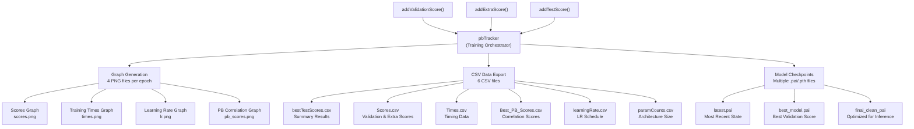
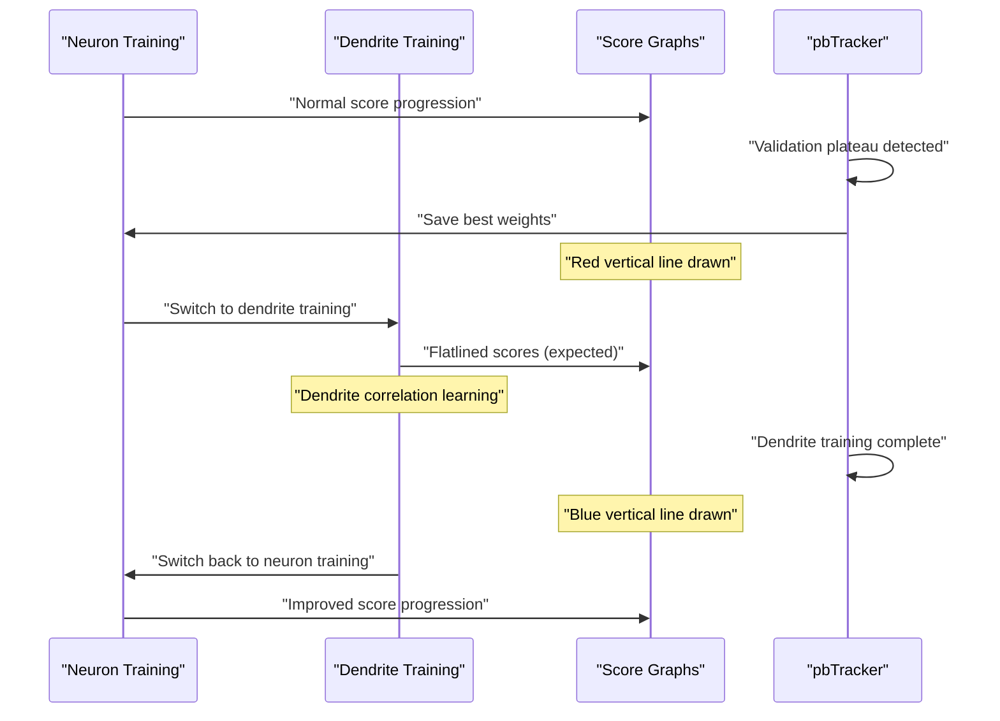
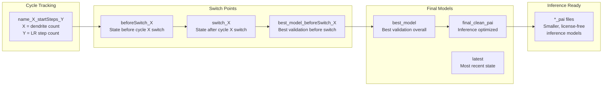

<!-- source: DeepWiki mcp.deepwiki.com · repo PerforatedAI/PerforatedAI · page 4.4 Understanding Output · fetched 2026-10-21 -->

# Understanding Output

Relevant source files

The following files were used as context for generating this wiki page:

- [API/output.md](API/output.md)

This page explains how to interpret the graphs, CSV files, and model outputs generated by the PerforatedAI training system. The system automatically generates comprehensive monitoring outputs during training to help you understand model performance, dendrite learning progress, and training dynamics.

For basic API usage patterns, see [Getting Started](#4.1). For troubleshooting training issues, see [Debugging and Troubleshooting](#4.3).

## Overview of Output Types

The PerforatedAI system generates three main categories of outputs during training:

| Output Type | Purpose | File Extensions |
|-------------|---------|----------------|
| **Visualization Graphs** | Real-time monitoring of training metrics | `.png` |
| **Data Export CSV Files** | Detailed numerical data for analysis | `.csv` |
| **Model Checkpoints** | Saved model states at key training points | `.pai`, `.pth` |

All outputs are saved in the directory specified by your save name parameter (defaults to `PB`).

Sources: [API/output.md:15-16]()

## Output Generation Flow

The following diagram shows how different components of the training system generate outputs:

Sources: [API/output.md:1-17]()

## Graph Outputs

The system automatically generates four graphs at every epoch to visualize training progress:

### Scores Graph
Displays all tracked scores over training epochs. Key elements include:
- **Validation scores**: Primary metric for early stopping decisions
- **Running validation score**: Smoothed validation trend
- **Extra scores**: Added via `addExtraScore()` calls
- **Test scores**: Added via `addTestScore()` calls
- **Training mode indicators**: 
  - Red vertical lines: Switch to dendrite training
  - Blue vertical lines: Switch back to neuron training

### Training Times Graph
Shows computational cost as dendrites are added to the network, helping assess scalability trade-offs.

### Learning Rate Graph
Visualizes learning rate adjustments over epochs, useful for understanding optimizer behavior.

### PB Correlation Graph
**For Perforated Backpropagation (PB) training only**: Shows correlation scores of each dendrite node set. This graph remains blank for Gradient Descent (GD) dendrite training.

Sources: [API/output.md:7-13]()

## Training Mode Visualization

The following diagram illustrates how training mode switches are represented in the graphs:

Sources: [API/output.md:7-8]()

## CSV Data Files

The system exports detailed numerical data in CSV format for further analysis:

### Primary Results File: `bestTestScores.csv`
This is the main output summary showing:
- Best test scores at epochs where best validation scores were achieved
- Parameter counts for each network architecture version
- Requires `addTestScore()` calls to function properly

### Detailed Data Files

| CSV File | Content | Usage |
|----------|---------|-------|
| `Scores.csv` | Best validation scores and extra scores per epoch | Performance tracking |
| `Best_PB_Scores.csv` | Best PB correlation scores per epoch | Dendrite learning analysis |
| `Times.csv` | Timing information per epoch | Performance profiling |
| `learningRate.csv` | Learning rate per epoch | Optimizer analysis |
| `paramCounts.csv` | Total network parameters per cycle | Architecture growth tracking |
| `switchEpochs.csv` | Epochs where training mode switched | Training phase analysis |

Sources: [API/output.md:17](), [API/output.md:44-58]()

## Model Checkpoint Naming Convention

The system saves models at key training points with descriptive names:

Sources: [API/output.md:25-42]()

## Interpreting PB Training Results

For Perforated Backpropagation training, look for these key indicators:

### Healthy PB Correlation Scores
- **PB scores should not be significantly lower than 0.001**
- Lower scores indicate correlation learning failure
- Debug by adjusting module wrapping and processor definitions

### Expected Score Behavior During Dendrite Training
- **Validation/training scores should flatline during dendrite learning**
- Minor fluctuation acceptable if input order is randomized
- Significant changes indicate wrapping problems
- **After blue vertical lines**: Scores should improve consistently

### Warning Signs
- Unwrapped modules warning at initialization
- Significant score changes during dendrite phases
- PB correlation scores below 0.001 threshold

Sources: [API/output.md:19-23]()

## Troubleshooting Output Issues

Common output interpretation problems and solutions:

| Issue | Symptom | Solution |
|-------|---------|----------|
| **Missing PB correlation data** | Empty correlation graph | Check if using PB mode (not GD mode) |
| **Erratic dendrite phase scores** | Scores change during flat periods | Verify all modules are properly wrapped |
| **Poor correlation learning** | PB scores < 0.001 | Adjust processor definitions and module wrapping |
| **Missing test score data** | Empty `bestTestScores.csv` | Ensure `addTestScore()` is being called |

For detailed debugging techniques, see [Debugging and Troubleshooting](#4.3). For customization options to fix wrapping issues, see [Advanced Customization](#4.2).

Sources: [API/output.md:19-23]()

---

