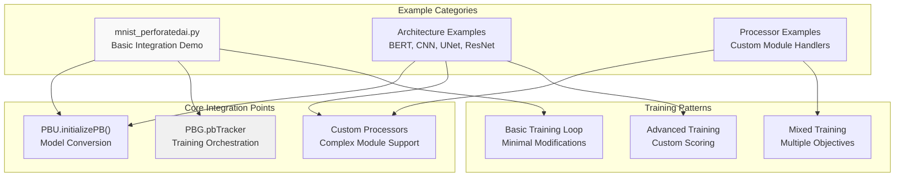
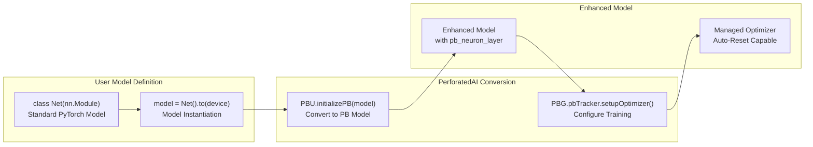
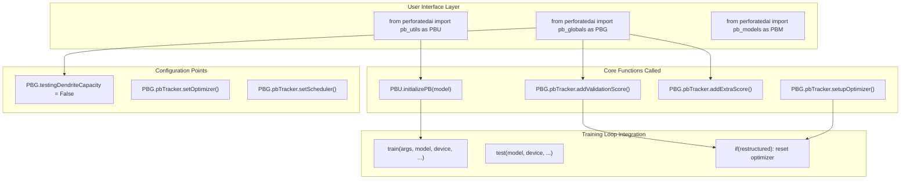

<!-- source: DeepWiki mcp.deepwiki.com · repo PerforatedAI/PerforatedAI · page 5 Examples and Tutorials · fetched 2026-10-21 -->

# Examples and Tutorials

<details>
<summary>Relevant source files</summary>

The following files were used as context for generating this wiki page:

- [mnist_perforatedai.py](mnist_perforatedai.py)

</details>


This page provides an overview of practical examples demonstrating PerforatedAI integration patterns with different neural network architectures. The examples show how to modify existing PyTorch training workflows to incorporate automatic dendrite addition and management.

For detailed implementation documentation of the core library components, see [Core Library Reference](#3). For step-by-step integration guidance, see [User Guide](#4).

## Purpose and Scope

The examples and tutorials demonstrate three key integration patterns:

- **Basic Integration**: Minimal changes to existing PyTorch code using `PBU.initializePB()` and `PBG.pbTracker`
- **Architecture-Specific**: Adaptations for BERT, CNN, UNet, and ResNet models with custom processing requirements  
- **Advanced Customization**: Custom processor implementations for complex module types

Each example shows the complete workflow from model conversion through training orchestration and results analysis.

## Available Examples Overview

The repository includes several categories of examples that demonstrate different aspects of PerforatedAI integration:



Sources: [mnist_perforatedai.py:1-208]()

## Key Integration Patterns

The examples demonstrate several common integration patterns that map PyTorch training workflows to PerforatedAI components:

### Model Initialization Pattern



Sources: [mnist_perforatedai.py:14-24](), [mnist_perforatedai.py:185-194]()

### Training Loop Integration Pattern

The examples show how minimal modifications to existing training loops enable automatic dendrite management:

| Training Phase | Standard PyTorch | PerforatedAI Integration |
|---------------|------------------|-------------------------|
| Model Forward | `output = model(data)` | `output = model(data)` (unchanged) |
| Loss Computation | `loss = criterion(output, target)` | `loss = criterion(output, target)` (unchanged) |
| Backward Pass | `loss.backward()` | `loss.backward()` (unchanged) |
| Optimizer Step | `optimizer.step()` | `optimizer.step()` (unchanged) |
| Validation | Manual accuracy tracking | `PBG.pbTracker.addValidationScore()` |
| Model Updates | Manual architecture changes | Automatic dendrite addition |
| Optimizer Reset | Manual when needed | Automatic when restructured |

Sources: [mnist_perforatedai.py:41-93]()

## Training Orchestration Flow

The following diagram shows how the training orchestration system manages the lifecycle of dendrite addition and training mode switching:

```mermaid
sequenceDiagram
    participant USER as "User Training Loop"
    participant TRACKER as "PBG.pbTracker"
    participant MODEL as "Enhanced Model"
    participant OPT as "Optimizer Management"
    
    USER->>TRACKER: "addValidationScore(score, model)"
    TRACKER->>TRACKER: "Evaluate improvement history"
    
    alt "Performance Plateau Detected"
        TRACKER->>MODEL: "Add dendrites to layers"
        TRACKER->>TRACKER: "Mark as restructured=True"
        TRACKER->>OPT: "Prepare optimizer reset"
        TRACKER->>USER: "Return (model, True, False)"
        USER->>TRACKER: "setupOptimizer(model, args)"
        TRACKER->>USER: "Return new optimizer"
    else "Continue Training"
        TRACKER->>USER: "Return (model, False, False)"
    end
    
    opt "Training Complete"
        TRACKER->>USER: "Return (model, False, True)"
        USER->>USER: "Exit training loop"
    end
```

Sources: [mnist_perforatedai.py:84-93]()

## Code Entity Mapping

The examples demonstrate how high-level concepts map to specific code entities:



Sources: [mnist_perforatedai.py:10-12](), [mnist_perforatedai.py:62](), [mnist_perforatedai.py:85-92](), [mnist_perforatedai.py:183](), [mnist_perforatedai.py:187](), [mnist_perforatedai.py:190-194]()

## Example Categories

### Basic Integration Examples
- **MNIST Classification**: Complete working example with CNN architecture showing minimal integration steps
- **Training Loop Patterns**: Standard PyTorch training loops with PerforatedAI integration points
- **Optimizer Management**: Automatic optimizer reset handling when model structure changes

### Architecture-Specific Examples  
- **BERT Integration**: Natural language processing models with attention mechanisms
- **CNN Applications**: Computer vision models with convolutional layers
- **UNet Segmentation**: Medical imaging and segmentation architectures
- **ResNet Variants**: Residual networks with skip connections

### Advanced Customization Examples
- **Custom Processors**: Handling specialized module types like LSTM cells
- **Mixed Training Strategies**: Combining gradient descent with correlation learning
- **PEFT Integration**: Parameter-efficient fine-tuning with LoRA adapters

## Detailed Tutorials

For comprehensive walkthroughs of specific examples:

- **Step-by-step MNIST integration**: See [MNIST Tutorial](#5.1)
- **Architecture-specific adaptations**: See [Architecture Examples](#5.2) 
- **Custom processor development**: See [Processor Examples](#5.3)

For installation and setup requirements, see [Installation and Setup](#6).

Sources: [mnist_perforatedai.py:1-208]()

---

