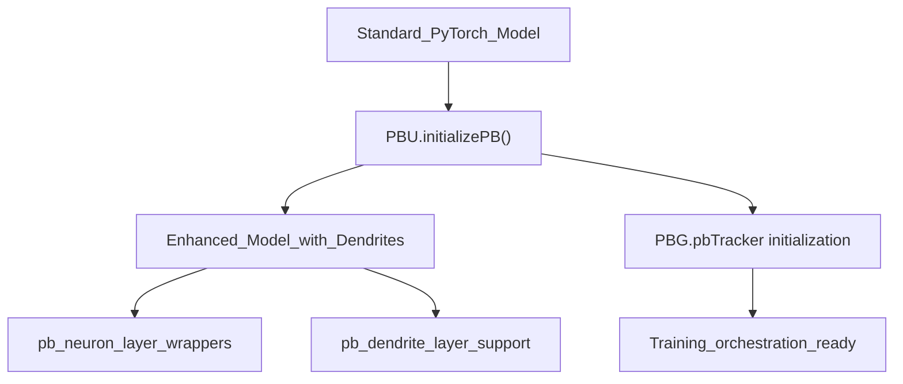
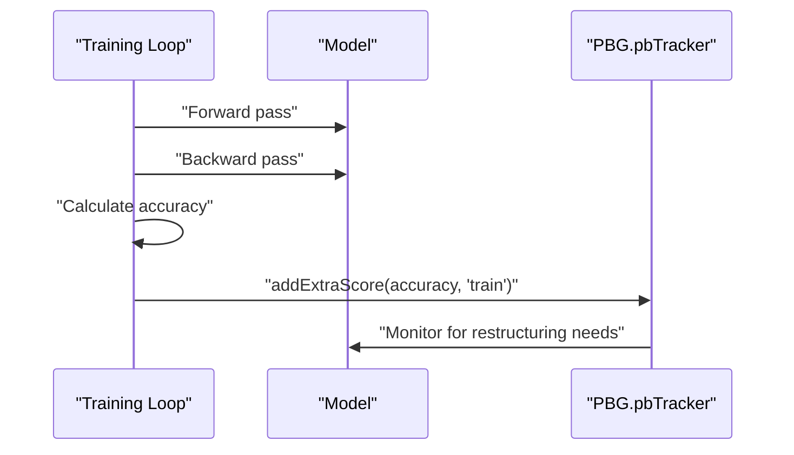
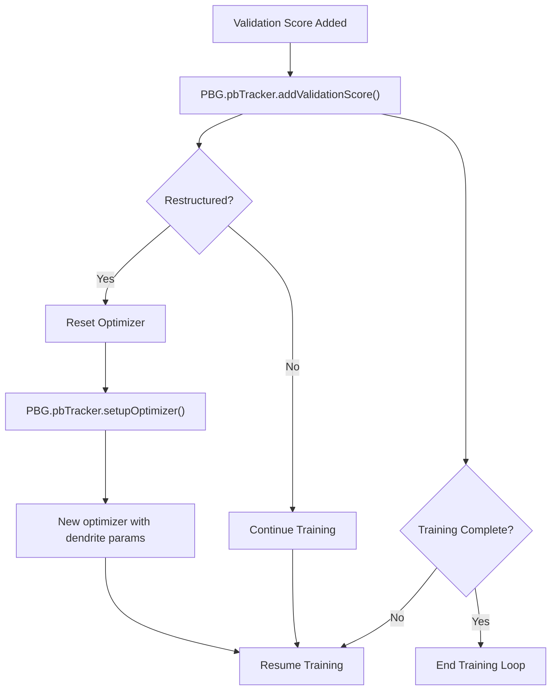
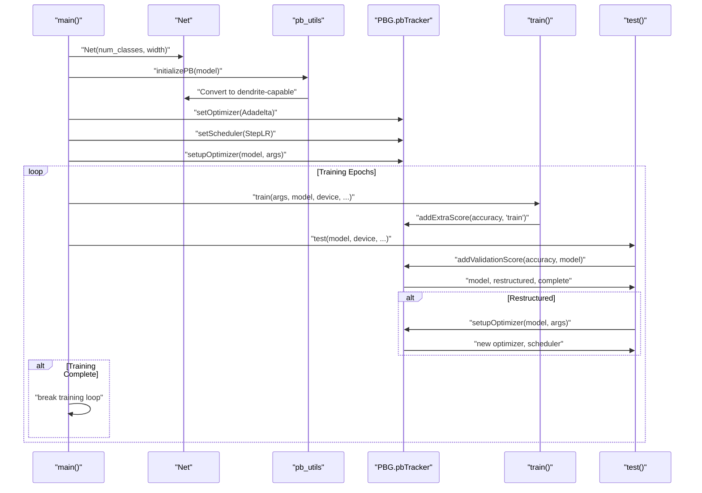

<!-- source: DeepWiki mcp.deepwiki.com · repo PerforatedAI/PerforatedAI · page 5.1 MNIST Tutorial · fetched 2026-10-21 -->

# MNIST Tutorial

<details>
<summary>Relevant source files</summary>

The following files were used as context for generating this wiki page:

- [mnist_perforatedai.py](mnist_perforatedai.py)

</details>


This document provides a step-by-step walkthrough of integrating PerforatedAI dendrite functionality with a standard PyTorch MNIST classifier. The tutorial demonstrates the basic API usage patterns and shows how dendrites are automatically added during training to improve model performance.

For advanced configuration options and custom processing functions, see [Advanced Customization](#4.2). For troubleshooting integration issues, see [Debugging and Troubleshooting](#4.3).

## Overview

The MNIST tutorial demonstrates the minimal changes required to add dendrite functionality to an existing PyTorch training script. The example uses a simple CNN architecture and shows how PerforatedAI automatically manages dendrite addition based on validation performance without requiring significant modifications to the training loop.

**Key Integration Points:**
- Model initialization with `PBU.initializePB()`
- Training orchestration via `PBG.pbTracker`
- Automatic model restructuring when validation plateaus
- Optimizer reset handling for new dendrite parameters

Sources: [mnist_perforatedai.py:1-207]()

## Model Definition

The tutorial uses a standard CNN architecture defined in the `Net` class, consisting of two convolutional layers followed by two fully connected layers with dropout regularization.

```python
class Net(nn.Module):
    def __init__(self, num_classes, width):
        # Convolutional layers
        self.conv1 = nn.Conv2d(1, int(32*width), 3, 1)
        self.conv2 = nn.Conv2d(int(32*width), int(64*width), 3, 1)
        
        # Dropout layers
        self.dropout1 = nn.Dropout(0.25)
        self.dropout2 = nn.Dropout(0.5)
        
        # Fully connected layers  
        self.fc1 = nn.Linear(144*int(64*width), int(128*width))
        self.fc2 = nn.Linear(int(128*width), num_classes)
```

The model architecture remains unchanged from standard PyTorch implementations. PerforatedAI integration occurs at the initialization and training stages without modifying the model definition.

Sources: [mnist_perforatedai.py:14-38]()

## PerforatedAI Integration Points

### Module Imports

The integration begins with importing the PerforatedAI core modules:

| Module | Purpose |
|--------|---------|
| `pb_globals` (PBG) | Global configuration and tracker access |
| `pb_models` (PBM) | Custom processing functions |
| `pb_utils` (PBU) | Model conversion and utilities |

Sources: [mnist_perforatedai.py:10-12]()

### Model Initialization

After creating the standard PyTorch model, it must be converted to support dendrite functionality using `PBU.initializePB()`:



The conversion process wraps compatible modules with dendrite-capable layers while preserving the original model behavior.

Sources: [mnist_perforatedai.py:187]()

### Tracker Configuration

The `pbTracker` system manages dendrite addition and training orchestration. Configuration includes setting the optimizer and scheduler classes along with their parameters:

```python
# Configure optimizer and scheduler types
PBG.pbTracker.setOptimizer(optim.Adadelta)
PBG.pbTracker.setScheduler(StepLR)

# Setup with parameters
optimArgs = {'params': model.parameters(), 'lr': args.lr}
schedArgs = {'step_size': 1, 'gamma': args.gamma}
optimizer, scheduler = PBG.pbTracker.setupOptimizer(model, optimArgs, schedArgs)
```

Sources: [mnist_perforatedai.py:190-194]()

## Training Loop Modifications

### Training Function Changes

The training function requires minimal modifications to integrate with PerforatedAI. The key addition is providing training accuracy to the tracker system:



The `addExtraScore()` method allows the tracker to monitor training progress and determine when dendrite addition might be beneficial.

Sources: [mnist_perforatedai.py:41-64]()

### Validation Integration

The test function provides validation scores to trigger dendrite addition decisions. The tracker returns three values indicating the model state and required actions:

| Return Value | Type | Purpose |
|--------------|------|---------|
| `model` | Model | Updated model (potentially with new dendrites) |
| `restructured` | bool | Indicates if dendrites were added |
| `trainingComplete` | bool | Indicates if training should terminate |

```python
model, restructured, trainingComplete = PBG.pbTracker.addValidationScore(
    accuracy, model
)
```

When restructuring occurs, the optimizer and scheduler must be reset to include parameters from newly added dendrites.

Sources: [mnist_perforatedai.py:85-93]()

## Model Restructuring Handling

### Optimizer Reset Logic

When the tracker adds dendrites to the model, the optimizer must be recreated to include the new parameters:



The `setupOptimizer()` method handles the recreation of both optimizer and scheduler instances with the expanded parameter set.

Sources: [mnist_perforatedai.py:89-93]()

## Complete Training Flow

The following diagram illustrates the complete integration of PerforatedAI with the MNIST training process:



This sequence shows how the PerforatedAI components coordinate to provide automatic dendrite management with minimal code changes.

Sources: [mnist_perforatedai.py:196-201]()

## Configuration Options

### Dataset Support

The tutorial supports both MNIST and EMNIST datasets with appropriate preprocessing:

| Dataset | Classes | Transform Features |
|---------|---------|-------------------|
| MNIST | 10 | Standard normalization |
| EMNIST | 47 | Augmentation with rotation and affine transforms |

### Model Parameters

The `width` parameter allows scaling the model size, affecting all layer dimensions proportionally. This enables testing dendrite behavior across different model capacities.

### Global Configuration

The example sets `PBG.testingDendriteCapacity = False` to use the standard dendrite addition logic rather than testing modes.

Sources: [mnist_perforatedai.py:147-183]()

## Expected Results

During training, the system will:

1. Train the base model using standard backpropagation
2. Monitor validation performance for improvement plateaus  
3. Add dendrites when performance stagnates
4. Reset the optimizer to include new dendrite parameters
5. Continue training with expanded model capacity
6. Repeat until convergence or maximum epochs reached

The tracker generates visualization graphs and CSV files documenting the training process and dendrite addition events. For details on interpreting these outputs, see [Understanding Output](#4.4).

Sources: [mnist_perforatedai.py:1-207]()

---

