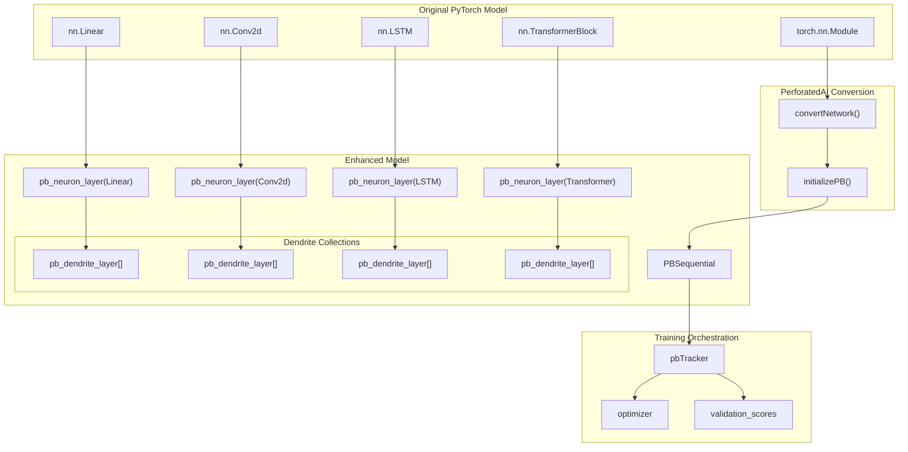
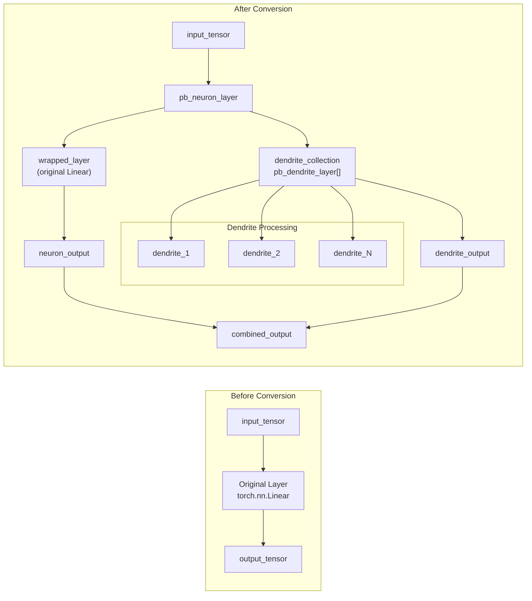
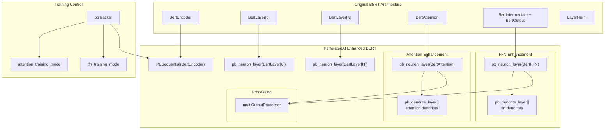
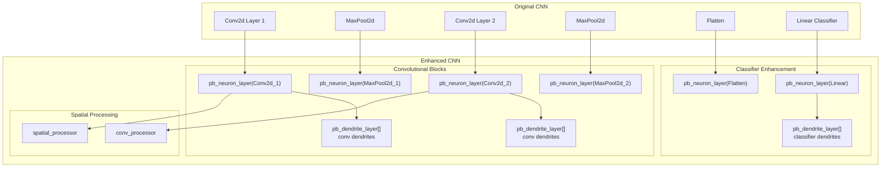
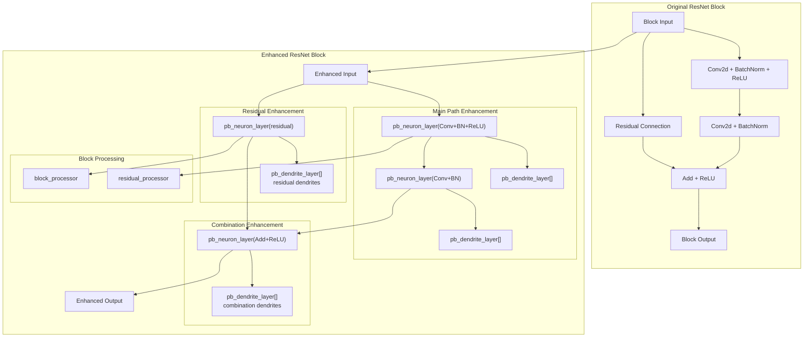
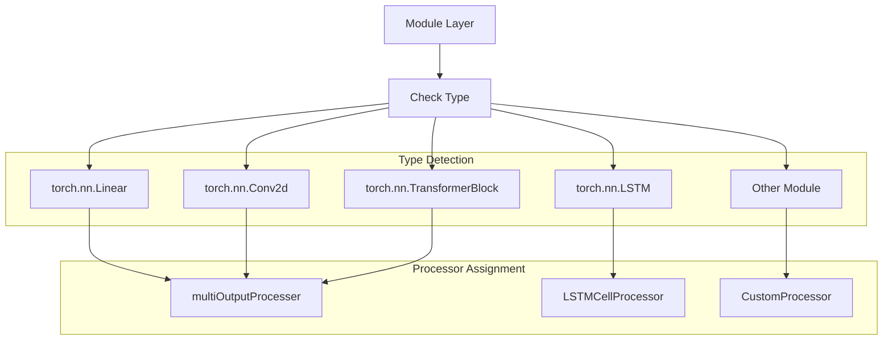

<!-- source: DeepWiki mcp.deepwiki.com · repo PerforatedAI/PerforatedAI · page 5.2 Architecture Examples · fetched 2026-10-21 -->

# Architecture Examples

Relevant source files

The following files were used as context for generating this wiki page:

- [BERT.png](BERT.png)
- [CNN.png](CNN.png)
- [ResNet.png](ResNet.png)
- [UNet.png](UNet.png)

## Purpose and Scope

This document provides visual examples of how PerforatedAI integrates artificial dendrites into different neural network architectures. It demonstrates the transformation patterns for major architecture types including BERT, CNN, UNet, and ResNet, showing how standard PyTorch modules are wrapped and enhanced with dendrite functionality.

For basic integration steps and API usage, see [Getting Started](#4.1). For detailed configuration of module conversion rules, see [Advanced Customization](#4.2).

## Integration Architecture Overview

The following diagram shows how PerforatedAI transforms standard PyTorch architectures by wrapping modules with dendrite-enabled layers:

Sources: [pb_utils.py](), [pb_neuron_layer.py](), [pb_dendrite_layer.py](), [pb_neuron_layer_tracker.py]()

## Layer Transformation Patterns

### Standard Layer Wrapping

Each supported PyTorch layer type follows a consistent transformation pattern where the original functionality is preserved while adding dendrite capabilities:

Sources: [pb_neuron_layer.py](), [pb_dendrite_layer.py]()

## BERT Architecture Integration

BERT models are transformed by wrapping attention layers, feed-forward networks, and layer normalization components:

Sources: [BERT.png](), [pb_models.py](), [pb_neuron_layer_tracker.py]()

## CNN Architecture Integration

Convolutional networks are enhanced by adding dendrites to convolutional layers, pooling operations, and fully connected layers:

Sources: [CNN.png](), [pb_neuron_layer.py](), [convertNetwork function in pb_utils.py]()

## UNet Architecture Integration

UNet models require special handling for skip connections and the encoder-decoder structure:

```mermaid
graph TD
    subgraph "Original UNet Structure"
        subgraph "Encoder Path"
            UE1["Encoder Block 1"]
            UE2["Encoder Block 2"]
            UE3["Encoder Block 3"]
            UE4["Encoder Block 4"]
        end
        
        subgraph "Decoder Path"
            UD4["Decoder Block 4"]
            UD3["Decoder Block 3"]
            UD2["Decoder Block 2"]
            UD1["Decoder Block 1"]
        end
        
        subgraph "Skip Connections"
            SC1["Skip 1"]
            SC2["Skip 2"]  
            SC3["Skip 3"]
        end
    end
    
    subgraph "Enhanced UNet"
        subgraph "Enhanced Encoder"
            PUE1["pb_neuron_layer(Encoder_1)"]
            PDE1["pb_dendrite_layer[]"]
            PUE2["pb_neuron_layer(Encoder_2)"]
            PDE2["pb_dendrite_layer[]"]
            PUE3["pb_neuron_layer(Encoder_3)"]
            PDE3["pb_dendrite_layer[]"]
            PUE4["pb_neuron_layer(Encoder_4)"]
            PDE4["pb_dendrite_layer[]"]
        end
        
        subgraph "Enhanced Decoder"
            PUD4["pb_neuron_layer(Decoder_4)"]
            PDD4["pb_dendrite_layer[]"]
            PUD3["pb_neuron_layer(Decoder_3)"]
            PDD3["pb_dendrite_layer[]"]
            PUD2["pb_neuron_layer(Decoder_2)"]
            PDD2["pb_dendrite_layer[]"]
            PUD1["pb_neuron_layer(Decoder_1)"]
            PDD1["pb_dendrite_layer[]"]
        end
        
        subgraph "Enhanced Connections"
            PSC1["pb_neuron_layer(Skip_1)"]
            PSC2["pb_neuron_layer(Skip_2)"]
            PSC3["pb_neuron_layer(Skip_3)"]
        end
        
        subgraph "Specialized Processing"
            UPROC["unet_processor"]
            SKPROC["skip_connection_processor"]
        end
    end

    UE1 --> PUE1
    UE2 --> PUE2
    UE3 --> PUE3
    UE4 --> PUE4
    
    UD4 --> PUD4
    UD3 --> PUD3
    UD2 --> PUD2
    UD1 --> PUD1
    
    SC1 --> PSC1
    SC2 --> PSC2
    SC3 --> PSC3
    
    PUE1 --> PDE1
    PUE2 --> PDE2
    PUE3 --> PDE3
    PUE4 --> PDE4
    
    PUD4 --> PDD4
    PUD3 --> PDD3
    PUD2 --> PDD2
    PUD1 --> PDD1
    
    PUE1 --> UPROC
    PSC1 --> SKPROC
```

Sources: [UNet.png](), [pb_models.py](), [multiOutputProcesser in pb_models.py]()

## ResNet Architecture Integration

ResNet models present unique challenges due to residual connections, requiring careful handling of skip connections and block structures:

Sources: [ResNet.png](), [pb_neuron_layer.py](), [residual connection handling in pb_utils.py]()

## Processing Variations by Architecture Type

Different architecture types require specialized processing approaches:

| Architecture Type | Primary Processor | Key Considerations |
|------------------|-------------------|-------------------|
| **BERT/Transformers** | `multiOutputProcesser` | Attention mechanisms, sequence processing |
| **CNN** | `multiOutputProcesser` | Spatial convolutions, pooling operations |
| **UNet** | `multiOutputProcesser` | Skip connections, encoder-decoder structure |
| **ResNet** | `multiOutputProcesser` | Residual connections, identity mappings |
| **LSTM/RNN** | `LSTMCellProcessor` | Stateful processing, sequence memory |

### Processor Selection Logic

Sources: [pb_models.py](), [processor selection logic in pb_utils.py]()

---

