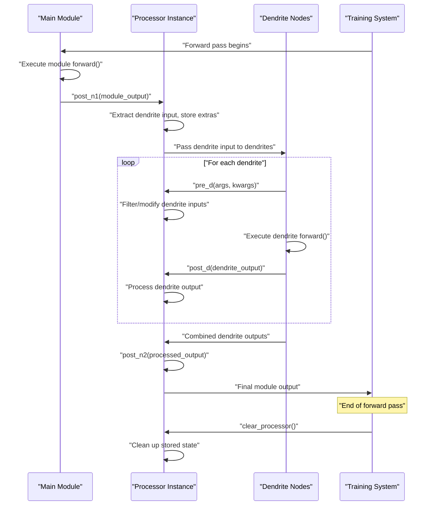
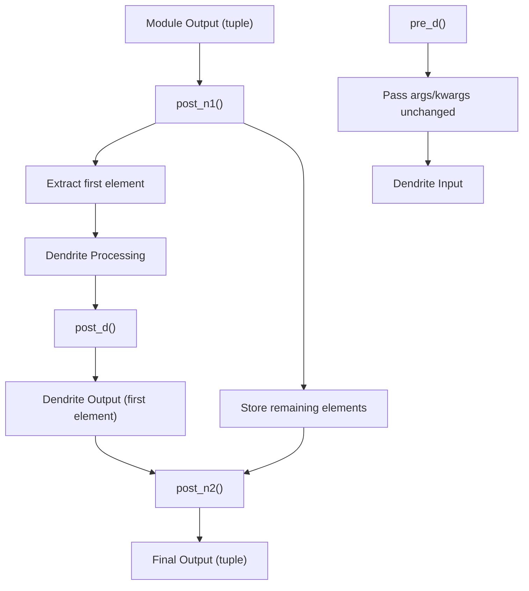
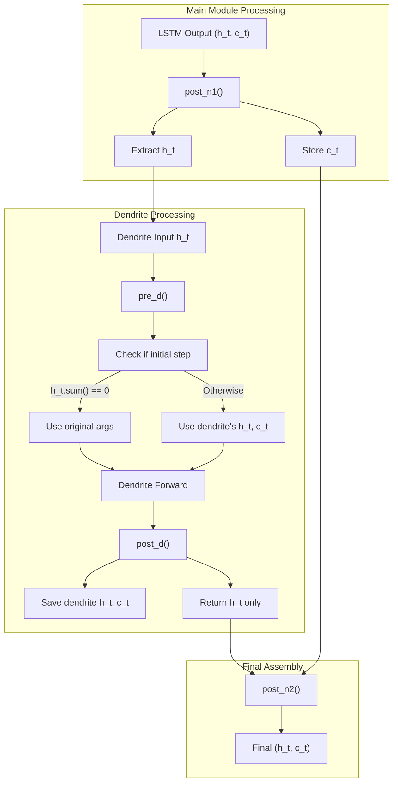
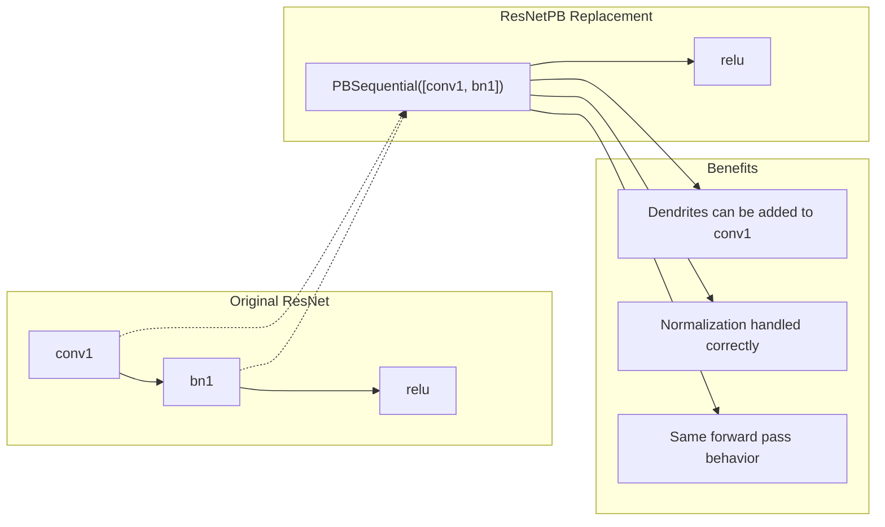

<!-- source: DeepWiki mcp.deepwiki.com · repo PerforatedAI/PerforatedAI · page 5.3 Processor Examples · fetched 2026-10-21 -->

# Processor Examples

<details>
<summary>Relevant source files</summary>

The following files were used as context for generating this wiki page:

- [API/processorExample.png](API/processorExample.png)
- [perforatedai/pb_models.py](perforatedai/pb_models.py)

</details>


This page demonstrates practical examples of custom processing functions for complex module types in PerforatedAI. Processors enable dendrite integration with PyTorch modules that have non-standard input/output patterns, such as modules returning multiple values or maintaining internal state.

For general information about the processor system architecture, see [Model Processors](#3.6). For configuration details, see [Advanced Customization](#4.2).

## Purpose and Scope

Processors solve the fundamental challenge of integrating dendrites with PyTorch modules whose `forward()` methods don't follow the simple "one tensor in, one tensor out" pattern. The examples in this page show:

- **Simple Multi-Output Processing**: Handling modules that return multiple values
- **Stateful Module Processing**: Managing complex internal state like LSTM cells
- **Module Replacement Patterns**: Creating custom module wrappers for architectural integration

## Processor Lifecycle

Before examining specific examples, it's important to understand how processors integrate into the dendrite training workflow:



**Sources:** [perforatedai/pb_models.py:13-20]()

## Simple Multi-Output Processing

The `multiOutputProcesser` handles the common case where a module returns multiple values but only the first should be processed by dendrites.

### Implementation Example

The processor follows the standard four-method pattern:



The key methods from [perforatedai/pb_models.py:23-42]():

| Method | Purpose | Input | Output |
|--------|---------|-------|---------|
| `post_n1` | Extract dendrite target from module output | Module output tuple | First element only |
| `post_n2` | Recombine processed output with stored elements | Processed first element | Complete tuple |
| `pre_d` | Prepare dendrite input | Original args/kwargs | Unchanged args/kwargs |
| `post_d` | Extract dendrite contribution | Dendrite output | First element only |

### Usage Pattern

```python
# Module that returns (primary_output, auxiliary_info, metadata)
processor = multiOutputProcesser()

# During forward pass:
# 1. Module produces: (tensor, info, meta)
# 2. post_n1 extracts tensor, stores (info, meta)
# 3. Dendrites process tensor
# 4. post_n2 recombines: (processed_tensor, info, meta)
```

**Sources:** [perforatedai/pb_models.py:23-42]()

## Complex Stateful Processing

The `LSTMCellProcessor` demonstrates handling modules with complex internal state that must be managed separately for the main module and each dendrite.

### LSTM State Management

LSTM cells return both hidden state `h_t` and cell state `c_t`, but only `h_t` should be modified by dendrites:



### State Isolation Strategy

Each dendrite maintains its own internal state, isolated from the main module:

| Component | Hidden State | Cell State | Purpose |
|-----------|--------------|------------|---------|
| Main Module | `h_t` (modified by dendrites) | `c_t_n` (stored in processor) | Primary LSTM computation |
| Each Dendrite | `h_t_d` (internal) | `c_t_d` (internal) | Independent dendrite state |

The processor manages this isolation through careful state routing in [perforatedai/pb_models.py:68-85]():

- **Initial step**: Dendrites use original input with zero states
- **Continuing steps**: Dendrites use their own saved `h_t_d` and `c_t_d`
- **Output**: Only `h_t` is passed to main module for combination

### Critical State Management

The `clear_processor()` method is essential for preventing state leakage between training examples:

```python
def clear_processor(self):
    if hasattr(self, 'h_t_d'):
        delattr(self, 'h_t_d')  # Clear dendrite hidden state
    if hasattr(self, 'c_t_d'):
        delattr(self, 'c_t_d')  # Clear dendrite cell state  
    if hasattr(self, 'c_t_n'):
        delattr(self, 'c_t_n')  # Clear stored main cell state
```

**Sources:** [perforatedai/pb_models.py:45-94]()

## Module Replacement Patterns

For complex architectures, processors may not be sufficient. The `ResNetPB` class demonstrates creating drop-in replacements that integrate PerforatedAI components directly into the architecture.

### ResNet Integration Strategy



### Implementation Structure

The replacement module from [perforatedai/pb_models.py:99-156]() follows these principles:

1. **Preserve Original Behavior**: Copy all attributes and structure from the original module
2. **Targeted Modifications**: Only change components that need dendrite integration
3. **Seamless Integration**: Use `PBSequential` to wrap related layers together

Key modification pattern:
```python
# Original: separate conv and norm layers
# self.conv1 = original.conv1
# self.bn1 = original.bn1

# Replacement: wrapped in PBSequential
self.b1 = PBG.PBSequential([
    otherResNet.conv1,
    otherResNet.bn1
])
```

This approach enables dendrite addition to `conv1` while maintaining the architectural integrity of batch normalization.

**Sources:** [perforatedai/pb_models.py:99-156]()

## Processor Development Guidelines

### When to Use Each Approach

| Scenario | Recommended Approach | Example |
|----------|---------------------|---------|
| Multiple outputs, simple processing | `multiOutputProcesser` | Transformer with attention weights |
| Complex state management | Custom processor (like `LSTMCellProcessor`) | RNN variants, memory networks |
| Architectural integration needed | Module replacement (like `ResNetPB`) | Pre-trained models, complex blocks |

### Common Implementation Patterns

1. **State Storage**: Use instance variables to store data between method calls
2. **State Cleanup**: Always implement `clear_processor()` to prevent leakage
3. **Error Handling**: Check for attribute existence before cleanup
4. **Type Checking**: Handle both single values and tuples consistently

### Integration with Training System

Processors integrate automatically with the training orchestrator when modules are converted. The system handles:

- Processor instantiation for each dendrite
- Method calling at appropriate points in forward pass
- State cleanup between training examples
- Error propagation and debugging support

**Sources:** [perforatedai/pb_models.py:13-20](), [perforatedai/pb_models.py:88-94]()

---

