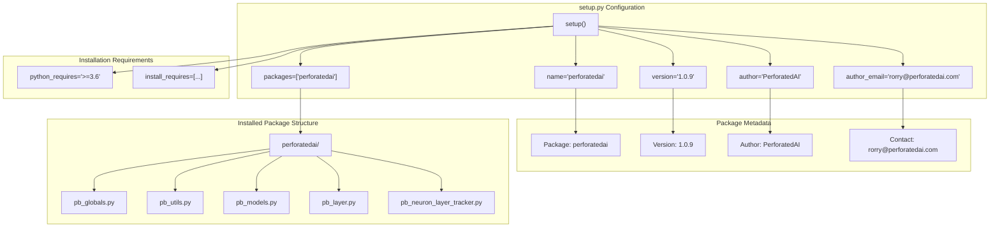
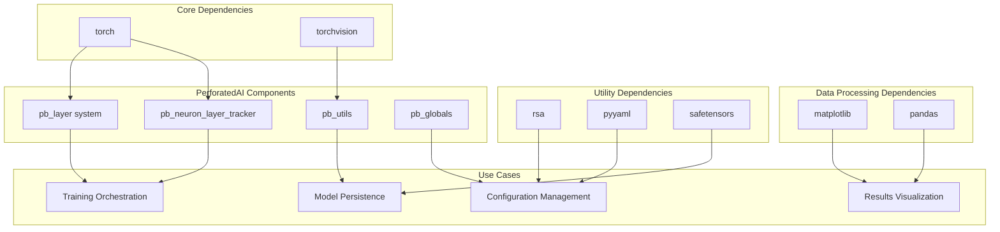

<!-- source: DeepWiki mcp.deepwiki.com · repo PerforatedAI/PerforatedAI · page 6 Installation and Setup · fetched 2026-10-21 -->

# Installation and Setup

<details>
<summary>Relevant source files</summary>

The following files were used as context for generating this wiki page:

- [LICENSE](LICENSE)
- [setup.py](setup.py)

</details>


This document covers the installation process, system requirements, dependencies, and licensing information for the PerforatedAI library. It provides the technical details needed to properly install and configure the package in your Python environment.

For usage patterns and integration steps after installation, see [Getting Started](#4.1). For advanced configuration options that affect the installation behavior, see [Advanced Customization](#4.2).

## System Requirements

PerforatedAI requires Python 3.6 or higher as specified in [setup.py:17](). The library is designed to work across different operating systems and integrates with the PyTorch ecosystem.

### Python Version Compatibility

| Python Version | Support Status |
|----------------|----------------|
| 3.6+ | ✅ Supported |
| < 3.6 | ❌ Not supported |

**Sources:** [setup.py:17]()

## Installation Methods

### Standard Installation

The package is distributed as `perforatedai` version `1.0.9` and can be installed using standard Python package management tools:

```bash
pip install perforatedai
```

### Development Installation

For development or modification of the library:

```bash
git clone https://github.com/PerforatedAI/PerforatedAI
cd PerforatedAI
pip install -e .
```

**Sources:** [setup.py:6-8]()

## Package Configuration Overview

The following diagram shows how the setup.py configuration maps to the installed package structure:



**Sources:** [setup.py:5-16]()

## Dependencies Architecture

PerforatedAI requires several core dependencies that support different aspects of the system functionality:



**Sources:** [setup.py:18-26]()

## Required Dependencies

The following table details the specific dependencies and their roles in the PerforatedAI system:

| Dependency | Purpose | Used By |
|------------|---------|---------|
| `torch` | Core neural network operations | `pb_layer`, `pb_neuron_layer_tracker` |
| `torchvision` | Vision-related utilities and transforms | `pb_utils` conversion functions |
| `matplotlib` | Graph generation and visualization | Training progress visualization |
| `pandas` | Data manipulation for CSV exports | Results analysis and export |
| `rsa` | Cryptographic operations | Configuration security |
| `pyyaml` | YAML configuration parsing | Settings management |
| `safetensors` | Secure tensor serialization | Model saving/loading |

### Installation Command with Dependencies

When installing PerforatedAI, pip automatically resolves and installs these dependencies:

```bash
pip install perforatedai
# Automatically installs: torch torchvision matplotlib pandas rsa pyyaml safetensors
```

**Sources:** [setup.py:18-26]()

## Package Information

### Author and Contact Information

- **Package Name:** `perforatedai`
- **Current Version:** `1.0.9`
- **Author:** PerforatedAI
- **Contact:** rorry@perforatedai.com

### Package Metadata

The package includes the following classifier information as defined in [setup.py:12-16]():

```python
classifiers=[
    'Programming Language: Python :: 3',
    'License: TBD',
    'Operating System: OS Independent',
]
```

**Sources:** [setup.py:9-16]()

## Licensing

PerforatedAI is distributed under the Apache License 2.0. This is a permissive open-source license that allows:

### License Permissions
- ✅ Commercial use
- ✅ Distribution
- ✅ Modification
- ✅ Patent use
- ✅ Private use

### License Conditions
- ℹ️ License and copyright notice must be included
- ℹ️ Changes must be documented

### Key License Terms

The Apache 2.0 license provides the following grants as specified in [LICENSE:67-88]():

1. **Copyright License:** Perpetual, worldwide, non-exclusive, royalty-free license to reproduce, prepare derivative works, publicly display, perform, sublicense, and distribute the work.

2. **Patent License:** Perpetual, worldwide, non-exclusive, royalty-free patent license for patent claims necessarily infringed by contributions.

### License Text Location

The full license text is available in [LICENSE:1-203]() in the repository root. When redistributing the software, this license file must be included per the terms in [LICENSE:95-96]().

**Sources:** [LICENSE:1-203]()

## Installation Verification

After installation, verify that PerforatedAI is properly installed and accessible:

### Basic Import Test

```python
import perforatedai.pb_globals as pbg
import perforatedai.pb_utils as pbu
import perforatedai.pb_neuron_layer_tracker as pbtracker
```

### Version Verification

Check that the installed version matches the expected version `1.0.9`:

```python
import pkg_resources
version = pkg_resources.get_distribution("perforatedai").version
print(f"PerforatedAI version: {version}")
```

### Dependency Verification

Ensure all required dependencies are available:

```python
import torch
import torchvision
import matplotlib
import pandas
import rsa
import yaml
import safetensors
```

If any import fails, reinstall the package or manually install the missing dependency.

**Sources:** [setup.py:6-7](), [setup.py:18-26]()

## Troubleshooting Installation Issues

### Common Issues

| Issue | Solution |
|-------|----------|
| Python version too old | Upgrade to Python 3.6+ |
| PyTorch installation fails | Install PyTorch separately first |
| Permission denied | Use `--user` flag or virtual environment |
| Package conflicts | Create fresh virtual environment |

### Virtual Environment Setup

For isolated installation:

```bash
python -m venv perforatedai-env
source perforatedai-env/bin/activate  # On Windows: perforatedai-env\Scripts\activate
pip install perforatedai
```

For additional troubleshooting and debugging information, see [Debugging and Troubleshooting](#4.3).

**Sources:** [setup.py:17](), [setup.py:18-26]()