# Page: Overview

# Overview

<details>
<summary>Relevant source files</summary>

The following files were used as context for generating this wiki page:

- [README.md](README.md)

</details>


This document introduces the PerforatedAI library, explaining the concept of artificial dendrites and how the library enhances PyTorch neural networks with biologically-inspired dendrite functionality. It covers the library's purpose, core architecture, and integration approach.

For detailed research background, see [Research Foundation](#2). For hands-on usage instructions, see [Getting Started](#4.1). For specific implementation details of core components, see [Core Library Reference](#3).

## What is PerforatedAI?

PerforatedAI is a PyTorch library that adds artificial dendrites to existing neural networks with minimal code changes. Dendrites are branched extensions of neurons that process inputs before they reach the neuron's cell body. By incorporating dendrite-like structures into artificial neural networks, the library aims to improve model performance and learning efficiency.

The library's main value proposition is ease of integration - users can add dendrite functionality to any existing PyTorch model with less than an hour of coding work, rather than reimplementing entire architectures from scratch.

## Core Concepts

### Artificial Dendrites

Artificial dendrites are additional computational structures added to neural network layers that:
- Process inputs before they reach the main neuron computation
- Can be trained separately or in conjunction with main network parameters  
- Dynamically expand the network's representational capacity
- Are inspired by biological dendrite structures in real neurons

### Training Modes

The library operates in two primary training modes:

| Mode | Purpose | Target Parameters |
|------|---------|------------------|
| Neuron Training | Optimize main network parameters | Original PyTorch model weights |
| Dendrite Training | Optimize dendrite structures | Added dendrite parameters |

The system automatically switches between these modes based on validation performance metrics.

Sources: [README.md:1-46]()

## Library Architecture

### High-Level Component Structure

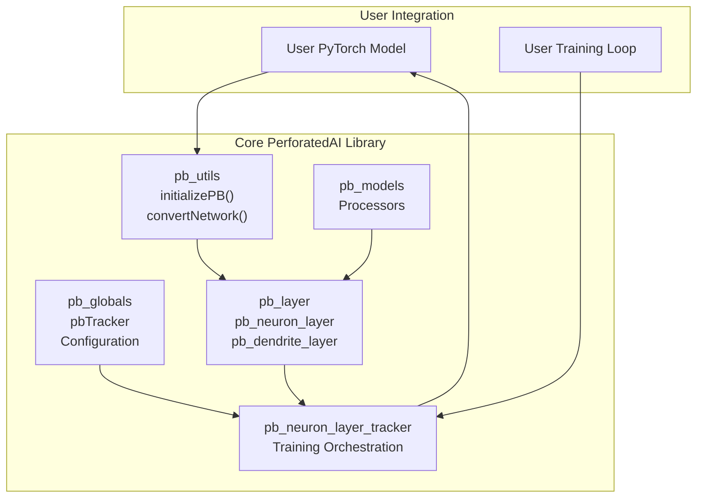

This diagram shows how user code interfaces with the PerforatedAI library. The `pb_utils.initializePB()` function converts the user's model, while `pb_globals.pbTracker` orchestrates the training process.

Sources: Based on high-level architecture diagrams provided

### Model Conversion Process

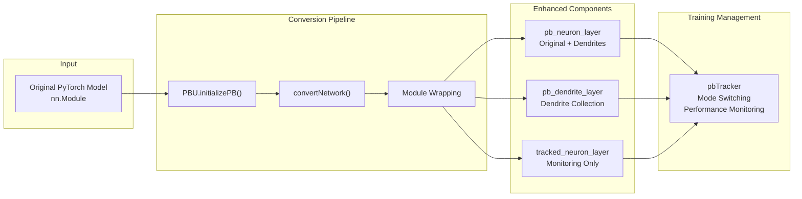

This conversion process transforms standard PyTorch modules into dendrite-enhanced versions while preserving the original model's functionality and interface.

Sources: Based on core library architecture analysis

## Supported Architectures

The library supports a wide range of PyTorch architectures through its flexible conversion system:

### Language Models
- **BERT**: Transformer-based models for NLP tasks
- **GPT2**: Autoregressive language models, including PEFT/LoRA integration
- Custom transformer architectures

### Computer Vision
- **CNN**: Convolutional neural networks for image classification
- **UNet**: Encoder-decoder architectures for segmentation
- **ResNet**: Residual networks and similar architectures

### Processing Adapters

The `pb_models` module provides specialized processors for different module types:

| Processor | Purpose | Target Modules |
|-----------|---------|----------------|
| `multiOutputProcesser` | General-purpose processing | Most standard layers |
| `LSTMCellProcessor` | Stateful module handling | LSTM, GRU cells |
| Custom processors | User-defined logic | Specialized architectures |

Sources: [README.md:14-38]()

## Integration Workflow

### Typical User Experience

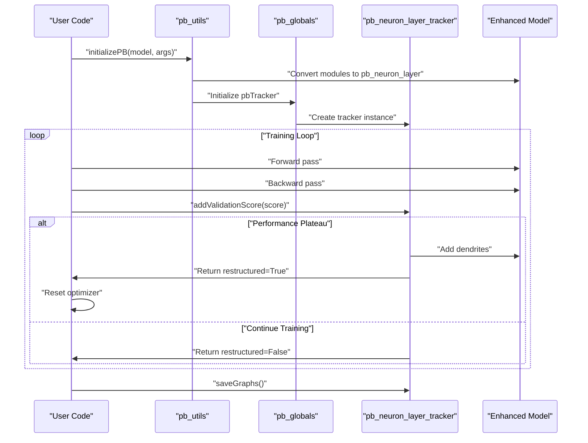

The integration requires minimal changes to existing training loops - users primarily need to call `initializePB()` and `addValidationScore()` while the system handles dendrite management automatically.

Sources: Based on training orchestration analysis

## Key Features

### Automatic Dendrite Management
- Dynamic addition of dendrite structures based on performance metrics
- Automatic switching between neuron and dendrite training modes
- No manual architecture modification required

### PyTorch Compatibility
- Preserves existing model interfaces and training loops
- Compatible with standard PyTorch optimizers and loss functions
- Supports GPU acceleration and distributed training

### Flexible Configuration
- Customizable conversion rules through `pb_globals`
- Support for custom processing functions
- Configurable training strategies and performance thresholds

### Research-Backed Approach
- Based on decades of dendrite research in computational neuroscience
- Implements both classical and modern dendrite learning methods
- Provides pathway to advanced "Perforated Backpropagation" techniques

Sources: [README.md:1-46]()

## Getting Started

To begin using PerforatedAI with your existing PyTorch model:

1. **Install the library** - See [Installation and Setup](#6)
2. **Convert your model** - Use `pb_utils.initializePB()` to add dendrite capability
3. **Modify training loop** - Add validation score reporting with `pbTracker.addValidationScore()`
4. **Configure options** - Customize behavior through `pb_globals` settings

For detailed implementation instructions, see [Getting Started](#4.1). For advanced configuration options, see [Advanced Customization](#4.2).

The [MNIST Tutorial](#5.1) provides a complete walkthrough of integrating dendrites with a simple CNN, while [Architecture Examples](#5.2) show integration patterns for more complex models.

Sources: [README.md:1-46]()

---

# Page: Research Foundation

# Research Foundation

<details>
<summary>Relevant source files</summary>

The following files were used as context for generating this wiki page:

- [DendritePapersAndSummaries/README.md](DendritePapersAndSummaries/README.md)

</details>


This document provides the scientific background and research history that informs PerforatedAI's dendrite integration approach. It traces the evolution of artificial dendrite research from 1989 to present, explaining how theoretical concepts translate into the practical implementation found in this library.

For technical implementation details of these research concepts, see [Core Library Reference](#3). For practical usage patterns, see [User Guide](#4).

## Research Evolution Timeline

The development of artificial dendrites in neural networks spans over three decades, with distinct methodological phases leading to the current gradient descent-compatible approach.

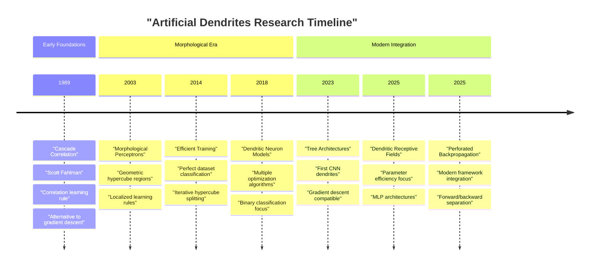

Sources: [DendritePapersAndSummaries/README.md:21-52]()

## Methodological Evolution

The research shows three distinct approaches to integrating dendrites with neural networks, each addressing different limitations of traditional architectures.

| Approach | Period | Key Papers | Learning Method | GD Compatible | Multi-Layer |
|----------|--------|------------|----------------|---------------|-------------|
| **Correlation Learning** | 1989 | Cascade Correlation | Correlation maximization | No | No |
| **Geometric Regions** | 2003-2018 | Morphological Perceptrons | Hypercube encapsulation | No | No |  
| **Gradient Integration** | 2023-2025 | Tree Architectures, Perforated BP | Hybrid GD + correlation | Yes | Yes |

Sources: [DendritePapersAndSummaries/README.md:7-17]()

## Core Research Insights

### Cascade Correlation Foundation (1989)

The foundational work by Fahlman introduced the correlation learning rule, establishing the theoretical basis for differentiating dendrite nodes from neuron nodes. This approach used correlation maximization rather than gradient descent.

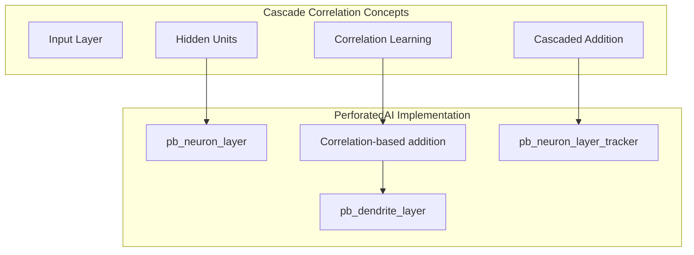

Sources: [DendritePapersAndSummaries/README.md:21-22]()

### Morphological Perceptron Era (2003-2018)

This period focused on geometric interpretations where dendrites define hypercube regions in input space through excitatory and inhibitory connections. The 2014 work proved that sufficient dendrites allow perfect classification of any training dataset.

Key insights:
- **Hypercube Encapsulation**: Dendrites create geometric regions containing input patterns
- **Iterative Splitting**: Training involves progressively subdividing regions until class purity
- **Frozen Weights**: Final dendrite weights are fixed after region identification

Sources: [DendritePapersAndSummaries/README.md:24-33]()

### Modern Gradient Integration (2023-2025)

Recent work bridges traditional dendrite concepts with modern deep learning frameworks, culminating in gradient descent-compatible approaches.

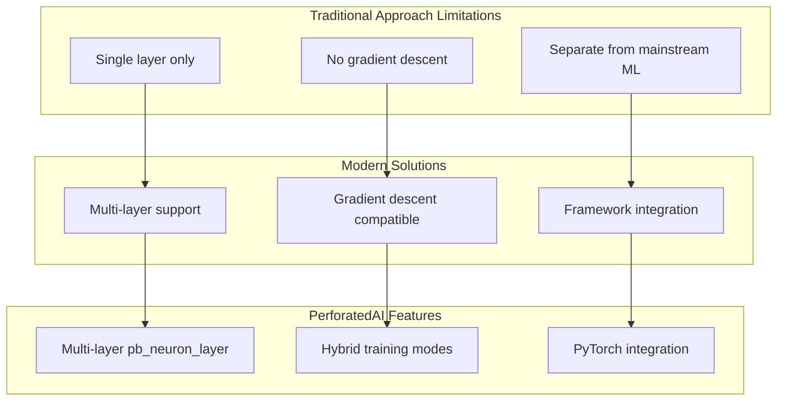

Sources: [DendritePapersAndSummaries/README.md:39-52]()

## Perforated Backpropagation Innovation

The core innovation of Perforated Backpropagation separates forward and backward passes, allowing dendrites to enhance feature complexity without disrupting gradient flow.

### Forward Pass Enhancement
- Dendrites participate in forward computation
- Enable complex feature detection within existing neurons
- Maintain original network feature count

### Backward Pass Isolation  
- Dendrites excluded from gradient computation
- Prevents interference with established error signals
- Maintains training stability

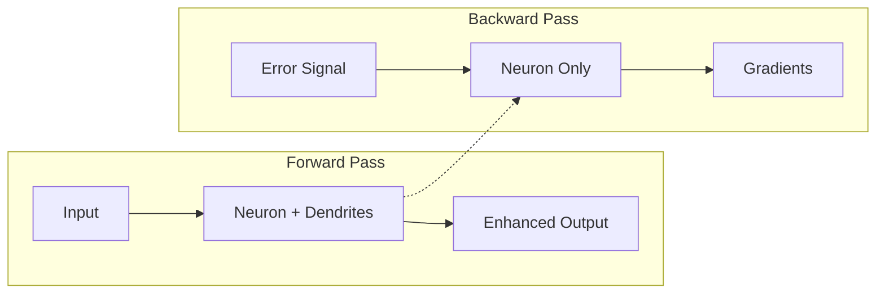

This separation enables the `pb_neuron_layer_tracker` to manage dual training modes while preserving network stability.

Sources: [DendritePapersAndSummaries/README.md:46-48]()

## Research to Implementation Mapping

The theoretical concepts from decades of research directly inform PerforatedAI's implementation architecture:

| Research Concept | Implementation Component | Code Location |
|------------------|-------------------------|---------------|
| Correlation Learning | Dendrite addition logic | `pb_neuron_layer_tracker` |
| Cascaded Architecture | Dynamic layer modification | `pb_utils.initializePB` |
| Geometric Regions | Dendrite weight learning | `pb_dendrite_layer` |
| Forward/Backward Separation | Training mode switching | `pb_neuron_layer` |
| Multi-layer Support | Module conversion | `convertNetwork` functions |

Sources: [DendritePapersAndSummaries/README.md:1-53]()

## Parameter Efficiency Evidence

Recent research consistently demonstrates that dendritic architectures achieve superior parameter efficiency compared to traditional networks:

- **2023 CNN Study**: Dendritic models matched LeNet accuracy with significantly fewer parameters
- **2025 MLP Study**: Dendritic architectures substantially outperformed traditional MLPs in parameter efficiency  
- **2025 Compression Study**: Reduced network sizes with dendrite addition achieved equivalent performance

This efficiency stems from dendrites' ability to increase feature complexity without proportional parameter growth, a key motivation for the PerforatedAI library design.

Sources: [DendritePapersAndSummaries/README.md:40-52]()

---

# Page: Core Library Reference

# Core Library Reference

<details>
<summary>Relevant source files</summary>

The following files were used as context for generating this wiki page:

- [perforatedai/__init__.py](perforatedai/__init__.py)
- [setup.py](setup.py)

</details>


This document provides technical documentation for the core PerforatedAI library components and their interactions. It covers the main modules, classes, and functions that implement the dendrite integration functionality.

For practical usage patterns and integration steps, see [Getting Started](#4.1). For detailed configuration options, see individual component sections [Architecture Overview](#3.1) through [Model Processors](#3.6).

## Core Library Structure

The PerforatedAI library consists of five main modules that work together to enable dendrite functionality in PyTorch neural networks. Each module has a specific responsibility in the dendrite integration pipeline.

### Core Module Architecture

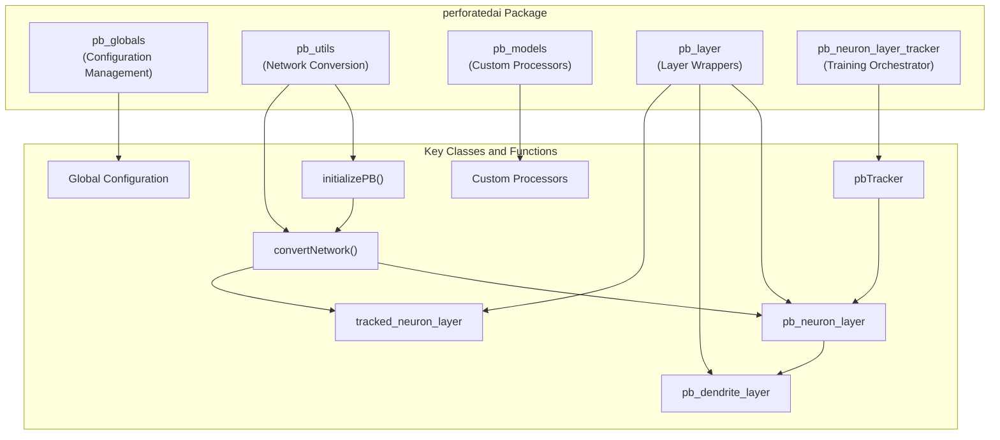

**Sources:** Architecture diagrams, perforatedai/__init__.py

### Component Responsibilities

| Module | Primary Function | Key Components |
|--------|-----------------|----------------|
| `pb_utils` | Network conversion and initialization | `initializePB()`, `convertNetwork()` |
| `pb_neuron_layer_tracker` | Training lifecycle management | `pbTracker` |
| `pb_layer` | PyTorch module wrapping | `pb_neuron_layer`, `pb_dendrite_layer` |
| `pb_globals` | Configuration and settings | Global configuration variables |
| `pb_models` | Custom processing logic | Module-specific processors |

## System Integration Flow

The following diagram shows how user code integrates with the PerforatedAI library and the sequence of operations during model enhancement.

### Integration Sequence

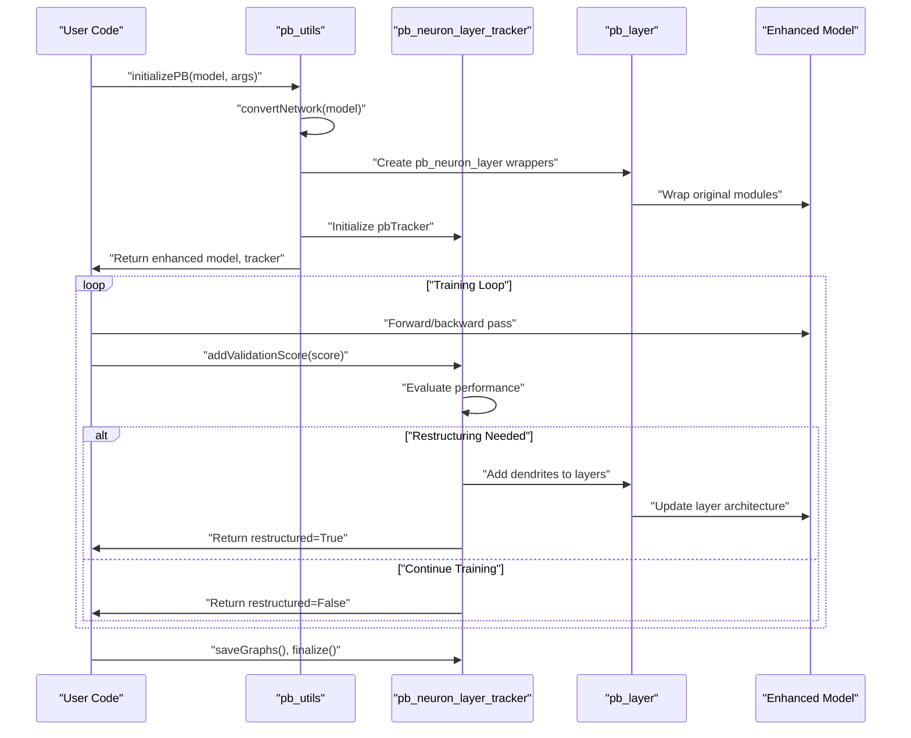

**Sources:** Architecture diagrams, system flow documentation

## Module Dependencies

The core library modules have specific dependency relationships that determine initialization order and functionality availability.

### Dependency Graph

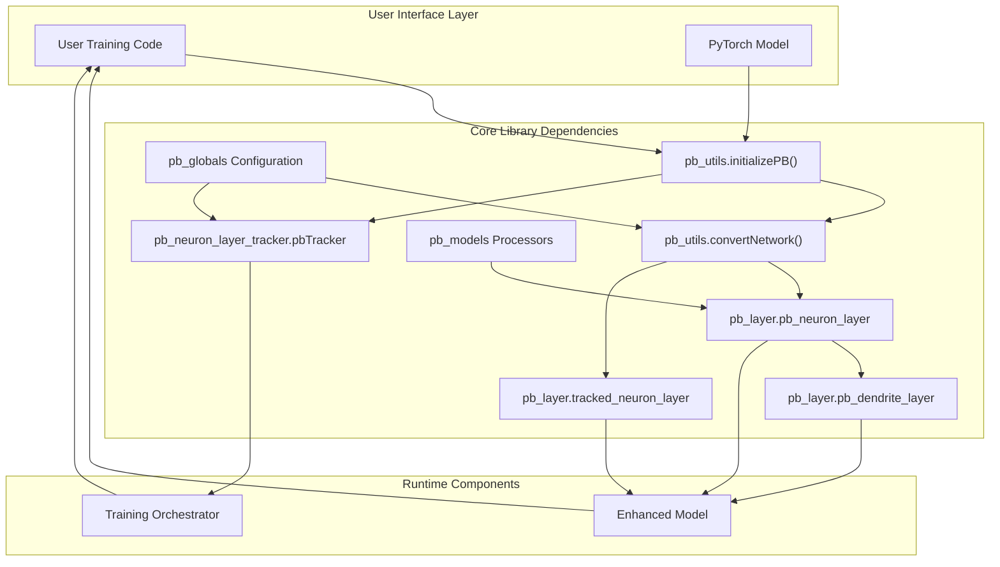

**Sources:** Architecture diagrams, module interaction patterns

## Training Mode Management

The library implements a sophisticated training mode switching system that alternates between optimizing neuron parameters and dendrite parameters based on validation performance.

### Mode Switching Logic

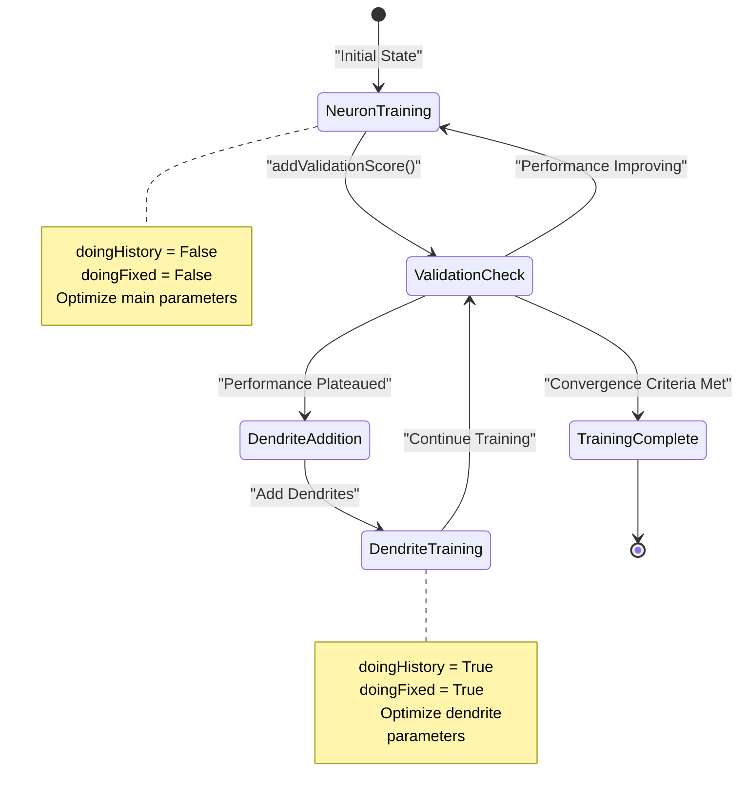

**Sources:** Architecture diagrams, training orchestration flow

## Key Integration Points

The library provides several key integration points where user code interacts with the PerforatedAI system:

### Primary Entry Points

| Function/Class | Module | Purpose |
|----------------|---------|---------|
| `initializePB()` | `pb_utils` | Main initialization function for model conversion |
| `pbTracker` | `pb_neuron_layer_tracker` | Central training orchestrator instance |
| `convertNetwork()` | `pb_utils` | Core network conversion function |
| `setupOptimizer()` | `pb_neuron_layer_tracker` | Optimizer configuration for dendrite training |
| `addValidationScore()` | `pb_neuron_layer_tracker` | Performance tracking and mode switching |

### Configuration Control Points

The system exposes several configuration mechanisms:

- **Global Settings**: Through `pb_globals` module configuration
- **Processing Rules**: Via `pb_models` custom processors  
- **Layer Wrapping**: Through `pb_layer` wrapper classes
- **Training Parameters**: Via `pbTracker` orchestrator settings

**Sources:** setup.py, architecture diagrams, integration flow documentation

## Package Structure

The PerforatedAI library is distributed as a single Python package with the following dependencies and structure:

### Dependencies

From [setup.py:18-26]():
- `torch` - PyTorch framework integration
- `torchvision` - Vision model support
- `matplotlib` - Visualization and graphing
- `pandas` - Data analysis and CSV output
- `rsa` - Cryptographic functions
- `pyyaml` - Configuration file support
- `safetensors` - Secure tensor serialization

### Package Information

- **Package Name**: `perforatedai` 
- **Version**: 1.0.9 (from [setup.py:7]())
- **Python Requirements**: >=3.6 (from [setup.py:17]())
- **License**: Apache 2.0

**Sources:** setup.py, perforatedai/__init__.py

---

# Page: Architecture Overview

# Architecture Overview

<details>
<summary>Relevant source files</summary>

The following files were used as context for generating this wiki page:

- [perforatedai/pb_globals.py](perforatedai/pb_globals.py)
- [perforatedai/pb_layer.py](perforatedai/pb_layer.py)
- [perforatedai/pb_utils.py](perforatedai/pb_utils.py)

</details>


This document explains how the core PerforatedAI library components work together to enable dendrite functionality in PyTorch models. It covers the high-level system design, component interactions, and data flow patterns that transform standard neural networks into dendrite-enhanced architectures.

For detailed information about specific components, see [Training Orchestration](#3.2) for `pb_neuron_layer_tracker`, [Layer System](#3.3) for layer wrappers, [Configuration System](#3.4) for `pb_globals`, and [Utilities and Conversion](#3.5) for network transformation functions.

## Core Components Overview

The PerforatedAI library consists of five primary subsystems that work together to provide dendrite functionality:

### Component Architecture

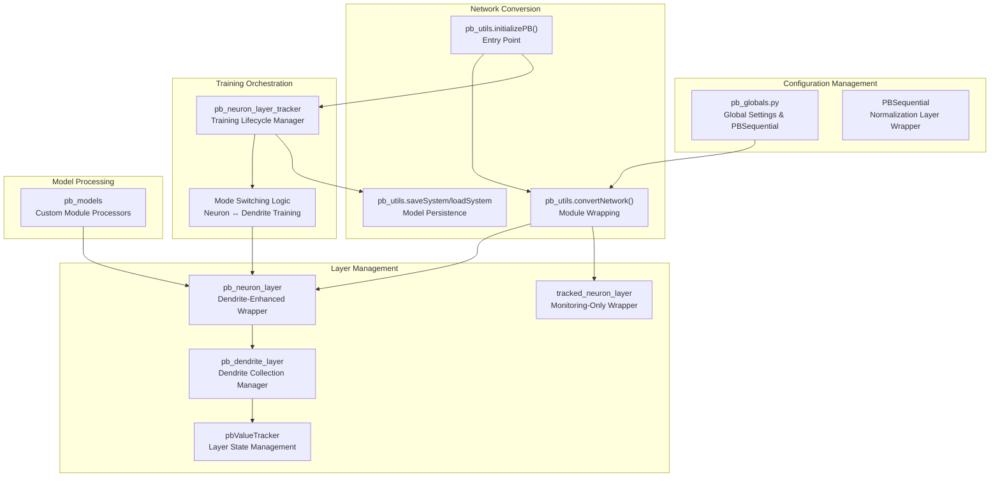

**Sources:** [perforatedai/pb_globals.py:1-183](), [perforatedai/pb_layer.py:1-611](), [perforatedai/pb_utils.py:1-498]()

## System Integration Flow

The integration process transforms a standard PyTorch model into a dendrite-enhanced model through a well-defined sequence:

### Model Transformation Pipeline

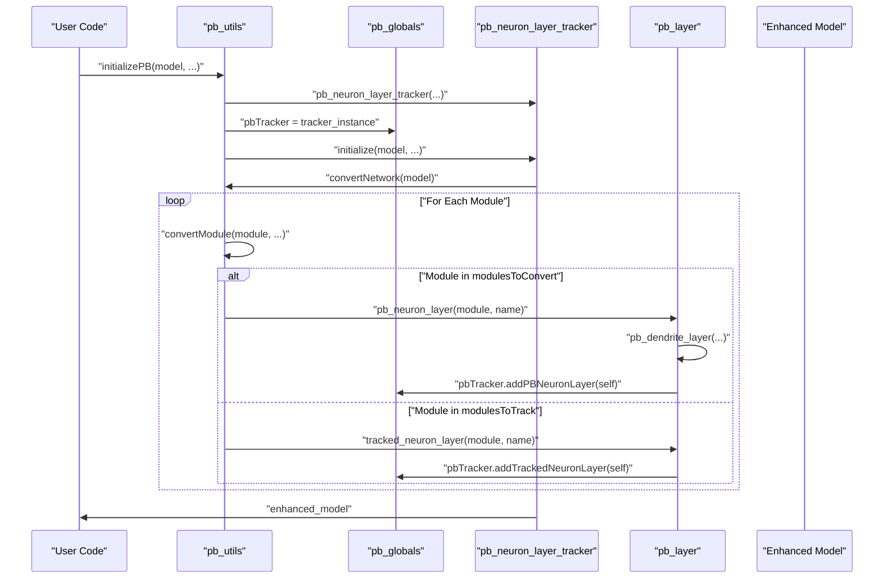

**Sources:** [perforatedai/pb_utils.py:24-29](), [perforatedai/pb_utils.py:214-259](), [perforatedai/pb_layer.py:100-156]()

## Layer Architecture

The layer system creates a hierarchical wrapper structure that enables dendrite functionality while preserving the original PyTorch module interface:

### Layer Wrapper Hierarchy

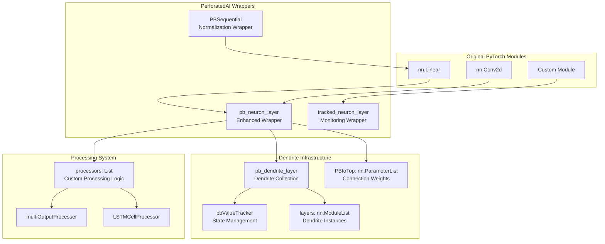

**Sources:** [perforatedai/pb_layer.py:100-156](), [perforatedai/pb_layer.py:305-332](), [perforatedai/pb_layer.py:341-420](), [perforatedai/pb_globals.py:51-56]()

### Key Layer Classes and Responsibilities

| Class | Purpose | Key Methods | Configuration |
|-------|---------|-------------|---------------|
| `pb_neuron_layer` | Main wrapper for dendrite-enhanced modules | `forward()`, `setMode()`, `addPBLayer()` | `PBG.modulesToConvert` |
| `pb_dendrite_layer` | Manages collection of dendrite instances | `addPBLayer()`, `setMode()` | Internal to `pb_neuron_layer` |
| `tracked_neuron_layer` | Monitoring-only wrapper for unsupported modules | `forward()` | `PBG.modulesToTrack` |
| `pbValueTracker` | State management for dendrite layers | `setupArrays()`, `reinitializeForPB()` | Automatic initialization |
| `PBSequential` | Wrapper for normalization layer sequences | `forward()` | Manual wrapping required |

**Sources:** [perforatedai/pb_layer.py:100-300](), [perforatedai/pb_layer.py:305-332](), [perforatedai/pb_layer.py:341-527](), [perforatedai/pb_layer.py:532-611](), [perforatedai/pb_globals.py:51-56]()

## Training Orchestration

The training system coordinates between neuron optimization and dendrite addition through a centralized tracker:

### Training Lifecycle Management

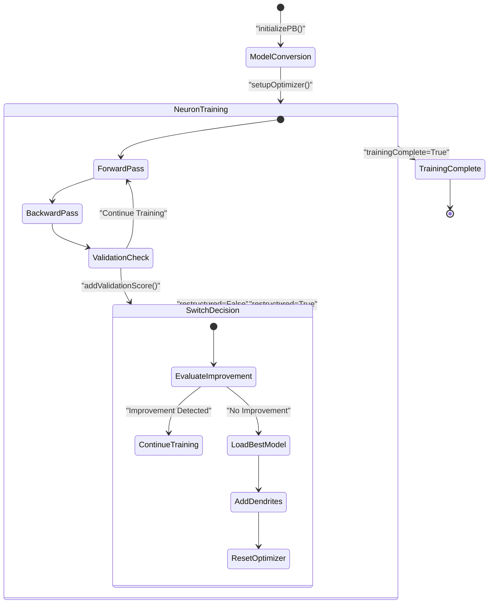

**Sources:** [perforatedai/pb_utils.py:424-497](), [perforatedai/pb_layer.py:210-254]()

## Configuration Management

The configuration system provides centralized control over conversion behavior, training parameters, and system-wide settings:

### Configuration Architecture

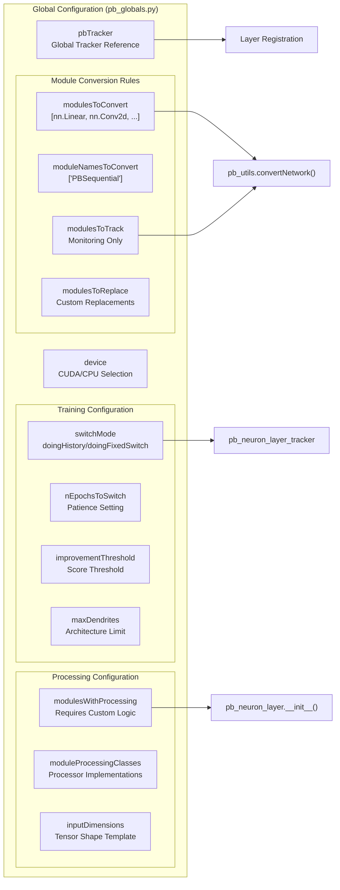

**Sources:** [perforatedai/pb_globals.py:8-183](), [perforatedai/pb_utils.py:108-212](), [perforatedai/pb_layer.py:112-127]()

### Critical Configuration Points

The system relies on several key configuration decisions that must be made before model conversion:

1. **Input Dimensions**: `PBG.inputDimensions` defines the tensor shape template with exactly one `0` indicating the neuron dimension [perforatedai/pb_globals.py:104]()
2. **Module Conversion Lists**: `modulesToConvert` and `modulesToTrack` determine which PyTorch modules receive dendrite enhancement [perforatedai/pb_globals.py:59-64]()
3. **Switch Mode**: `switchMode` controls when dendrites are added during training [perforatedai/pb_globals.py:120-141]()
4. **Processing Requirements**: Complex modules need custom processors defined in `modulesWithProcessing` [perforatedai/pb_globals.py:76-79]()

**Sources:** [perforatedai/pb_globals.py:59-183](), [perforatedai/pb_layer.py:132-137](), [perforatedai/pb_layer.py:199-208]()

---

# Page: Training Orchestration

# Training Orchestration

<details>
<summary>Relevant source files</summary>

The following files were used as context for generating this wiki page:

- [perforatedai/pb_neuron_layer_tracker.py](perforatedai/pb_neuron_layer_tracker.py)

</details>


This document covers the `pb_neuron_layer_tracker` system, which serves as the central orchestrator for the PerforatedAI training process. The tracker manages the lifecycle of dendrite addition, coordinates training mode switches between neuron and dendrite optimization phases, and handles model persistence throughout the adaptive training process.

For information about the layer-level dendrite implementation, see [Layer System](#3.3). For configuration options that control orchestration behavior, see [Configuration System](#3.4).

## Purpose and Core Responsibilities

The `pb_neuron_layer_tracker` class acts as the central command system that:

- **Orchestrates Training Phases**: Manages switches between neuron training mode (`'n'`) and dendrite training mode (`'p'`)
- **Monitors Performance**: Tracks validation scores and determines when dendrite addition is beneficial
- **Manages Model State**: Handles saving, loading, and restoration of model states during restructuring
- **Controls Learning Parameters**: Coordinates optimizer and scheduler behavior across training phases
- **Generates Analytics**: Produces comprehensive metrics, graphs, and CSV outputs for training analysis

Sources: [perforatedai/pb_neuron_layer_tracker.py:29-33](), [perforatedai/pb_neuron_layer_tracker.py:34-254]()

## Training Orchestration Flow

The following diagram shows the high-level orchestration flow managed by `pb_neuron_layer_tracker`:

### Training Lifecycle Management

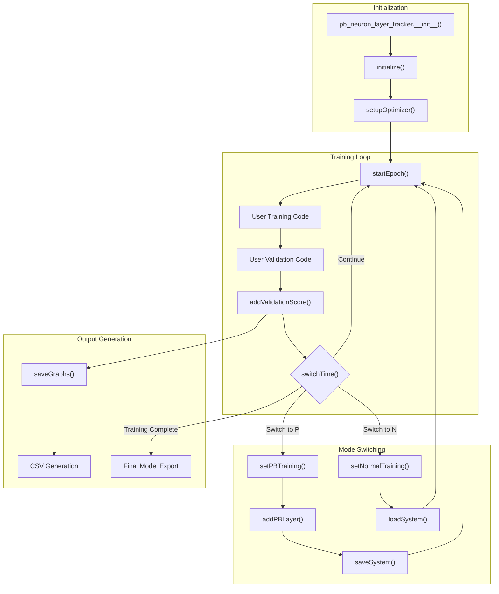

Sources: [perforatedai/pb_neuron_layer_tracker.py:709-737](), [perforatedai/pb_neuron_layer_tracker.py:1122-1524]()

## Training Mode Management

The orchestrator manages two distinct training phases through mode switching:

| Mode | Description | Parameter Optimization | Duration Control |
|------|-------------|----------------------|------------------|
| `'n'` | Neuron Training | Standard PyTorch parameters via `net.parameters()` | Until validation improvement stops |
| `'p'` | Dendrite Training | Dendrite-specific parameters via `getPBNetworkParams()` | Single epoch or until correlation learning completes |

### Mode Switching Decision Logic

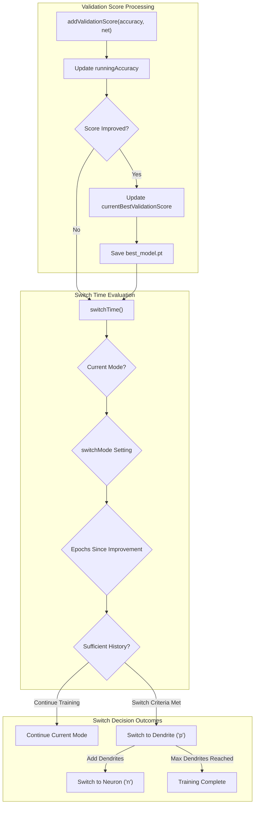

Sources: [perforatedai/pb_neuron_layer_tracker.py:556-604](), [perforatedai/pb_neuron_layer_tracker.py:1122-1524]()

## Key Orchestration Methods

### Core Training Control Methods

The tracker provides several critical methods for managing the training process:

| Method | Purpose | Key Behavior |
|--------|---------|--------------|
| `addValidationScore()` | Process validation results and make switching decisions | [Lines 1122-1524]() |
| `switchTime()` | Evaluate whether to switch training modes | [Lines 556-604]() |
| `setPBTraining()` | Transition to dendrite training mode | [Lines 662-688]() |
| `setNormalTraining()` | Transition to neuron training mode | [Lines 691-708]() |
| `setupOptimizer()` | Configure optimizer for current training phase | [Lines 510-549]() |

### State Management Methods

The tracker handles complex state management across training phases:

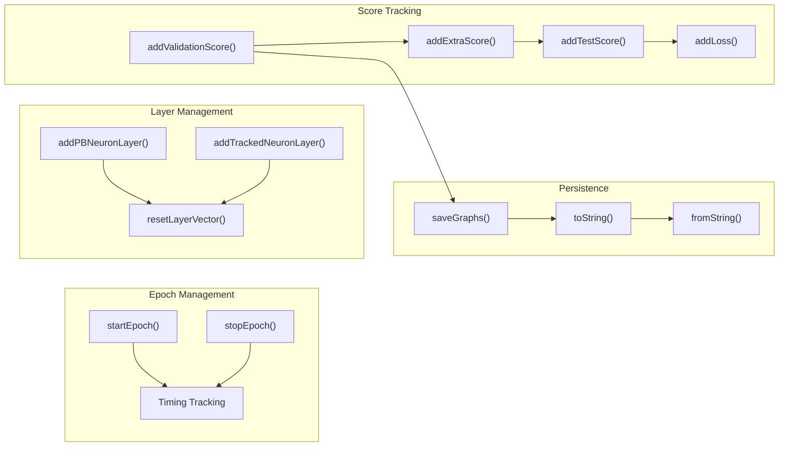

Sources: [perforatedai/pb_neuron_layer_tracker.py:709-754](), [perforatedai/pb_neuron_layer_tracker.py:621-649](), [perforatedai/pb_neuron_layer_tracker.py:1062-1115]()

## Learning Rate and Scheduler Management

The orchestrator implements sophisticated learning rate management for optimal dendrite initialization:

### Learning Rate Discovery Process

When adding dendrites, the system automatically finds optimal initial learning rates:

1. **Baseline Establishment**: Train at default learning rate until scheduler steps twice
2. **Rate Testing**: Test progressively lower initial learning rates 
3. **Performance Comparison**: Compare validation scores at equivalent scheduler positions
4. **Optimal Selection**: Choose the learning rate that provides best dendrite initialization

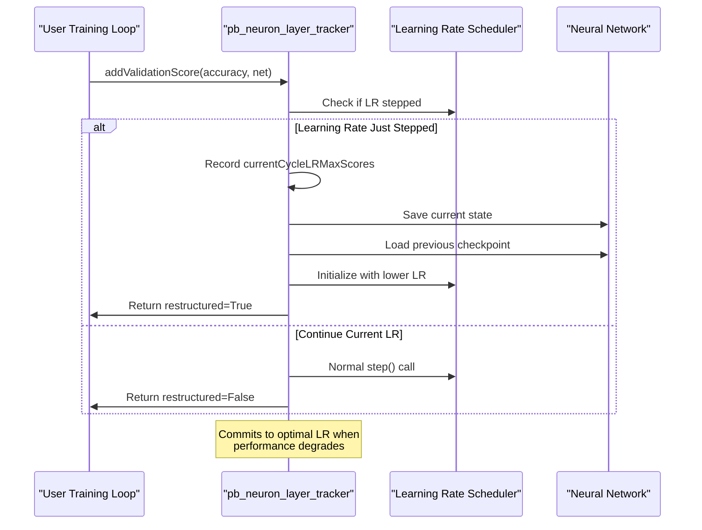

Sources: [perforatedai/pb_neuron_layer_tracker.py:1326-1506](), [perforatedai/pb_neuron_layer_tracker.py:476-507]()

## Integration with Other Components

### Component Communication Pattern

```mermaid
graph TB
    subgraph "External Components"
        USER["User Training Code"]
        OPTIMIZER["PyTorch Optimizer"]
        SCHEDULER["Learning Rate Scheduler"]
    end
    
    subgraph "PerforatedAI Core"
        TRACKER["pb_neuron_layer_tracker"]
        GLOBALS["pb_globals (PBG)"]
        UTILS["pb_utils (PBU)"]
        LAYERS["pb_neuron_layer + pb_dendrite_layer"]
    end
    
    USER -->|"addValidationScore()"| TRACKER
    TRACKER -->|"Configuration Access"| GLOBALS
    TRACKER -->|"Model Conversion & Persistence"| UTILS
    TRACKER -->|"Layer Management"| LAYERS
    
    TRACKER -->|"setupOptimizer()"| OPTIMIZER
    TRACKER -->|"Schedule Management"| SCHEDULER
    
    LAYERS -->|"Mode Changes"| TRACKER
    UTILS -->|"Network Conversion"| TRACKER
    GLOBALS -->|"Settings & Flags"| TRACKER
```

### Key Integration Points

| Component | Interaction Pattern | Primary Methods |
|-----------|-------------------|-----------------|
| `pb_globals` | Configuration access via `PBG.*` | Global settings and flags |
| `pb_utils` | Model operations via `PBU.*` | `saveSystem()`, `loadSystem()`, `convertNetwork()` |
| `pb_layer` | Direct method calls | `setMode()`, `addPBLayer()` |
| User Code | Method invocation | `addValidationScore()`, `setupOptimizer()` |

Sources: [perforatedai/pb_neuron_layer_tracker.py:25-27](), [perforatedai/pb_neuron_layer_tracker.py:510-549]()

## Output and Analytics Generation

The tracker produces comprehensive training analytics through the `saveGraphs()` method:

### Generated Outputs

| Output Type | File Pattern | Content |
|-------------|-------------|---------|
| Training Graphs | `{saveName}.png` | Validation scores, timing, learning rates, dendrite scores |
| Score Data | `{saveName}Scores.csv` | All validation and extra scores by epoch |
| Timing Data | `{saveName}Times.csv` | Training and validation timing metrics |
| Switch Data | `{saveName}switchEpochs.csv` | Mode switching history |
| Parameter Data | `{saveName}paramCounts.csv` | Model parameter counts by structure |
| Best Scores | `{saveName}bestTestScores.csv` | Optimal scores by parameter count |

### Metrics Tracking

The tracker maintains detailed metrics across training phases:

- **Performance Metrics**: Validation accuracy, test scores, extra scores
- **Training Metrics**: Learning rates, training loss, epoch timing
- **Structural Metrics**: Parameter counts, switch epochs, dendrite counts  
- **Diagnostic Metrics**: Learning rate stepping, scheduler states, mode durations

Sources: [perforatedai/pb_neuron_layer_tracker.py:794-1059](), [perforatedai/pb_neuron_layer_tracker.py:1062-1115]()

---

# Page: Layer System

# Layer System

<details>
<summary>Relevant source files</summary>

The following files were used as context for generating this wiki page:

- [perforatedai/pb_layer.py](perforatedai/pb_layer.py)

</details>


This document covers the core layer wrapper classes that transform standard PyTorch modules into dendrite-capable modules. The layer system handles module wrapping, parameter management, training mode switching, and the integration of dendrite outputs with neuron outputs.

For information about the training orchestration that manages these layers, see [Training Orchestration](#3.2). For configuration options that control layer behavior, see [Configuration System](#3.4).

## Layer Wrapper Classes Overview

The layer system consists of three main wrapper classes that encapsulate PyTorch modules with different levels of dendrite integration:

```mermaid
classDiagram
    class pb_neuron_layer {
        +mainModule: nn.Module
        +pb: pb_dendrite_layer
        +PBtoTop: ParameterList
        +pbLayersAdded: int
        +processor: Processor
        +forward(*args, **kwargs)
        +setMode(mode)
        +addPBLayer()
        +setThisInputDimensions(dims)
    }
    
    class tracked_neuron_layer {
        +mainModule: nn.Module
        +forward(*args, **kwargs)
        +setMode(mode)
    }
    
    class pb_dendrite_layer {
        +layers: ModuleList
        +numPBLayers: int
        +PBtoPB: ParameterList
        +candidateLayer: ModuleList
        +processors: list
        +forward(*args, **kwargs)
        +addPBLayer()
        +setMode(mode)
    }
    
    class pbValueTracker {
        +layerName: str
        +out_channels: int
        +thisInputDimensions: Tensor
        +initialized: Tensor
        +setupArrays(channels)
        +setOutChannels(shape)
    }
    
    pb_neuron_layer ||--|| pb_dendrite_layer : "contains"
    pb_dendrite_layer ||--o{ pbValueTracker : "tracks values"
    pb_neuron_layer ||--o| "Processor" : "optional processing"
```

**Sources:** [perforatedai/pb_layer.py:100-156](), [perforatedai/pb_layer.py:305-331](), [perforatedai/pb_layer.py:341-380](), [perforatedai/pb_layer.py:532-551]()

## Module Conversion and Wrapping

The conversion process transforms standard PyTorch modules into dendrite-capable wrappers based on configuration rules:

### Module Wrapping Flow

```mermaid
flowchart TD
    A["Original PyTorch Module"] --> B{"Module Type Check"}
    B --> C{"In moduleNamesToSkip?"}
    C -->|Yes| D["tracked_neuron_layer"]
    C -->|No| E["pb_neuron_layer"]
    E --> F["pb_dendrite_layer created"]
    F --> G{"Requires Processor?"}
    G -->|Yes| H["Add processor from PBG config"]
    G -->|No| I["Standard wrapper"]
    D --> J["setTracked_params()"]
    E --> K["setWrapped_params()"]
    
    H --> L["Register with pbTracker"]
    I --> L
    J --> M["Register with pbTracker"]
    K --> L
```

The wrapping process marks parameters appropriately and registers layers with the global tracker:

- **pb_neuron_layer**: Full dendrite capability with `setWrapped_params()` [perforatedai/pb_layer.py:107]()
- **tracked_neuron_layer**: Monitoring only with `setTracked_params()` [perforatedai/pb_layer.py:313]()

**Sources:** [perforatedai/pb_layer.py:89-95](), [perforatedai/pb_layer.py:100-156](), [perforatedai/pb_layer.py:305-317]()

### Processor Integration

Modules requiring special processing are automatically assigned processors based on type matching:

```mermaid
graph LR
    A["Module Type"] --> B{"In modulesWithProcessing?"}
    B -->|Yes| C["moduleProcessingClasses[index]()"]
    B -->|No| D{"In moduleNamesWithProcessing?"}
    D -->|Yes| E["moduleByNameProcessingClasses[index]()"]
    D -->|No| F["processor = None"]
```

**Sources:** [perforatedai/pb_layer.py:112-126](), [perforatedai/pb_layer.py:415-421]()

## Training Mode Management

The layer system supports two training modes that are coordinated across neuron and dendrite components:

### Mode Switching Mechanics

| Mode | Description | Parameter Updates | Dendrite State |
|------|-------------|------------------|----------------|
| `'n'` (Neuron) | Train main module parameters | Neurons + dendrite-to-neuron weights | Fixed architecture |
| `'p'` (Dendrite) | Train dendrite parameters | Candidate dendrites only | Adding new dendrites |

```mermaid
sequenceDiagram
    participant T as "pbTracker"
    participant N as "pb_neuron_layer"
    participant D as "pb_dendrite_layer"
    participant V as "pbValueTracker"
    
    T->>N: setMode('p')
    N->>D: setMode('p')
    D->>D: addPBLayer()
    D->>D: Initialize candidate layers
    Note over D: Train candidates
    T->>N: setMode('n')
    N->>D: setMode('n')  
    D->>D: Convert best candidate to layer
    N->>N: Add PBtoTop weights
    N->>N: Increment pbLayersAdded
```

**Sources:** [perforatedai/pb_layer.py:210-253](), [perforatedai/pb_layer.py:453-486]()

### Dendrite Addition Process

When adding dendrites, the system creates candidate modules and selects the best one:

1. **Candidate Creation**: Creates `PBG.globalCandidates` copies with random initialization [perforatedai/pb_layer.py:409-425]()
2. **Training Phase**: Candidates train independently during dendrite mode
3. **Selection**: Best candidate becomes permanent dendrite [perforatedai/pb_layer.py:474-483]()
4. **Weight Integration**: Dendrite-to-neuron weights added to `PBtoTop` [perforatedai/pb_layer.py:218-229]()

**Sources:** [perforatedai/pb_layer.py:399-436](), [perforatedai/pb_layer.py:461-486]()

## Forward Pass Mechanics

The forward pass integrates outputs from the main neuron and all dendrite layers:

### Neuron Layer Forward Pass

```mermaid
flowchart TD
    A["Input (*args, **kwargs)"] --> B["mainModule(*args, **kwargs)"]
    B --> C["processor.post_n1(out)"]
    C --> D["pb.forward(*args, **kwargs)"]
    D --> E["pbOuts = dendrite outputs"]
    E --> F{"pbLayersAdded > 0?"}
    F -->|Yes| G["Combine with PBtoTop weights"]
    F -->|No| H["out unchanged"]
    G --> I["out += pbOut[i] * PBtoTop[i]"]
    I --> J["Register filterBackward hook"]
    H --> J
    J --> K["processor.post_n2(out)"]
    K --> L["Return combined output"]
```

The key integration happens at lines [perforatedai/pb_layer.py:274-283]() where dendrite outputs are scaled and added to neuron outputs.

**Sources:** [perforatedai/pb_layer.py:258-299]()

### Dendrite Layer Forward Pass

Dendrites process inputs and apply inter-dendrite connections:

```mermaid
flowchart TD
    A["Input to each dendrite"] --> B["Apply processors.pre_d()"]
    B --> C["layers[c](*args, **kwargs)"]
    C --> D["Apply processors.post_d()"]
    D --> E["Store in outs[c]"]
    E --> F["Apply dendrite-to-dendrite weights"]
    F --> G["currentOut += PBtoPB[outIdx][inIdx] * outs[inIdx]"]
    G --> H["Apply PBForwardFunction"]
    H --> I["Return all dendrite outputs"]
```

**Sources:** [perforatedai/pb_layer.py:490-526]()

## Input Dimension Management

The layer system requires proper input dimension specification for tensor shape handling:

### Dimension Configuration

Input dimensions use a special format where exactly one dimension is marked as `0` to indicate the neuron index:

- **Format**: `[batch_size, 0, height, width]` for CNNs
- **Format**: `[batch_size, 0]` for Linear layers  
- **Node Index**: Position of `0` indicates which dimension contains neurons

```mermaid
graph TD
    A["thisInputDimensions"] --> B{"Validation: exactly one 0?"}
    B -->|No| C["Error: need exactly one 0"]
    B -->|Yes| D["thisNodeIndex = position of 0"]
    D --> E["Used for tensor reshaping"]
    E --> F["Applied in forward pass"]
    F --> G["Used in PBtoTop weight expansion"]
```

The dimension validation occurs at multiple points: [perforatedai/pb_layer.py:133-136](), [perforatedai/pb_layer.py:363-366](), [perforatedai/pb_layer.py:542-545]()

### Automatic Dimension Setting

For Linear layers with convolutional defaults, dimensions are automatically corrected:

```python
# Automatic correction for Linear layers
if ((issubclass(type(startModule),nn.Linear) or 
    (issubclass(type(startModule),PBG.PBSequential) and issubclass(type(startModule.model[0]),nn.Linear))) 
    and (np.array(self.thisInputDimensions)[2:] == -1).all()):
    self.setThisInputDimensions(self.thisInputDimensions[0:2])
```

**Sources:** [perforatedai/pb_layer.py:151-154](), [perforatedai/pb_layer.py:198-208]()

## Parameter and State Management

The layer system manages multiple parameter groups and state tracking:

### Parameter Organization

```mermaid
graph TD
    subgraph "pb_neuron_layer Parameters"
        A["mainModule.parameters()"]
        B["PBtoTop: ParameterList"]
        C["CandidatetoTop: Parameter"]
    end
    
    subgraph "pb_dendrite_layer Parameters"  
        D["layers[i].parameters()"]
        E["PBtoPB: ParameterList"]
        F["PBtoCandidates: ParameterList"]
    end
    
    subgraph "State Tracking"
        G["pbValueTracker.out_channels"]
        H["pbValueTracker.initialized"]
        I["pb_dendrite_layer.numCycles"]
    end
    
    A --> J["Neuron Training Mode"]
    D --> K["Dendrite Training Mode"]
    B --> J
    E --> K
```

### State Persistence

The system supports model saving/loading with dendrite state preservation:

- **Clear Processors**: Remove temporary processor state [perforatedai/pb_layer.py:165-170]()
- **Clear Dendrites**: Reset dendrite architecture for loading [perforatedai/pb_layer.py:176-183]()
- **Parameter Marking**: Dendrite parameters marked with `.pbWrapped = True` [perforatedai/pb_layer.py:435]()

**Sources:** [perforatedai/pb_layer.py:140-144](), [perforatedai/pb_layer.py:369-371](), [perforatedai/pb_layer.py:432-435]()

### Gradient Flow Management  

The `filterBackward` function ensures proper gradient flow and dimension setup:

```mermaid
flowchart TD
    A["Gradient flows backward"] --> B["filterBackward() called"]
    B --> C{"currentDInit == False?"}
    C -->|Yes| D["Validate input dimensions"]
    D --> E["Setup arrays with known shape"]
    E --> F["Set currentDInit = True"]
    C -->|No| G["Continue normal backward"]
    F --> G
```

This function handles the lazy initialization of output channels based on the first backward pass through each layer.

**Sources:** [perforatedai/pb_layer.py:33-86](), [perforatedai/pb_layer.py:292-294]()

---

# Page: Configuration System

# Configuration System

<details>
<summary>Relevant source files</summary>

The following files were used as context for generating this wiki page:

- [perforatedai/pb_globals.py](perforatedai/pb_globals.py)

</details>


## Purpose and Scope

The Configuration System centralizes all settings and parameters that control the behavior of the PerforatedAI library. This system is primarily implemented in the `pb_globals` module, which provides global configuration variables, the `PBSequential` wrapper class, and settings that govern module conversion, training behavior, and dendrite addition policies.

For information about how these configurations are used during training orchestration, see [Training Orchestration](#3.2). For details on how module conversion settings work with the layer system, see [Layer System](#3.3).

## Configuration Architecture

The configuration system operates through global variables and lists that are imported and referenced throughout the PerforatedAI codebase. The central configuration file coordinates several key areas of functionality.

### Configuration Categories Overview

```mermaid
graph TD
    subgraph "pb_globals Module"
        GLOBALS["pb_globals.py"]
    end
    
    subgraph "Device and Environment"
        DEVICE["device"] 
        CUDA["use_cuda"]
        DTYPE["dType"]
    end
    
    subgraph "Module Conversion Lists"
        CONVERT["modulesToConvert"]
        TRACK["modulesToTrack"] 
        REPLACE["modulesToReplace"]
        SKIP["moduleNamesToSkip"]
    end
    
    subgraph "Training Control"
        SWITCH["switchMode"]
        HISTORY["doingHistory"]
        FIXED["doingFixedSwitch"]
        NOSWITCH["doingNoSwitch"]
    end
    
    subgraph "Debug and Logging"
        VERBOSE["verbose"]
        SILENT["silent"]
        CONFIRM["confirmCorrectSizes"]
    end
    
    subgraph "Wrapper Classes"
        PBSEQ["PBSequential"]
    end
    
    GLOBALS --> DEVICE
    GLOBALS --> CONVERT
    GLOBALS --> SWITCH
    GLOBALS --> VERBOSE
    GLOBALS --> PBSEQ
    
    CONVERT --> TRACK
    CONVERT --> REPLACE
    CONVERT --> SKIP
    
    SWITCH --> HISTORY
    SWITCH --> FIXED
    SWITCH --> NOSWITCH
```

**Sources:** [perforatedai/pb_globals.py:1-183]()

## PBSequential Class

The `PBSequential` class provides a wrapper for sequences of PyTorch modules that should be treated as a single unit during conversion. This is essential for handling normalization layers and output layers that should not have dendrites added individually.

### PBSequential Usage Pattern

```mermaid
graph LR
    subgraph "User Model"
        LAYERS["Multiple PyTorch Modules"]
    end
    
    subgraph "PBSequential Wrapper"
        PBSEQ_CLASS["PBSequential.__init__"]
        SEQUENTIAL["nn.Sequential"]
        FORWARD["PBSequential.forward"]
    end
    
    subgraph "Conversion System"
        NAMES["moduleNamesToConvert"]
        CONVERTER["Module Converter"]
    end
    
    LAYERS --> PBSEQ_CLASS
    PBSEQ_CLASS --> SEQUENTIAL
    SEQUENTIAL --> FORWARD
    
    PBSEQ_CLASS --> NAMES
    NAMES --> CONVERTER
```

The `PBSequential` class wraps multiple layers into a single module that gets converted as one unit:

| Use Case | Example |
|----------|---------|
| Normalization Layers | `PBSequential([nn.Linear(hidden, width), nn.LayerNorm(width)])` |
| Output Layers | `PBSequential([nn.Linear(hidden, classes), nn.Softmax(dim=1)])` |
| Custom Sequences | `PBSequential([nn.Conv2d(in_ch, out_ch, 3), nn.ReLU(), nn.Dropout(0.1)])` |

**Sources:** [perforatedai/pb_globals.py:51-56]()

## Module Conversion Configuration

The module conversion system uses several lists to control which PyTorch modules get converted to dendrite-enabled layers, which get tracked, and which get replaced or skipped.

### Conversion Lists and Their Purposes

```mermaid
graph TD
    subgraph "Module Classification"
        INPUT["PyTorch Module"]
        
        CONVERT_CHECK{"In modulesToConvert or<br/>moduleNamesToConvert?"}
        REPLACE_CHECK{"In modulesToReplace?"}
        TRACK_CHECK{"In modulesToTrack?"}
        SKIP_CHECK{"In moduleNamesToSkip?"}
        
        CONVERT_ACTION["Convert to pb_neuron_layer"]
        REPLACE_ACTION["Replace with replacementModules"]
        TRACK_ACTION["Wrap with tracked_neuron_layer"]
        SKIP_ACTION["Leave unchanged"]
    end
    
    INPUT --> REPLACE_CHECK
    REPLACE_CHECK -->|Yes| REPLACE_ACTION
    REPLACE_CHECK -->|No| SKIP_CHECK
    SKIP_CHECK -->|Yes| SKIP_ACTION
    SKIP_CHECK -->|No| CONVERT_CHECK
    CONVERT_CHECK -->|Yes| CONVERT_ACTION
    CONVERT_CHECK -->|No| TRACK_CHECK
    TRACK_CHECK -->|Yes| TRACK_ACTION
    TRACK_CHECK -->|No| SKIP_ACTION
```

### Default Conversion Settings

| Configuration List | Default Values | Purpose |
|-------------------|---------------|---------|
| `modulesToConvert` | `[nn.Conv1d, nn.Conv2d, nn.Conv3d, nn.Linear]` | Module types that get dendrites |
| `moduleNamesToConvert` | `['PBSequential']` | Module names that get dendrites |
| `modulesToTrack` | `[]` | Module types to monitor but not convert |
| `moduleNamesToSkip` | `[]` | Specific module names to leave unchanged |
| `modulesToReplace` | `[]` | Module types to replace before conversion |

**Sources:** [perforatedai/pb_globals.py:58-84]()

## Training Mode Configuration

The training mode configuration controls when and how dendrites are added during the training process. Three primary modes are available, controlled by the `switchMode` variable.

### Switch Mode Settings

```mermaid
graph TD
    subgraph "Switch Mode Options"
        SWITCH_MODE["switchMode"]
        
        HISTORY["doingHistory = 1"]
        FIXED["doingFixedSwitch = 2"] 
        NO_SWITCH["doingNoSwitch = 3"]
        
        SWITCH_MODE --> HISTORY
        SWITCH_MODE --> FIXED
        SWITCH_MODE --> NO_SWITCH
    end
    
    subgraph "History Mode Parameters"
        EPOCHS["nEpochsToSwitch = 10"]
        LOOKBACK["historyLookback = 1"]
        INITIAL["initialHistoryAfterSwitches = 0"]
        
        HISTORY --> EPOCHS
        HISTORY --> LOOKBACK
        HISTORY --> INITIAL
    end
    
    subgraph "Fixed Mode Parameters"
        FIXED_NUM["fixedSwitchNum = 250"]
        FIRST_NUM["firstFixedSwitchNum = 249"]
        
        FIXED --> FIXED_NUM
        FIXED --> FIRST_NUM
    end
    
    subgraph "Improvement Thresholds"
        PERCENT["improvementThreshold = 0.0001"]
        RAW["improvementThresholdRaw = 1e-5"]
        
        HISTORY --> PERCENT
        HISTORY --> RAW
    end
```

### Training Mode Parameters

| Mode | Key Settings | Behavior |
|------|--------------|----------|
| History Mode (`doingHistory`) | `nEpochsToSwitch`, `improvementThreshold` | Add dendrites when validation stops improving |
| Fixed Mode (`doingFixedSwitch`) | `fixedSwitchNum`, `firstFixedSwitchNum` | Add dendrites at fixed epoch intervals |
| No Switch Mode (`doingNoSwitch`) | N/A | Standard training without dendrite addition |

**Sources:** [perforatedai/pb_globals.py:114-141]()

## Processing Configuration

Complex modules that don't follow the standard single-tensor-input/single-tensor-output pattern require special processing. These are configured through processing lists that map module types to processor classes.

### Processing Configuration Structure

```mermaid
graph LR
    subgraph "Module Processing Lists"
        MOD_PROC["modulesWithProcessing"]
        MOD_CLASSES["moduleProcessingClasses"]
        NAME_PROC["moduleNamesWithProcessing"]
        NAME_CLASSES["moduleByNameProcessingClasses"]
    end
    
    subgraph "Processing Assignment"
        BY_TYPE["Processing by Module Type"]
        BY_NAME["Processing by Module Name"]
    end
    
    subgraph "Processor Classes"
        MULTI["multiOutputProcessor"]
        LSTM["LSTMCellProcessor"]
        CUSTOM["Custom Processors"]
    end
    
    MOD_PROC --> BY_TYPE
    MOD_CLASSES --> BY_TYPE
    NAME_PROC --> BY_NAME
    NAME_CLASSES --> BY_NAME
    
    BY_TYPE --> MULTI
    BY_TYPE --> LSTM
    BY_NAME --> CUSTOM
```

**Sources:** [perforatedai/pb_globals.py:73-79]()

## Debug and Performance Configuration

The configuration system provides extensive debugging and performance tuning options that control logging verbosity, memory usage, and validation behavior.

### Debug Configuration Options

| Setting | Default | Purpose |
|---------|---------|---------|
| `verbose` | `False` | Enable epoch-level debug output |
| `extraVerbose` | `False` | Enable batch-level debug output |
| `silent` | `False` | Suppress all PerforatedAI output |
| `confirmCorrectSizes` | `False` | Validate tensor dimensions (performance cost) |
| `debuggingInputDimensions` | `0` | Debug input dimension handling |

### Performance and Memory Settings

| Setting | Default | Purpose |
|---------|---------|---------|
| `usingSafeTensors` | `True` | Use SafeTensors format for model saving |
| `testSaves` | `True` | Save intermediate models during testing |
| `saveOldGraphScores` | `True` | Track performance without dendrites |
| `drawingPB` | `True` | Generate training visualization graphs |

**Sources:** [perforatedai/pb_globals.py:14-98]()

## Dendrite Addition Parameters

The configuration system controls the behavior of dendrite addition, including initialization, retry policies, and capacity limits.

### Dendrite Configuration Parameters

```mermaid
graph TD
    subgraph "Dendrite Addition Control"
        MAX_TRIES["maxDendriteTries = 5"]
        MAX_DEND["maxDendrites = 100"]
        RETAIN["retainAllPB = False"]
        
        WEIGHT_INIT["candidateWeightInitializationMultiplier = 0.01"]
        CANDIDATES["globalCandidates = 1"]
        
        FIND_LR["findBestLR = True"]
        DONT_GIVE_UP["dontGiveUpUnlessLearningRateLowered = True"]
    end
    
    subgraph "Testing and Validation"
        TEST_CAPACITY["testingDendriteCapacity = True"]
        RESET_SCORE["resetBestScoreOnSwitch = False"]
    end
    
    MAX_TRIES --> TEST_CAPACITY
    WEIGHT_INIT --> CANDIDATES
    FIND_LR --> DONT_GIVE_UP
```

### Key Dendrite Parameters

| Parameter | Default | Description |
|-----------|---------|-------------|
| `maxDendriteTries` | `5` | Retry attempts for each dendrite addition |
| `maxDendrites` | `100` | Maximum total dendrites per module |
| `candidateWeightInitializationMultiplier` | `0.01` | Scale factor for random dendrite weights |
| `findBestLR` | `True` | Sweep learning rates when adding dendrites |
| `testingDendriteCapacity` | `True` | Quick test before full training |

**Sources:** [perforatedai/pb_globals.py:34-169]()

## Input Dimension Configuration

The `inputDimensions` setting is critical for proper dendrite operation and must be configured for each model architecture to specify the expected tensor format.

### Input Dimensions Format

The `inputDimensions` array specifies the expected tensor layout:
- `0`: Neuron/feature dimension
- `-1`: Variable dimensions (batch size, sequence length, etc.)

| Architecture | Input Format | `inputDimensions` Setting |
|-------------|--------------|--------------------------|
| Standard Dense | `[batch, features]` | `[-1, 0]` |
| CNN | `[batch, channels, height, width]` | `[-1, 0, -1, -1]` |
| Sequential | `[batch, sequence, features]` | `[-1, -1, 0]` |

**Sources:** [perforatedai/pb_globals.py:100-104]()

---

# Page: Utilities and Conversion

# Utilities and Conversion

<details>
<summary>Relevant source files</summary>

The following files were used as context for generating this wiki page:

- [perforatedai/pb_utils.py](perforatedai/pb_utils.py)

</details>


This document covers the `pb_utils` module, which provides the core utilities for converting PyTorch models to PerforatedAI-enhanced versions, managing model persistence, and handling training mode switches. This module serves as the primary interface between user code and the PerforatedAI system.

For information about the layer system that these utilities create, see [Layer System](#3.3). For configuration options that control conversion behavior, see [Configuration System](#3.4). For the training orchestration system that these utilities initialize, see [Training Orchestration](#3.2).

## Network Initialization and Conversion

The conversion system transforms standard PyTorch models into PerforatedAI-enhanced versions by wrapping selected modules with dendrite-capable layers.

### Primary Entry Point

The `initializePB` function serves as the main entry point for converting any PyTorch model to support dendrite functionality:

```mermaid
graph TD
    USER_MODEL["User's PyTorch Model"]
    INIT_PB["initializePB()"]
    TRACKER_INIT["PBT.pb_neuron_layer_tracker()"]
    TRACKER_INITIALIZE["pbTracker.initialize()"]
    CONVERTED_MODEL["Enhanced Model with Dendrites"]
    
    USER_MODEL --> INIT_PB
    INIT_PB --> TRACKER_INIT
    TRACKER_INIT --> TRACKER_INITIALIZE
    TRACKER_INITIALIZE --> CONVERTED_MODEL
    
    INIT_PB -.-> GLOBAL_TRACKER["PBG.pbTracker"]
    INIT_PB -.-> SAVE_NAME["PBG.saveName"]
```

**Network Initialization Flow**

The function creates a global tracker instance and delegates the actual model conversion to the tracker's initialization system. It accepts parameters for training configuration, graph generation, and score optimization direction.

Sources: [perforatedai/pb_utils.py:25-29]()

### Module Conversion System

The conversion process recursively traverses the model structure and wraps eligible modules based on configuration rules:

```mermaid
graph TD
    CONVERT_NETWORK["convertNetwork()"]
    CONVERT_MODULE["convertModule()"]
    REPLACE_MODULES["replacePredefinedModules()"]
    
    subgraph "Module Processing Logic"
        CHECK_REPLACE["Check modulesToReplace"]
        CHECK_CONVERT["Check modulesToConvert"]
        CHECK_TRACK["Check modulesToTrack"]
        CREATE_PB_LAYER["PB.pb_neuron_layer()"]
        CREATE_TRACKED_LAYER["PB.tracked_neuron_layer()"]
    end
    
    subgraph "Validation"
        CHECK_WRAPPED["Check wrapped parameters"]
        VALIDATE_UNWRAPPED["Validate unwrapped modules"]
        REGISTER_TRACKER["Register trackerString buffer"]
    end
    
    CONVERT_NETWORK --> CONVERT_MODULE
    CONVERT_MODULE --> CHECK_REPLACE
    CONVERT_MODULE --> CHECK_CONVERT  
    CONVERT_MODULE --> CHECK_TRACK
    
    CHECK_REPLACE --> REPLACE_MODULES
    CHECK_CONVERT --> CREATE_PB_LAYER
    CHECK_TRACK --> CREATE_TRACKED_LAYER
    
    CONVERT_NETWORK --> CHECK_WRAPPED
    CHECK_WRAPPED --> VALIDATE_UNWRAPPED
    VALIDATE_UNWRAPPED --> REGISTER_TRACKER
```

**Module Conversion Decision Tree**

The system uses several configuration lists from `pb_globals` to determine how to handle each module:
- `modulesToReplace`: Modules to replace with custom implementations
- `modulesToConvert`: Modules to wrap with `pb_neuron_layer`
- `modulesToTrack`: Modules to wrap with `tracked_neuron_layer`
- `moduleNamesToNotSave`: Modules to skip during conversion

Sources: [perforatedai/pb_utils.py:108-259]()

### Recursive Module Processing

The `convertModule` function handles both sequential containers (`nn.Sequential`, `nn.ModuleList`) and general modules differently:

| Module Type | Processing Method | Key Considerations |
|-------------|-------------------|-------------------|
| `nn.Sequential` | Iterate over `named_children()` | Preserves order and indexing |
| `nn.ModuleList` | Iterate over `named_children()` | Maintains list structure |
| General Module | Iterate over `__dir__()` attributes | Handles arbitrary module structures |

The function includes safety checks for:
- Self-referential pointers within modules
- Duplicate module references 
- Normalization layers that should be wrapped
- Module name filtering based on `moduleNamesToNotSave`

Sources: [perforatedai/pb_utils.py:109-212]()

## Module Discovery and Parameter Management

The utilities provide several functions to locate and manage PerforatedAI-enhanced modules within converted models:

```mermaid
graph TD
    MODEL["Converted Model"]
    
    subgraph "Discovery Functions"
        GET_PB["getPBModules()"]
        GET_TRACKED["getTrackedModules()"]
        GET_PARAMS["getPBModuleParams()"]
    end
    
    subgraph "Return Types"
        PB_LIST["List of pb_neuron_layer instances"]
        TRACKED_LIST["List of tracked_neuron_layer instances"]
        PARAM_LIST["List of trainable parameters"]
    end
    
    MODEL --> GET_PB
    MODEL --> GET_TRACKED
    MODEL --> GET_PARAMS
    
    GET_PB --> PB_LIST
    GET_TRACKED --> TRACKED_LIST
    GET_PARAMS --> PARAM_LIST
    
    PB_LIST -.-> NETWORK_PARAMS["getPBNetworkParams()"]
    NETWORK_PARAMS --> PARAM_LIST
```

**Module Discovery Functions**

These functions recursively traverse model hierarchies to locate specific layer types:

- `getPBModules()`: Finds all `pb_neuron_layer` instances for dendrite management
- `getTrackedModules()`: Finds all `tracked_neuron_layer` instances for monitoring
- `getPBModuleParams()`: Extracts trainable parameters from dendrite-capable layers

Sources: [perforatedai/pb_utils.py:32-101]()

## Model Persistence and State Management

The persistence system handles both model weights and PerforatedAI-specific state information using safetensors for compatibility:

```mermaid
graph TD
    subgraph "Save Operations"
        SAVE_SYSTEM["saveSystem()"]
        SAVE_NET["saveNet()"]
        PAI_SAVE["paiSaveSystem()"]
    end
    
    subgraph "Load Operations"
        LOAD_SYSTEM["loadSystem()"]
        LOAD_NET["loadNet()"]
        LOAD_FROM_DICT["loadNetFromDict()"]
    end
    
    subgraph "State Conversion"
        STRING_TO_TENSOR["stringToTensor()"]
        STRING_FROM_TENSOR["stringFromTensor()"]
        TRACKER_STRING["net.trackerString buffer"]
    end
    
    subgraph "Cycle Management"
        SIMULATE_CYCLES["simulateCycles()"]
        ADD_PB_LAYER["module.addPBLayer()"]
        SET_MODE["module.setMode()"]
    end
    
    SAVE_SYSTEM --> STRING_TO_TENSOR
    STRING_TO_TENSOR --> TRACKER_STRING
    SAVE_SYSTEM --> SAVE_NET
    
    LOAD_SYSTEM --> LOAD_NET
    LOAD_NET --> LOAD_FROM_DICT
    LOAD_FROM_DICT --> SIMULATE_CYCLES
    SIMULATE_CYCLES --> ADD_PB_LAYER
    SIMULATE_CYCLES --> SET_MODE
    
    LOAD_SYSTEM --> STRING_FROM_TENSOR
    STRING_FROM_TENSOR --> TRACKER_STRING
```

**Model Persistence Architecture**

The system stores both PyTorch state dictionaries and PerforatedAI training state:

1. **Tracker State Serialization**: Converts the training tracker to a tensor-encoded string for safetensors compatibility
2. **Dendrite Reconstruction**: Simulates training cycles to rebuild dendrite structures during loading
3. **Parameter Continuity**: Ensures dendrite parameters are properly restored with correct shapes

Sources: [perforatedai/pb_utils.py:262-382](), [perforatedai/pb_utils.py:404-420]()

### String-Tensor Conversion

The persistence system converts tracker state strings to tensors for storage compatibility:

| Function | Purpose | Memory Optimization |
|----------|---------|-------------------|
| `stringToTensor()` | Convert string to tensor of character codes | Direct conversion using `map(ord, string)` |
| `stringFromTensor()` | Convert tensor back to string | Block processing to handle memory constraints |

The `stringFromTensor` function processes tensors in 100,000-character blocks to avoid memory errors with large state strings.

Sources: [perforatedai/pb_utils.py:262-277]()

## Training Mode Management

The system manages transitions between neuron training and dendrite training modes:

```mermaid
graph TD
    subgraph "Mode Switch Triggers"
        VALIDATION_PLATEAU["Validation Score Plateau"]
        EARLY_STOPPING["Early Stopping Criteria"]
    end
    
    subgraph "Switch Operations"
        CHANGE_MODES["changeLearningModes()"]
        LOAD_BEST["loadSystem() best model"]
        SET_PB_TRAINING["setPBTraining()"]
        SET_NORMAL_TRAINING["setNormalTraining()"]
    end
    
    subgraph "State Tracking"
        SWITCH_EPOCHS["switchEpochs array"]
        OVERWRITTEN_EPOCHS["overWrittenEpochs counter"]
        PARAM_COUNTS["paramCounts array"]
    end
    
    VALIDATION_PLATEAU --> CHANGE_MODES
    EARLY_STOPPING --> CHANGE_MODES
    
    CHANGE_MODES --> LOAD_BEST
    LOAD_BEST --> SET_PB_TRAINING
    SET_PB_TRAINING --> SET_NORMAL_TRAINING
    
    CHANGE_MODES --> SWITCH_EPOCHS
    CHANGE_MODES --> OVERWRITTEN_EPOCHS
    CHANGE_MODES --> PARAM_COUNTS
```

**Training Mode Lifecycle**

The mode switching system handles:

1. **N-Mode to P-Mode**: Loads best neuron weights, adds dendrites, switches to dendrite optimization
2. **P-Mode to N-Mode**: Returns to neuron training with enhanced architecture
3. **State Preservation**: Tracks epoch counts, parameter counts, and score histories across switches

Sources: [perforatedai/pb_utils.py:424-497]()

### Cycle Simulation

When loading models with existing dendrites, the system must reconstruct the dendrite architecture by simulating the training cycles that created it:

```mermaid
graph LR
    LOAD_MODEL["loadNet()"]
    CHECK_CYCLES["Check numCycles in state_dict"]
    SIMULATE["simulateCycles()"]
    
    subgraph "Simulation Loop"
        MODE_N["mode = 'n'"]
        SET_MODE_P["setMode('p')"]
        ADD_DENDRITES["addPBLayer()"]
        MODE_P["mode = 'p'"]
        SET_MODE_N["setMode('n')"]
    end
    
    LOAD_MODEL --> CHECK_CYCLES
    CHECK_CYCLES --> SIMULATE
    SIMULATE --> MODE_N
    MODE_N --> SET_MODE_P
    SET_MODE_P --> ADD_DENDRITES
    ADD_DENDRITES --> MODE_P
    MODE_P --> SET_MODE_N
    SET_MODE_N --> MODE_N
```

**Dendrite Architecture Reconstruction**

Each cycle alternates between neuron mode ('n') and dendrite mode ('p'), with dendrites added during the transition to dendrite mode.

Sources: [perforatedai/pb_utils.py:405-419]()

## Helper Utilities

The module provides several utility functions for model management:

| Function | Purpose | Key Features |
|----------|---------|--------------|
| `deepCopyPAI()` | Create deep copy of PerforatedAI model | Clears processors before copying to avoid reference issues |
| `countParams()` | Count total model parameters | Standard PyTorch parameter counting |
| `paiSaveNet()` | Save additional PAI-specific state | Currently minimal in open source version |

The `deepCopyPAI` function is specifically designed to handle the complex reference structures within PerforatedAI models by clearing processor references before performing the deep copy operation.

Sources: [perforatedai/pb_utils.py:392-402]()

---

# Page: Model Processors

# Model Processors

<details>
<summary>Relevant source files</summary>

The following files were used as context for generating this wiki page:

- [perforatedai/pb_models.py](perforatedai/pb_models.py)

</details>


Model processors in PerforatedAI enable dendrite integration with complex PyTorch modules that have non-standard input/output patterns. While basic modules accept one tensor and return one tensor, many real-world modules return multiple outputs, maintain internal state, or require special handling during dendrite processing.

This document covers the processor system that handles these complex modules. For basic module conversion and wrapping, see [Utilities and Conversion](#3.5). For understanding how processors fit into the overall layer system, see [Layer System](#3.3).

## Processor Architecture Overview

The processor system separates the forward pass into distinct phases, allowing dendrites to operate on the appropriate parts of complex module outputs while preserving other components.

### Processing Pipeline

```mermaid
graph TD
    INPUT["Module Input"]
    MAIN_MODULE["Main Module<br/>(Original PyTorch Module)"]
    POST_N1["post_n1()<br/>Extract dendrite target"]
    DENDRITE_PROC["Dendrite Processing<br/>Multiple dendrite nodes"]
    POST_N2["post_n2()<br/>Reconstruct full output"]
    OUTPUT["Final Output"]
    
    DENDRITE_INPUT["Dendrite Input"]
    PRE_D["pre_d()<br/>Filter/prepare input"]
    DENDRITE_MODULE["Individual Dendrite"]
    POST_D["post_d()<br/>Extract contribution"]
    DENDRITE_OUTPUT["Dendrite Contribution"]
    
    INPUT --> MAIN_MODULE
    MAIN_MODULE --> POST_N1
    POST_N1 --> DENDRITE_PROC
    DENDRITE_PROC --> POST_N2
    POST_N2 --> OUTPUT
    
    DENDRITE_INPUT --> PRE_D
    PRE_D --> DENDRITE_MODULE
    DENDRITE_MODULE --> POST_D
    POST_D --> DENDRITE_OUTPUT
    
    POST_N1 -.-> PRE_D
    POST_D -.-> DENDRITE_PROC
```

**Sources:** [perforatedai/pb_models.py:13-20]()

### Processor Method Roles

| Method | Phase | Purpose | Input | Output |
|--------|--------|---------|-------|--------|
| `post_n1` | After main module | Extract dendrite target from complex output | Module output | Dendrite processing input |
| `post_n2` | Before final output | Reconstruct complete module output | Processed dendrite result | Final module output |
| `pre_d` | Before each dendrite | Filter/prepare dendrite input | Original module input + state | Dendrite-specific input |
| `post_d` | After each dendrite | Extract dendrite contribution | Dendrite output | Contribution to add |
| `clear_processor` | Between batches/epochs | Clean up internal state | None | None |

**Sources:** [perforatedai/pb_models.py:49-94]()

## Built-in Processors

### multiOutputProcesser

The `multiOutputProcesser` handles modules that return tuples or multiple outputs where only the first output should be processed by dendrites.

```mermaid
graph LR
    INPUT["(tensor1, tensor2, tensor3)"]
    POST_N1["post_n1<br/>Extract tensor1<br/>Store (tensor2, tensor3)"]
    DENDRITES["Dendrite Processing<br/>on tensor1"]
    POST_N2["post_n2<br/>Combine processed tensor1<br/>with stored extras"]
    OUTPUT["(processed_tensor1, tensor2, tensor3)"]
    
    INPUT --> POST_N1
    POST_N1 --> DENDRITES
    DENDRITES --> POST_N2
    POST_N2 --> OUTPUT
```

#### Implementation Details

- **post_n1**: Extracts first element `args[0][0]`, stores remaining elements as `self.extraOut`
- **post_n2**: Reconstructs tuple with processed first element and stored extras
- **pre_d/post_d**: Pass-through operations for individual dendrites
- **clear_processor**: Removes stored `extraOut` attribute

**Sources:** [perforatedai/pb_models.py:23-42]()

### LSTMCellProcessor

The `LSTMCellProcessor` demonstrates complex state management for recurrent modules that maintain hidden and cell states.

```mermaid
graph TD
    subgraph "Main Module Processing"
        INPUT_MAIN["(input, (h_t, c_t))"]
        LSTM_MAIN["LSTM Cell"]
        POST_N1_LSTM["post_n1<br/>Extract h_t<br/>Store c_t"]
        H_T["h_t for dendrites"]
    end
    
    subgraph "Dendrite Processing"
        INPUT_D["Dendrite Input"]
        PRE_D_LSTM["pre_d<br/>State management<br/>First step vs continuing"]
        DENDRITE_LSTM["Dendrite LSTM"]
        POST_D_LSTM["post_d<br/>Store (h_t_d, c_t_d)<br/>Return h_t_d"]
    end
    
    subgraph "Output Reconstruction"
        POST_N2_LSTM["post_n2<br/>Combine processed h_t<br/>with stored c_t"]
        OUTPUT_FINAL["(modified_h_t, c_t)"]
    end
    
    INPUT_MAIN --> LSTM_MAIN
    LSTM_MAIN --> POST_N1_LSTM
    POST_N1_LSTM --> H_T
    
    INPUT_D --> PRE_D_LSTM
    PRE_D_LSTM --> DENDRITE_LSTM
    DENDRITE_LSTM --> POST_D_LSTM
    
    H_T --> POST_N2_LSTM
    POST_N2_LSTM --> OUTPUT_FINAL
```

#### State Management Logic

The processor handles the complexity of LSTM state:
- **Initial step detection**: Checks if `h_t.sum() == 0` to identify first timestep
- **State isolation**: Each dendrite maintains separate `h_t_d` and `c_t_d` states
- **Output filtering**: Only hidden state `h_t` participates in dendrite processing

**Sources:** [perforatedai/pb_models.py:45-94]()

## Custom Processors

### Creating Custom Processors

Custom processors must implement all five required methods. The processor class is instantiated once for the main module and separately for each dendrite.

```mermaid
classDiagram
    class CustomProcessor {
        +post_n1(args, kwargs)
        +post_n2(args, kwargs)
        +pre_d(args, kwargs)
        +post_d(args, kwargs)
        +clear_processor()
        -internal_state
    }
    
    class MainModuleInstance {
        +processor : CustomProcessor
        +uses_post_n1_post_n2()
    }
    
    class DendriteInstance {
        +processor : CustomProcessor
        +uses_pre_d_post_d()
    }
    
    CustomProcessor <|-- MainModuleInstance
    CustomProcessor <|-- DendriteInstance
```

#### Design Guidelines

1. **State Management**: Store temporary state as instance attributes
2. **Input/Output Consistency**: Ensure `pre_d` and `post_d` maintain proper tensor flow
3. **Cleanup**: Always implement `clear_processor` to prevent memory leaks
4. **Error Handling**: Consider edge cases like first timesteps or empty inputs

**Sources:** [perforatedai/pb_models.py:18-19]()

### ResNetPB Module Replacement

For complex architectures, sometimes entire modules need replacement rather than processing. The `ResNetPB` class demonstrates module replacement for ResNet architectures.

```mermaid
graph TB
    subgraph "Original ResNet"
        CONV1["conv1"]
        BN1["bn1"]
        RELU["relu"]
        LAYERS["layer1-4"]
    end
    
    subgraph "ResNetPB Replacement"
        B1["PBSequential([conv1, bn1])"]
        RELU_PB["relu (unchanged)"]
        LAYERS_PB["converted layers"]
    end
    
    subgraph "Conversion Process"
        ORIGINAL["Original ResNet"]
        EXTRACT["Extract components"]
        WRAP["Wrap in PBSequential"]
        REPLACE["Replace in new module"]
    end
    
    CONV1 --> B1
    BN1 --> B1
    RELU --> RELU_PB
    LAYERS --> LAYERS_PB
    
    ORIGINAL --> EXTRACT
    EXTRACT --> WRAP
    WRAP --> REPLACE
```

The `ResNetPB` constructor demonstrates:
- **Component preservation**: Copy unchanged attributes directly
- **Sequential wrapping**: Combine related modules in `PBSequential`
- **Layer conversion**: Process each layer block appropriately

**Sources:** [perforatedai/pb_models.py:99-156]()

## Integration Examples

### Processor Assignment

Processors are typically assigned during module conversion in the layer system:

```python
# Example processor usage pattern
module.processor = multiOutputProcesser()
```

The processor instance is shared between the main module's `post_n1`/`post_n2` calls and each dendrite's `pre_d`/`post_d` calls.

### State Lifecycle

```mermaid
sequenceDiagram
    participant Training as "Training Loop"
    participant Module as "pb_neuron_layer"
    participant Processor as "Processor Instance"
    participant Dendrite as "Dendrite Node"
    
    Training->>Module: Forward pass
    Module->>Processor: post_n1(module_output)
    Processor->>Module: extracted_target
    
    loop Each Dendrite
        Module->>Dendrite: Process dendrite
        Dendrite->>Processor: pre_d(input, state)
        Processor->>Dendrite: filtered_input
        Dendrite->>Processor: post_d(dendrite_output)
        Processor->>Dendrite: contribution
    end
    
    Module->>Processor: post_n2(combined_result)
    Processor->>Module: final_output
    
    Training->>Processor: clear_processor()
    Processor->>Training: state_cleared
```

**Sources:** [perforatedai/pb_models.py:18-20](), [perforatedai/pb_models.py:87-94]()

The processor system enables seamless dendrite integration with complex PyTorch modules while maintaining the original module's interface and behavior. Custom processors can handle any module architecture by implementing the five-method interface and managing internal state appropriately.

---

# Page: User Guide

# User Guide

<details>
<summary>Relevant source files</summary>

The following files were used as context for generating this wiki page:

- [API/README.md](API/README.md)

</details>


## Purpose and Scope

This guide provides practical instructions for integrating the PerforatedAI library into your PyTorch projects to add artificial dendrites to neural networks. It covers the essential workflow, key API components, and integration patterns needed to get started with dendrite-enhanced training.

For step-by-step integration instructions, see [Getting Started](#4.1). For advanced configuration options and module conversion rules, see [Advanced Customization](#4.2). For troubleshooting common issues, see [Debugging and Troubleshooting](#4.3). For understanding the output files and graphs generated by the system, see [Understanding Output](#4.4).

For detailed technical documentation of the core library components, see [Core Library Reference](#3). For working examples with different architectures, see [Examples and Tutorials](#5).

## Core Concepts and Workflow

PerforatedAI transforms your existing PyTorch models by wrapping key layers with dendrite-capable equivalents and managing the training process through an automated orchestrator. The system operates in two primary modes: **neuron training** (optimizing main network parameters) and **dendrite training** (optimizing dendrite-specific parameters).

### System Architecture and User Integration Points

```mermaid
flowchart TD
    USER_MODEL["Your PyTorch Model"]
    USER_LOOP["Your Training Loop"]
    
    subgraph "PerforatedAI Integration Points"
        INIT["PBU.initializePB()"]
        TRACKER["PBG.pbTracker"]
        SETUP_OPT["pbTracker.setupOptimizer()"]
        ADD_VAL["pbTracker.addValidationScore()"]
    end
    
    subgraph "Automatic Conversion Layer"
        CONVERT["convertNetwork()"]
        PB_NEURON["pb_neuron_layer"]
        PB_DENDRITE["pb_dendrite_layer"]
        TRACKED["tracked_neuron_layer"]
    end
    
    subgraph "Training Orchestration"
        MODE_SWITCH["Mode Switching Logic"]
        NEURON_MODE["Neuron Training Mode"]
        DENDRITE_MODE["Dendrite Training Mode"]
        RESTRUCTURE["Model Restructuring"]
    end
    
    USER_MODEL --> INIT
    INIT --> CONVERT
    CONVERT --> PB_NEURON
    CONVERT --> TRACKED
    PB_NEURON --> PB_DENDRITE
    
    USER_LOOP --> SETUP_OPT
    USER_LOOP --> ADD_VAL
    
    TRACKER --> MODE_SWITCH
    MODE_SWITCH --> NEURON_MODE
    MODE_SWITCH --> DENDRITE_MODE
    MODE_SWITCH --> RESTRUCTURE
    
    ADD_VAL --> TRACKER
    RESTRUCTURE --> USER_LOOP
    
    SETUP_OPT --> TRACKER
    TRACKER --> PB_NEURON
    TRACKER --> PB_DENDRITE
```

**Sources:** [API/README.md:1-117]()

### Training Mode Management

```mermaid
stateDiagram-v2
    [*] --> InitialTraining
    
    InitialTraining : Neuron Training Mode
    InitialTraining : Optimize main network parameters
    InitialTraining : pbTracker monitors validation scores
    
    InitialTraining --> EvaluateImprovement : addValidationScore()
    
    EvaluateImprovement --> ContinueTraining : Score improving
    EvaluateImprovement --> AddDendrites : No improvement detected
    
    ContinueTraining --> InitialTraining : restructured=False
    
    AddDendrites : Add dendrites to stagnated layers
    AddDendrites : Switch to Dendrite Training Mode
    AddDendrites : Reset optimizer with new parameters
    
    AddDendrites --> DendriteTraining : restructured=True
    
    DendriteTraining : Dendrite Training Mode
    DendriteTraining : Optimize dendrite parameters only
    DendriteTraining : Main network frozen
    
    DendriteTraining --> EvaluateDendrites : addValidationScore()
    
    EvaluateDendrites --> ContinueDendrites : Dendrites improving
    EvaluateDendrites --> IncorporateDendrites : Dendrites trained
    EvaluateDendrites --> CompleteTraining : No dendrite improvement
    
    ContinueDendrites --> DendriteTraining : restructured=False
    
    IncorporateDendrites : Merge dendrites into main network
    IncorporateDendrites : Return to Neuron Training Mode
    IncorporateDendrites --> InitialTraining : restructured=True
    
    CompleteTraining --> [*] : trainingComplete=True
```

**Sources:** [API/README.md:70-96](), [API/README.md:109-114]()

## Integration Patterns

The PerforatedAI library requires minimal changes to existing PyTorch training code. The integration follows a consistent pattern across different architectures and training setups.

### Required Code Integration Points

| Integration Point | Purpose | Required Action |
|------------------|---------|-----------------|
| **Model Initialization** | Convert PyTorch modules to dendrite-capable layers | Call `PBU.initializePB(model)` after model creation |
| **Optimizer Setup** | Enable automatic learning rate management | Use `pbTracker.setupOptimizer()` or `pbTracker.setOptimizerInstance()` |
| **Validation Loop** | Trigger dendrite addition and mode switching | Call `pbTracker.addValidationScore()` with validation metrics |
| **Training Loop** | Handle model restructuring events | Check `restructured` flag and reinitialize optimizer when needed |
| **Score Tracking** | Monitor training and test performance | Optional calls to `addExtraScore()` and `addTestScore()` |

### Core API Components

The library's functionality is accessed through three main modules imported as aliases:

```python
from perforatedai import pb_globals as PBG
from perforatedai import pb_models as PBM  
from perforatedai import pb_utils as PBU
```

#### Key Components and Their Roles

| Component | Location | Primary Functions |
|-----------|----------|-------------------|
| **`pbTracker`** | `PBG.pbTracker` | Central orchestrator managing training lifecycle, mode switching, and dendrite addition |
| **`initializePB()`** | `PBU.initializePB()` | Converts PyTorch model to dendrite-capable version by wrapping modules |
| **`setupOptimizer()`** | `pbTracker.setupOptimizer()` | Creates optimizer with automatic learning rate sweeping for dendrite phases |
| **`addValidationScore()`** | `pbTracker.addValidationScore()` | Triggers evaluation of training progress and potential restructuring |
| **`convertNetwork()`** | Internal conversion logic | Automatically wraps compatible modules with `pb_neuron_layer` or `tracked_neuron_layer` |

**Sources:** [API/README.md:11-17](), [API/README.md:18-27](), [API/README.md:28-48]()

## Typical Usage Workflow

### Basic Integration Sequence

```mermaid
sequenceDiagram
    participant User as "User Code"
    participant PBU as "pb_utils"
    participant PBG as "pb_globals"
    participant Tracker as "pbTracker"
    participant Model as "Enhanced Model"
    
    User->>User: "Create PyTorch model"
    User->>PBU: "initializePB(model)"
    PBU->>Model: "Convert modules to pb_neuron_layer"
    PBU->>PBG: "Create pbTracker instance"
    
    User->>Tracker: "setupOptimizer(model, optimArgs, schedArgs)"
    Tracker->>Tracker: "Initialize optimizer and scheduler"
    
    loop "Training Epochs"
        User->>Model: "Forward and backward pass"
        User->>Tracker: "addValidationScore(score, model)"
        
        alt "Model needs restructuring"
            Tracker->>Model: "Add dendrites or switch modes"
            Tracker->>User: "Return restructured=True"
            User->>Tracker: "setupOptimizer() with same args"
        else "Continue current mode"
            Tracker->>User: "Return restructured=False"
        end
        
        alt "Training complete"
            Tracker->>User: "Return trainingComplete=True"
            User->>User: "Break training loop"
        end
    end
```

**Sources:** [API/README.md:70-96]()

### Essential Integration Steps

1. **Import Required Modules**: Import `pb_globals`, `pb_utils`, and `pb_models` with standard aliases
2. **Initialize Model**: Call `PBU.initializePB(model)` immediately after model creation, before CUDA/parallel setup
3. **Setup Optimizer**: Use `pbTracker.setupOptimizer()` with optimizer class and arguments for automatic learning rate management
4. **Modify Validation**: Add `pbTracker.addValidationScore()` call at end of validation loop
5. **Handle Restructuring**: Check `restructured` flag and reinitialize optimizer when `True`
6. **Monitor Completion**: Break training loop when `trainingComplete` returns `True`

### Configuration and Testing

The system includes a built-in testing mode accessed through `PBG.testingDendriteCapacity`. When set to `True` (default), the system performs a limited dendrite capacity test to verify GPU memory and integration correctness. After receiving the completion message, set this to `False` for full experiments.

**Sources:** [API/README.md:113-116]()

## Next Steps

- **Start Here**: For detailed step-by-step integration instructions with code examples, see [Getting Started](#4.1)
- **Customize**: For advanced configuration options, module conversion rules, and custom processors, see [Advanced Customization](#4.2)  
- **Troubleshoot**: For common error messages and debugging techniques, see [Debugging and Troubleshooting](#4.3)
- **Understand Results**: For interpreting output graphs, CSV files, and model statistics, see [Understanding Output](#4.4)
- **See Examples**: For complete working examples with different architectures, see [Examples and Tutorials](#5)

**Sources:** [API/README.md:1-117]()

---

# Page: Getting Started

# Getting Started

<details>
<summary>Relevant source files</summary>

The following files were used as context for generating this wiki page:

- [API/README.md](API/README.md)

</details>


This page provides the essential steps for integrating PerforatedAI dendrites into your PyTorch models. It covers the basic API usage patterns and the minimal code changes required to enable automatic dendrite addition during training.

For advanced configuration options and custom module handling, see [Advanced Customization](#4.2). For troubleshooting integration issues, see [Debugging and Troubleshooting](#4.3). For understanding the system's output files and graphs, see [Understanding Output](#4.4).

## Installation

Install PerforatedAI from the repository root directory:

```bash
pip install -e .
```

Sources: [API/README.md:7-9]()

## Required Imports

Add these imports to your training script:

```python
from perforatedai import pb_globals as PBG
from perforatedai import pb_models as PBM
from perforatedai import pb_utils as PBU
```

Sources: [API/README.md:11-16]()

## Basic Integration Workflow

The integration process involves four key steps: model conversion, optimizer setup, training loop modification, and validation handling.

### Integration Steps Overview

```mermaid
flowchart TD
    A["model = YourModel()"] --> B["PBU.initializePB(model)"]
    B --> C["PBG.pbTracker.setupOptimizer()"]
    C --> D["Training Loop with Validation"]
    D --> E["PBG.pbTracker.addValidationScore()"]
    E --> F{restructured?}
    F -->|Yes| G["Reset Optimizer"]
    F -->|No| H{trainingComplete?}
    G --> H
    H -->|No| I["Continue Training"]
    H -->|Yes| J["Training Finished"]
    I --> D
    
    subgraph "Automatic Dendrite Management"
        K["pbTracker monitors validation scores"]
        L["Adds dendrites when improvement stagnates"]
        M["Returns restructured model"]
    end
    
    E -.-> K
    K --> L
    L --> M
    M -.-> F
```

Sources: [API/README.md:18-116]()

### Step 1: Model Conversion

Convert your PyTorch model immediately after initialization, before moving to GPU or applying DataParallel:

```python
model = YourModel()
model = PBU.initializePB(model)
# Now move to GPU or apply DataParallel
model.to(device)
```

The `initializePB` function automatically wraps compatible modules with dendrite-enabled layers and creates a `pbTracker` instance to manage the training process.

Sources: [API/README.md:22-26]()

### Step 2: Optimizer Setup

Configure the optimizer through the `pbTracker` system. The recommended approach uses `setupOptimizer()` which enables automatic learning rate adjustment when dendrites are added:

```python
PBG.pbTracker.setOptimizer(torch.optim.Adam)
PBG.pbTracker.setScheduler(torch.optim.lr_scheduler.ReduceLROnPlateau)
optimArgs = {'params': model.parameters(), 'lr': learning_rate}
schedArgs = {'mode': 'max', 'patience': 5}
optimizer, scheduler = PBG.pbTracker.setupOptimizer(model, optimArgs, schedArgs)
```

Alternative approach for frameworks that manage optimizers internally:

```python
PBG.pbTracker.setOptimizerInstance(optimizer)
```

Sources: [API/README.md:28-47]()

### Step 3: Training Loop Integration

The training loop requires minimal modification. The core change is calling `addValidationScore()` after validation and handling the returned flags:

```python
while True:  # Or use a high epoch count
    # Training phase - no changes needed
    train_one_epoch(model, optimizer)
    
    # Validation phase
    validation_score = validate(model, val_loader)
    
    # Core PerforatedAI integration point
    model, restructured, trainingComplete = PBG.pbTracker.addValidationScore(
        validation_score, model
    )
    model.to(device)  # Reapply device settings
    
    if trainingComplete:
        break
    elif restructured:
        # Reset optimizer for new model structure
        optimizer, scheduler = PBG.pbTracker.setupOptimizer(model, optimArgs, schedArgs)
```

Sources: [API/README.md:70-96](), [API/README.md:109-112]()

## Training Loop State Management

The `pbTracker` manages the training lifecycle through a state machine that alternates between neuron training and dendrite addition phases.

### Training State Flow

```mermaid
stateDiagram-v2
    [*] --> NeuronTraining
    NeuronTraining --> ValidationCheck : "addValidationScore()"
    ValidationCheck --> ImprovinWait : "score improving"
    ImprovinWait --> NeuronTraining : "continue training"
    ValidationCheck --> AddDendrites : "no improvement"
    AddDendrites --> DendriteTraining : "restructured=True"
    DendriteTraining --> ValidationCheck2 : "addValidationScore()"
    ValidationCheck2 --> DendriteTraining : "score improving"
    ValidationCheck2 --> EvaluateDendrites : "no improvement"
    EvaluateDendrites --> NeuronTraining : "dendrites helped"
    EvaluateDendrites --> [*] : "dendrites didn't help<br/>trainingComplete=True"
```

Sources: [API/README.md:70-96]()

### Key Return Values

The `addValidationScore()` method returns three values that control training flow:

| Return Value | Type | Description |
|--------------|------|-------------|
| `model` | `torch.nn.Module` | Updated model (may be restructured with new dendrites) |
| `restructured` | `bool` | `True` if model structure changed, requiring optimizer reset |
| `trainingComplete` | `bool` | `True` if training should stop (dendrites didn't improve performance) |

Sources: [API/README.md:87-96]()

## Score Tracking

The system tracks multiple score types to monitor training progress and make dendrite addition decisions:

### Essential Score Types

```python
# Validation score (required) - used for dendrite addition decisions
model, restructured, trainingComplete = PBG.pbTracker.addValidationScore(val_score, model)

# Training score (optional) - for monitoring only
PBG.pbTracker.addExtraScore(train_score, 'Train')

# Test score (optional) - tracked but not used for decisions
PBG.pbTracker.addTestScore(test_score, 'Test Accuracy')
```

### Score Management Flow

```mermaid
flowchart LR
    A["Training Score"] --> B["addExtraScore()"]
    C["Test Score"] --> D["addTestScore()"]
    E["Validation Score"] --> F["addValidationScore()"]
    
    B --> G["Graphs & CSV"]
    D --> H["CSV Only"]
    F --> I["Decision Making"]
    F --> G
    
    I --> J{Improving?}
    J -->|No| K["Add Dendrites"]
    J -->|Yes| L["Continue Training"]
    
    subgraph "Output Files"
        G
        H
        M["Best Test Scores CSV"]
    end
    
    D --> M
```

Sources: [API/README.md:49-68]()

## Initial Testing Mode

PerforatedAI includes a built-in testing mode to verify your setup before running full experiments:

```python
# Default setting - automatically enabled
PBG.testingDendriteCapacity = True  # Tests with 3 dendrite sets
# After successful test, set to False for real experiments
PBG.testingDendriteCapacity = False
```

The testing mode adds three sets of dendrites to verify GPU memory capacity and configuration correctness. Warnings will indicate any required customization.

Sources: [API/README.md:113-116]()

## Next Steps

After completing basic integration:

1. Run your model with `PBG.testingDendriteCapacity = True` to verify setup
2. Check for warnings indicating customization needs - see [Advanced Customization](#4.2)
3. Review generated graphs and CSV files - see [Understanding Output](#4.4) 
4. If issues arise, consult [Debugging and Troubleshooting](#4.3)
5. Explore the [MNIST Tutorial](#5.1) for a complete working example

Sources: [API/README.md:113-117]()

---

# Page: Advanced Customization

# Advanced Customization

<details>
<summary>Relevant source files</summary>

The following files were used as context for generating this wiki page:

- [API/customization.md](API/customization.md)

</details>


This page covers advanced configuration options, custom module conversion rules, and processing functions for complex architectures in the PerforatedAI library. For basic integration patterns, see [Getting Started](#4.1). For debugging specific issues, see [Debugging and Troubleshooting](#4.3).

## Configuration System

The PerforatedAI library provides extensive configuration options through the `pb_globals` module. These settings control training modes, dendrite addition strategies, and network conversion behavior.

### Training Mode Configuration

The library supports two primary training modes controlled through `PBG.switchMode`:

```mermaid
flowchart TD
    subgraph "Training Mode Options"
        A[PBG.switchMode] --> B["PBG.doingHistorySwitch<br/>(Default)"]
        A --> C["PBG.doingFixedSwitch<br/>(Alternative)"]
        A --> D["PBG.doingSwitchEveryTime<br/>(Testing)"]
    end
    
    B --> E["Switch based on<br/>validation improvement"]
    C --> F["PBG.fixedSwitchNum<br/>Fixed epoch intervals"]
    D --> G["Add dendrites<br/>every epoch"]
    
    F --> H["PBG.firstFixedSwitchNum<br/>Initial cycle length"]
    
    subgraph "Testing Configuration"
        I["PBG.testingDendriteCapacity = True<br/>(Default for testing)"]
        J["PBG.retainAllPB = True<br/>Keep all dendrites"]
        K["PBG.maxDendrites = X<br/>Capacity limit"]
    end
    
    G --> I
    I --> J
    J --> K
```

**Training Mode Configuration Options**
Sources: [API/customization.md:10-32]()

### Initialization Parameters

The `initializePB` function accepts several configuration parameters beyond the basic model:

| Parameter | Type | Default | Description |
|-----------|------|---------|-------------|
| `doingPB` | bool | True | Enable dendrite addition |
| `saveName` | str | 'PB' | Output folder name |
| `makingGraphs` | bool | True | Generate performance graphs |
| `maximizingScore` | bool | True | False for loss minimization |

Sources: [API/customization.md:34-46]()

## Module Conversion System

The most complex aspect of PerforatedAI integration involves configuring which modules to convert for dendrite learning. The system provides multiple approaches for specifying conversion rules.

```mermaid
graph TD
    subgraph "Module Identification Methods"
        A["PBG.moduleNamesToConvert<br/>String-based names"]
        B["PBG.modulesToConvert<br/>Type-based classes"]
        C["PBG.moduleNamesToTrack<br/>Track without wrapping"]
        D["PBG.modulesToTrack<br/>Track by type"]
        E["PBG.moduleIDsToTrack<br/>Specific module paths"]
    end
    
    subgraph "Conversion Process"
        F["convertNetwork()"]
        G["Parameter Analysis"]
        H["Wrapping Decision"]
    end
    
    subgraph "Output Categories"
        I["pb_neuron_layer<br/>Full dendrite capability"]
        J["tracked_neuron_layer<br/>Monitoring only"]
        K["Unwrapped<br/>No PerforatedAI integration"]
    end
    
    A --> F
    B --> F
    C --> F
    D --> F
    E --> F
    
    F --> G
    G --> H
    H --> I
    H --> J
    H --> K
    
    G --> L["Console Output:<br/>Unwrapped Parameters List"]
    L --> M["PBG.unwrappedModulesConfirmed = True<br/>Suppress future warnings"]
```

**Module Conversion Control Flow**
Sources: [API/customization.md:66-108]()

### Module Selection Strategies

The system automatically converts basic layers (`nn.Linear`, `nn.Conv2d`) but requires explicit configuration for complex modules:

**Name-based Conversion:**
```python
PBG.moduleNamesToConvert += ['moduleName']
```

**Type-based Conversion:**
```python
PBG.modulesToConvert += [moduleType]
```

**Tracking Without Wrapping:**
```python
PBG.moduleNamesToTrack += ['moduleToTrack']
PBG.moduleIDsToTrack += ['.layer1.0.conv1']
```

Sources: [API/customization.md:68-105]()

## Processing Functions

Complex modules with multiple inputs/outputs require custom processing functions to handle dendrite integration properly.

```mermaid
sequenceDiagram
    participant Input as "Input Tensors"
    participant NeuronPre as "Neuron Module"
    participant NeuronPost1 as "Neuron Postprocessor 1"
    participant DendritePrep as "Dendrite Preprocessor"
    participant DendriteModule as "Dendrite Module"
    participant DendritePost as "Dendrite Postprocessor"
    participant Combiner as "Output Combiner"
    participant NeuronPost2 as "Neuron Postprocessor 2"
    participant Output as "Final Output"
    
    Input->>NeuronPre: "Input + Hidden State"
    NeuronPre->>NeuronPost1: "(output, hidden)"
    NeuronPost1->>DendritePrep: "Split NHT for combination"
    
    Input->>DendritePrep: "Input + Previous DHT"
    DendritePrep->>DendriteModule: "Filtered inputs"
    DendriteModule->>DendritePost: "(dendrite_out, dendrite_hidden)"
    DendritePost->>Combiner: "Single tensor output + Save DHT"
    
    NeuronPost1->>Combiner: "Single tensor output"
    Combiner->>NeuronPost2: "Combined output"
    NeuronPost2->>Output: "(combined_output, NHT)"
```

**GRU Processing Function Flow**
Sources: [API/customization.md:134-147]()

### Processing Function Registration

Processing functions must be registered before network conversion:

```python
PBG.moduleNamesWithProcessing += ['GRU']
PBG.moduleByNameProcessingClasses += [PBM.GRUProcessor]

# Simple multi-output handler
PBG.moduleNamesWithProcessing += ['ModuleWithMultipleOutputs'] 
PBG.moduleByNameProcessingClasses += [PBM.multiOutputProcesser]
```

Sources: [API/customization.md:117-126]()

## Advanced Integration Patterns

### Multi-Module Systems

For systems with multiple separate models (e.g., GANs), create a wrapper module:

```mermaid
classDiagram
    class PairWrapper {
        +nn.Module netG
        +nn.Module netD
        +__init__(netG, netD)
    }
    
    class ConversionFlow {
        +create_model1()
        +create_model2() 
        +Pair(model1, model2)
        +initializePB(model)
        +extract_converted_models()
    }
    
    PairWrapper --> ConversionFlow : "Enables joint conversion"
```

**Multi-Module Integration Pattern**
Sources: [API/customization.md:157-177]()

### Input Dimension Configuration

Different module types require specific neuron dimension specifications:

| Architecture Type | Input Dimensions | Example |
|-------------------|------------------|---------|
| Convolutional | `[-1, 0, -1, -1]` | `[batch, neurons, x, y]` |
| Recurrent | `[-1, -1, 0]` | `[batch, sequence, neurons]` |
| Fully Connected | `[-1, 0]` | `[batch, neurons]` |
| 3D Convolutional | `[-1, -1, 0, -1, -1]` | `[batch, seq, neurons, x, y]` |

**Module-Specific Dimension Setting:**
```python
model.onlyRecurrentModule.setThisInputDimensions([-1, -1, 0])
model.fullyConnectedOutputLayer.setThisInputDimensions([-1, 0])
```

Sources: [API/customization.md:179-196]()

### Pretrained Network Integration

For pretrained models requiring architectural changes, use module replacement:

```mermaid
graph LR
    subgraph "Module Replacement System"
        A["Original Pretrained Module"] --> B["PBG.modulesToReplace"]
        C["Custom PAI-Compatible Module"] --> D["PBG.replacementModules"]
        B --> E["convertNetwork()"]
        D --> E
        E --> F["Replaced Module with<br/>Dendrite Capability"]
    end
    
    subgraph "Example: ResNet"
        G["torchvision.models.resnet.ResNet"] --> H["PBM.ResNetPB"]
    end
```

**Pretrained Module Replacement Flow**
Sources: [API/customization.md:200-209]()

## Parallel Processing Configuration

### DataParallel Setup

DataParallel requires a two-step initialization process:

```mermaid
sequenceDiagram
    participant User as "User Code"
    participant Tracker as "PBG.pbTracker"
    participant Storage as "File System"
    participant GPU as "Multi-GPU System"
    
    Note over User,GPU: Step 1: Single GPU Settings Generation
    User->>User: "Run on single GPU"
    User->>Tracker: "loss.backward()"
    User->>Tracker: "saveTrackerSettings()"
    Tracker->>Storage: "Save settings to saveName folder"
    User->>User: "exit(0)"
    
    Note over User,GPU: Step 2: Multi-GPU Initialization
    User->>Tracker: "initializeTrackerSettings()"
    Tracker->>Storage: "Load settings"
    User->>GPU: "torch.nn.DataParallel(net)"
```

**DataParallel Setup Sequence**
Sources: [API/customization.md:213-226]()

## Optimization and Troubleshooting

### Common Issues and Solutions

**Overfitting Problems:**
- Reduce network width/depth
- Add dropout layers
- Use regularization techniques

**Learning Problems:**
- Verify optimizer reinitialization after restructuring
- Check scheduler restart behavior
- Ensure proper module wrapping (avoid wrapping final activation layers)

**Module-Specific Issues:**
- Avoid wrapping modules with specific output requirements (e.g., Softmax before NLLLoss)
- Create separate module instances instead of reusing modules
- Group non-module operations into custom modules

Sources: [API/customization.md:249-283]()

### Validation Data Considerations

PerforatedAI uses validation scores for dendrite addition decisions, making proper data splitting critical:

```python
test_dataset = torchvision.datasets.MNIST(root='./data', train=False, download=True, transform=transform)
test_set, val_set = torch.utils.data.random_split(test_dataset, [5000, 5000])
```

Sources: [API/customization.md:284-291]()

---

# Page: Debugging and Troubleshooting

# Debugging and Troubleshooting

<details>
<summary>Relevant source files</summary>

The following files were used as context for generating this wiki page:

- [API/debugging.md](API/debugging.md)

</details>


This page provides comprehensive guidance for diagnosing and resolving common issues when using the PerforatedAI library. It covers error messages, debugging techniques, and solutions for integration problems that may arise during model conversion, training, and deployment.

For basic integration patterns, see [Getting Started](#4.1). For advanced configuration options that may prevent errors, see [Advanced Customization](#4.2). For understanding the system outputs during debugging, see [Understanding Output](#4.4).

## Error Classification and Resolution

### Error Categories Overview

The PerforatedAI system can encounter errors in several distinct phases of operation. Understanding which phase an error occurs in helps narrow down the root cause and appropriate solution.

```mermaid
flowchart TD
    Start["Error Encountered"] --> CheckPhase{"Which Phase?"}
    
    CheckPhase -->|"Model Conversion"| ConversionErrors["Conversion Errors"]
    CheckPhase -->|"Training Setup"| SetupErrors["Setup/Configuration Errors"]  
    CheckPhase -->|"Forward Pass"| ForwardErrors["Forward Pass Errors"]
    CheckPhase -->|"Backward Pass"| BackwardErrors["Backward Pass Errors"]
    CheckPhase -->|"Validation/Testing"| ValidationErrors["Validation Errors"]
    CheckPhase -->|"Model Saving/Loading"| PersistenceErrors["Persistence Errors"]
    
    ConversionErrors --> ConvCheck{"Check module conversion"}
    SetupErrors --> SetupCheck{"Check PBG settings & processors"}
    ForwardErrors --> ForwardCheck{"Check input dimensions & processors"}
    BackwardErrors --> BackwardCheck{"Check filterBackward & processors"}
    ValidationErrors --> ValCheck{"Check tracker initialization"}
    PersistenceErrors --> PersistCheck{"Check save settings & dependencies"}
    
    ConvCheck --> Solution1["Review convertNetwork configuration"]
    SetupCheck --> Solution2["Verify PBG globals and processor setup"]
    ForwardCheck --> Solution3["Fix input dimensions or processor logic"]
    BackwardCheck --> Solution4["Update processor clear functions"]
    ValCheck --> Solution5["Initialize pbTracker properly"]
    PersistCheck --> Solution6["Adjust save settings or use torch.save"]
```

Sources: [API/debugging.md:1-264]()

### Configuration and Setup Errors

These errors typically occur during initial model setup and configuration, often involving incorrect `pb_globals` settings or processor configuration.

#### Input Dimension Errors

| Error Message | Root Cause | Solution |
|---------------|------------|----------|
| `'pbValueTracker' object has no attribute 'out_channels'` | Input dimensions not set properly | Set input dimensions using `setInputDimensions` method |
| `Need exactly one 0 in the input dimensions` | Incorrect input dimension format | Use single 0 with -1s in proper format |
| `output with shape [X] doesn't match the broadcast shape [Y]` | Input dimensions mismatch actual tensor shapes | Debug with `pdb` to identify layer and fix dimensions |

Common input dimension setup pattern:
```python
# Correct format: single 0 indicating batch dimension
layer.setInputDimensions([-1, 0, -1, -1])  # For 4D tensor with batch at index 1
```

Sources: [API/debugging.md:23-38]()

#### Processor Configuration Errors

| Error Message | Root Cause | Solution |
|---------------|------------|----------|
| `AttributeError: 'tuple' object has no attribute 'requires_grad'` | Processor returning tuple instead of single tensor | Update processor to handle multiple outputs properly |
| `IndexError: list index out of range` | Mismatched processor arrays | Ensure `moduleNamesWithProcessing` and `moduleByNameProcessingClasses` align |

The processor setup must occur before network conversion:
```python
# Must be called before convertNetwork
PBG.modulesWithProcessing.setup_before_conversion()
```

Sources: [API/debugging.md:41-48](), [API/debugging.md:122-126]()

### Training and Runtime Errors

#### Forward Pass Issues

```mermaid
graph TD
    ForwardError["Forward Pass Error"] --> CheckProcessor{"Processor Issue?"}
    CheckProcessor -->|Yes| ProcessorFix["Fix processor logic"]
    CheckProcessor -->|No| CheckDimensions{"Input Dimensions?"}
    CheckDimensions -->|Yes| DimensionFix["Set proper input dimensions"]
    CheckDimensions -->|No| CheckConversion{"Conversion Issue?"}
    CheckConversion -->|Yes| ConversionFix["Review convertNetwork setup"]
    
    ProcessorFix --> ValidateSetup["Validate processor returns single tensor"]
    DimensionFix --> ValidateInput["Validate dimension format"]
    ConversionFix --> ValidateModules["Validate module detection"]
    
    ValidateSetup --> TestForward["Test forward pass"]
    ValidateInput --> TestForward
    ValidateModules --> TestForward
```

Sources: [API/debugging.md:40-48]()

#### Backward Pass Issues

The `filterBackward` function is a critical component that can fail for several reasons:

| Error Type | Symptom | Solution |
|------------|---------|----------|
| Processor Setup | `'NoneType' object has no attribute 'detach'` | Fix processor to use correct tensor output |
| Tracker Initialization | `'pbValueTracker' object has no attribute 'normalPassAverageD'` | Ensure proper tracker setup or check multi-GPU configuration |
| Unused Layers | Tracker not initialized | Verify all converted layers are used in forward/backward pass |

Critical considerations for multi-GPU setups:
- Use `saveTrackerSettings` and `initializeTrackerSettings` functions
- Ensure all `pbValueTracker` instances are properly initialized
- Avoid adding dendrites during initial validation epochs

Sources: [API/debugging.md:49-61]()

### Memory and Performance Issues

#### Memory Leak Diagnosis

Memory leaks manifest as out-of-memory errors that occur progressively during training, not immediately.

```mermaid
flowchart TD
    MemoryLeak["Memory Leak Detected"] --> EnableDebug["Set PBG.debuggingMemoryLeak = True"]
    EnableDebug --> CheckPhase{"Which Phase?"}
    
    CheckPhase -->|Training| CheckTraining["Check training loop"]
    CheckPhase -->|Validation| CheckEval["Ensure model.eval() mode"]
    
    CheckTraining --> CheckTensors["Look for persistent tensors"]
    CheckTraining --> CheckBackward["Verify all layers called in backward"]
    
    CheckTensors --> FixDetach["Add detach() to cumulative variables"]
    CheckBackward --> FixUsage["Ensure all forward calls have corresponding backward"]
    
    CheckEval --> FixEval["Use torch.no_grad() in validation"]
    
    FixDetach --> TestMemory["Test memory usage"]
    FixUsage --> TestMemory
    FixEval --> TestMemory
```

Common memory leak patterns:
- Cumulative loss tracking without `detach()`
- Forward passes without corresponding backward passes
- Validation loops not in `eval()` mode
- Persistent tensor references in training loop

Sources: [API/debugging.md:152-172]()

### Data Type and Device Compatibility

#### Device Configuration Issues

| Error Pattern | Cause | Solution |
|---------------|-------|----------|
| `Expected all tensors to be on the same device, but found at least two devices` | Mixed device placement | Set `PBG.device = 'cpu'` or ensure consistent device usage |
| `(was torch.cuda.HalfTensor got torch.cuda.FloatTensor)` | Data type mismatch | Set `PBG.dType = torch.double` or appropriate type |

Device configuration should be set early in the initialization:
```python
# For specific device control
PBG.device = 'cpu'  # or specific CUDA device
PBG.dType = torch.double  # for non-float data
```

Sources: [API/debugging.md:62-82]()

### Model Persistence and Loading

#### Save/Load Error Resolution

```mermaid
graph TD
    SaveError["Model Save/Load Error"] --> CheckType{"Error Type?"}
    
    CheckType -->|"Parameterized Modules"| ParamError["RuntimeError: Serialization of parametrized modules"]
    CheckType -->|"Pickle Error"| PickleError["Can't pickle local object"]
    CheckType -->|"SafeTensors Error"| SafeError["Tensors share memory"]
    CheckType -->|"Loading Error"| LoadError["KeyError: moduleName.mainModule"]
    
    ParamError --> ParamSolution["Set PBG.usingSafeTensors = False or use state_dict()"]
    PickleError --> PickleSolution["Replace lambda functions with named functions"]
    SafeError --> SafeSolution["Add problematic modules to PBG.moduleNamesToNotSave"]
    LoadError --> LoadSolution["Check model definition consistency or call order"]
    
    ParamSolution --> TestSave["Test model saving"]
    PickleSolution --> TestSave
    SafeSolution --> TestSave
    LoadSolution --> TestLoad["Test model loading"]
```

Default modules excluded from saving:
```python
PBG.moduleNamesToNotSave = ['.base_model']  # Default exclusion
```

Sources: [API/debugging.md:193-241]()

## Systematic Debugging Process

### Step-by-Step Troubleshooting

When encountering an error, follow this systematic approach:

1. **Identify the Error Phase**: Determine if error occurs during conversion, training setup, forward pass, backward pass, or persistence
2. **Check Configuration**: Verify `pb_globals` settings, processor setup, and input dimensions
3. **Validate Conversion**: Ensure all required modules were properly converted
4. **Test Components**: Isolate the problematic component using targeted debugging
5. **Apply Specific Solutions**: Use error-specific fixes documented above

### Component Access After Conversion

After conversion, module attributes are accessed differently:
```python
# Before conversion
model.yourModule.SOMEVARIABLE

# After conversion  
model.yourModule.mainModule.SOMEVARIABLE
```

Sources: [API/debugging.md:83-91]()

### Advanced Debugging Techniques

#### Memory Leak Investigation

Enable memory debugging:
```python
PBG.debuggingMemoryLeak = True
```

#### Component Isolation

Systematically remove model components to identify the source of issues. This is particularly effective for memory leaks and conversion problems.

#### Docker Environment Issues

For Docker-specific problems, increase shared memory:
```bash
docker run --gpus all -i --shm-size=8g -v .:/pai -w /pai -t pai /bin/bash
```

Sources: [API/debugging.md:154-176]()

### Known Limitations

Some errors are currently not fixable:

#### Loss Scaling Incompatibility

Functions like `ApexScaler` or `NativeScaler` from `timm.utils` cause type conflicts:
```
pytorch RuntimeError "has changed the type of value"
```

**Workaround**: Disable loss scaling when using PerforatedAI.

The issue occurs because these functions modify tensor types after the computation graph is created, but don't make equivalent changes to the PerforatedAI tensor copies.

Sources: [API/debugging.md:242-259]()

## Getting Additional Help

If standard debugging approaches don't resolve the issue:

1. **Check Error Categories**: Verify the error fits a known pattern above
2. **Review Configuration**: Double-check all `pb_globals` settings and processor configurations
3. **Test Minimal Case**: Create a minimal reproduction of the issue
4. **Component Isolation**: Remove components until the error disappears
5. **Contact Support**: Reach out with specific error messages and reproduction steps

Sources: [API/debugging.md:261-264]()

---

# Page: Understanding Output

# Understanding Output

<details>
<summary>Relevant source files</summary>

The following files were used as context for generating this wiki page:

- [API/output.md](API/output.md)

</details>


This page explains how to interpret the graphs, CSV files, and model outputs generated by the PerforatedAI training system. The system automatically generates comprehensive monitoring outputs during training to help you understand model performance, dendrite learning progress, and training dynamics.

For basic API usage patterns, see [Getting Started](#4.1). For troubleshooting training issues, see [Debugging and Troubleshooting](#4.3).

## Overview of Output Types

The PerforatedAI system generates three main categories of outputs during training:

| Output Type | Purpose | File Extensions |
|-------------|---------|----------------|
| **Visualization Graphs** | Real-time monitoring of training metrics | `.png` |
| **Data Export CSV Files** | Detailed numerical data for analysis | `.csv` |
| **Model Checkpoints** | Saved model states at key training points | `.pai`, `.pth` |

All outputs are saved in the directory specified by your save name parameter (defaults to `PB`).

Sources: [API/output.md:15-16]()

## Output Generation Flow

The following diagram shows how different components of the training system generate outputs:

```mermaid
graph TD
    TRACKER["pbTracker<br/>(Training Orchestrator)"] --> GRAPHS["Graph Generation<br/>4 PNG files per epoch"]
    TRACKER --> CSV["CSV Data Export<br/>6 CSV files"]
    TRACKER --> MODELS["Model Checkpoints<br/>Multiple .pai/.pth files"]
    
    VALIDATION["addValidationScore()"] --> TRACKER
    EXTRA["addExtraScore()"] --> TRACKER
    TEST["addTestScore()"] --> TRACKER
    
    GRAPHS --> SCORES_PNG["Scores Graph<br/>scores.png"]
    GRAPHS --> TIMES_PNG["Training Times Graph<br/>times.png"]
    GRAPHS --> LR_PNG["Learning Rate Graph<br/>lr.png"]
    GRAPHS --> PB_PNG["PB Correlation Graph<br/>pb_scores.png"]
    
    CSV --> BEST_TEST["bestTestScores.csv<br/>Summary Results"]
    CSV --> SCORES_CSV["Scores.csv<br/>Validation & Extra Scores"]
    CSV --> TIMES_CSV["Times.csv<br/>Timing Data"]
    CSV --> PB_CSV["Best_PB_Scores.csv<br/>Correlation Scores"]
    CSV --> LR_CSV["learningRate.csv<br/>LR Schedule"]
    CSV --> PARAMS["paramCounts.csv<br/>Architecture Size"]
    
    MODELS --> LATEST["latest.pai<br/>Most Recent State"]
    MODELS --> BEST["best_model.pai<br/>Best Validation Score"]
    MODELS --> FINAL["final_clean_pai<br/>Optimized for Inference"]
```

Sources: [API/output.md:1-17]()

## Graph Outputs

The system automatically generates four graphs at every epoch to visualize training progress:

### Scores Graph
Displays all tracked scores over training epochs. Key elements include:
- **Validation scores**: Primary metric for early stopping decisions
- **Running validation score**: Smoothed validation trend
- **Extra scores**: Added via `addExtraScore()` calls
- **Test scores**: Added via `addTestScore()` calls
- **Training mode indicators**: 
  - Red vertical lines: Switch to dendrite training
  - Blue vertical lines: Switch back to neuron training

### Training Times Graph
Shows computational cost as dendrites are added to the network, helping assess scalability trade-offs.

### Learning Rate Graph
Visualizes learning rate adjustments over epochs, useful for understanding optimizer behavior.

### PB Correlation Graph
**For Perforated Backpropagation (PB) training only**: Shows correlation scores of each dendrite node set. This graph remains blank for Gradient Descent (GD) dendrite training.

Sources: [API/output.md:7-13]()

## Training Mode Visualization

The following diagram illustrates how training mode switches are represented in the graphs:

```mermaid
sequenceDiagram
    participant NT as "Neuron Training"
    participant DT as "Dendrite Training" 
    participant GRAPH as "Score Graphs"
    participant TRACKER as "pbTracker"
    
    NT->>GRAPH: "Normal score progression"
    TRACKER->>TRACKER: "Validation plateau detected"
    TRACKER->>NT: "Save best weights"
    Note over GRAPH: "Red vertical line drawn"
    NT->>DT: "Switch to dendrite training"
    DT->>GRAPH: "Flatlined scores (expected)"
    Note over DT: "Dendrite correlation learning"
    TRACKER->>TRACKER: "Dendrite training complete"
    Note over GRAPH: "Blue vertical line drawn"
    DT->>NT: "Switch back to neuron training"
    NT->>GRAPH: "Improved score progression"
```

Sources: [API/output.md:7-8]()

## CSV Data Files

The system exports detailed numerical data in CSV format for further analysis:

### Primary Results File: `bestTestScores.csv`
This is the main output summary showing:
- Best test scores at epochs where best validation scores were achieved
- Parameter counts for each network architecture version
- Requires `addTestScore()` calls to function properly

### Detailed Data Files

| CSV File | Content | Usage |
|----------|---------|-------|
| `Scores.csv` | Best validation scores and extra scores per epoch | Performance tracking |
| `Best_PB_Scores.csv` | Best PB correlation scores per epoch | Dendrite learning analysis |
| `Times.csv` | Timing information per epoch | Performance profiling |
| `learningRate.csv` | Learning rate per epoch | Optimizer analysis |
| `paramCounts.csv` | Total network parameters per cycle | Architecture growth tracking |
| `switchEpochs.csv` | Epochs where training mode switched | Training phase analysis |

Sources: [API/output.md:17](), [API/output.md:44-58]()

## Model Checkpoint Naming Convention

The system saves models at key training points with descriptive names:

```mermaid
graph LR
    subgraph "Cycle Tracking"
        NAME_X["name_X_startSteps_Y<br/>X = dendrite count<br/>Y = LR step count"]
    end
    
    subgraph "Switch Points"  
        BEFORE["beforeSwitch_X<br/>State before cycle X switch"]
        SWITCH["switch_X<br/>State after cycle X switch"]
        BEST_BEFORE["best_model_beforeSwitch_X<br/>Best validation before switch"]
    end
    
    subgraph "Final Models"
        BEST["best_model<br/>Best validation overall"]
        FINAL["final_clean_pai<br/>Inference optimized"]
        LATEST["latest<br/>Most recent state"]
    end
    
    subgraph "Inference Ready"
        PAI_SUFFIX["*_pai files<br/>Smaller, license-free<br/>inference models"]
    end
    
    NAME_X --> BEFORE
    BEFORE --> SWITCH
    SWITCH --> BEST_BEFORE
    BEST_BEFORE --> BEST
    BEST --> FINAL
    FINAL --> PAI_SUFFIX
```

Sources: [API/output.md:25-42]()

## Interpreting PB Training Results

For Perforated Backpropagation training, look for these key indicators:

### Healthy PB Correlation Scores
- **PB scores should not be significantly lower than 0.001**
- Lower scores indicate correlation learning failure
- Debug by adjusting module wrapping and processor definitions

### Expected Score Behavior During Dendrite Training
- **Validation/training scores should flatline during dendrite learning**
- Minor fluctuation acceptable if input order is randomized
- Significant changes indicate wrapping problems
- **After blue vertical lines**: Scores should improve consistently

### Warning Signs
- Unwrapped modules warning at initialization
- Significant score changes during dendrite phases
- PB correlation scores below 0.001 threshold

Sources: [API/output.md:19-23]()

## Troubleshooting Output Issues

Common output interpretation problems and solutions:

| Issue | Symptom | Solution |
|-------|---------|----------|
| **Missing PB correlation data** | Empty correlation graph | Check if using PB mode (not GD mode) |
| **Erratic dendrite phase scores** | Scores change during flat periods | Verify all modules are properly wrapped |
| **Poor correlation learning** | PB scores < 0.001 | Adjust processor definitions and module wrapping |
| **Missing test score data** | Empty `bestTestScores.csv` | Ensure `addTestScore()` is being called |

For detailed debugging techniques, see [Debugging and Troubleshooting](#4.3). For customization options to fix wrapping issues, see [Advanced Customization](#4.2).

Sources: [API/output.md:19-23]()

---

# Page: Examples and Tutorials

# Examples and Tutorials

<details>
<summary>Relevant source files</summary>

The following files were used as context for generating this wiki page:

- [mnist_perforatedai.py](mnist_perforatedai.py)

</details>


This page provides an overview of practical examples demonstrating PerforatedAI integration patterns with different neural network architectures. The examples show how to modify existing PyTorch training workflows to incorporate automatic dendrite addition and management.

For detailed implementation documentation of the core library components, see [Core Library Reference](#3). For step-by-step integration guidance, see [User Guide](#4).

## Purpose and Scope

The examples and tutorials demonstrate three key integration patterns:

- **Basic Integration**: Minimal changes to existing PyTorch code using `PBU.initializePB()` and `PBG.pbTracker`
- **Architecture-Specific**: Adaptations for BERT, CNN, UNet, and ResNet models with custom processing requirements  
- **Advanced Customization**: Custom processor implementations for complex module types

Each example shows the complete workflow from model conversion through training orchestration and results analysis.

## Available Examples Overview

The repository includes several categories of examples that demonstrate different aspects of PerforatedAI integration:

```mermaid
graph TD
    subgraph "Example Categories"
        MNIST["mnist_perforatedai.py<br/>Basic Integration Demo"]
        ARCH["Architecture Examples<br/>BERT, CNN, UNet, ResNet"]
        PROC["Processor Examples<br/>Custom Module Handlers"]
    end
    
    subgraph "Core Integration Points"
        INIT["PBU.initializePB()<br/>Model Conversion"]
        TRACK["PBG.pbTracker<br/>Training Orchestration"]
        CUSTOM["Custom Processors<br/>Complex Module Support"]
    end
    
    subgraph "Training Patterns"
        BASIC["Basic Training Loop<br/>Minimal Modifications"]
        ADVANCED["Advanced Training<br/>Custom Scoring"]
        MIXED["Mixed Training<br/>Multiple Objectives"]
    end
    
    MNIST --> INIT
    MNIST --> TRACK
    MNIST --> BASIC
    
    ARCH --> INIT
    ARCH --> CUSTOM
    ARCH --> ADVANCED
    
    PROC --> CUSTOM
    PROC --> MIXED
    
    style MNIST fill:#f9f9f9
    style TRACK fill:#f0f0f0
```

Sources: [mnist_perforatedai.py:1-208]()

## Key Integration Patterns

The examples demonstrate several common integration patterns that map PyTorch training workflows to PerforatedAI components:

### Model Initialization Pattern

```mermaid
flowchart LR
    subgraph "User Model Definition"
        PYTORCH_MODEL["class Net(nn.Module)<br/>Standard PyTorch Model"]
        MODEL_INSTANCE["model = Net().to(device)<br/>Model Instantiation"]
    end
    
    subgraph "PerforatedAI Conversion"
        PB_INIT["PBU.initializePB(model)<br/>Convert to PB Model"]
        TRACKER_SETUP["PBG.pbTracker.setupOptimizer()<br/>Configure Training"]
    end
    
    subgraph "Enhanced Model"
        PB_MODEL["Enhanced Model<br/>with pb_neuron_layer"]
        OPTIMIZER["Managed Optimizer<br/>Auto-Reset Capable"]
    end
    
    PYTORCH_MODEL --> MODEL_INSTANCE
    MODEL_INSTANCE --> PB_INIT
    PB_INIT --> PB_MODEL
    PB_MODEL --> TRACKER_SETUP
    TRACKER_SETUP --> OPTIMIZER
```

Sources: [mnist_perforatedai.py:14-24](), [mnist_perforatedai.py:185-194]()

### Training Loop Integration Pattern

The examples show how minimal modifications to existing training loops enable automatic dendrite management:

| Training Phase | Standard PyTorch | PerforatedAI Integration |
|---------------|------------------|-------------------------|
| Model Forward | `output = model(data)` | `output = model(data)` (unchanged) |
| Loss Computation | `loss = criterion(output, target)` | `loss = criterion(output, target)` (unchanged) |
| Backward Pass | `loss.backward()` | `loss.backward()` (unchanged) |
| Optimizer Step | `optimizer.step()` | `optimizer.step()` (unchanged) |
| Validation | Manual accuracy tracking | `PBG.pbTracker.addValidationScore()` |
| Model Updates | Manual architecture changes | Automatic dendrite addition |
| Optimizer Reset | Manual when needed | Automatic when restructured |

Sources: [mnist_perforatedai.py:41-93]()

## Training Orchestration Flow

The following diagram shows how the training orchestration system manages the lifecycle of dendrite addition and training mode switching:

```mermaid
sequenceDiagram
    participant USER as "User Training Loop"
    participant TRACKER as "PBG.pbTracker"
    participant MODEL as "Enhanced Model"
    participant OPT as "Optimizer Management"
    
    USER->>TRACKER: "addValidationScore(score, model)"
    TRACKER->>TRACKER: "Evaluate improvement history"
    
    alt "Performance Plateau Detected"
        TRACKER->>MODEL: "Add dendrites to layers"
        TRACKER->>TRACKER: "Mark as restructured=True"
        TRACKER->>OPT: "Prepare optimizer reset"
        TRACKER->>USER: "Return (model, True, False)"
        USER->>TRACKER: "setupOptimizer(model, args)"
        TRACKER->>USER: "Return new optimizer"
    else "Continue Training"
        TRACKER->>USER: "Return (model, False, False)"
    end
    
    opt "Training Complete"
        TRACKER->>USER: "Return (model, False, True)"
        USER->>USER: "Exit training loop"
    end
```

Sources: [mnist_perforatedai.py:84-93]()

## Code Entity Mapping

The examples demonstrate how high-level concepts map to specific code entities:

```mermaid
graph TB
    subgraph "User Interface Layer"
        IMPORT_PBG["from perforatedai import pb_globals as PBG"]
        IMPORT_PBU["from perforatedai import pb_utils as PBU"] 
        IMPORT_PBM["from perforatedai import pb_models as PBM"]
    end
    
    subgraph "Core Functions Called"
        INIT_FUNC["PBU.initializePB(model)"]
        TRACK_VALIDATE["PBG.pbTracker.addValidationScore()"]
        TRACK_EXTRA["PBG.pbTracker.addExtraScore()"]
        TRACK_OPT["PBG.pbTracker.setupOptimizer()"]
    end
    
    subgraph "Configuration Points"
        TESTING_CAP["PBG.testingDendriteCapacity = False"]
        SET_OPT["PBG.pbTracker.setOptimizer()"]
        SET_SCHED["PBG.pbTracker.setScheduler()"]
    end
    
    subgraph "Training Loop Integration"
        TRAIN_FUNC["train(args, model, device, ...)"]
        TEST_FUNC["test(model, device, ...)"]
        RESTRUCTURE_CHECK["if(restructured): reset optimizer"]
    end
    
    IMPORT_PBG --> TRACK_VALIDATE
    IMPORT_PBG --> TRACK_EXTRA
    IMPORT_PBG --> TESTING_CAP
    
    IMPORT_PBU --> INIT_FUNC
    
    INIT_FUNC --> TRAIN_FUNC
    TRACK_VALIDATE --> RESTRUCTURE_CHECK
    TRACK_OPT --> RESTRUCTURE_CHECK
```

Sources: [mnist_perforatedai.py:10-12](), [mnist_perforatedai.py:62](), [mnist_perforatedai.py:85-92](), [mnist_perforatedai.py:183](), [mnist_perforatedai.py:187](), [mnist_perforatedai.py:190-194]()

## Example Categories

### Basic Integration Examples
- **MNIST Classification**: Complete working example with CNN architecture showing minimal integration steps
- **Training Loop Patterns**: Standard PyTorch training loops with PerforatedAI integration points
- **Optimizer Management**: Automatic optimizer reset handling when model structure changes

### Architecture-Specific Examples  
- **BERT Integration**: Natural language processing models with attention mechanisms
- **CNN Applications**: Computer vision models with convolutional layers
- **UNet Segmentation**: Medical imaging and segmentation architectures
- **ResNet Variants**: Residual networks with skip connections

### Advanced Customization Examples
- **Custom Processors**: Handling specialized module types like LSTM cells
- **Mixed Training Strategies**: Combining gradient descent with correlation learning
- **PEFT Integration**: Parameter-efficient fine-tuning with LoRA adapters

## Detailed Tutorials

For comprehensive walkthroughs of specific examples:

- **Step-by-step MNIST integration**: See [MNIST Tutorial](#5.1)
- **Architecture-specific adaptations**: See [Architecture Examples](#5.2) 
- **Custom processor development**: See [Processor Examples](#5.3)

For installation and setup requirements, see [Installation and Setup](#6).

Sources: [mnist_perforatedai.py:1-208]()

---

# Page: MNIST Tutorial

# MNIST Tutorial

<details>
<summary>Relevant source files</summary>

The following files were used as context for generating this wiki page:

- [mnist_perforatedai.py](mnist_perforatedai.py)

</details>


This document provides a step-by-step walkthrough of integrating PerforatedAI dendrite functionality with a standard PyTorch MNIST classifier. The tutorial demonstrates the basic API usage patterns and shows how dendrites are automatically added during training to improve model performance.

For advanced configuration options and custom processing functions, see [Advanced Customization](#4.2). For troubleshooting integration issues, see [Debugging and Troubleshooting](#4.3).

## Overview

The MNIST tutorial demonstrates the minimal changes required to add dendrite functionality to an existing PyTorch training script. The example uses a simple CNN architecture and shows how PerforatedAI automatically manages dendrite addition based on validation performance without requiring significant modifications to the training loop.

**Key Integration Points:**
- Model initialization with `PBU.initializePB()`
- Training orchestration via `PBG.pbTracker`
- Automatic model restructuring when validation plateaus
- Optimizer reset handling for new dendrite parameters

Sources: [mnist_perforatedai.py:1-207]()

## Model Definition

The tutorial uses a standard CNN architecture defined in the `Net` class, consisting of two convolutional layers followed by two fully connected layers with dropout regularization.

```python
class Net(nn.Module):
    def __init__(self, num_classes, width):
        # Convolutional layers
        self.conv1 = nn.Conv2d(1, int(32*width), 3, 1)
        self.conv2 = nn.Conv2d(int(32*width), int(64*width), 3, 1)
        
        # Dropout layers
        self.dropout1 = nn.Dropout(0.25)
        self.dropout2 = nn.Dropout(0.5)
        
        # Fully connected layers  
        self.fc1 = nn.Linear(144*int(64*width), int(128*width))
        self.fc2 = nn.Linear(int(128*width), num_classes)
```

The model architecture remains unchanged from standard PyTorch implementations. PerforatedAI integration occurs at the initialization and training stages without modifying the model definition.

Sources: [mnist_perforatedai.py:14-38]()

## PerforatedAI Integration Points

### Module Imports

The integration begins with importing the PerforatedAI core modules:

| Module | Purpose |
|--------|---------|
| `pb_globals` (PBG) | Global configuration and tracker access |
| `pb_models` (PBM) | Custom processing functions |
| `pb_utils` (PBU) | Model conversion and utilities |

Sources: [mnist_perforatedai.py:10-12]()

### Model Initialization

After creating the standard PyTorch model, it must be converted to support dendrite functionality using `PBU.initializePB()`:

```mermaid
flowchart TD
    A[Standard_PyTorch_Model] --> B["PBU.initializePB()"]
    B --> C[Enhanced_Model_with_Dendrites]
    C --> D[pb_neuron_layer_wrappers]
    C --> E[pb_dendrite_layer_support]
    
    B --> F["PBG.pbTracker initialization"]
    F --> G[Training_orchestration_ready]
```

The conversion process wraps compatible modules with dendrite-capable layers while preserving the original model behavior.

Sources: [mnist_perforatedai.py:187]()

### Tracker Configuration

The `pbTracker` system manages dendrite addition and training orchestration. Configuration includes setting the optimizer and scheduler classes along with their parameters:

```python
# Configure optimizer and scheduler types
PBG.pbTracker.setOptimizer(optim.Adadelta)
PBG.pbTracker.setScheduler(StepLR)

# Setup with parameters
optimArgs = {'params': model.parameters(), 'lr': args.lr}
schedArgs = {'step_size': 1, 'gamma': args.gamma}
optimizer, scheduler = PBG.pbTracker.setupOptimizer(model, optimArgs, schedArgs)
```

Sources: [mnist_perforatedai.py:190-194]()

## Training Loop Modifications

### Training Function Changes

The training function requires minimal modifications to integrate with PerforatedAI. The key addition is providing training accuracy to the tracker system:

```mermaid
sequenceDiagram
    participant TL as "Training Loop"
    participant M as "Model"
    participant T as "PBG.pbTracker"
    
    TL->>M: "Forward pass"
    TL->>M: "Backward pass"
    TL->>TL: "Calculate accuracy"
    TL->>T: "addExtraScore(accuracy, 'train')"
    T->>M: "Monitor for restructuring needs"
```

The `addExtraScore()` method allows the tracker to monitor training progress and determine when dendrite addition might be beneficial.

Sources: [mnist_perforatedai.py:41-64]()

### Validation Integration

The test function provides validation scores to trigger dendrite addition decisions. The tracker returns three values indicating the model state and required actions:

| Return Value | Type | Purpose |
|--------------|------|---------|
| `model` | Model | Updated model (potentially with new dendrites) |
| `restructured` | bool | Indicates if dendrites were added |
| `trainingComplete` | bool | Indicates if training should terminate |

```python
model, restructured, trainingComplete = PBG.pbTracker.addValidationScore(
    accuracy, model
)
```

When restructuring occurs, the optimizer and scheduler must be reset to include parameters from newly added dendrites.

Sources: [mnist_perforatedai.py:85-93]()

## Model Restructuring Handling

### Optimizer Reset Logic

When the tracker adds dendrites to the model, the optimizer must be recreated to include the new parameters:

```mermaid
flowchart TD
    A["Validation Score Added"] --> B["PBG.pbTracker.addValidationScore()"]
    B --> C{Restructured?}
    C -->|Yes| D["Reset Optimizer"]
    C -->|No| E["Continue Training"]
    
    D --> F["PBG.pbTracker.setupOptimizer()"]
    F --> G["New optimizer with dendrite params"]
    G --> H["Resume Training"]
    
    E --> H
    
    B --> I{Training Complete?}
    I -->|Yes| J["End Training Loop"]
    I -->|No| H
```

The `setupOptimizer()` method handles the recreation of both optimizer and scheduler instances with the expanded parameter set.

Sources: [mnist_perforatedai.py:89-93]()

## Complete Training Flow

The following diagram illustrates the complete integration of PerforatedAI with the MNIST training process:

```mermaid
sequenceDiagram
    participant Main as "main()"
    participant Model as "Net"
    participant PBU as "pb_utils"
    participant Tracker as "PBG.pbTracker"
    participant Train as "train()"
    participant Test as "test()"
    
    Main->>Model: "Net(num_classes, width)"
    Main->>PBU: "initializePB(model)"
    PBU->>Model: "Convert to dendrite-capable"
    Main->>Tracker: "setOptimizer(Adadelta)"
    Main->>Tracker: "setScheduler(StepLR)"
    Main->>Tracker: "setupOptimizer(model, args)"
    
    loop Training Epochs
        Main->>Train: "train(args, model, device, ...)"
        Train->>Tracker: "addExtraScore(accuracy, 'train')"
        Main->>Test: "test(model, device, ...)"
        Test->>Tracker: "addValidationScore(accuracy, model)"
        Tracker->>Test: "model, restructured, complete"
        
        alt Restructured
            Test->>Tracker: "setupOptimizer(model, args)"
            Tracker->>Test: "new optimizer, scheduler"
        end
        
        alt Training Complete
            Main->>Main: "break training loop"
        end
    end
```

This sequence shows how the PerforatedAI components coordinate to provide automatic dendrite management with minimal code changes.

Sources: [mnist_perforatedai.py:196-201]()

## Configuration Options

### Dataset Support

The tutorial supports both MNIST and EMNIST datasets with appropriate preprocessing:

| Dataset | Classes | Transform Features |
|---------|---------|-------------------|
| MNIST | 10 | Standard normalization |
| EMNIST | 47 | Augmentation with rotation and affine transforms |

### Model Parameters

The `width` parameter allows scaling the model size, affecting all layer dimensions proportionally. This enables testing dendrite behavior across different model capacities.

### Global Configuration

The example sets `PBG.testingDendriteCapacity = False` to use the standard dendrite addition logic rather than testing modes.

Sources: [mnist_perforatedai.py:147-183]()

## Expected Results

During training, the system will:

1. Train the base model using standard backpropagation
2. Monitor validation performance for improvement plateaus  
3. Add dendrites when performance stagnates
4. Reset the optimizer to include new dendrite parameters
5. Continue training with expanded model capacity
6. Repeat until convergence or maximum epochs reached

The tracker generates visualization graphs and CSV files documenting the training process and dendrite addition events. For details on interpreting these outputs, see [Understanding Output](#4.4).

Sources: [mnist_perforatedai.py:1-207]()

---

# Page: Architecture Examples

# Architecture Examples

<details>
<summary>Relevant source files</summary>

The following files were used as context for generating this wiki page:

- [BERT.png](BERT.png)
- [CNN.png](CNN.png)
- [ResNet.png](ResNet.png)
- [UNet.png](UNet.png)

</details>


## Purpose and Scope

This document provides visual examples of how PerforatedAI integrates artificial dendrites into different neural network architectures. It demonstrates the transformation patterns for major architecture types including BERT, CNN, UNet, and ResNet, showing how standard PyTorch modules are wrapped and enhanced with dendrite functionality.

For basic integration steps and API usage, see [Getting Started](#4.1). For detailed configuration of module conversion rules, see [Advanced Customization](#4.2).

## Integration Architecture Overview

The following diagram shows how PerforatedAI transforms standard PyTorch architectures by wrapping modules with dendrite-enabled layers:

```mermaid
graph TD
    subgraph "Original PyTorch Model"
        PM["torch.nn.Module"]
        PL1["nn.Linear"]
        PL2["nn.Conv2d"] 
        PL3["nn.LSTM"]
        PL4["nn.TransformerBlock"]
    end
    
    subgraph "PerforatedAI Conversion"
        CNF["convertNetwork()"]
        IPB["initializePB()"]
    end
    
    subgraph "Enhanced Model"
        PBM["PBSequential"]
        PNL1["pb_neuron_layer(Linear)"]
        PNL2["pb_neuron_layer(Conv2d)"]
        PNL3["pb_neuron_layer(LSTM)"]
        PNL4["pb_neuron_layer(Transformer)"]
        
        subgraph "Dendrite Collections"
            PDL1["pb_dendrite_layer[]"]
            PDL2["pb_dendrite_layer[]"]
            PDL3["pb_dendrite_layer[]"]
            PDL4["pb_dendrite_layer[]"]
        end
    end
    
    subgraph "Training Orchestration"
        PBT["pbTracker"]
        OPT["optimizer"]
        VAL["validation_scores"]
    end

    PM --> CNF
    CNF --> IPB
    IPB --> PBM
    
    PL1 --> PNL1
    PL2 --> PNL2
    PL3 --> PNL3
    PL4 --> PNL4
    
    PNL1 --> PDL1
    PNL2 --> PDL2
    PNL3 --> PDL3
    PNL4 --> PDL4
    
    PBM --> PBT
    PBT --> OPT
    PBT --> VAL
```

Sources: [pb_utils.py](), [pb_neuron_layer.py](), [pb_dendrite_layer.py](), [pb_neuron_layer_tracker.py]()

## Layer Transformation Patterns

### Standard Layer Wrapping

Each supported PyTorch layer type follows a consistent transformation pattern where the original functionality is preserved while adding dendrite capabilities:

```mermaid
graph LR
    subgraph "Before Conversion"
        OL["Original Layer<br/>torch.nn.Linear"]
        OI["input_tensor"]
        OO["output_tensor"]
        
        OI --> OL
        OL --> OO
    end
    
    subgraph "After Conversion"
        PNL["pb_neuron_layer"]
        WL["wrapped_layer<br/>(original Linear)"]
        DC["dendrite_collection<br/>pb_dendrite_layer[]"]
        
        subgraph "Dendrite Processing"
            DP1["dendrite_1"]
            DP2["dendrite_2"]
            DP3["dendrite_N"]
        end
        
        NI["input_tensor"] --> PNL
        PNL --> WL
        PNL --> DC
        DC --> DP1
        DC --> DP2
        DC --> DP3
        WL --> NO["neuron_output"]
        DC --> DO["dendrite_output"]
        NO --> CO["combined_output"]
        DO --> CO
    end
```

Sources: [pb_neuron_layer.py](), [pb_dendrite_layer.py]()

## BERT Architecture Integration

BERT models are transformed by wrapping attention layers, feed-forward networks, and layer normalization components:

```mermaid
graph TD
    subgraph "Original BERT Architecture"
        BE["BertEncoder"]
        BL1["BertLayer[0]"]
        BL2["BertLayer[N]"]
        BA["BertAttention"]
        BFF["BertIntermediate + BertOutput"]
        BLN["LayerNorm"]
    end
    
    subgraph "PerforatedAI Enhanced BERT" 
        PBE["PBSequential(BertEncoder)"]
        PBL1["pb_neuron_layer(BertLayer[0])"]
        PBL2["pb_neuron_layer(BertLayer[N])"]
        
        subgraph "Attention Enhancement"
            PNLA["pb_neuron_layer(BertAttention)"]
            PDLA["pb_dendrite_layer[]<br/>attention dendrites"]
        end
        
        subgraph "FFN Enhancement"  
            PNLF["pb_neuron_layer(BertFFN)"]
            PDLF["pb_dendrite_layer[]<br/>ffn dendrites"]
        end
        
        subgraph "Processing"
            PROC["multiOutputProcesser"]
        end
    end
    
    subgraph "Training Control"
        TRK["pbTracker"]
        AMODE["attention_training_mode"]
        FMODE["ffn_training_mode"]
    end

    BE --> PBE
    BL1 --> PBL1
    BL2 --> PBL2
    BA --> PNLA
    BFF --> PNLF
    
    PNLA --> PDLA
    PNLF --> PDLF
    
    PNLA --> PROC
    PNLF --> PROC
    
    TRK --> AMODE
    TRK --> FMODE
    TRK --> PBE
```

Sources: [BERT.png](), [pb_models.py](), [pb_neuron_layer_tracker.py]()

## CNN Architecture Integration

Convolutional networks are enhanced by adding dendrites to convolutional layers, pooling operations, and fully connected layers:

```mermaid
graph TD
    subgraph "Original CNN"
        CC1["Conv2d Layer 1"]
        CP1["MaxPool2d"]
        CC2["Conv2d Layer 2"] 
        CP2["MaxPool2d"]
        CF["Flatten"]
        CFC["Linear Classifier"]
    end
    
    subgraph "Enhanced CNN"
        subgraph "Convolutional Blocks"
            PCC1["pb_neuron_layer(Conv2d_1)"]
            PDC1["pb_dendrite_layer[]<br/>conv dendrites"]
            PCP1["pb_neuron_layer(MaxPool2d_1)"]
            
            PCC2["pb_neuron_layer(Conv2d_2)"]
            PDC2["pb_dendrite_layer[]<br/>conv dendrites"]
            PCP2["pb_neuron_layer(MaxPool2d_2)"]
        end
        
        subgraph "Classifier Enhancement"
            PCF["pb_neuron_layer(Flatten)"]
            PCFC["pb_neuron_layer(Linear)"]
            PDFC["pb_dendrite_layer[]<br/>classifier dendrites"]
        end
        
        subgraph "Spatial Processing"
            SPROC["spatial_processor"]
            CPROC["conv_processor"]
        end
    end
    
    CC1 --> PCC1
    CP1 --> PCP1
    CC2 --> PCC2
    CP2 --> PCP2
    CF --> PCF
    CFC --> PCFC
    
    PCC1 --> PDC1
    PCC2 --> PDC2
    PCFC --> PDFC
    
    PCC1 --> SPROC
    PCC2 --> CPROC
```

Sources: [CNN.png](), [pb_neuron_layer.py](), [convertNetwork function in pb_utils.py]()

## UNet Architecture Integration

UNet models require special handling for skip connections and the encoder-decoder structure:

```mermaid
graph TD
    subgraph "Original UNet Structure"
        subgraph "Encoder Path"
            UE1["Encoder Block 1"]
            UE2["Encoder Block 2"]
            UE3["Encoder Block 3"]
            UE4["Encoder Block 4"]
        end
        
        subgraph "Decoder Path"
            UD4["Decoder Block 4"]
            UD3["Decoder Block 3"]
            UD2["Decoder Block 2"]
            UD1["Decoder Block 1"]
        end
        
        subgraph "Skip Connections"
            SC1["Skip 1"]
            SC2["Skip 2"]  
            SC3["Skip 3"]
        end
    end
    
    subgraph "Enhanced UNet"
        subgraph "Enhanced Encoder"
            PUE1["pb_neuron_layer(Encoder_1)"]
            PDE1["pb_dendrite_layer[]"]
            PUE2["pb_neuron_layer(Encoder_2)"]
            PDE2["pb_dendrite_layer[]"]
            PUE3["pb_neuron_layer(Encoder_3)"]
            PDE3["pb_dendrite_layer[]"]
            PUE4["pb_neuron_layer(Encoder_4)"]
            PDE4["pb_dendrite_layer[]"]
        end
        
        subgraph "Enhanced Decoder"
            PUD4["pb_neuron_layer(Decoder_4)"]
            PDD4["pb_dendrite_layer[]"]
            PUD3["pb_neuron_layer(Decoder_3)"]
            PDD3["pb_dendrite_layer[]"]
            PUD2["pb_neuron_layer(Decoder_2)"]
            PDD2["pb_dendrite_layer[]"]
            PUD1["pb_neuron_layer(Decoder_1)"]
            PDD1["pb_dendrite_layer[]"]
        end
        
        subgraph "Enhanced Connections"
            PSC1["pb_neuron_layer(Skip_1)"]
            PSC2["pb_neuron_layer(Skip_2)"]
            PSC3["pb_neuron_layer(Skip_3)"]
        end
        
        subgraph "Specialized Processing"
            UPROC["unet_processor"]
            SKPROC["skip_connection_processor"]
        end
    end

    UE1 --> PUE1
    UE2 --> PUE2
    UE3 --> PUE3
    UE4 --> PUE4
    
    UD4 --> PUD4
    UD3 --> PUD3
    UD2 --> PUD2
    UD1 --> PUD1
    
    SC1 --> PSC1
    SC2 --> PSC2
    SC3 --> PSC3
    
    PUE1 --> PDE1
    PUE2 --> PDE2
    PUE3 --> PDE3
    PUE4 --> PDE4
    
    PUD4 --> PDD4
    PUD3 --> PDD3
    PUD2 --> PDD2
    PUD1 --> PDD1
    
    PUE1 --> UPROC
    PSC1 --> SKPROC
```

Sources: [UNet.png](), [pb_models.py](), [multiOutputProcesser in pb_models.py]()

## ResNet Architecture Integration

ResNet models present unique challenges due to residual connections, requiring careful handling of skip connections and block structures:

```mermaid
graph TD
    subgraph "Original ResNet Block"
        RI["Block Input"]
        RC1["Conv2d + BatchNorm + ReLU"]
        RC2["Conv2d + BatchNorm"]
        RR["Residual Connection"]
        RA["Add + ReLU"]
        RO["Block Output"]
        
        RI --> RC1
        RI --> RR
        RC1 --> RC2
        RC2 --> RA
        RR --> RA
        RA --> RO
    end
    
    subgraph "Enhanced ResNet Block"
        PRI["Enhanced Input"]
        
        subgraph "Main Path Enhancement"
            PRC1["pb_neuron_layer(Conv+BN+ReLU)"]
            PDC1["pb_dendrite_layer[]"]
            PRC2["pb_neuron_layer(Conv+BN)"]
            PDC2["pb_dendrite_layer[]"]
        end
        
        subgraph "Residual Enhancement"
            PRR["pb_neuron_layer(residual)"]
            PDR["pb_dendrite_layer[]<br/>residual dendrites"]
        end
        
        subgraph "Combination Enhancement"
            PRA["pb_neuron_layer(Add+ReLU)"]
            PDA["pb_dendrite_layer[]<br/>combination dendrites"]
        end
        
        subgraph "Block Processing"
            RPROC["residual_processor"]
            BPROC["block_processor"]
        end
        
        PRO["Enhanced Output"]
    end
    
    RI --> PRI
    PRI --> PRC1
    PRI --> PRR
    
    PRC1 --> PDC1
    PRC1 --> PRC2
    PRC2 --> PDC2
    PRC2 --> PRA
    
    PRR --> PDR
    PRR --> PRA
    
    PRA --> PDA
    PRA --> PRO
    
    PRC1 --> RPROC
    PRR --> BPROC
```

Sources: [ResNet.png](), [pb_neuron_layer.py](), [residual connection handling in pb_utils.py]()

## Processing Variations by Architecture Type

Different architecture types require specialized processing approaches:

| Architecture Type | Primary Processor | Key Considerations |
|------------------|-------------------|-------------------|
| **BERT/Transformers** | `multiOutputProcesser` | Attention mechanisms, sequence processing |
| **CNN** | `multiOutputProcesser` | Spatial convolutions, pooling operations |
| **UNet** | `multiOutputProcesser` | Skip connections, encoder-decoder structure |
| **ResNet** | `multiOutputProcesser` | Residual connections, identity mappings |
| **LSTM/RNN** | `LSTMCellProcessor` | Stateful processing, sequence memory |

### Processor Selection Logic

```mermaid
graph TD
    ML["Module Layer"]
    CT["Check Type"]
    
    subgraph "Type Detection"
        TL["torch.nn.Linear"]
        TC["torch.nn.Conv2d"]  
        TT["torch.nn.TransformerBlock"]
        TR["torch.nn.LSTM"]
        TO["Other Module"]
    end
    
    subgraph "Processor Assignment"
        MP["multiOutputProcesser"]
        LP["LSTMCellProcessor"] 
        CP["CustomProcessor"]
    end
    
    ML --> CT
    CT --> TL
    CT --> TC
    CT --> TT
    CT --> TR
    CT --> TO
    
    TL --> MP
    TC --> MP
    TT --> MP
    TR --> LP
    TO --> CP
```

Sources: [pb_models.py](), [processor selection logic in pb_utils.py]()

---

# Page: Processor Examples

# Processor Examples

<details>
<summary>Relevant source files</summary>

The following files were used as context for generating this wiki page:

- [API/processorExample.png](API/processorExample.png)
- [perforatedai/pb_models.py](perforatedai/pb_models.py)

</details>


This page demonstrates practical examples of custom processing functions for complex module types in PerforatedAI. Processors enable dendrite integration with PyTorch modules that have non-standard input/output patterns, such as modules returning multiple values or maintaining internal state.

For general information about the processor system architecture, see [Model Processors](#3.6). For configuration details, see [Advanced Customization](#4.2).

## Purpose and Scope

Processors solve the fundamental challenge of integrating dendrites with PyTorch modules whose `forward()` methods don't follow the simple "one tensor in, one tensor out" pattern. The examples in this page show:

- **Simple Multi-Output Processing**: Handling modules that return multiple values
- **Stateful Module Processing**: Managing complex internal state like LSTM cells
- **Module Replacement Patterns**: Creating custom module wrappers for architectural integration

## Processor Lifecycle

Before examining specific examples, it's important to understand how processors integrate into the dendrite training workflow:

```mermaid
sequenceDiagram
    participant M as "Main Module"
    participant P as "Processor Instance"
    participant D as "Dendrite Nodes"
    participant T as "Training System"
    
    T->>M: "Forward pass begins"
    M->>M: "Execute module forward()"
    M->>P: "post_n1(module_output)"
    P->>P: "Extract dendrite input, store extras"
    P->>D: "Pass dendrite input to dendrites"
    
    loop "For each dendrite"
        D->>P: "pre_d(args, kwargs)"
        P->>P: "Filter/modify dendrite inputs"
        D->>D: "Execute dendrite forward()"
        D->>P: "post_d(dendrite_output)"
        P->>P: "Process dendrite output"
    end
    
    D->>P: "Combined dendrite outputs"
    P->>P: "post_n2(processed_output)"
    P->>T: "Final module output"
    
    Note over T: "End of forward pass"
    T->>P: "clear_processor()"
    P->>P: "Clean up stored state"
```

**Sources:** [perforatedai/pb_models.py:13-20]()

## Simple Multi-Output Processing

The `multiOutputProcesser` handles the common case where a module returns multiple values but only the first should be processed by dendrites.

### Implementation Example

The processor follows the standard four-method pattern:

```mermaid
flowchart TD
    ModOut["Module Output (tuple)"] --> PostN1["post_n1()"]
    PostN1 --> Extract["Extract first element"]
    PostN1 --> Store["Store remaining elements"]
    Extract --> Dendrites["Dendrite Processing"]
    
    Dendrites --> PostD["post_d()"]
    PostD --> DendOut["Dendrite Output (first element)"]
    
    DendOut --> PostN2["post_n2()"]
    Store --> PostN2
    PostN2 --> FinalOut["Final Output (tuple)"]
    
    PreD["pre_d()"] --> PassThrough["Pass args/kwargs unchanged"]
    PassThrough --> DendInput["Dendrite Input"]
```

The key methods from [perforatedai/pb_models.py:23-42]():

| Method | Purpose | Input | Output |
|--------|---------|-------|---------|
| `post_n1` | Extract dendrite target from module output | Module output tuple | First element only |
| `post_n2` | Recombine processed output with stored elements | Processed first element | Complete tuple |
| `pre_d` | Prepare dendrite input | Original args/kwargs | Unchanged args/kwargs |
| `post_d` | Extract dendrite contribution | Dendrite output | First element only |

### Usage Pattern

```python
# Module that returns (primary_output, auxiliary_info, metadata)
processor = multiOutputProcesser()

# During forward pass:
# 1. Module produces: (tensor, info, meta)
# 2. post_n1 extracts tensor, stores (info, meta)
# 3. Dendrites process tensor
# 4. post_n2 recombines: (processed_tensor, info, meta)
```

**Sources:** [perforatedai/pb_models.py:23-42]()

## Complex Stateful Processing

The `LSTMCellProcessor` demonstrates handling modules with complex internal state that must be managed separately for the main module and each dendrite.

### LSTM State Management

LSTM cells return both hidden state `h_t` and cell state `c_t`, but only `h_t` should be modified by dendrites:

```mermaid
graph TD
    subgraph "Main Module Processing"
        LSTMOut["LSTM Output (h_t, c_t)"] --> PostN1["post_n1()"]
        PostN1 --> ExtractH["Extract h_t"]
        PostN1 --> StoreC["Store c_t"]
    end
    
    subgraph "Dendrite Processing"
        ExtractH --> DendInput["Dendrite Input h_t"]
        DendInput --> PreD["pre_d()"]
        PreD --> StateCheck["Check if initial step"]
        StateCheck --> |"h_t.sum() == 0"| UseOriginal["Use original args"]
        StateCheck --> |"Otherwise"| UseInternal["Use dendrite's h_t, c_t"]
        UseOriginal --> DendForward["Dendrite Forward"]
        UseInternal --> DendForward
        DendForward --> PostD["post_d()"]
        PostD --> SaveState["Save dendrite h_t, c_t"]
        PostD --> ReturnH["Return h_t only"]
    end
    
    subgraph "Final Assembly"
        ReturnH --> PostN2["post_n2()"]
        StoreC --> PostN2
        PostN2 --> FinalOut["Final (h_t, c_t)"]
    end
```

### State Isolation Strategy

Each dendrite maintains its own internal state, isolated from the main module:

| Component | Hidden State | Cell State | Purpose |
|-----------|--------------|------------|---------|
| Main Module | `h_t` (modified by dendrites) | `c_t_n` (stored in processor) | Primary LSTM computation |
| Each Dendrite | `h_t_d` (internal) | `c_t_d` (internal) | Independent dendrite state |

The processor manages this isolation through careful state routing in [perforatedai/pb_models.py:68-85]():

- **Initial step**: Dendrites use original input with zero states
- **Continuing steps**: Dendrites use their own saved `h_t_d` and `c_t_d`
- **Output**: Only `h_t` is passed to main module for combination

### Critical State Management

The `clear_processor()` method is essential for preventing state leakage between training examples:

```python
def clear_processor(self):
    if hasattr(self, 'h_t_d'):
        delattr(self, 'h_t_d')  # Clear dendrite hidden state
    if hasattr(self, 'c_t_d'):
        delattr(self, 'c_t_d')  # Clear dendrite cell state  
    if hasattr(self, 'c_t_n'):
        delattr(self, 'c_t_n')  # Clear stored main cell state
```

**Sources:** [perforatedai/pb_models.py:45-94]()

## Module Replacement Patterns

For complex architectures, processors may not be sufficient. The `ResNetPB` class demonstrates creating drop-in replacements that integrate PerforatedAI components directly into the architecture.

### ResNet Integration Strategy

```mermaid
flowchart LR
    subgraph "Original ResNet"
        Conv1["conv1"] --> BN1["bn1"]
        BN1 --> ReLU["relu"]
    end
    
    subgraph "ResNetPB Replacement"
        PBSeq["PBSequential([conv1, bn1])"] --> ReLU2["relu"]
    end
    
    subgraph "Benefits"
        B1["Dendrites can be added to conv1"]
        B2["Normalization handled correctly"]
        B3["Same forward pass behavior"]
    end
    
    Conv1 -.-> PBSeq
    BN1 -.-> PBSeq
    PBSeq --> B1
    PBSeq --> B2
    PBSeq --> B3
```

### Implementation Structure

The replacement module from [perforatedai/pb_models.py:99-156]() follows these principles:

1. **Preserve Original Behavior**: Copy all attributes and structure from the original module
2. **Targeted Modifications**: Only change components that need dendrite integration
3. **Seamless Integration**: Use `PBSequential` to wrap related layers together

Key modification pattern:
```python
# Original: separate conv and norm layers
# self.conv1 = original.conv1
# self.bn1 = original.bn1

# Replacement: wrapped in PBSequential
self.b1 = PBG.PBSequential([
    otherResNet.conv1,
    otherResNet.bn1
])
```

This approach enables dendrite addition to `conv1` while maintaining the architectural integrity of batch normalization.

**Sources:** [perforatedai/pb_models.py:99-156]()

## Processor Development Guidelines

### When to Use Each Approach

| Scenario | Recommended Approach | Example |
|----------|---------------------|---------|
| Multiple outputs, simple processing | `multiOutputProcesser` | Transformer with attention weights |
| Complex state management | Custom processor (like `LSTMCellProcessor`) | RNN variants, memory networks |
| Architectural integration needed | Module replacement (like `ResNetPB`) | Pre-trained models, complex blocks |

### Common Implementation Patterns

1. **State Storage**: Use instance variables to store data between method calls
2. **State Cleanup**: Always implement `clear_processor()` to prevent leakage
3. **Error Handling**: Check for attribute existence before cleanup
4. **Type Checking**: Handle both single values and tuples consistently

### Integration with Training System

Processors integrate automatically with the training orchestrator when modules are converted. The system handles:

- Processor instantiation for each dendrite
- Method calling at appropriate points in forward pass
- State cleanup between training examples
- Error propagation and debugging support

**Sources:** [perforatedai/pb_models.py:13-20](), [perforatedai/pb_models.py:88-94]()

---

# Page: Installation and Setup

# Installation and Setup

<details>
<summary>Relevant source files</summary>

The following files were used as context for generating this wiki page:

- [LICENSE](LICENSE)
- [setup.py](setup.py)

</details>


This document covers the installation process, system requirements, dependencies, and licensing information for the PerforatedAI library. It provides the technical details needed to properly install and configure the package in your Python environment.

For usage patterns and integration steps after installation, see [Getting Started](#4.1). For advanced configuration options that affect the installation behavior, see [Advanced Customization](#4.2).

## System Requirements

PerforatedAI requires Python 3.6 or higher as specified in [setup.py:17](). The library is designed to work across different operating systems and integrates with the PyTorch ecosystem.

### Python Version Compatibility

| Python Version | Support Status |
|----------------|----------------|
| 3.6+ | ✅ Supported |
| < 3.6 | ❌ Not supported |

**Sources:** [setup.py:17]()

## Installation Methods

### Standard Installation

The package is distributed as `perforatedai` version `1.0.9` and can be installed using standard Python package management tools:

```bash
pip install perforatedai
```

### Development Installation

For development or modification of the library:

```bash
git clone https://github.com/PerforatedAI/PerforatedAI
cd PerforatedAI
pip install -e .
```

**Sources:** [setup.py:6-8]()

## Package Configuration Overview

The following diagram shows how the setup.py configuration maps to the installed package structure:

```mermaid
graph TD
    subgraph "setup.py Configuration"
        SETUP["setup()"]
        NAME["name='perforatedai'"]
        VERSION["version='1.0.9'"]
        PACKAGES["packages=['perforatedai']"]
        AUTHOR["author='PerforatedAI'"]
        EMAIL["author_email='rorry@perforatedai.com'"]
    end
    
    subgraph "Package Metadata"
        PKG_NAME["Package: perforatedai"]
        PKG_VERSION["Version: 1.0.9"]
        PKG_AUTHOR["Author: PerforatedAI"]
        PKG_EMAIL["Contact: rorry@perforatedai.com"]
    end
    
    subgraph "Installation Requirements"
        PYTHON_REQ["python_requires='>=3.6'"]
        INSTALL_REQ["install_requires=[...]"]
    end
    
    subgraph "Installed Package Structure"
        INSTALLED["perforatedai/"]
        PB_GLOBALS["pb_globals.py"]
        PB_UTILS["pb_utils.py"]
        PB_MODELS["pb_models.py"]
        PB_LAYER["pb_layer.py"]
        PB_TRACKER["pb_neuron_layer_tracker.py"]
    end
    
    SETUP --> NAME
    SETUP --> VERSION
    SETUP --> PACKAGES
    SETUP --> AUTHOR
    SETUP --> EMAIL
    SETUP --> PYTHON_REQ
    SETUP --> INSTALL_REQ
    
    NAME --> PKG_NAME
    VERSION --> PKG_VERSION
    AUTHOR --> PKG_AUTHOR
    EMAIL --> PKG_EMAIL
    
    PACKAGES --> INSTALLED
    INSTALLED --> PB_GLOBALS
    INSTALLED --> PB_UTILS
    INSTALLED --> PB_MODELS
    INSTALLED --> PB_LAYER
    INSTALLED --> PB_TRACKER
```

**Sources:** [setup.py:5-16]()

## Dependencies Architecture

PerforatedAI requires several core dependencies that support different aspects of the system functionality:

```mermaid
graph TD
    subgraph "Core Dependencies"
        TORCH["torch"]
        TORCHVISION["torchvision"]
    end
    
    subgraph "Data Processing Dependencies"
        MATPLOTLIB["matplotlib"]
        PANDAS["pandas"]
    end
    
    subgraph "Utility Dependencies"
        RSA["rsa"]
        PYYAML["pyyaml"]
        SAFETENSORS["safetensors"]
    end
    
    subgraph "PerforatedAI Components"
        PB_LAYER_SYS["pb_layer system"]
        PB_TRACKER_SYS["pb_neuron_layer_tracker"]
        PB_UTILS_SYS["pb_utils"]
        PB_GLOBALS_SYS["pb_globals"]
    end
    
    subgraph "Use Cases"
        TRAINING["Training Orchestration"]
        VISUALIZATION["Results Visualization"]
        MODEL_SAVE["Model Persistence"]
        CONFIG_MGMT["Configuration Management"]
    end
    
    TORCH --> PB_LAYER_SYS
    TORCH --> PB_TRACKER_SYS
    TORCHVISION --> PB_UTILS_SYS
    
    MATPLOTLIB --> VISUALIZATION
    PANDAS --> VISUALIZATION
    
    RSA --> CONFIG_MGMT
    PYYAML --> CONFIG_MGMT
    SAFETENSORS --> MODEL_SAVE
    
    PB_LAYER_SYS --> TRAINING
    PB_TRACKER_SYS --> TRAINING
    PB_UTILS_SYS --> MODEL_SAVE
    PB_GLOBALS_SYS --> CONFIG_MGMT
```

**Sources:** [setup.py:18-26]()

## Required Dependencies

The following table details the specific dependencies and their roles in the PerforatedAI system:

| Dependency | Purpose | Used By |
|------------|---------|---------|
| `torch` | Core neural network operations | `pb_layer`, `pb_neuron_layer_tracker` |
| `torchvision` | Vision-related utilities and transforms | `pb_utils` conversion functions |
| `matplotlib` | Graph generation and visualization | Training progress visualization |
| `pandas` | Data manipulation for CSV exports | Results analysis and export |
| `rsa` | Cryptographic operations | Configuration security |
| `pyyaml` | YAML configuration parsing | Settings management |
| `safetensors` | Secure tensor serialization | Model saving/loading |

### Installation Command with Dependencies

When installing PerforatedAI, pip automatically resolves and installs these dependencies:

```bash
pip install perforatedai
# Automatically installs: torch torchvision matplotlib pandas rsa pyyaml safetensors
```

**Sources:** [setup.py:18-26]()

## Package Information

### Author and Contact Information

- **Package Name:** `perforatedai`
- **Current Version:** `1.0.9`
- **Author:** PerforatedAI
- **Contact:** rorry@perforatedai.com

### Package Metadata

The package includes the following classifier information as defined in [setup.py:12-16]():

```python
classifiers=[
    'Programming Language: Python :: 3',
    'License: TBD',
    'Operating System: OS Independent',
]
```

**Sources:** [setup.py:9-16]()

## Licensing

PerforatedAI is distributed under the Apache License 2.0. This is a permissive open-source license that allows:

### License Permissions
- ✅ Commercial use
- ✅ Distribution
- ✅ Modification
- ✅ Patent use
- ✅ Private use

### License Conditions
- ℹ️ License and copyright notice must be included
- ℹ️ Changes must be documented

### Key License Terms

The Apache 2.0 license provides the following grants as specified in [LICENSE:67-88]():

1. **Copyright License:** Perpetual, worldwide, non-exclusive, royalty-free license to reproduce, prepare derivative works, publicly display, perform, sublicense, and distribute the work.

2. **Patent License:** Perpetual, worldwide, non-exclusive, royalty-free patent license for patent claims necessarily infringed by contributions.

### License Text Location

The full license text is available in [LICENSE:1-203]() in the repository root. When redistributing the software, this license file must be included per the terms in [LICENSE:95-96]().

**Sources:** [LICENSE:1-203]()

## Installation Verification

After installation, verify that PerforatedAI is properly installed and accessible:

### Basic Import Test

```python
import perforatedai.pb_globals as pbg
import perforatedai.pb_utils as pbu
import perforatedai.pb_neuron_layer_tracker as pbtracker
```

### Version Verification

Check that the installed version matches the expected version `1.0.9`:

```python
import pkg_resources
version = pkg_resources.get_distribution("perforatedai").version
print(f"PerforatedAI version: {version}")
```

### Dependency Verification

Ensure all required dependencies are available:

```python
import torch
import torchvision
import matplotlib
import pandas
import rsa
import yaml
import safetensors
```

If any import fails, reinstall the package or manually install the missing dependency.

**Sources:** [setup.py:6-7](), [setup.py:18-26]()

## Troubleshooting Installation Issues

### Common Issues

| Issue | Solution |
|-------|----------|
| Python version too old | Upgrade to Python 3.6+ |
| PyTorch installation fails | Install PyTorch separately first |
| Permission denied | Use `--user` flag or virtual environment |
| Package conflicts | Create fresh virtual environment |

### Virtual Environment Setup

For isolated installation:

```bash
python -m venv perforatedai-env
source perforatedai-env/bin/activate  # On Windows: perforatedai-env\Scripts\activate
pip install perforatedai
```

For additional troubleshooting and debugging information, see [Debugging and Troubleshooting](#4.3).

**Sources:** [setup.py:17](), [setup.py:18-26]()