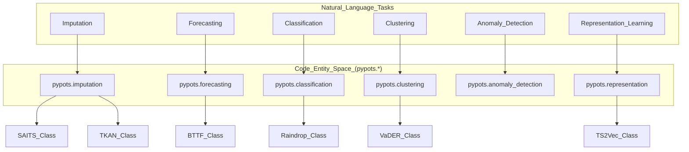
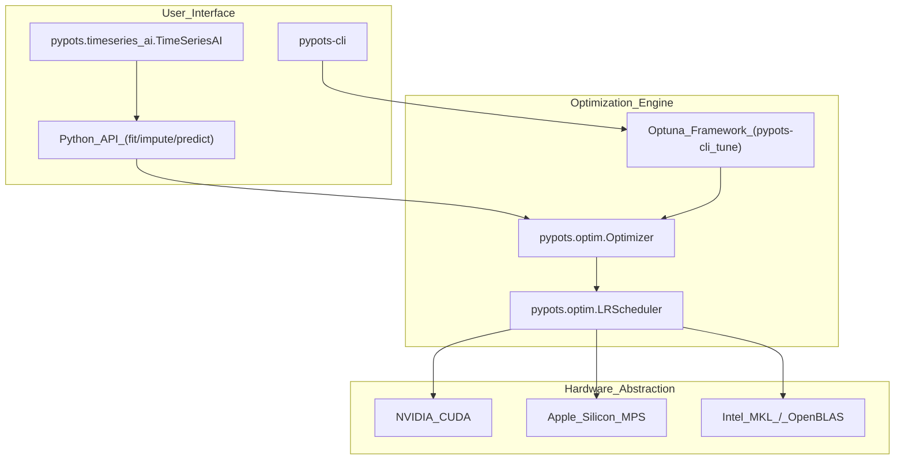

<!-- source: DeepWiki mcp.deepwiki.com · repo WenjieDu/PyPOTS · page 1 PyPOTS Overview · fetched 2026-10-21 -->

# PyPOTS Overview

Relevant source files

The following files were used as context for generating this wiki page:

- [README.md](README.md)
- [README_zh.md](README_zh.md)
- [docs/algo_table.rst](docs/algo_table.rst)
- [docs/faq.rst](docs/faq.rst)
- [docs/index.rst](docs/index.rst)
- [docs/install.rst](docs/install.rst)
- [docs/milestones.rst](docs/milestones.rst)
- [docs/model_api.rst](docs/model_api.rst)
- [docs/pypots.anomaly_detection.rst](docs/pypots.anomaly_detection.rst)
- [docs/pypots.classification.rst](docs/pypots.classification.rst)
- [docs/pypots.clustering.rst](docs/pypots.clustering.rst)
- [docs/pypots.data.rst](docs/pypots.data.rst)
- [docs/pypots.forecasting.rst](docs/pypots.forecasting.rst)
- [docs/pypots.imputation.rst](docs/pypots.imputation.rst)
- [docs/pypots.nn.rst](docs/pypots.nn.rst)
- [docs/pypots.rst](docs/pypots.rst)
- [docs/pypots.utils.rst](docs/pypots.utils.rst)
- [docs/references.bib](docs/references.bib)
- [pypots/__init__.py](pypots/__init__.py)
- [pypots/clustering/__init__.py](pypots/clustering/__init__.py)
- [pypots/nn/modules/__init__.py](pypots/nn/modules/__init__.py)
- [pypots/utils/__init__.py](pypots/utils/__init__.py)
- [pypots/version.py](pypots/version.py)
- [requirements/conda_dev_env.yml](requirements/conda_dev_env.yml)
- [requirements/conda_env.yml](requirements/conda_env.yml)
- [requirements/requirements.txt](requirements/requirements.txt)
- [requirements/requirements_dev.txt](requirements/requirements_dev.txt)

PyPOTS (pronounced **"Pie Pots"**) is a comprehensive Python toolbox designed for machine learning on **Partially-Observed Time Series (POTS)**. In real-world scenarios, time-series data often suffer from missing values due to sensor failures, communication errors, or malfunctions [README.md:68-72](). PyPOTS fills the gap in the data mining ecosystem by providing a unified framework for imputation, forecasting, classification, clustering, and anomaly detection specifically tailored for incomplete multivariate time series [README.md:74-80]().

### Mission and Core Philosophy
The mission of PyPOTS is to make machine learning on POTS easy rather than tedious. It allows researchers and engineers to focus on core modeling problems by providing standardized APIs and state-of-the-art (SOTA) algorithms [README.md:74-79](). 

A key feature of the library is the adaptation of standard neural architectures (like Transformers) to POTS data. Models not originally designed for missing data (marked with `🧑‍🔧` in the documentation) are integrated using the **Observed Reconstruction Task (ORT)** and **Masked Imputation Task (MIT)** strategy introduced in the SAITS paper [README.md:104-108]().

---

## The PyPOTS Ecosystem: The "Coffee Universe"

PyPOTS is part of a broader ecosystem designed to handle the entire lifecycle of time-series analysis, from data simulation to benchmarking.

| Project | Role | Integration Point |
| :--- | :--- | :--- |
| **TSDB** | Time-Series Data Beans | Dataset loading and preprocessing [README.md:129-131]() |
| **PyGrinder** | Missing value simulation | Creating MCAR/MAR/MNAR patterns [README.md:129-131]() |
| **BenchPOTS** | Benchmarking | Standardized evaluation of POTS models [README.md:129-131]() |
| **BrewPOTS** | Tutorials | Interactive examples and usage guides [README.md:78-79]() |

For a deep dive into these related projects, see **[Ecosystem & Related Projects](#1.2)**.

**Sources:** [README.md:129-131](), [docs/index.rst:100-103]()

---

## Supported Tasks & Model Catalog

PyPOTS organizes its functionality into specialized task modules, all accessible via the top-level package `pypots`. Submodules are lazy-loaded to ensure fast imports [pypots/__init__.py:1-7, 14-26]().

### Functional Architecture
The following diagram illustrates how the high-level task modules relate to the underlying code entities and specific implementation classes.

**Diagram 1: Task to Code Mapping**

**Sources:** [pypots/__init__.py:14-39](), [README.md:90-117](), [docs/pypots.imputation.rst:1-150](), [docs/pypots.anomaly_detection.rst:1-12]()

### Model Summary Table
PyPOTS includes a vast library of models, ranging from classical statistical methods to modern Foundation Models (TSFMs) and LLM-based approaches [README.md:113-121]().

| Task | Key Models |
| :--- | :--- |
| **Imputation** | SAITS, Transformer, CSDI, USGAN, TimesNet, iTransformer, TKAN, TOTEM, TSLANet, HELIX [docs/pypots.imputation.rst]() |
| **Forecasting** | BTTF, TimeMixer, DLinear, PatchTST, MICN, TimeLLM, GPT4TS, MOMENT, MixLinear [docs/pypots.forecasting.rst]() |
| **Classification** | BRITS, GRUD, Raindrop, SeFT, CSAI, TEFN [docs/pypots.classification.rst]() |
| **Clustering** | CRLI, VaDER [pypots/clustering/__init__.py:1-40](), [docs/pypots.clustering.rst]() |
| **Anomaly Detection** | Reconstruction-based: Autoformer, TimesNet, DLinear, iTransformer, SAITS, SegRNN [docs/pypots.anomaly_detection.rst]() |

---

## System Integration & Optimization

PyPOTS is built on PyTorch and supports extensive hardware acceleration and hyperparameter optimization via the `pypots.optim` and `pypots-cli` components.

**Diagram 2: System Stack & Optimization Flow**

**Sources:** [README.md:98-103](), [pypots/__init__.py:14-54](), [pypots/version.py:22]()

### Key Technical Features
*   **Hyperparameter Optimization (HPO):** Since v2.0, the functionality is implemented with the **Optuna** framework via `pypots-cli tune` [README.md:98-103]().
*   **Hardware Acceleration:** Supports CUDA for NVIDIA GPUs, MPS for Apple Silicon, and MKL/OpenBLAS for Intel/AMD CPUs [docs/install.rst:69-90]().
*   **LLM & TSFM Support:** Advanced support for adapting frozen LLMs (e.g., GPT-2, LLaMA via `GPT4TS` or `TimeLLM`) and Foundation Models (e.g. `MOMENT`) [docs/pypots.imputation.rst:49-76](), [docs/pypots.forecasting.rst:22-48]().
*   **TimeSeriesAI:** An emerging integration point for the Time-Series.AI platform [pypots/__init__.py:50-54]().

For detailed setup instructions, see **[Getting Started: Installation & Configuration](#1.1)**.

---

## Navigating the Wiki

This wiki is structured to take you from a novice user to a contributor:

1.  **[Getting Started: Installation & Configuration](#1.1)**: Install the library and configure your environment for your specific hardware.
2.  **[Ecosystem & Related Projects](#1.2)**: Understand how to use TSDB for data and PyGrinder for simulating missingness.
3.  **Core Architecture**: (Section 2) Learn about the base class hierarchy, data pipelines, and the `pypots.nn` module structure.
4.  **Task Modules**: (Section 3) Deep dives into specific algorithms for Imputation, Forecasting, Classification, Clustering, and Anomaly Detection.
5.  **Evaluation & Metrics**: (Section 4) How to measure model performance and use visualization utilities.
6.  **CLI & Workflow Tools**: (Section 5) Automating experiments with `pypots-cli` and the Optuna-based tuning system.
7.  **Testing & CI/CD**: (Section 6) Overview of the quality assurance process and build pipelines.

**Sources:** [README.md:81-88](), [docs/index.rst:105-112](), [pypots/__init__.py:14-26]()

---

