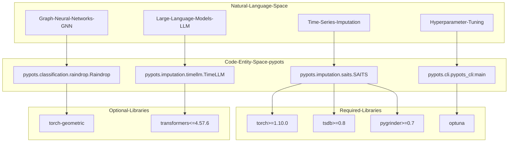
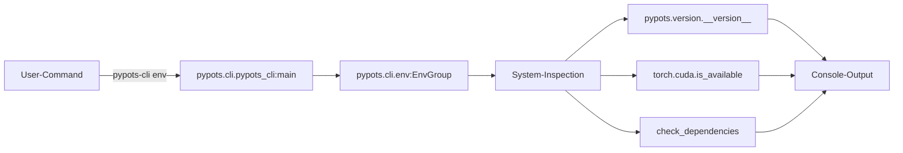

<!-- source: DeepWiki mcp.deepwiki.com · repo WenjieDu/PyPOTS · page 1.1 Getting Started: Installation & Configuration · fetched 2026-10-21 -->

# Getting Started: Installation & Configuration

<details>
<summary>Relevant source files</summary>

The following files were used as context for generating this wiki page:

- [.pre-commit-config.yaml](.pre-commit-config.yaml)
- [README.md](README.md)
- [README_zh.md](README_zh.md)
- [docs/algo_table.rst](docs/algo_table.rst)
- [docs/faq.rst](docs/faq.rst)
- [docs/index.rst](docs/index.rst)
- [docs/install.rst](docs/install.rst)
- [docs/milestones.rst](docs/milestones.rst)
- [docs/model_api.rst](docs/model_api.rst)
- [docs/pypots.anomaly_detection.rst](docs/pypots.anomaly_detection.rst)
- [docs/pypots.classification.rst](docs/pypots.classification.rst)
- [docs/pypots.clustering.rst](docs/pypots.clustering.rst)
- [docs/pypots.data.rst](docs/pypots.data.rst)
- [docs/pypots.forecasting.rst](docs/pypots.forecasting.rst)
- [docs/pypots.imputation.rst](docs/pypots.imputation.rst)
- [docs/pypots.nn.rst](docs/pypots.nn.rst)
- [docs/pypots.rst](docs/pypots.rst)
- [docs/pypots.utils.rst](docs/pypots.utils.rst)
- [docs/references.bib](docs/references.bib)
- [pypots/nn/modules/__init__.py](pypots/nn/modules/__init__.py)
- [pyproject.toml](pyproject.toml)
- [requirements/conda_dev_env.yml](requirements/conda_dev_env.yml)
- [requirements/conda_env.yml](requirements/conda_env.yml)
- [requirements/requirements.txt](requirements/requirements.txt)
- [requirements/requirements_dev.txt](requirements/requirements_dev.txt)

</details>


This page provides a technical guide for setting up the PyPOTS environment. PyPOTS is designed to handle **Partially-Observed Time Series (POTS)** and requires a specific stack of dependencies to support its neural network models, optimization routines, and data processing pipelines [docs/install.rst:1-4]().

## Installation Methods

PyPOTS can be installed via standard Python package managers or isolated containers.

### 1. Via pip
The simplest method to install the stable version from PyPI:
```bash
pip install pypots            # the first time installation
pip install pypots --upgrade  # update pypots to the latest version
```
To access the latest features (development branch):
```bash
pip install https://github.com/WenjieDu/PyPOTS/archive/main.zip
```
[docs/install.rst:10-14]()

### 2. Via Conda
PyPOTS is available on the `conda-forge` channel. The project provides `conda_env.yml` for environment reproducibility [requirements/conda_env.yml:1-28]().
```bash
conda install conda-forge::pypots  # the first time installation
conda update  conda-forge::pypots  # update pypots to the latest version
```
[docs/install.rst:16-18]() [requirements/conda_env.yml:3-5]()

### 3. Via Docker
Official images are maintained on DockerHub. Users can pull the pre-configured environment to avoid dependency conflicts [docs/install.rst:20-21]().
```bash
docker run -it --name pypots wenjiedu/pypots  # docker will auto pull our built image and run a instance for you
```
[docs/install.rst:20-21]()

Sources: [docs/install.rst:1-25](), [requirements/conda_env.yml:1-28]()

---

## Hardware-Specific Optimizations

PyPOTS leverages PyTorch for neural network operations and can be accelerated across various hardware backends.

### GPU Acceleration (NVIDIA CUDA)
PyPOTS supports CUDA-enabled GPUs for training and inference [docs/install.rst:71-74]().
*   **Activation**: Set the `device` argument to `"cuda"` during model initialization.
*   **Automatic Detection**: If `device` is not specified, PyPOTS automatically detects and uses the default CUDA device if available [docs/install.rst:75-77]().

### CPU & Apple Silicon Acceleration
For non-CUDA environments, performance can be improved by using optimized BLAS/MKL libraries via Conda:

| Platform | Recommended Optimization Command |
| :--- | :--- |
| **Apple Silicon** | `conda install numpy scipy scikit-learn numexpr "libblas=*=*accelerate"` |
| **Intel CPUs** | `conda install numpy scipy scikit-learn numexpr "libblas=*=*mkl"` |
| **AMD CPUs** | | `conda install -c conda-forge numpy scipy scikit-learn numexpr "libblas=*=*openblas"` |

[docs/install.rst:78-90]()

Sources: [docs/install.rst:71-90]()

---

## Dependency Management & Versioning

PyPOTS enforces specific version constraints to ensure compatibility across its ecosystem (TSDB, PyGrinder, BenchPOTS).

### Core Dependencies
*   **Python >= 3.8**: Required because Python 3.7 reached end-of-life in 2023 and to maintain compatibility with `torch-geometric` [docs/install.rst:57-64](). 
*   **PyTorch >= 1.10.0**: Necessary for compatibility with `pytorch_sparse` [docs/install.rst:65-68]().
*   **Data Ecosystem**: Requires `tsdb >= 0.8`, `pygrinder >= 0.7`, and `benchpots >= 1` [requirements/requirements.txt:15-17]().
*   **CLI & HPO**: Requires `click` for the command-line interface and `optuna` for hyperparameter optimization [requirements/requirements.txt:1, 4]().

### Optional Dependencies (Task-Specific)
Certain models require additional libraries that are not installed by default:
*   **GNN Models** (e.g., `Raindrop`): Requires `torch-geometric`, `torch-scatter`, and `torch-sparse` [docs/install.rst:48-52]().
*   **LLM Models** (e.g., `TimeLLM`, `GPT4TS`): Requires `transformers <= 4.57.6` [requirements/requirements.txt:13]().

### Dependency Flow Diagram
The following diagram illustrates how PyPOTS components relate to external dependencies and task-specific requirements.

**Title: PyPOTS Dependency and Entity Mapping**

Sources: [docs/install.rst:27-52](), [requirements/requirements.txt:1-18](), [docs/pypots.imputation.rst:4-7](), [docs/pypots.classification.rst:94-97]()

---

## Environment Verification

To verify the installation and check the current hardware environment, PyPOTS provides the `pypots-cli` tool.

**Title: CLI Environment Initialization Flow**

Sources: [requirements/requirements.txt:1](), [docs/install.rst:71-77](), [README.md:98-102]()

### Version Pinning Rationale
PyPOTS strictly pins certain dependencies to maintain stability:
*   **`numpy < 2.0`**: Prevents breaking changes in tensor math operations [requirements/conda_env.yml:13]().
*   **`torch >= 1.10.0`**: Specifically required due to `pytorch_sparse` compatibility issues in earlier versions [docs/install.rst:65-68]().
*   **`transformers <= 4.57.6`**: Version limited to ensure compatibility with LLM-based time-series models [requirements/requirements.txt:13]().
*   **`tsdb >= 0.8` & `benchpots >= 1`**: Ensures support for the latest data loading and benchmarking protocols [requirements/requirements.txt:15, 17]().

Sources:
- [docs/install.rst:1-90]()
- [requirements/conda_env.yml:1-28]()
- [requirements/requirements.txt:1-18]()
- [README.md:68-80]()

---

