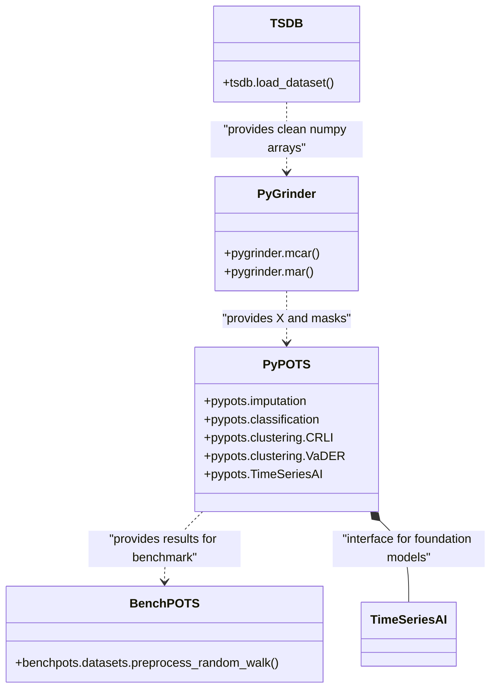

<!-- source: DeepWiki mcp.deepwiki.com · repo WenjieDu/PyPOTS · page 1.2 Ecosystem & Related Projects · fetched 2026-10-21 -->

# Ecosystem & Related Projects

<details>
<summary>Relevant source files</summary>

The following files were used as context for generating this wiki page:

- [README.md](README.md)
- [README_zh.md](README_zh.md)
- [docs/index.rst](docs/index.rst)
- [docs/model_api.rst](docs/model_api.rst)
- [docs/pypots.anomaly_detection.rst](docs/pypots.anomaly_detection.rst)
- [docs/pypots.classification.rst](docs/pypots.classification.rst)
- [docs/pypots.clustering.rst](docs/pypots.clustering.rst)
- [docs/pypots.data.rst](docs/pypots.data.rst)
- [docs/pypots.forecasting.rst](docs/pypots.forecasting.rst)
- [docs/pypots.imputation.rst](docs/pypots.imputation.rst)
- [docs/pypots.rst](docs/pypots.rst)
- [docs/pypots.utils.rst](docs/pypots.utils.rst)
- [docs/references.bib](docs/references.bib)
- [examples/anomaly_detection/crossformer_anomalydetection_example.py](examples/anomaly_detection/crossformer_anomalydetection_example.py)
- [examples/anomaly_detection/etsformer_anomalydetection_example.py](examples/anomaly_detection/etsformer_anomalydetection_example.py)
- [examples/anomaly_detection/fedformer_anomalydetection_example.py](examples/anomaly_detection/fedformer_anomalydetection_example.py)
- [examples/anomaly_detection/film_anomalydetection_example.py](examples/anomaly_detection/film_anomalydetection_example.py)
- [examples/anomaly_detection/informer_anomalydetection_example.py](examples/anomaly_detection/informer_anomalydetection_example.py)
- [examples/anomaly_detection/itransformer_anomalydetection_example.py](examples/anomaly_detection/itransformer_anomalydetection_example.py)
- [examples/anomaly_detection/nonstationary_transformer_anomalydetection_example.py](examples/anomaly_detection/nonstationary_transformer_anomalydetection_example.py)
- [examples/anomaly_detection/pyraformer_anomalydetection_example.py](examples/anomaly_detection/pyraformer_anomalydetection_example.py)
- [pypots/__init__.py](pypots/__init__.py)
- [pypots/clustering/__init__.py](pypots/clustering/__init__.py)
- [pypots/utils/__init__.py](pypots/utils/__init__.py)
- [pypots/version.py](pypots/version.py)

</details>


The PyPOTS ecosystem, often referred to as the "coffee universe," consists of several specialized libraries designed to streamline the lifecycle of machine learning on Partially-Observed Time Series (POTS). While the core PyPOTS library focuses on model implementation and training, its related projects handle data acquisition, missingness simulation, benchmarking, and educational tutorials.

### The Coffee Universe Architecture

The integration of these projects creates a unified pipeline from raw data to benchmarked results. The following diagram illustrates the data flow between the core entities, moving from the "Natural Language Space" of project names to the "Code Entity Space" of packages and classes.

**Diagram: PyPOTS Ecosystem Data Flow & Entity Mapping**
```mermaid
graph TD
    subgraph "External_World" ["External World"]
        "RawDatasets"["Raw Datasets (PhysioNet, UCI, etc.)"]
    end

    subgraph "Data_Preparation_Layer" ["Data Preparation Layer"]
        "TSDB"["TSDB (Dataset Loading)"]
        "PyGrinder"["PyGrinder (Missingness Simulation)"]
    end

    subgraph "Core_Modeling_Layer" ["Core Modeling Layer"]
        "PyPOTS"["PyPOTS Core Library"]
        "Time_Series_AI"["Time-Series.AI (Cloud/LLM Service)"]
    end

    subgraph "Evaluation_Learning_Layer" ["Evaluation & Learning Layer"]
        "BenchPOTS"["BenchPOTS (Benchmarking)"]
        "BrewPOTS"["BrewPOTS (Tutorials)"]
    end

    "RawDatasets" --> "TSDB"
    "TSDB" -- "Clean Data" --> "PyGrinder"
    "PyGrinder" -- "POTS Data (X, Mask)" --> "PyPOTS"
    "PyPOTS" -- "Results/Metrics" --> "BenchPOTS"
    "BrewPOTS" -- "Usage Patterns" --> "PyPOTS"
    "Time_Series_AI" -.-> "PyPOTS"

    %% Code Entity Mapping
    "TSDB" -.-> "tsdb_package"["package: tsdb"]
    "PyGrinder" -.-> "pygrinder_package"["package: pygrinder"]
    "PyPOTS" -.-> "pypots_package"["package: pypots"]
    "Time_Series_AI" -.-> "tsai_client"["pypots.TimeSeriesAI"]
```
**Sources:** [pypots/__init__.py:14-26](), [pypots/__init__.py:50-54](), [README.md:82-88](), [README_zh.md:115-115]()

---

### TSDB: Time-Series Data Beans
**TSDB** (`tsdb`) is the data-loading engine of the ecosystem. It simplifies the process of downloading and preprocessing public time-series datasets into formats compatible with PyPOTS.

*   **Role**: Acts as a repository for "data beans."
*   **Integration**: PyPOTS utilizes TSDB to fetch datasets for testing and benchmarking. It is often used to provide the source data for the `pypots.data` pipeline [[pypots/__init__.py:37-37]()].
*   **Key Functionality**: Provides standardized loaders for datasets, ensuring data is ready for modeling tasks like imputation and classification [[README.md:110-117]()].

**Sources:** [pypots/__init__.py:37-37](), [README.md:110-117]()

---

### PyGrinder: Data Munging & Missingness Simulation
**PyGrinder** (`pygrinder`) is responsible for "grinding" clean datasets into partially-observed ones. It is essential for evaluating imputation and classification models where ground truth is required for missing values.

*   **Missingness Mechanisms**: Implements simulation for MCAR (Missing Completely At Random), MAR (Missing At Random), and MNAR (Missing Not At Random).
*   **Data Flow**: It takes complete arrays and returns data corrupted with missing values. This simulation is a prerequisite for the training strategies used in various PyPOTS models, particularly those using the **ORT (Observed Reconstruction Task)** and **MIT (Missing Information Task)** approaches [[README.md:104-108]()].

**Sources:** [README.md:104-108](), [README_zh.md:99-102]()

---

### BenchPOTS: The Benchmarking Standard
**BenchPOTS** (`benchpots`) provides a standardized framework for evaluating POTS algorithms across various tasks (Imputation, Classification, Forecasting, Anomaly Detection, etc.) to ensure fair comparison.

*   **Implementation**: It is used extensively for data generation in PyPOTS examples and tests. Specifically, the `preprocess_random_walk` function is a standard way to create synthetic datasets for minimalist examples [[examples/anomaly_detection/fedformer_anomalydetection_example.py:6-6]()].
*   **Research Integration**: PyPOTS utilizes BenchPOTS to ensure that performance metrics are calculated over consistent data splits, supporting the academic rigor of the toolbox [[README.md:63-65]()].

**Sources:** [examples/anomaly_detection/fedformer_anomalydetection_example.py:6-6](), [README.md:63-65]()

---

### BrewPOTS: Interactive Tutorials
**BrewPOTS** serves as the educational arm, providing Jupyter notebooks and interactive examples.

*   **Purpose**: Demonstrates how to "brew" a solution using the toolbox.
*   **Auto-generated Examples**: PyPOTS includes a suite of standalone examples in the `examples/` directory. These scripts demonstrate how to initialize, train, and evaluate models using `benchpots` for data generation.
    *   **Usage**: To run an example, execute the script directly, e.g., `python examples/anomaly_detection/fedformer_anomalydetection_example.py` [[examples/anomaly_detection/fedformer_anomalydetection_example.py:1-56]()].
    *   **Coverage**: Examples cover tasks such as Anomaly Detection with models like FEDformer [[examples/anomaly_detection/fedformer_anomalydetection_example.py:1-56]()][examples/anomaly_detection/fedformer_anomalydetection_example.py:1-56]() and iTransformer [[examples/anomaly_detection/itransformer_anomalydetection_example.py:1-54]()].

**Sources:** [examples/anomaly_detection/fedformer_anomalydetection_example.py:1-56](), [examples/anomaly_detection/itransformer_anomalydetection_example.py:1-54]()

---

### Time-Series.AI: TSFM & LLM Integration
**Time-Series.AI** provides advanced Large Language Model (LLM) and Time-Series Foundation Model (TSFM) capabilities, serving as an emerging integration point for PyPOTS.

*   **Integration**: Accessed via the `pypots.TimeSeriesAI` class [[pypots/__init__.py:50-54]()].
*   **Lazy Loading**: The `TimeSeriesAI` client is lazy-loaded on first access to keep the initial `import pypots` fast and lightweight [[pypots/__init__.py:4-7]()].
*   **Task Support**: Extends PyPOTS capabilities to state-of-the-art foundation models, supporting core tasks like `IMPT`, `FCST`, `CLAF`, `CLUS`, and `ANOD` through a unified client interface [[README_zh.md:115-115]()].

**Sources:** [pypots/__init__.py:4-7](), [pypots/__init__.py:50-54](), [README_zh.md:115-115]()

---

### Integration and Dependency Management

The ecosystem is designed for modularity but maintains tight versioning to ensure compatibility across the different "beans" and "pots."

| Project | Code Entity / Package | Primary Purpose | Supported Tasks |
| :--- | :--- | :--- | :--- |
| **PyPOTS** | `pypots` | Core algorithms and training logic | IMPT, FCST, CLAF, CLUS, ANOD [[pypots/__init__.py:14-26]()] |
| **TSDB** | `tsdb` | Dataset collection and preprocessing | Data Loading [[pypots/__init__.py:37-37]()] |
| **PyGrinder** | `pygrinder` | Missingness simulation | Data Augmentation [[README.md:104-108]()] |
| **BenchPOTS** | `benchpots` | Reproducible benchmarking | Evaluation & Testing [[examples/anomaly_detection/fedformer_anomalydetection_example.py:6-6]()] |
| **Time-Series.AI**| `pypots.TimeSeriesAI` | LLM-based foundation models | TSFM Integration [[pypots/__init__.py:50]()] |

**Diagram: Code Entity Association**


**Sources:** [pypots/__init__.py:14-56](), [pypots/clustering/__init__.py:8-14](), [README.md:110-117](), [examples/anomaly_detection/fedformer_anomalydetection_example.py:6-6]()

---

