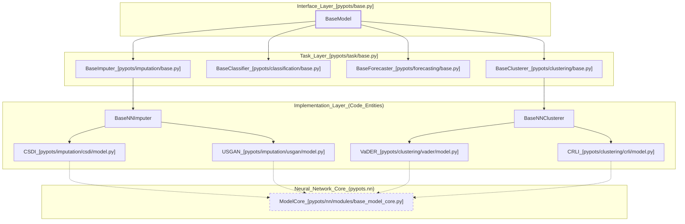
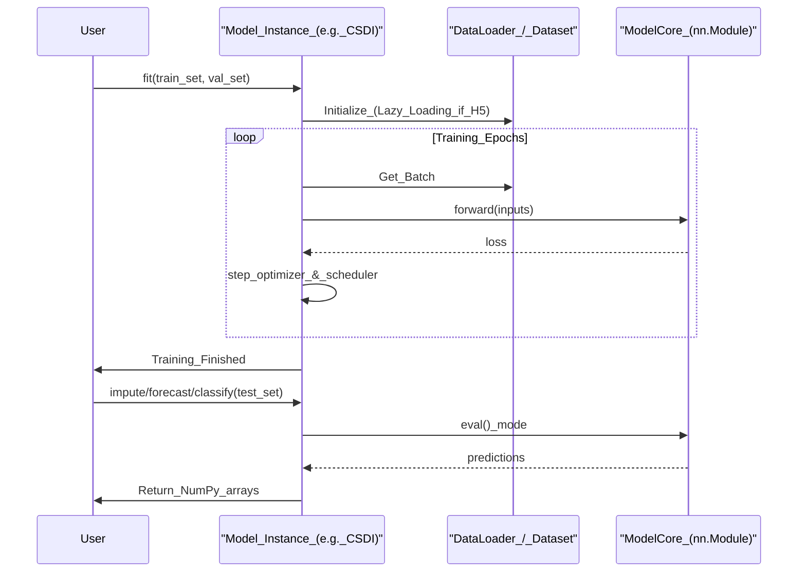

<!-- source: DeepWiki mcp.deepwiki.com · repo WenjieDu/PyPOTS · page 2 Core Architecture · fetched 2026-10-21 -->

# Core Architecture

Relevant source files

The following files were used as context for generating this wiki page:

- [pypots/__init__.py](pypots/__init__.py)
- [pypots/base.py](pypots/base.py)
- [pypots/classification/base.py](pypots/classification/base.py)
- [pypots/clustering/__init__.py](pypots/clustering/__init__.py)
- [pypots/clustering/base.py](pypots/clustering/base.py)
- [pypots/clustering/crli/model.py](pypots/clustering/crli/model.py)
- [pypots/clustering/vader/model.py](pypots/clustering/vader/model.py)
- [pypots/forecasting/base.py](pypots/forecasting/base.py)
- [pypots/imputation/base.py](pypots/imputation/base.py)
- [pypots/imputation/csdi/model.py](pypots/imputation/csdi/model.py)
- [pypots/imputation/gpvae/model.py](pypots/imputation/gpvae/model.py)
- [pypots/imputation/usgan/model.py](pypots/imputation/usgan/model.py)
- [pypots/utils/__init__.py](pypots/utils/__init__.py)
- [pypots/version.py](pypots/version.py)

PyPOTS is designed with a layered, object-oriented architecture that abstracts the complexities of time-series modeling while providing a consistent interface across different tasks like imputation, forecasting, classification, clustering, and representation learning. The system follows a clear separation of concerns between high-level model management and low-level neural network operations.

### High-Level Layered Design

The architecture is divided into three primary layers:
1.  **Interface Layer (`BaseModel`)**: Manages the model lifecycle, including device placement (CPU/GPU), logging, and persistence [pypots/base.py:38-93]().
2.  **Task Layer (e.g., `BaseImputer`, `BaseClassifier`)**: Defines task-specific APIs such as `impute()`, `forecast()`, or `classify()` [pypots/imputation/base.py:21-52](), [pypots/classification/base.py:21-51](), [pypots/forecasting/base.py:22-53](), [pypots/clustering/base.py:18-48]().
3.  **Neural Network Layer (`BaseNNModel` & `ModelCore`)**: Orchestrates the PyTorch training loop, validation, early stopping, and automatic mixed precision (AMP) [pypots/base.py:107-108]().

### Code Entity Relationship Diagram

The following diagram illustrates how the core base classes relate to specific model implementations and the underlying PyTorch modules.

**Model Class Hierarchy and Execution Flow**

**Sources:** [pypots/base.py:38-176](), [pypots/imputation/base.py:21-165](), [pypots/classification/base.py:21-168](), [pypots/clustering/base.py:18-159](), [pypots/forecasting/base.py:22-165]().

---

### Base Class Hierarchy

The foundation of PyPOTS is a hierarchical inheritance structure that ensures all models behave predictably.

*   **`BaseModel`**: The root abstract class. It handles device management via `_setup_device` [pypots/base.py:122-163](), directory creation for saving results via `_setup_path` [pypots/base.py:120](), and verbosity settings [pypots/base.py:110-111]().
*   **`BaseNNModel`**: Extends `BaseModel` for neural networks. It introduces the `fit()` and `predict()` orchestration, manages the `Optimizer` and `LRScheduler` wrappers, and implements the training loop with optional early stopping.
*   **Task-Specific Base Classes**: These classes bridge the gap between generic NN training and specific time-series tasks. For example, `BaseNNImputer` provides the `impute()` method as a wrapper around `predict()` to return raw NumPy arrays [pypots/imputation/base.py:133-162](). Similarly, `BaseNNForecaster` provides `forecast()` [pypots/forecasting/base.py:134-162]() and `BaseNNClassifier` provides `classify()` and `predict_proba()` [pypots/classification/base.py:137-190]().

For details, see [Base Class Hierarchy](#2.1).

---

### Model Lifecycle (Fit / Predict / Save)

PyPOTS models follow a unified lifecycle pattern, regardless of whether they are GANs, Diffusions, or Transformers.

**Standard Model Lifecycle**

1.  **Initialization**: Models are initialized with hyperparameters and a `device`. During initialization, the `ModelCore` (e.g., `_CSDI` or `_VaDER`) is instantiated and sent to the specified device [pypots/imputation/csdi/model.py:159-174](), [pypots/clustering/vader/model.py:130-131]().
2.  **Fitting**: The `fit()` method accepts dictionaries or file paths. If a path is provided, PyPOTS uses lazy loading to handle datasets larger than memory [pypots/imputation/base.py:71-101](). Fitting involves an internal `_train_model` call which executes the epoch loop [pypots/clustering/vader/model.py:159-163]().
3.  **Persistence**: Models support saving and loading. The `model_saving_strategy` parameter allows users to save the "best" model based on validation performance, "better" models during training, or "all" checkpoints [pypots/base.py:59-66](). PyPOTS uses a custom loader `_load_model_file` to handle weight-only restrictions in newer PyTorch versions by manually setting `weights_only=False` to load supplementary PyPOTS metadata [pypots/base.py:29-35]().

---

### Device & Resource Management

PyPOTS provides robust support for modern hardware acceleration:
*   **Device Flexibility**: Supports `cpu`, `cuda`, and multi-GPU setups via `DataParallel` [pypots/base.py:122-163]().
*   **Automatic Mixed Precision (AMP)**: Enabled via `enable_amp=True` to reduce memory footprint and speed up training on compatible GPUs [pypots/base.py:51-54]().
*   **Parallel Training**: If a list of devices is provided (e.g. `['cuda:0', 'cuda:1']`), the model is automatically wrapped in `torch.nn.DataParallel` [pypots/base.py:143-163]().

**Sources:** [pypots/base.py:122-176](), [pypots/base.py:51-54]().

---

### Data Pipeline & Optimization

The architecture integrates tightly with a specialized data pipeline and optimization wrapper system:

*   **Data Pipeline**: Uses task-specific datasets (e.g. `DatasetForCSDI`, `DatasetForVaDER`) to handle missing values, masks (`missing_mask`, `indicating_mask`), and time-series specific features like `deltas` [pypots/imputation/csdi/model.py:184-198](), [pypots/imputation/usgan/model.py:172-195](). For details, see [Data Pipeline & Dataset Abstractions](#2.2).
*   **Optimization**: Instead of passing raw PyTorch optimizers, PyPOTS uses a wrapper system (`pypots.optim`) that allows for a two-stage initialization: parameter-independent config followed by parameter-binding via `init_optimizer()` [pypots/clustering/vader/model.py:135-140](), [pypots/imputation/csdi/model.py:177-182](). This is particularly useful for complex models like `USGAN` or `CRLI` which require multiple optimizers for Generators and Discriminators [pypots/imputation/usgan/model.py:154-170](), [pypots/clustering/crli/model.py:167-191](). For details, see [Optimization & Learning Rate Scheduling](#2.3).
*   **Neural Modules**: Shared components like Attention, backbones (Transformer, TimesNet), and various loss functions are centralized in `pypots.nn`. For details, see [Neural Network Modules (pypots.nn)](#2.4).

**Sources:** [pypots/imputation/usgan/model.py:172-195](), [pypots/clustering/vader/model.py:135-140](), [pypots/imputation/csdi/model.py:177-182](), [pypots/clustering/crli/model.py:167-191]().

---

