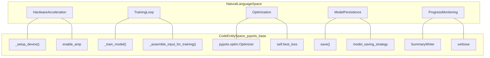
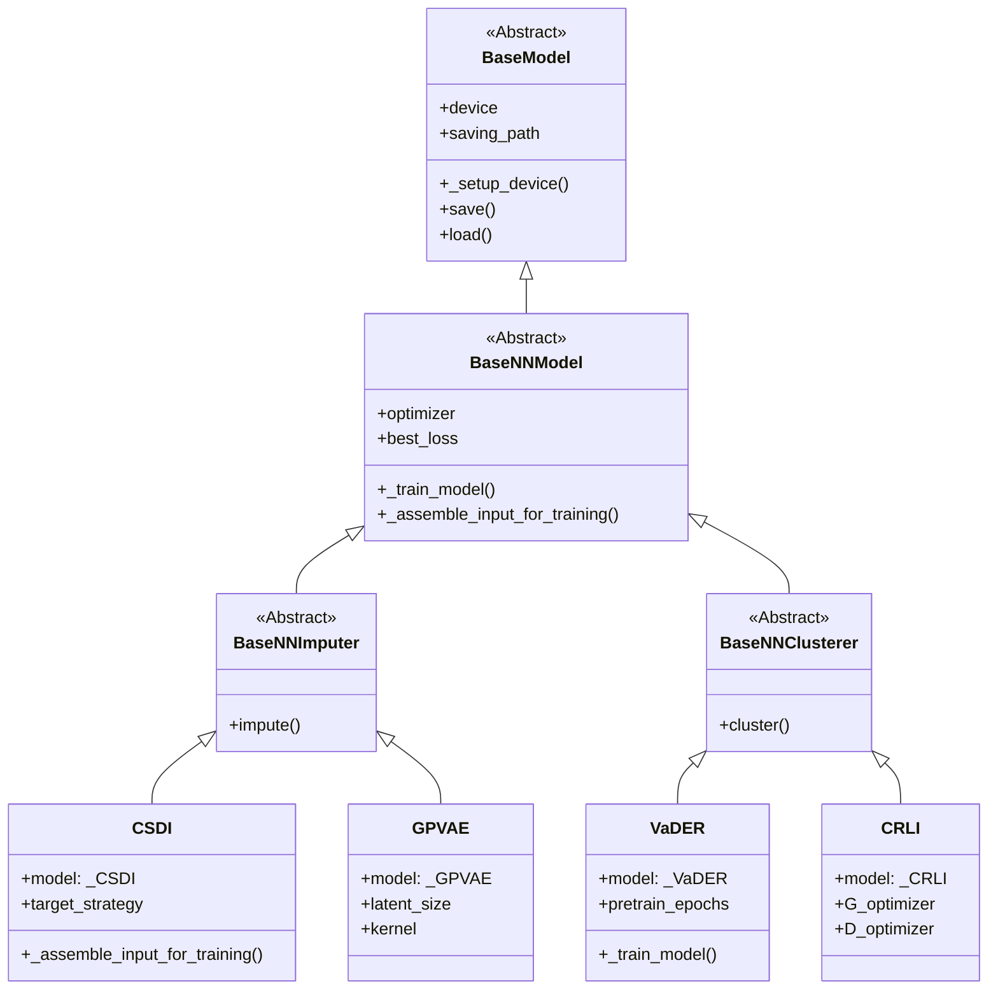

<!-- source: DeepWiki mcp.deepwiki.com · repo WenjieDu/PyPOTS · page 2.1 Base Class Hierarchy · fetched 2026-10-21 -->

# Base Class Hierarchy

Relevant source files

The following files were used as context for generating this wiki page:

- [pypots/base.py](pypots/base.py)
- [pypots/classification/base.py](pypots/classification/base.py)
- [pypots/classification/brits/model.py](pypots/classification/brits/model.py)
- [pypots/classification/grud/model.py](pypots/classification/grud/model.py)
- [pypots/classification/raindrop/model.py](pypots/classification/raindrop/model.py)
- [pypots/classification/template/model.py](pypots/classification/template/model.py)
- [pypots/clustering/base.py](pypots/clustering/base.py)
- [pypots/clustering/crli/model.py](pypots/clustering/crli/model.py)
- [pypots/clustering/template/model.py](pypots/clustering/template/model.py)
- [pypots/clustering/vader/model.py](pypots/clustering/vader/model.py)
- [pypots/forecasting/base.py](pypots/forecasting/base.py)
- [pypots/forecasting/template/model.py](pypots/forecasting/template/model.py)
- [pypots/imputation/base.py](pypots/imputation/base.py)
- [pypots/imputation/brits/model.py](pypots/imputation/brits/model.py)
- [pypots/imputation/csdi/model.py](pypots/imputation/csdi/model.py)
- [pypots/imputation/gpvae/model.py](pypots/imputation/gpvae/model.py)
- [pypots/imputation/mrnn/model.py](pypots/imputation/mrnn/model.py)
- [pypots/imputation/saits/model.py](pypots/imputation/saits/model.py)
- [pypots/imputation/template/model.py](pypots/imputation/template/model.py)
- [pypots/imputation/transformer/model.py](pypots/imputation/transformer/model.py)
- [pypots/imputation/usgan/model.py](pypots/imputation/usgan/model.py)

The PyPOTS framework is built upon a structured hierarchy of abstract base classes designed to standardize the lifecycle of machine learning models for time-series analysis. This hierarchy ensures consistency across different tasks—such as imputation, classification, forecasting, clustering, and anomaly detection—while providing built-in support for advanced features like Automatic Mixed Precision (AMP), multi-GPU training, and early stopping.

## 1. Top-Level Abstract Classes

The foundation of every model in PyPOTS consists of two primary base classes: `BaseModel` and `BaseNNModel`.

### BaseModel
`BaseModel` is the root abstract class for all implementations [pypots/base.py:38](). It handles environment-level configurations including:
*   **Device Management**: Automatically detects CUDA or CPU availability if not specified [pypots/base.py:123-130](). It supports single strings, `torch.device` objects, or lists for parallel training [pypots/base.py:131-163]().
*   **Path Setup**: Initializes directories for saving checkpoints and TensorBoard logs via `SummaryWriter` [pypots/base.py:114-121]().
*   **Saving Strategies**: Implements logic for `None`, `"best"`, `"better"`, and `"all"` checkpointing strategies [pypots/base.py:94-97]().

### BaseNNModel
Inheriting from `BaseModel`, `BaseNNModel` provides the infrastructure specifically for neural network-based models [pypots/base.py:214](). It manages:
*   **Optimization**: Wraps `pypots.optim` objects and handles parameter initialization through `init_optimizer()` [pypots/base.py:269-275]().
*   **Training Loop**: Implements the standard `_train_model` method, which iterates through epochs, handles batch processing, and executes backpropagation [pypots/base.py:461-558]().
*   **Early Stopping**: Monitors validation performance and terminates training if no improvement is seen within the `patience` window [pypots/base.py:494-510]().
*   **Data Parallelism**: Automatically wraps the model core with `torch.nn.DataParallel` when multiple CUDA devices are provided [pypots/base.py:437-446]().

### Natural Language to Code Entity Mapping: Core Lifecycle
The following diagram maps high-level training concepts to the specific methods and attributes defined in the base classes.

**Core Lifecycle Method/Attribute Mapping**

**Sources:** [pypots/base.py:38-100](), [pypots/base.py:123-163](), [pypots/base.py:214-275](), [pypots/base.py:461-558]()

---

## 2. Task-Specific Base Classes

PyPOTS extends `BaseNNModel` into task-specific abstractions. These classes define the standard interface (e.g., `fit()`, `predict()`) that users interact with across different domains.

| Task | Base Class | Primary Interface Methods |
| :--- | :--- | :--- |
| **Imputation** | `BaseNNImputer` | `fit()`, `predict()`, `impute()` [pypots/imputation/base.py:165]() |
| **Classification** | `BaseNNClassifier` | `fit()`, `predict()`, `classify()`, `predict_proba()` [pypots/classification/base.py:214]() |
| **Forecasting** | `BaseNNForecaster` | `fit()`, `predict()`, `forecast()` [pypots/forecasting/base.py:165]() |
| **Clustering** | `BaseNNClusterer` | `fit()`, `predict()`, `cluster()` [pypots/clustering/base.py:159]() |

### Task-Specific Logic Examples
*   **Imputation**: The `impute()` method is a convenience wrapper around `predict()`, specifically returning the `imputation` key from the result dictionary [pypots/imputation/base.py:133-162]().
*   **Classification**: The `classify()` method handles the conversion of model logits into discrete class labels, while `predict_proba()` returns raw probabilities [pypots/classification/base.py:137-191]().
*   **Forecasting**: The `forecast()` method extracts the `forecasting` key, typically of shape `[n_samples, n_pred_steps, n_features]` [pypots/forecasting/base.py:134-162]().
*   **Clustering**: Models like `VaDER` implement a custom `_train_model` to handle Gaussian Mixture Model (GMM) pre-training phases [pypots/clustering/vader/model.py:159-224](). `CRLI` utilizes dual optimizers (`G_optimizer` and `D_optimizer`) to handle adversarial training [pypots/clustering/crli/model.py:167-185]().

**Sources:** [pypots/imputation/base.py:133-165](), [pypots/classification/base.py:137-214](), [pypots/forecasting/base.py:134-165](), [pypots/clustering/base.py:132-159](), [pypots/clustering/vader/model.py:159-224](), [pypots/clustering/crli/model.py:167-185]()

---

## 3. Training Infrastructure

### Automatic Mixed Precision (AMP)
PyPOTS utilizes `torch.cuda.amp` via a custom `autocast` wrapper [pypots/base.py:20](). When `enable_amp=True` is passed to the constructor, the training loop executes forward passes and loss calculations within the autocast context to reduce memory footprint and increase speed on compatible hardware [pypots/base.py:476-483]().

### Multi-GPU Support
If a list of devices is provided (e.g. `device=['cuda:0', 'cuda:1']`), the model is wrapped in `torch.nn.DataParallel` [pypots/base.py:437-446](). PyPOTS handles the necessary attribute redirection (e.g. accessing `self.model.module` for saved weights or optimizer initialization) automatically [pypots/base.py:447-450](). For example, `USGAN` and `CRLI` check if `self.device` is a list to correctly target parameters in the `module.backbone` [pypots/imputation/usgan/model.py:165-170](), [pypots/clustering/crli/model.py:178-185]().

### Early Stopping and Validation
The training loop evaluates the model on the `val_set` at the end of each epoch [pypots/base.py:485-492]().
1.  If the `validation_metric` improves, the `best_model_dict` is updated with a deep copy of the state [pypots/base.py:494-500]().
2.  If no improvement is seen for `patience` consecutive epochs, the loop breaks [pypots/base.py:504-510]().
3.  Upon completion, the best weights are restored to the model [pypots/base.py:521-522]().

### Model Saving Strategies
Checkpointing is governed by the `model_saving_strategy` attribute [pypots/base.py:59-66]():
| Strategy | Behavior |
| :--- | :--- |
| `None` | No checkpoints are saved to disk [pypots/base.py:61](). |
| `"best"` | Only the version with the lowest validation loss is saved at the end of training [pypots/base.py:62](). |
| `"better"` | Saves a new checkpoint whenever the validation metric improves during training [pypots/base.py:63](). |
| `"all"` | Saves a checkpoint after every single epoch [pypots/base.py:65](). |

**Sources:** [pypots/base.py:20](), [pypots/base.py:59-66](), [pypots/base.py:437-450](), [pypots/base.py:476-522](), [pypots/imputation/usgan/model.py:165-170](), [pypots/clustering/crli/model.py:178-185]()

---

## 4. Implementation Hierarchy Diagram

This diagram shows how concrete models (like `CSDI`, `VaDER`, or `CRLI`) inherit from the base infrastructure to provide specialized functionality.

**Entity Relationship Hierarchy**

**Sources:** [pypots/base.py:38](), [pypots/base.py:214](), [pypots/imputation/base.py:165](), [pypots/imputation/csdi/model.py:25](), [pypots/imputation/gpvae/model.py:24](), [pypots/clustering/base.py:159](), [pypots/clustering/vader/model.py:27](), [pypots/clustering/crli/model.py:26]()

---

