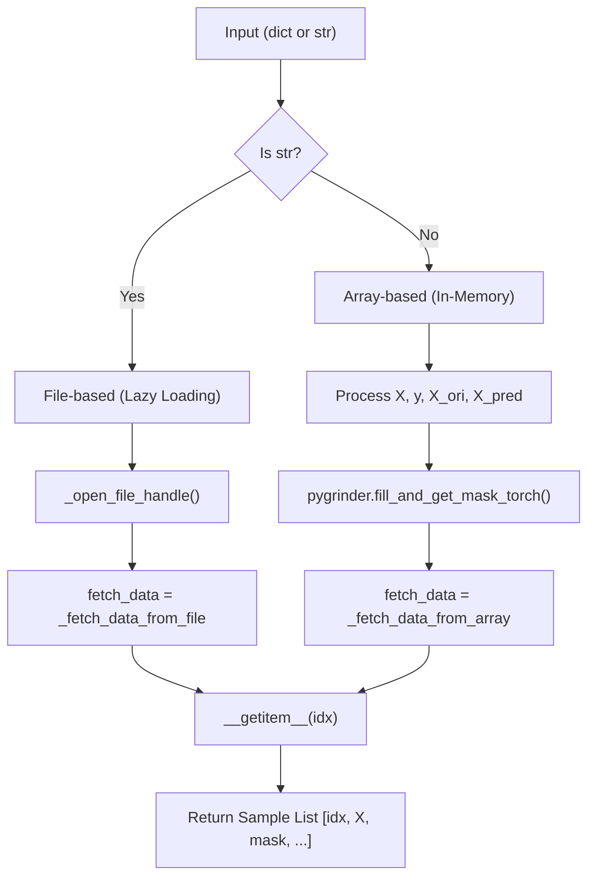
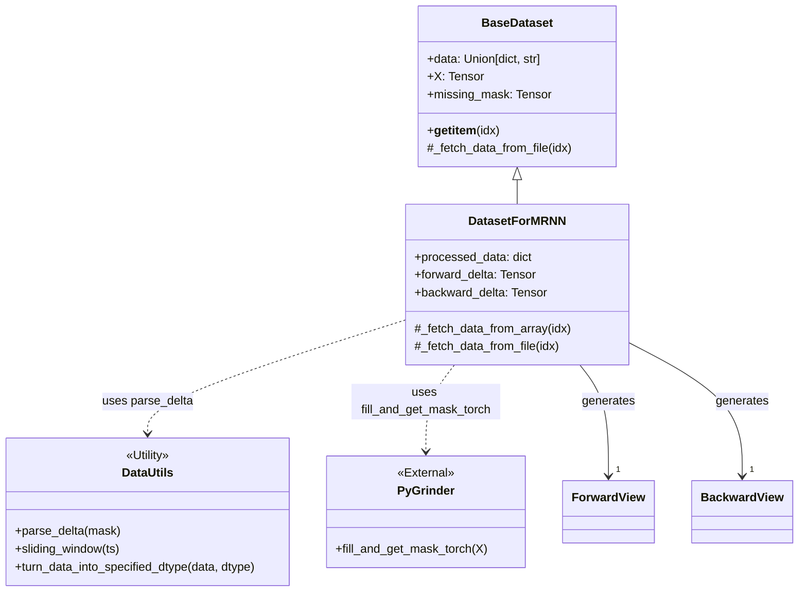

<!-- source: DeepWiki mcp.deepwiki.com · repo WenjieDu/PyPOTS · page 2.2 Data Pipeline & Dataset Abstractions · fetched 2026-10-21 -->

# Data Pipeline & Dataset Abstractions

Relevant source files

The following files were used as context for generating this wiki page:

- [pypots/classification/grud/data.py](pypots/classification/grud/data.py)
- [pypots/clustering/crli/data.py](pypots/clustering/crli/data.py)
- [pypots/clustering/vader/data.py](pypots/clustering/vader/data.py)
- [pypots/data/__init__.py](pypots/data/__init__.py)
- [pypots/data/dataset/base.py](pypots/data/dataset/base.py)
- [pypots/data/saving/__init__.py](pypots/data/saving/__init__.py)
- [pypots/data/saving/h5.py](pypots/data/saving/h5.py)
- [pypots/data/saving/pickle.py](pypots/data/saving/pickle.py)
- [pypots/data/utils.py](pypots/data/utils.py)
- [pypots/imputation/brits/data.py](pypots/imputation/brits/data.py)
- [pypots/imputation/mrnn/data.py](pypots/imputation/mrnn/data.py)
- [pypots/imputation/saits/data.py](pypots/imputation/saits/data.py)
- [pypots/nn/modules/etsformer/layers.py](pypots/nn/modules/etsformer/layers.py)
- [pypots/utils/file.py](pypots/utils/file.py)
- [tests/anomaly_detection/__init__.py](tests/anomaly_detection/__init__.py)
- [tests/anomaly_detection/autoformer.py](tests/anomaly_detection/autoformer.py)
- [tests/anomaly_detection/saits.py](tests/anomaly_detection/saits.py)
- [tests/anomaly_detection/tefn.py](tests/anomaly_detection/tefn.py)
- [tests/data/saving.py](tests/data/saving.py)
- [tests/data/utils.py](tests/data/utils.py)
- [tests/global_test_config.py](tests/global_test_config.py)
- [tests/representation/ts2vec.py](tests/representation/ts2vec.py)

The PyPOTS data pipeline is designed to handle diverse time-series data formats, ranging from small in-memory dictionaries to massive datasets requiring lazy-loading from disk. The core abstraction is the `BaseDataset`, which provides a unified interface for all PyPOTS models while managing complex data flows including missingness masks and time-gap (delta) calculations.

### The BaseDataset Abstraction

The `BaseDataset` class [pypots/data/dataset/base.py:23-23]() extends `torch.utils.data.Dataset` to provide a standardized structure for time-series tasks. It supports two primary modes of operation: **Array-based** (loading all data into RAM) and **File-based** (lazy-loading from HDF5 or Pickle files) [pypots/data/dataset/base.py:106-132]().

#### Key Data Components
The pipeline manages several critical tensors that flow through the system:
*   `X`: The input time-series data, potentially containing missing values (NaNs). Shape: `[n_samples, n_steps, n_features]` [pypots/data/dataset/base.py:32-33]().
*   `X_ori`: The original "ground truth" data. Used primarily in imputation tasks to calculate loss on artificially masked values [pypots/data/dataset/base.py:34-36]().
*   `missing_mask`: A binary mask where `0` indicates a missing value and `1` indicates an observed value [pypots/data/utils.py:135-135]().
*   `indicating_mask`: Specifically used in models like SAITS; it represents the difference between `X_ori`'s mask and `X`'s mask, highlighting which values were artificially masked for training [pypots/imputation/mrnn/data.py:181-182]().
*   `X_pred`: The target sequence for forecasting tasks [pypots/data/dataset/base.py:37-41]().

#### Data Flow and Initialization
The diagram below illustrates how raw input data is processed into the internal representation used by the `BaseDataset`.

**Title: Data Initialization Flow in BaseDataset**

Sources: [pypots/data/dataset/base.py:106-131](), [pypots/imputation/mrnn/data.py:85-188]()

### Supported Formats and Lazy Loading

PyPOTS supports HDF5 and Pickle formats for persistent storage [pypots/data/dataset/base.py:18-18](). The variable `SUPPORTED_DATASET_FILE_FORMATS` defines the allowed extensions [pypots/data/dataset/base.py:108-111]().

*   **HDF5 (`.h5`, `.hdf5`)**: Preferred for large datasets. The `_fetch_data_from_file` method [pypots/imputation/mrnn/data.py:133-188]() uses the H5 file handle to read only the required slice `idx` into memory, preventing OOM (Out-of-Memory) errors during training on massive datasets.
*   **Pickle (`.pkl`)**: Supported for smaller, serialized Python objects via `pickle_dump` and `pickle_load` [pypots/data/saving/pickle.py:16-68]().

#### Saving and Loading Utilities
The `pypots.data.saving` module provides wrappers to simplify these operations:
*   `save_dict_into_h5`: Recursively saves nested dictionaries into HDF5 groups and datasets [pypots/data/saving/h5.py:19-81](). It automatically creates parent directories using `create_dir_if_not_exist` [pypots/data/saving/h5.py:74-74]().
*   `load_dict_from_h5`: Reconstructs a Python dictionary from an H5 file [pypots/data/saving/h5.py:84-129]().
*   `pickle_dump` / `pickle_load`: Standardized pickling with automatic directory creation and support for `pandas` pickle reading if version >= 2.0.0 [pypots/data/saving/pickle.py:16-68]().

Sources: [pypots/data/saving/h5.py:1-129](), [pypots/data/saving/pickle.py:1-69](), [pypots/data/dataset/base.py:106-131](), [pypots/data/saving/__init__.py:9-14]()

### Irregular Time Series: parse_delta

For models that handle irregular sampling (e.g., BRITS, GRU-D, M-RNN), PyPOTS provides `parse_delta`. This function calculates the time-gap matrix $\delta$, which represents the amount of time since the last observation for each feature.

Implementation details:
*   **Math Definition**: Based on Che et al. (2018) [pypots/data/utils.py:32-52]().
*   **Logic**: For the first step, $\delta_1 = 0$ [pypots/data/utils.py:59-59](). For subsequent steps $t > 1$:
    $\delta_t = 1 + (1 - m_{t-1}) \odot \delta_{t-1}$
    where $m$ is the missing mask [pypots/data/utils.py:62-62]().
*   **Backends**: PyPOTS implements this for both NumPy (`_parse_delta_numpy`) [pypots/data/utils.py:81-125]() and PyTorch (`_parse_delta_torch`) [pypots/data/utils.py:32-78](). The entry point `parse_delta` automatically dispatches to the correct backend [pypots/data/utils.py:152-158]().

Sources: [pypots/data/utils.py:128-158](), [pypots/imputation/mrnn/data.py:67-70](), [pypots/classification/grud/data.py:61-61]()

### Sliding Window Transforms

To transform long univariate or multivariate time series into fixed-length samples for deep learning models, PyPOTS utilizes sliding window utilities.

*   `sliding_window`: Truncates a series of shape `[total_length, n_features]` into samples of shape `[n_samples, window_len, n_features]` [pypots/data/utils.py:161-196](). This function wraps the `benchpots` implementation [pypots/data/utils.py:192-196]().
*   `inverse_sliding_window`: Reconstructs the original sequence from overlapped windows [pypots/data/utils.py:199-199]().

Sources: [pypots/data/utils.py:161-199]()

### Data Flow in Task-Specific Datstractions

Task-specific datasets, such as `DatasetForMRNN` [pypots/imputation/mrnn/data.py:17-17]() and `DatasetForGRUD` [pypots/classification/grud/data.py:18-18](), extend `BaseDataset` to perform specialized preprocessing. For instance, M-RNN requires both forward and backward temporal views of the data.

**Title: Entity Relationship & Data Flow for M-RNN Dataset**

In `DatasetForMRNN`, the `__init__` method generates backward sequences using `torch.flip` [pypots/imputation/mrnn/data.py:68-70]() and calculates deltas for both directions. When `__getitem__` is called, it returns a collated list containing the index, forward X, forward mask, forward delta, and their backward counterparts [pypots/imputation/mrnn/data.py:113-123](). For file-based data, it opens the handle lazily [pypots/imputation/mrnn/data.py:148-149]() and calculates these features on-the-fly [pypots/imputation/mrnn/data.py:151-164]().

In `DatasetForGRUD`, the pipeline includes calculating the empirical mean of features for imputation [pypots/classification/grud/data.py:62-66]() and filling missing values with Last Observation Carried Forward (LOCF) using `locf_torch` [pypots/classification/grud/data.py:59-59]().

### Data Integrity Utilities
PyPOTS includes utilities to ensure data consistency during the pipeline flow:
*   `turn_data_into_specified_dtype`: A unified interface to convert data between `list`, `np.ndarray`, and `torch.Tensor` [pypots/data/utils.py:15-29]().
*   `key_in_data_set`: A checking utility used in `BaseDataset` to verify that mandatory keys like `X` are present in the input dictionary or file [pypots/data/dataset/base.py:116-145]().

Sources: [pypots/imputation/mrnn/data.py:17-188](), [pypots/classification/grud/data.py:18-151](), [pypots/data/dataset/base.py:23-78](), [pypots/data/utils.py:15-29]()

---

