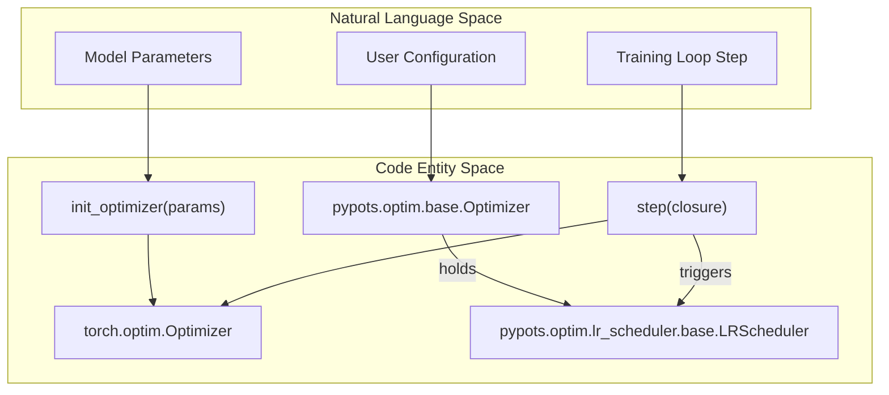
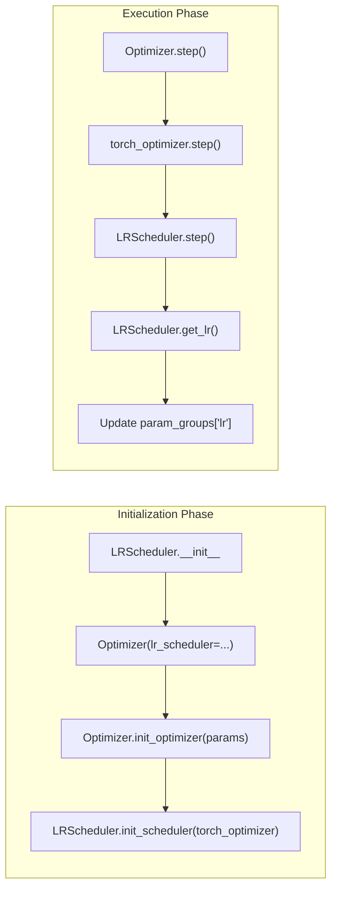

<!-- source: DeepWiki mcp.deepwiki.com · repo WenjieDu/PyPOTS · page 2.3 Optimization & Learning Rate Scheduling · fetched 2026-10-21 -->

# Optimization & Learning Rate Scheduling

Relevant source files

The following files were used as context for generating this wiki page:

- [docs/pypots.optim.rst](docs/pypots.optim.rst)
- [pypots/optim/__init__.py](pypots/optim/__init__.py)
- [pypots/optim/adadelta.py](pypots/optim/adadelta.py)
- [pypots/optim/adagrad.py](pypots/optim/adagrad.py)
- [pypots/optim/adam.py](pypots/optim/adam.py)
- [pypots/optim/adamw.py](pypots/optim/adamw.py)
- [pypots/optim/base.py](pypots/optim/base.py)
- [pypots/optim/lr_scheduler/__init__.py](pypots/optim/lr_scheduler/__init__.py)
- [pypots/optim/lr_scheduler/base.py](pypots/optim/lr_scheduler/base.py)
- [pypots/optim/lr_scheduler/constant_lrs.py](pypots/optim/lr_scheduler/constant_lrs.py)
- [pypots/optim/lr_scheduler/exponential_lrs.py](pypots/optim/lr_scheduler/exponential_lrs.py)
- [pypots/optim/lr_scheduler/lambda_lrs.py](pypots/optim/lr_scheduler/lambda_lrs.py)
- [pypots/optim/lr_scheduler/linear_lrs.py](pypots/optim/lr_scheduler/linear_lrs.py)
- [pypots/optim/lr_scheduler/multiplicative_lrs.py](pypots/optim/lr_scheduler/multiplicative_lrs.py)
- [pypots/optim/lr_scheduler/multistep_lrs.py](pypots/optim/lr_scheduler/multistep_lrs.py)
- [pypots/optim/lr_scheduler/step_lrs.py](pypots/optim/lr_scheduler/step_lrs.py)
- [pypots/optim/rmsprop.py](pypots/optim/rmsprop.py)
- [pypots/optim/sgd.py](pypots/optim/sgd.py)
- [tests/optim/adadelta.py](tests/optim/adadelta.py)
- [tests/optim/adagrad.py](tests/optim/adagrad.py)
- [tests/optim/adam.py](tests/optim/adam.py)
- [tests/optim/adamw.py](tests/optim/adamw.py)
- [tests/optim/lr_schedulers.py](tests/optim/lr_schedulers.py)
- [tests/optim/rmsprop.py](tests/optim/rmsprop.py)
- [tests/optim/sgd.py](tests/optim/sgd.py)

The `pypots.optim` module provides a specialized wrapper system for PyTorch optimizers and learning rate schedulers. Its primary purpose is to decouple model architecture hyperparameters from optimization settings, ensuring cleaner code and improved readability [pypots/optim/base.py:1-14](). By providing a two-stage initialization pattern, PyPOTS allows users to define optimization strategies independently of the neural network parameters they will eventually manage.

## The Optimizer Wrapper System

All optimizers in PyPOTS inherit from the `Optimizer` base class [pypots/optim/base.py:25-26](). Unlike standard PyTorch optimizers that require model parameters at instantiation, PyPOTS optimizers are initialized with hyperparameters first, and the target parameters are bound later via the `init_optimizer` method [pypots/optim/base.py:49-57]().

### Core Components

| Component | Role | Code Entity |
| :--- | :--- | :--- |
| **Base Class** | Defines the interface for all PyPOTS optimizers. | `pypots.optim.base.Optimizer` [pypots/optim/base.py:25]() |
| **Concrete Wrappers** | Implementations for Adam, AdamW, SGD, etc. | `pypots.optim.adam.Adam`, `pypots.optim.sgd.SGD`, etc. [pypots/optim/__init__.py:8-13]() |
| **Internal Engine** | The actual `torch.optim` instance. | `self.torch_optimizer` [pypots/optim/base.py:38-41]() |
| **Scheduler Link** | Optional integrated learning rate scheduler. | `self.lr_scheduler` [pypots/optim/base.py:46]() |

### Two-Stage Initialization Pattern

The initialization of a PyPOTS optimizer follows a specific flow to bridge the gap between user configuration and the PyTorch backend:

1.  **Lazy Configuration**: The user instantiates a PyPOTS optimizer (e.g., `Adam`) with hyperparameters like `lr` and `weight_decay` [pypots/optim/adam.py:43-51]().
2.  **Parameter Binding**: Inside the model's setup phase, `init_optimizer(params)` is called [pypots/optim/base.py:49-57]().
3.  **Backend Instantiation**: The wrapper creates the real `torch.optim` object and initializes the `LRScheduler` if one was provided [pypots/optim/adam.py:61-76]().

**Optimization Pipeline Architecture**

Title: "Optimization Pipeline Architecture"

Sources: [pypots/optim/base.py:25-58](), [pypots/optim/base.py:94-108](), [pypots/optim/adam.py:61-76]()

---

## Concrete Optimizer Implementations

PyPOTS wraps the most commonly used PyTorch optimization algorithms. Each wrapper ensures that the `torch_optimizer` is correctly instantiated with the specific arguments required by the underlying algorithm [pypots/optim/__init__.py:8-22]().

| PyPOTS Class | PyTorch Backend | Key Parameters |
| :--- | :--- | :--- |
| `Adam` | `torch.optim.Adam` | `lr`, `betas`, `eps`, `weight_decay`, `amsgrad` [pypots/optim/adam.py:43-51]() |
| `AdamW` | `torch.optim.AdamW` | `lr`, `betas`, `eps`, `weight_decay`, `amsgrad` [pypots/optim/adamw.py:44-51]() |
| `SGD` | `torch.optim.SGD` | `lr`, `momentum`, `weight_decay`, `dampening`, `nesterov` [pypots/optim/sgd.py:43-50]() |
| `RMSprop` | `torch.optim.RMSprop` | `lr`, `momentum`, `alpha`, `eps`, `centered` [pypots/optim/rmsprop.py:47-55]() |
| `Adagrad` | `torch.optim.Adagrad` | `lr`, `lr_decay`, `weight_decay`, `initial_accumulator_value` [pypots/optim/adagrad.py:43-51]() |
| `Adadelta` | `torch.optim.Adadelta` | `lr`, `rho`, `eps`, `weight_decay` [pypots/optim/adadelta.py:40-47]() |

### Example: Adagrad Implementation
The `Adagrad` wrapper demonstrates the pattern of storing hyperparameters in `__init__` [pypots/optim/adagrad.py:42-55]() and passing them to the backend in `init_optimizer` [pypots/optim/adagrad.py:57-77](). Note that PyPOTS sets a default `initial_accumulator_value` of 0.01 to avoid division by zero issues, differing from the PyTorch default [pypots/optim/adagrad.py:47]().

Sources: [pypots/optim/__init__.py:8-22](), [pypots/optim/adagrad.py:17-77](), [pypots/optim/adamw.py:17-77](), [pypots/optim/sgd.py:17-77](), [pypots/optim/adadelta.py:17-71](), [pypots/optim/rmsprop.py:17-83]()

---

## Learning Rate Scheduling

PyPOTS includes a sub-system for learning rate scheduling under `pypots.optim.lr_scheduler`. These classes are adapted from PyTorch but modified to support the two-stage initialization pattern, meaning you don't have to pass the optimizer immediately upon instantiation [pypots/optim/lr_scheduler/__init__.py:1-7]().

### Integrated Stepping
A key feature of the PyPOTS optimizer wrapper is the automatic handling of scheduler steps. When `Optimizer.step()` is called, it first executes the parameter update via the torch backend and then immediately calls `self.lr_scheduler.step()` if a scheduler is present [pypots/optim/base.py:105-108]().

### Scheduler Lifecycle

Title: "LRScheduler Initialization and Execution Lifecycle"

Sources: [pypots/optim/lr_scheduler/base.py:39-58](), [pypots/optim/lr_scheduler/base.py:118-167](), [pypots/optim/base.py:105-108]()

### Available Schedulers
The following schedulers are available and can be passed to any PyPOTS optimizer [pypots/optim/lr_scheduler/__init__.py:20-28]():
*   `LambdaLR`: Sets the learning rate to the initial LR times a given function [tests/optim/lr_schedulers.py:34]().
*   `MultiplicativeLR`: Multiplies the learning rate by a factor given in the lambda function [tests/optim/lr_schedulers.py:37]().
*   `StepLR`: Decays the learning rate by `gamma` every `step_size` epochs [tests/optim/lr_schedulers.py:40]().
*   `MultiStepLR`: Decays the learning rate by `gamma` once the number of epochs reaches one of the milestones [tests/optim/lr_schedulers.py:43]().
*   `ExponentialLR`: Decays the learning rate by `gamma` every epoch [tests/optim/lr_schedulers.py:52]().
*   `LinearLR`: Decays the learning rate linearly for a set number of iterations [tests/optim/lr_schedulers.py:49]().
*   `ConstantLR`: Decays the learning rate by a constant factor until a milestone is reached [tests/optim/lr_schedulers.py:46]().

### Safety Mechanisms
The `LRScheduler` base class includes a `with_counter` wrapper for the optimizer's step method [pypots/optim/lr_scheduler/base.py:74-101](). This ensures that `lr_scheduler.step()` is called after `optimizer.step()`, adhering to PyTorch's requirements. If the order is violated or if the optimizer step is overridden incorrectly, the system logs a warning to the user [pypots/optim/lr_scheduler/base.py:125-144]().

Sources: [pypots/optim/lr_scheduler/base.py:18-167](), [tests/optim/lr_schedulers.py:30-53](), [pypots/optim/lr_scheduler/__init__.py:1-28]()

---

