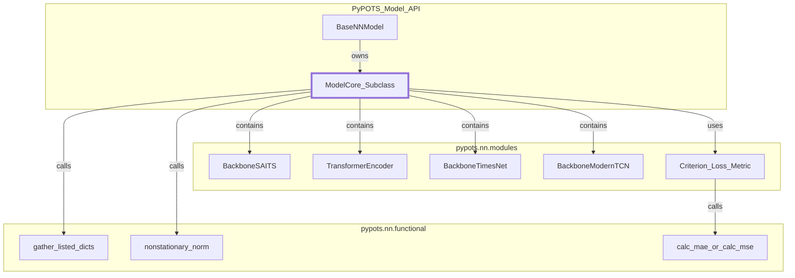
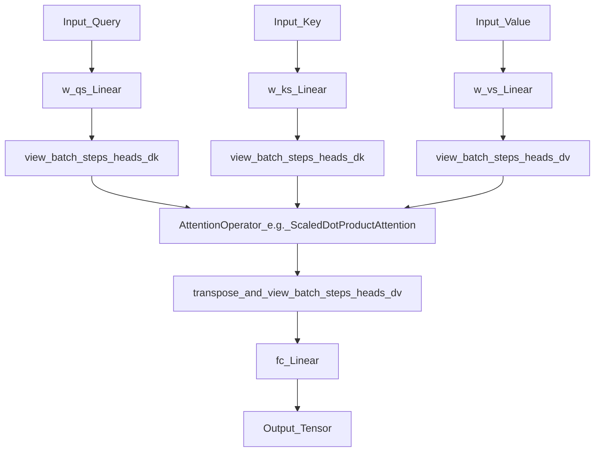
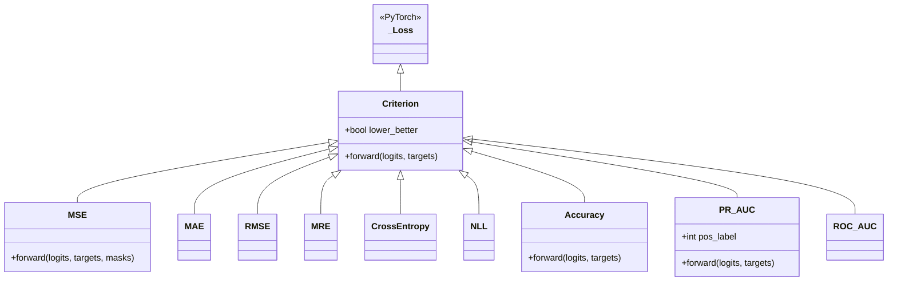

<!-- source: DeepWiki mcp.deepwiki.com · repo WenjieDu/PyPOTS · page 2.4 Neural Network Modules (pypots.nn) · fetched 2026-10-21 -->

# Neural Network Modules (pypots.nn)

Relevant source files

The following files were used as context for generating this wiki page:

- [docs/algo_table.rst](docs/algo_table.rst)
- [docs/faq.rst](docs/faq.rst)
- [docs/install.rst](docs/install.rst)
- [docs/milestones.rst](docs/milestones.rst)
- [docs/pypots.nn.rst](docs/pypots.nn.rst)
- [pypots/nn/functional/__init__.py](pypots/nn/functional/__init__.py)
- [pypots/nn/functional/gathering.py](pypots/nn/functional/gathering.py)
- [pypots/nn/functional/normalization.py](pypots/nn/functional/normalization.py)
- [pypots/nn/modules/__init__.py](pypots/nn/modules/__init__.py)
- [pypots/nn/modules/brits/__init__.py](pypots/nn/modules/brits/__init__.py)
- [pypots/nn/modules/grud/__init__.py](pypots/nn/modules/grud/__init__.py)
- [pypots/nn/modules/loss.py](pypots/nn/modules/loss.py)
- [pypots/nn/modules/metric.py](pypots/nn/modules/metric.py)
- [pypots/nn/modules/patchtst/__init__.py](pypots/nn/modules/patchtst/__init__.py)
- [pypots/nn/modules/saits/__init__.py](pypots/nn/modules/saits/__init__.py)
- [pypots/nn/modules/saits/backbone.py](pypots/nn/modules/saits/backbone.py)
- [pypots/nn/modules/saits/embedding.py](pypots/nn/modules/saits/embedding.py)
- [pypots/nn/modules/transformer/__init__.py](pypots/nn/modules/transformer/__init__.py)
- [pypots/nn/modules/transformer/attention.py](pypots/nn/modules/transformer/attention.py)
- [pypots/nn/modules/transformer/layers.py](pypots/nn/modules/transformer/layers.py)
- [pypots/nn/modules/usgan/__init__.py](pypots/nn/modules/usgan/__init__.py)
- [requirements/conda_dev_env.yml](requirements/conda_dev_env.yml)
- [requirements/conda_env.yml](requirements/conda_env.yml)
- [requirements/requirements.txt](requirements/requirements.txt)
- [requirements/requirements_dev.txt](requirements/requirements_dev.txt)

The `pypots.nn` package provides the foundational building blocks for all neural network models in the PyPOTS ecosystem. It includes core base classes for model logic, shared backbone architectures (like Transformers, SAITS, BRITS, and TimeMixer), a standardized hierarchy for loss functions and metrics, and functional utilities for data manipulation and normalization.

## Model Core and Base Architecture

In PyPOTS, the `ModelCore` class serves as the primary container for the PyTorch-based neural network logic. While high-level task classes (e.g. `BaseNNImputer`) handle the training loop and device management, the core modules define the specific `forward()` pass and internal parameter state [pypots/nn/modules/base_model_core.py:8-14]().

### System Entity Mapping: Model Logic Flow
The following diagram illustrates how high-level PyPOTS components interact with the internal neural network modules and backbones.

Title: PyPOTS Neural Network Entity Association

**Sources:** [pypots/nn/modules/saits/backbone.py:19-27](), [pypots/nn/modules/loss.py:17-31](), [pypots/nn/modules/base_model_core.py:8-14]()

---

## Shared Backbone Modules

PyPOTS provides highly modular implementations of popular time-series backbones. These are often reused across imputation, classification, and forecasting tasks.

### Transformer Components
The Transformer implementation is split into granular sub-modules to allow for flexible architecture design, used in models like SAITS and Transformer-based imputers.

| Class | Role | File Reference |
| :--- | :--- | :--- |
| `AttentionOperator` | Abstract base for attention mechanisms. | [pypots/nn/modules/transformer/attention.py:22-40]() |
| `ScaledDotProductAttention` | Standard dot-product attention with scaling and dropout. | [pypots/nn/modules/transformer/attention.py:42-117]() |
| `MultiHeadAttention` | Multi-head wrapper that projects queries, keys, and values. | [pypots/nn/modules/transformer/attention.py:119-220]() |
| `PositionWiseFeedForward` | FFN with residual connection and LayerNorm. | [pypots/nn/modules/transformer/layers.py:15-64]() |
| `TransformerEncoderLayer` | A single encoder block combining MHA and FFN. | [pypots/nn/modules/transformer/layers.py:66-158]() |
| `TransformerDecoderLayer` | A single decoder block with self-attention and encoder-attention. | [pypots/nn/modules/transformer/layers.py:160-273]() |

### Modern Time-Series Backbones
PyPOTS includes several state-of-the-art backbones designed for multi-scale and decomposition-based modeling:

*   **BackboneTimesNet**: Utilizes `TimesBlock` to capture multi-periodicity by transforming 1D time series into 2D variations using FFT [pypots/nn/modules/timesnet/__init__.py]().
*   **BackboneModernTCN**: A hierarchical TCN backbone using `Stage` modules, downsampling layers, and multi-scale fusing [pypots/nn/modules/moderntcn/__init__.py]().
*   **BackboneSAITS**: A specialized self-attention backbone that integrates an embedding layer with a transformer encoder for imputation tasks [pypots/nn/modules/saits/backbone.py:19-27]().
*   **RevIN**: A Reversible Instance Normalization module that handles distribution shift, with a PyPOTS-specific implementation to handle `missing_mask` during mean/variance calculation [pypots/nn/modules/revin/__init__.py]().

### Multi-Head Attention Data Flow
The `MultiHeadAttention` module manages the transformation of input tensors into multiple subspaces.

Title: MultiHeadAttention Tensor Transformation Flow

**Sources:** [pypots/nn/modules/transformer/attention.py:155-219](), [pypots/nn/modules/transformer/layers.py:105-111]()

---

## Functional Utilities (`pypots.nn.functional`)

The functional package contains stateless operations used for data gathering, normalization, and error calculation.

### Data Gathering
The `gather_listed_dicts` function is a critical utility for post-processing model outputs. It takes a list of dictionaries (usually from batch-wise forward passes) and concatenates their values into a single dictionary of NumPy arrays [pypots/nn/functional/gathering.py:12-41]().

### Normalization & Error
- **`nonstationary_norm`**: Implements normalization from Non-stationary Transformer. It calculates mean and standard deviation while respecting the `missing_mask` to handle distribution shift in incomplete data [pypots/nn/functional/normalization.py:14-62]().
- **`nonstationary_denorm`**: Reverses the normalization using the stored means and standard deviations [pypots/nn/functional/normalization.py:64-98]().
- **Error Calculations**: Provides optimized functions for `calc_mae`, `calc_mse`, `calc_rmse`, and `calc_mre` which handle masking to ignore missing values during error computation [pypots/nn/functional/__init__.py:10-14]().

---

## Criterion Hierarchy (Loss & Metrics)

PyPOTS uses a unified `Criterion` base class for both training loss functions and evaluation metrics. This hierarchy inherits from PyTorch's `_Loss` class [pypots/nn/modules/loss.py:17-33]().

### Class Hierarchy: Criterion & Metrics
The design ensures that all evaluation and optimization logic follows a consistent interface: `forward(logits, targets)`.

Title: PyPOTS Criterion and Metric Class Hierarchy

**Sources:** [pypots/nn/modules/loss.py:17-134](), [pypots/nn/modules/metric.py:17-67]()

### Implementation Details
- **Base Class**: `Criterion` includes a `lower_better` flag. For `MSE`, `MAE`, or `CrossEntropy`, this is `True` [pypots/nn/modules/loss.py:20-33](). For `Accuracy`, `PR_AUC`, or `ROC_AUC`, it is `False` [pypots/nn/modules/metric.py:19-55]().
- **Regression Metrics**: `MSE`, `MAE`, `RMSE`, and `MRE` support an optional `masks` parameter to calculate errors specifically on indicated values by calling functional counterparts [pypots/nn/modules/loss.py:54-108]().
- **Classification Metrics**: `Accuracy`, `PR_AUC`, and `ROC_AUC` internally apply `softmax` to `logits`, then convert to NumPy to utilize specialized implementations like `calc_pr_auc` or `calc_acc` [pypots/nn/modules/metric.py:28-34](), [pypots/nn/modules/metric.py:62-66]().
- **Loss Functions**: `CrossEntropy` and `NLL` wrap standard `torch.nn.functional` implementations within the PyPOTS `Criterion` interface [pypots/nn/modules/loss.py:110-133]().

**Sources:** [pypots/nn/modules/loss.py:1-134](), [pypots/nn/modules/metric.py:1-67](), [pypots/nn/functional/__init__.py:10-14]()

---

