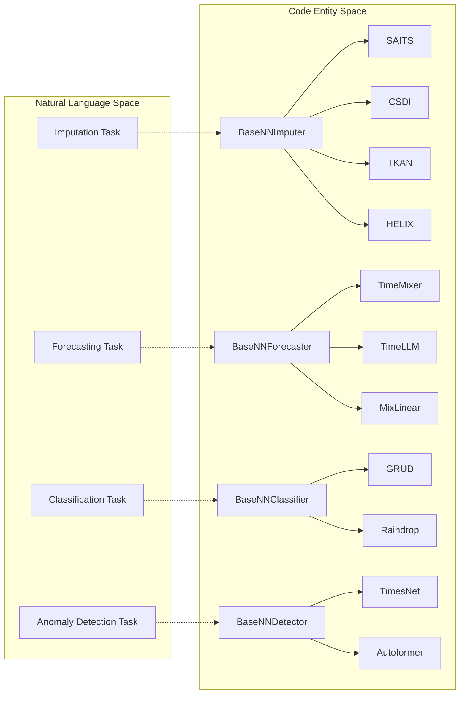

<!-- source: DeepWiki mcp.deepwiki.com · repo WenjieDu/PyPOTS · page 3 Task Modules · fetched 2026-10-21 -->

# Task Modules

<details>
<summary>Relevant source files</summary>

The following files were used as context for generating this wiki page:

- [.gitignore](.gitignore)
- [README.md](README.md)
- [README_zh.md](README_zh.md)
- [docs/index.rst](docs/index.rst)
- [docs/model_api.rst](docs/model_api.rst)
- [docs/pypots.anomaly_detection.rst](docs/pypots.anomaly_detection.rst)
- [docs/pypots.classification.rst](docs/pypots.classification.rst)
- [docs/pypots.clustering.rst](docs/pypots.clustering.rst)
- [docs/pypots.data.rst](docs/pypots.data.rst)
- [docs/pypots.forecasting.rst](docs/pypots.forecasting.rst)
- [docs/pypots.imputation.rst](docs/pypots.imputation.rst)
- [docs/pypots.rst](docs/pypots.rst)
- [docs/pypots.utils.rst](docs/pypots.utils.rst)
- [docs/references.bib](docs/references.bib)
- [pypots/anomaly_detection/__init__.py](pypots/anomaly_detection/__init__.py)
- [pypots/anomaly_detection/dlinear/__init__.py](pypots/anomaly_detection/dlinear/__init__.py)
- [pypots/anomaly_detection/dlinear/model.py](pypots/anomaly_detection/dlinear/model.py)
- [pypots/anomaly_detection/reformer/__init__.py](pypots/anomaly_detection/reformer/__init__.py)
- [pypots/anomaly_detection/reformer/model.py](pypots/anomaly_detection/reformer/model.py)
- [pypots/anomaly_detection/scinet/__init__.py](pypots/anomaly_detection/scinet/__init__.py)
- [pypots/anomaly_detection/scinet/model.py](pypots/anomaly_detection/scinet/model.py)
- [pypots/anomaly_detection/segrnn/__init__.py](pypots/anomaly_detection/segrnn/__init__.py)
- [pypots/anomaly_detection/timesnet/__init__.py](pypots/anomaly_detection/timesnet/__init__.py)
- [pypots/anomaly_detection/timesnet/model.py](pypots/anomaly_detection/timesnet/model.py)
- [pypots/classification/__init__.py](pypots/classification/__init__.py)
- [pypots/classification/autoformer/__init__.py](pypots/classification/autoformer/__init__.py)
- [pypots/classification/autoformer/core.py](pypots/classification/autoformer/core.py)
- [pypots/classification/autoformer/model.py](pypots/classification/autoformer/model.py)
- [pypots/classification/patchtst/__init__.py](pypots/classification/patchtst/__init__.py)
- [pypots/classification/patchtst/core.py](pypots/classification/patchtst/core.py)
- [pypots/classification/patchtst/model.py](pypots/classification/patchtst/model.py)
- [pypots/forecasting/__init__.py](pypots/forecasting/__init__.py)
- [pypots/forecasting/dlinear/__init__.py](pypots/forecasting/dlinear/__init__.py)
- [pypots/forecasting/dlinear/core.py](pypots/forecasting/dlinear/core.py)
- [pypots/forecasting/dlinear/model.py](pypots/forecasting/dlinear/model.py)
- [pypots/forecasting/film/__init__.py](pypots/forecasting/film/__init__.py)
- [pypots/forecasting/film/core.py](pypots/forecasting/film/core.py)
- [pypots/forecasting/film/model.py](pypots/forecasting/film/model.py)
- [pypots/forecasting/micn/__init__.py](pypots/forecasting/micn/__init__.py)
- [pypots/forecasting/micn/core.py](pypots/forecasting/micn/core.py)
- [pypots/forecasting/micn/model.py](pypots/forecasting/micn/model.py)
- [pypots/imputation/__init__.py](pypots/imputation/__init__.py)
- [pypots/imputation/helix/__init__.py](pypots/imputation/helix/__init__.py)
- [pypots/imputation/helix/core.py](pypots/imputation/helix/core.py)
- [pypots/imputation/helix/model.py](pypots/imputation/helix/model.py)
- [tests/imputation/fits.py](tests/imputation/fits.py)

</details>


PyPOTS is organized into specialized task modules, each targeting a specific analytical challenge in the domain of Partially-Observed Time Series (POTS). While many models are multi-purpose, the library provides task-specific wrappers and interfaces to ensure a unified user experience across imputation, forecasting, classification, clustering, and anomaly detection.

The following diagram illustrates the relationship between the core `pypots` base classes and the primary task-oriented subpackages.

### Task Module Architecture
```mermaid
graph TD
    subgraph "PyPOTS Task Modules"
        ["pypots.imputation"] --> ["BaseNNImputer"]
        ["pypots.forecasting"] --> ["BaseNNForecaster"]
        ["pypots.classification"] --> ["BaseNNClassifier"]
        ["pypots.clustering"] --> ["BaseNNClusterer"]
        ["pypots.anomaly_detection"] --> ["BaseNNDetector"]
        ["pypots.representation"] --> ["BaseNNRepresentor"]
    end

    ["pypots.nn"] -.-> |"Provides ModelCore backbones"| "PyPOTS Task Modules"
    ["pypots.optim"] -.-> |"Provides Optimizer wrappers"| "PyPOTS Task Modules"

    style ["pypots.imputation"] stroke-dasharray: 5 5
    style ["pypots.forecasting"] stroke-dasharray: 5 5
```
Sources: [pypots/imputation/__init__.py:1-112](), [pypots/classification/__init__.py:1-34](), [pypots/forecasting/__init__.py:1-44](), [pypots/anomaly_detection/__init__.py:1-52]()

---

## Imputation (`pypots.imputation`)
The imputation module is the cornerstone of PyPOTS, designed to fill missing values in multivariate time series. It features a massive catalog of over 40 models, including classical methods like `LOCF`, `Mean`, `Median`, and `Lerp`, and advanced neural networks like `SAITS`, `CSDI`, `TimesNet`, and newer additions like `TKAN` (Temporal Kolmogorov-Arnold Networks), `HELIX`, and `TOTEM` (VQ-VAE tokenization).

Many models (marked with `🧑‍🔧` in documentation) are adapted for POTS using the **ORT (Observed Reconstruction Task)** and **MIT (Masking Imputation Task)** training strategies originally proposed in the SAITS paper.

For details, see [Imputation](#3.1).

Sources: [README.md:104-108](), [pypots/imputation/__init__.py:8-58](), [docs/pypots.imputation.rst:1-316](), [docs/references.bib:137-147]()

## Forecasting (`pypots.forecasting`)
The forecasting module handles the prediction of future time steps based on historical, partially-observed data. PyPOTS models are built to be robust against missingness in the input sequence. Key models include `TimeMixer`, `DLinear`, `MixLinear` (extreme low-resource), and foundation models like `TimeLLM`, `GPT4TS`, and `MOMENT`. The interface centers on the `forecast()` method and the `n_pred_steps` parameter.

For details, see [Forecasting](#3.2).

Sources: [pypots/forecasting/__init__.py:8-24](), [README.md:117](), [docs/pypots.forecasting.rst:1-156](), [docs/references.bib:16-22]()

## Classification (`pypots.classification`)
This module focuses on assigning labels to time-series sequences. It includes models specifically designed for irregular sampling and missing values, such as `Raindrop`, `GRUD`, and `SeFT`. The module provides standard `classify()` and `predict_proba()` interfaces, inheriting from task-specific base classes.

For details, see [Classification](#3.3).

Sources: [pypots/classification/__init__.py:8-19](), [README.md:113](), [docs/pypots.classification.rst:1-111](), [docs/references.bib:158-171]()

## Clustering (`pypots.clustering`)
The clustering module provides tools for unsupervised grouping of time-series trajectories. It features `VaDER` (Variational Deep Embedding with Recurrent neural networks) and `CRLI` (Clustering and Representation Learning for Incomplete time series). These models handle the dual challenge of imputing missing data while learning cluster assignments.

For details, see [Clustering](#3.4).

Sources: [README.md:114](), [docs/index.rst:134](), [docs/references.bib:123-135]()

## Anomaly Detection (`pypots.anomaly_detection`)
Anomaly detection in PyPOTS is largely reconstruction-based. The module includes an expanded catalog of 21 models, such as `Autoformer`, `TimesNet`, `PatchTST`, `SegRNN`, and `iTransformer`. These models learn the normal patterns of the data; observations that deviate significantly from their reconstructed versions are flagged. Users can tune detection sensitivity via the `anomaly_rate` threshold.

For details, see [Anomaly Detection](#3.5).

Sources: [pypots/anomaly_detection/__init__.py:8-29](), [README.md:115](), [docs/pypots.anomaly_detection.rst:1-192]()

## Representation Learning (`pypots.representation`)
Representation learning aims to map raw, partially-observed time series into a continuous latent space (embeddings). The primary model here is `TS2Vec`, which learns representations that can be used for various downstream tasks like classification or clustering.

For details, see [Representation Learning](#3.6).

Sources: [README.md:116](), [docs/index.rst:135](), [pypots/classification/__init__.py:19]()

---

### Task-Model Entity Mapping

The following diagram maps high-level task concepts to specific code entities and their respective base classes within the PyPOTS hierarchy.


Sources: [pypots/imputation/__init__.py:13-52](), [pypots/forecasting/__init__.py:8-24](), [pypots/classification/__init__.py:11-14](), [pypots/anomaly_detection/__init__.py:8-18]()

### Task Summary Table

| Task Domain | Base Class | Key Model Entities | Interface Method |
| :--- | :--- | :--- | :--- |
| **Imputation** | `BaseNNImputer` | `SAITS`, `CSDI`, `TKAN`, `HELIX` | `impute()` |
| **Forecasting** | `BaseNNForecaster` | `TimeMixer`, `DLinear`, `TimeLLM`, `MixLinear` | `forecast()` |
| **Classification** | `BaseNNClassifier` | `GRUD`, `Raindrop`, `SeFT` | `classify()` |
| **Clustering** | `BaseNNClusterer` | `VaDER`, `CRLI` | `cluster()` |
| **Anomaly Detection** | `BaseNNDetector` | `TimesNet`, `PatchTST`, `Autoformer` | `detect()` |
| **Representation** | `BaseNNRepresentor` | `TS2Vec` | `represent()` |

Sources: [pypots/imputation/__init__.py:60-112](), [pypots/forecasting/__init__.py:26-44](), [pypots/classification/__init__.py:21-34](), [pypots/anomaly_detection/__init__.py:30-52]()

---

