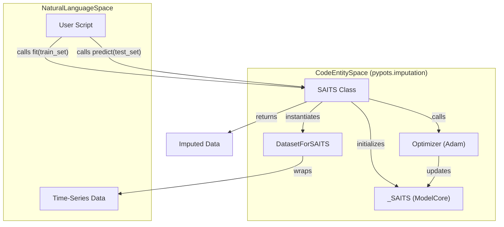
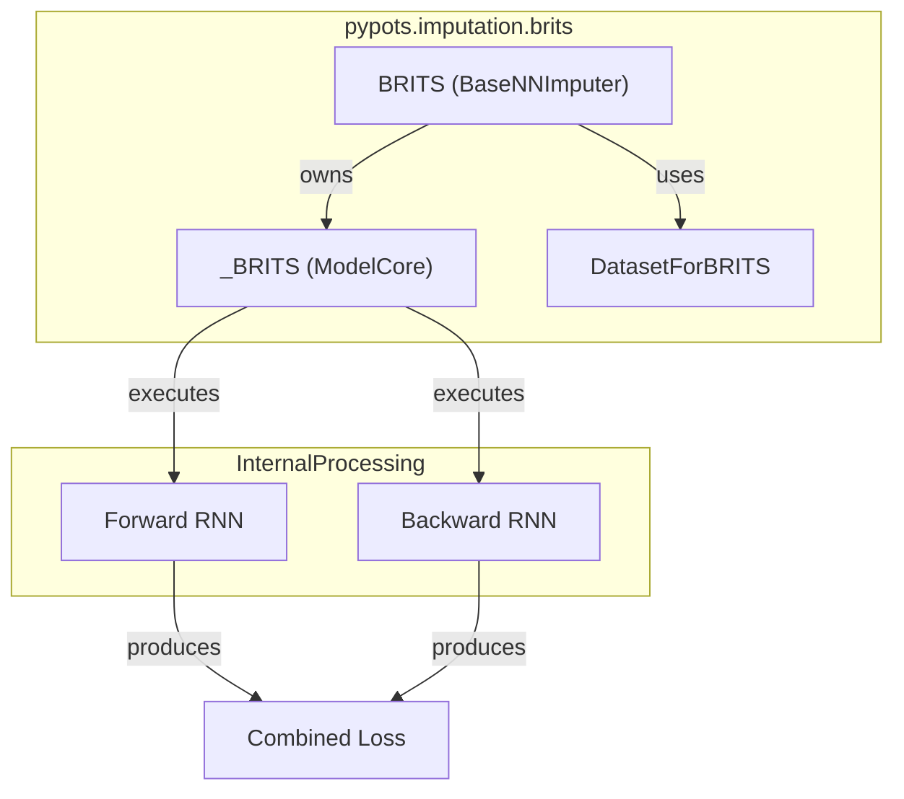

<!-- source: DeepWiki mcp.deepwiki.com · repo WenjieDu/PyPOTS · page 3.1 Imputation · fetched 2026-10-21 -->

# Imputation

<details>
<summary>Relevant source files</summary>

The following files were used as context for generating this wiki page:

- [.gitignore](.gitignore)
- [pypots/anomaly_detection/segrnn/model.py](pypots/anomaly_detection/segrnn/model.py)
- [pypots/anomaly_detection/tefn/model.py](pypots/anomaly_detection/tefn/model.py)
- [pypots/classification/brits/model.py](pypots/classification/brits/model.py)
- [pypots/classification/csai/core.py](pypots/classification/csai/core.py)
- [pypots/classification/csai/model.py](pypots/classification/csai/model.py)
- [pypots/classification/grud/model.py](pypots/classification/grud/model.py)
- [pypots/classification/raindrop/model.py](pypots/classification/raindrop/model.py)
- [pypots/forecasting/segrnn/__init__.py](pypots/forecasting/segrnn/__init__.py)
- [pypots/forecasting/segrnn/core.py](pypots/forecasting/segrnn/core.py)
- [pypots/forecasting/segrnn/model.py](pypots/forecasting/segrnn/model.py)
- [pypots/forecasting/tefn/model.py](pypots/forecasting/tefn/model.py)
- [pypots/imputation/__init__.py](pypots/imputation/__init__.py)
- [pypots/imputation/autoformer/model.py](pypots/imputation/autoformer/model.py)
- [pypots/imputation/brits/model.py](pypots/imputation/brits/model.py)
- [pypots/imputation/crossformer/model.py](pypots/imputation/crossformer/model.py)
- [pypots/imputation/csai/core.py](pypots/imputation/csai/core.py)
- [pypots/imputation/csai/data.py](pypots/imputation/csai/data.py)
- [pypots/imputation/csai/model.py](pypots/imputation/csai/model.py)
- [pypots/imputation/csdi/data.py](pypots/imputation/csdi/data.py)
- [pypots/imputation/dlinear/model.py](pypots/imputation/dlinear/model.py)
- [pypots/imputation/etsformer/model.py](pypots/imputation/etsformer/model.py)
- [pypots/imputation/fedformer/model.py](pypots/imputation/fedformer/model.py)
- [pypots/imputation/film/__init__.py](pypots/imputation/film/__init__.py)
- [pypots/imputation/film/model.py](pypots/imputation/film/model.py)
- [pypots/imputation/helix/__init__.py](pypots/imputation/helix/__init__.py)
- [pypots/imputation/helix/core.py](pypots/imputation/helix/core.py)
- [pypots/imputation/helix/model.py](pypots/imputation/helix/model.py)
- [pypots/imputation/informer/model.py](pypots/imputation/informer/model.py)
- [pypots/imputation/koopa/model.py](pypots/imputation/koopa/model.py)
- [pypots/imputation/lerp/__init__.py](pypots/imputation/lerp/__init__.py)
- [pypots/imputation/lerp/model.py](pypots/imputation/lerp/model.py)
- [pypots/imputation/locf/model.py](pypots/imputation/locf/model.py)
- [pypots/imputation/mean/__init__.py](pypots/imputation/mean/__init__.py)
- [pypots/imputation/mean/model.py](pypots/imputation/mean/model.py)
- [pypots/imputation/median/__init__.py](pypots/imputation/median/__init__.py)
- [pypots/imputation/median/model.py](pypots/imputation/median/model.py)
- [pypots/imputation/micn/model.py](pypots/imputation/micn/model.py)
- [pypots/imputation/mrnn/model.py](pypots/imputation/mrnn/model.py)
- [pypots/imputation/patchtst/model.py](pypots/imputation/patchtst/model.py)
- [pypots/imputation/reformer/model.py](pypots/imputation/reformer/model.py)
- [pypots/imputation/revinscinet/model.py](pypots/imputation/revinscinet/model.py)
- [pypots/imputation/saits/model.py](pypots/imputation/saits/model.py)
- [pypots/imputation/scinet/model.py](pypots/imputation/scinet/model.py)
- [pypots/imputation/segrnn/core.py](pypots/imputation/segrnn/core.py)
- [pypots/imputation/segrnn/model.py](pypots/imputation/segrnn/model.py)
- [pypots/imputation/stemgnn/model.py](pypots/imputation/stemgnn/model.py)
- [pypots/imputation/tcn/model.py](pypots/imputation/tcn/model.py)
- [pypots/imputation/tefn/core.py](pypots/imputation/tefn/core.py)
- [pypots/imputation/tefn/model.py](pypots/imputation/tefn/model.py)
- [pypots/imputation/tide/model.py](pypots/imputation/tide/model.py)
- [pypots/imputation/timesnet/model.py](pypots/imputation/timesnet/model.py)
- [pypots/imputation/tkan/__init__.py](pypots/imputation/tkan/__init__.py)
- [pypots/imputation/tkan/core.py](pypots/imputation/tkan/core.py)
- [pypots/imputation/tkan/model.py](pypots/imputation/tkan/model.py)
- [pypots/imputation/totem/__init__.py](pypots/imputation/totem/__init__.py)
- [pypots/imputation/totem/core.py](pypots/imputation/totem/core.py)
- [pypots/imputation/totem/model.py](pypots/imputation/totem/model.py)
- [pypots/imputation/transformer/model.py](pypots/imputation/transformer/model.py)
- [pypots/imputation/trmf/__init__.py](pypots/imputation/trmf/__init__.py)
- [pypots/imputation/trmf/core.py](pypots/imputation/trmf/core.py)
- [pypots/imputation/trmf/data.py](pypots/imputation/trmf/data.py)
- [pypots/imputation/trmf/model.py](pypots/imputation/trmf/model.py)
- [pypots/imputation/tslanet/__init__.py](pypots/imputation/tslanet/__init__.py)
- [pypots/imputation/tslanet/core.py](pypots/imputation/tslanet/core.py)
- [pypots/imputation/tslanet/model.py](pypots/imputation/tslanet/model.py)
- [pypots/nn/modules/csai/backbone.py](pypots/nn/modules/csai/backbone.py)
- [pypots/nn/modules/csai/layers.py](pypots/nn/modules/csai/layers.py)
- [pypots/nn/modules/segrnn/backbone.py](pypots/nn/modules/segrnn/backbone.py)
- [pypots/nn/modules/tefn/backbone.py](pypots/nn/modules/tefn/backbone.py)
- [pypots/nn/modules/tefn/layers.py](pypots/nn/modules/tefn/layers.py)
- [pypots/nn/modules/tkan/__init__.py](pypots/nn/modules/tkan/__init__.py)
- [pypots/nn/modules/tkan/backbone.py](pypots/nn/modules/tkan/backbone.py)
- [pypots/nn/modules/tkan/layers.py](pypots/nn/modules/tkan/layers.py)
- [pypots/nn/modules/trmf/__init__.py](pypots/nn/modules/trmf/__init__.py)
- [pypots/nn/modules/trmf/backbone.py](pypots/nn/modules/trmf/backbone.py)
- [tests/classification/csai.py](tests/classification/csai.py)
- [tests/classification/raindrop.py](tests/classification/raindrop.py)
- [tests/imputation/brits.py](tests/imputation/brits.py)
- [tests/imputation/csai.py](tests/imputation/csai.py)
- [tests/imputation/csdi.py](tests/imputation/csdi.py)
- [tests/imputation/film.py](tests/imputation/film.py)
- [tests/imputation/fits.py](tests/imputation/fits.py)
- [tests/imputation/gpvae.py](tests/imputation/gpvae.py)
- [tests/imputation/lerp.py](tests/imputation/lerp.py)
- [tests/imputation/locf.py](tests/imputation/locf.py)
- [tests/imputation/mean.py](tests/imputation/mean.py)
- [tests/imputation/median.py](tests/imputation/median.py)
- [tests/imputation/mrnn.py](tests/imputation/mrnn.py)
- [tests/imputation/saits.py](tests/imputation/saits.py)
- [tests/imputation/timesnet.py](tests/imputation/timesnet.py)
- [tests/imputation/tkan.py](tests/imputation/tkan.py)
- [tests/imputation/transformer.py](tests/imputation/transformer.py)
- [tests/imputation/usgan.py](tests/imputation/usgan.py)

</details>


The `pypots.imputation` module is the core component of the PyPOTS library, providing a comprehensive suite of algorithms to fill missing values in partially-observed time-series data. It supports a wide range of methods, from classic statistical approaches to state-of-the-art deep learning architectures including Transformers, RNNs, GANs, Diffusion models, and KAN-based networks.

### Model Catalog

PyPOTS categorizes imputation models into two main groups: Neural Network (NN) based models and Naive (statistical) models [pypots/imputation/__init__.py:61-112]().

#### Neural Network Models
These models inherit from `BaseNNImputer` [pypots/imputation/saits/model.py:17-17]() and implement the standard `fit()` and `predict()` (which serves as the `impute()` functionality) interface.

| Model Class | Description | Key Features |
| :--- | :--- | :--- |
| `SAITS` | Self-Attention-based Imputation | DMSA mechanism, ORT and MIT training strategy [pypots/imputation/saits/model.py:25-124]() |
| `Transformer` | Vanilla Transformer for Imputation | Multi-head self-attention applied to time-series [pypots/imputation/transformer/model.py:24-122]() |
| `BRITS` | Bidirectional RNNs | Handles missing values in recurrent dynamics via dual-directional decay [pypots/imputation/brits/model.py:24-87]() |
| `TimesNet` | Multi-periodicity Analysis | Transforms 1D time-series into 2D variations using FFT [pypots/imputation/timesnet/model.py:23-106]() |
| `PatchTST` | Patch-based Time Series Transformer | Processes time-series as patches to capture local semantic [pypots/imputation/patchtst/model.py:28-127]() |
| `TKAN` | Kolmogorov-Arnold Network Imputer | Uses KAN-based layers for non-linear temporal modeling [pypots/imputation/__init__.py:52-52]() |
| `TOTEM` | VQ-VAE Tokenization | Imputation via vector-quantized tokenization [pypots/imputation/__init__.py:50-50]() |
| `TSLANet` | Adaptive Spectral Network | Adaptive spectral filters for time-series modeling [pypots/imputation/__init__.py:51-51]() |
| `TRMF` | Temporal Regularized Matrix Factorization | Matrix factorization with temporal dependencies [pypots/imputation/__init__.py:45-45]() |
| `CSDI` | Conditional Score-based Diffusion | Probabilistic imputation using score-based diffusion models [pypots/imputation/__init__.py:10-10]() |
| `MRNN` | Multi-directional RNN | Uses correlations between different feature streams [pypots/imputation/mrnn/model.py:25-88]() |
| `GPVAE` | Gaussian Process VAE | Combines VAEs with Gaussian Process priors [pypots/imputation/__init__.py:11-11]() |
| `USGAN` | Unsupervised GAN | GAN-based imputation for time-series [pypots/imputation/__init__.py:31-31]() |
| `CSAI` | Consistent Sequential Imputation | Bidirectional GRU with consistency and reconstruction losses [pypots/imputation/csai/model.py:25-112]() |
| `GRUD` | Gated Recurrent Unit with Decay | RNN-based model designed for irregularly sampled time series [pypots/imputation/__init__.py:37-37]() |
| `HELIX` | HELIX Imputation Model | Recurrent architecture for handling irregular time series [pypots/imputation/__init__.py:38-38]() |
| `iTransformer` | Inverted Transformer | Applies attention across features instead of time steps [pypots/imputation/__init__.py:15-15]() |
| `DLinear` | Decomposition Linear Model | Simple yet effective linear model for time-series [pypots/imputation/__init__.py:29-29]() |
| `TimeMixer` | Multi-scale Mixing | Decomposes time series into different scales for imputation [pypots/imputation/__init__.py:41-41]() |

#### Naive Models
These models provide simple baselines and do not require training (the `fit()` method is a no-op that issues a warning [pypots/imputation/locf/model.py:61-70]()).

| Model Class | Strategy | Description |
| :--- | :--- | :--- |
| `LOCF` | Last Observed Carried Forward | Fills missing values with the last known observation; supports NOCB via backward strategy [pypots/imputation/locf/model.py:20-42]() |
| `Mean` | Mean Imputation | Fills missing values with the feature-wise mean [pypots/imputation/__init__.py:56-56]() |
| `Median` | Median Imputation | Fills missing values with the feature-wise median [pypots/imputation/__init__.py:57-57]() |
| `Lerp` | Linear Interpolation | Fills missing values using linear gradients between observed points [pypots/imputation/__init__.py:58-58]() |

**Sources:** [pypots/imputation/__init__.py:1-112](), [pypots/imputation/saits/model.py:25-124](), [pypots/imputation/locf/model.py:20-42](), [pypots/imputation/mrnn/model.py:25-88](), [pypots/imputation/timesnet/model.py:23-106](), [pypots/imputation/csai/model.py:25-112]()

### Training Strategy: ORT & MIT

Many advanced models in PyPOTS (like `SAITS`, `Transformer`, and `PatchTST`) utilize a dual-loss training strategy to improve imputation accuracy and model robustness.

*   **ORT (Observed Reconstruction Task):** Forces the model to reconstruct the actually observed values.
*   **MIT (Masked Imputation Task):** Randomly masks some observed values during training and forces the model to predict them, simulating the imputation of unknown values.

In the `SAITS` implementation, these are controlled via `ORT_weight` and `MIT_weight` parameters [pypots/imputation/saits/model.py:69-74]().

### Data Pipeline

Imputation models typically use specific Dataset classes to handle the complexities of missingness, such as generating masks or calculating time deltas.

*   **`DatasetForSAITS`**: A general-purpose dataset for Transformer-based models (e.g. `SAITS`, `Transformer`, `TimesNet`, `PatchTST`) that provides `X`, `missing_mask`, and `indicating_mask` [pypots/imputation/saits/data.py:16-16](), [pypots/imputation/saits/model.py:16-16]().
*   **`DatasetForBRITS`**: Specifically designed for RNN models that require forward and backward sequences and time `deltas` [pypots/imputation/brits/data.py:15-15](), [pypots/imputation/brits/model.py:15-15]().
*   **`DatasetForMRNN`**: Specialized for multi-directional RNN requirements including backward sequences [pypots/imputation/mrnn/data.py:15-15](), [pypots/imputation/mrnn/model.py:15-16]().
*   **`DatasetForGRUD`**: Handles datasets for GRU-D and Raindrop, calculating `deltas` and `empirical_mean` [pypots/classification/grud/data.py:16-16](), [pypots/classification/raindrop/model.py:16-16]().
*   **`DatasetForCSAI`**: Handles consistency-based bidirectional sequences and specific removal strategies [pypots/imputation/csai/data.py:14-14](), [pypots/imputation/csai/model.py:14-14]().

#### Code Entity Mapping: Imputation Flow

The following diagram illustrates how high-level imputer classes interact with their internal neural network cores and data loaders.

High-level Imputation Architecture

**Sources:** [pypots/imputation/saits/model.py:15-21](), [pypots/imputation/saits/model.py:126-164](), [pypots/imputation/saits/model.py:190-205]()

#### Code Entity Mapping: Specialized RNN Model Structure (BRITS)

The diagram below shows how recurrent models like BRITS handle bidirectional temporal dependencies.

BRITS Model Internals

**Sources:** [pypots/imputation/brits/model.py:24-87](), [pypots/imputation/brits/model.py:141-168](), [pypots/imputation/brits/model.py:170-200]()

### Basic Usage

The standard workflow for using a PyPOTS imputer involves initializing the model, calling `fit()` for training, and `predict()` for generating imputations.

```python
from pypots.imputation import SAITS

# Initialize the model
imputer = SAITS(n_steps=24, n_features=10, n_layers=2, d_model=64, n_heads=4, d_k=16, d_v=16, d_ffn=128)

# Train the model
imputer.fit(train_set) # train_set can be a dict or path to HDF5

# Impute missing values
predictions = imputer.predict(test_set)
imputed_data = predictions["imputation"]
```
**Sources:** [pypots/imputation/saits/model.py:126-164](), [pypots/imputation/saits/model.py:255-265]()

### Advanced Imputation

PyPOTS also supports cutting-edge approaches such as Large Language Model (LLM) reprogramming and Foundation Models for time-series.

*   **LLM-Based Imputation**: Models like `TimeLLM` and `GPT4TS` leverage frozen language model backbones (e.g., GPT-2, LLaMA) to perform imputation via cross-domain reprogramming [pypots/imputation/__init__.py:46-47]().
*   **Foundation Models**: `MOMENT` (T5-based) provides pre-trained representations for zero-shot or fine-tuned imputation [pypots/imputation/__init__.py:48-48]().

For details, see [LLM-Based Imputation (TimeLLM, GPT4TS & MOMENT)](#3.1.1).

**Sources:** [pypots/imputation/__init__.py:46-48](), [pypots/imputation/saits/model.py:25-124]()

---

