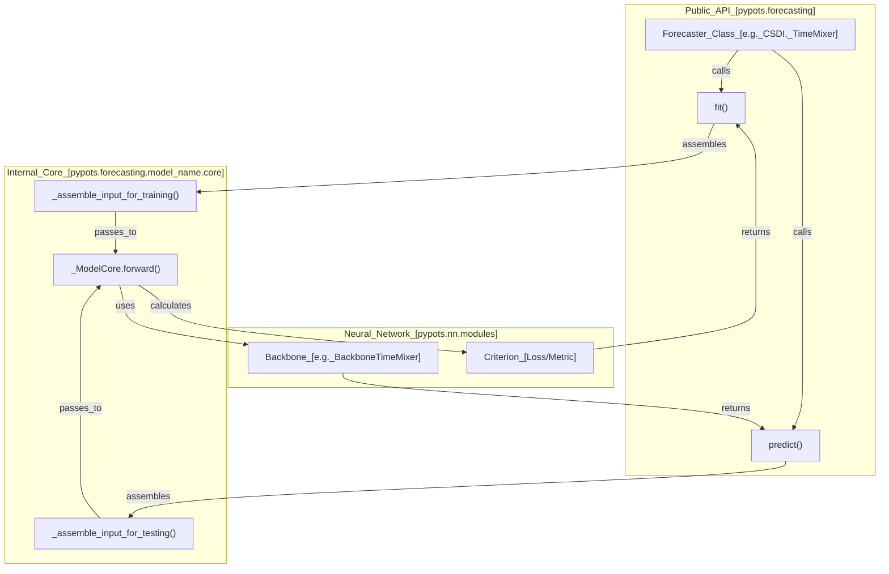
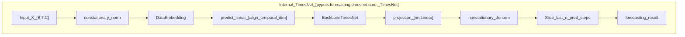
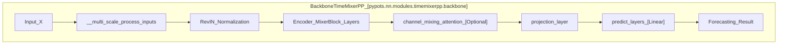
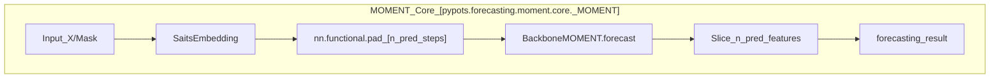
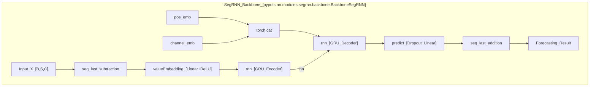
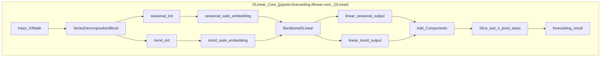

<!-- source: DeepWiki mcp.deepwiki.com · repo WenjieDu/PyPOTS · page 3.2 Forecasting · fetched 2026-10-21 -->

# Forecasting

<details>
<summary>Relevant source files</summary>

The following files were used as context for generating this wiki page:

- [pypots/anomaly_detection/segrnn/model.py](pypots/anomaly_detection/segrnn/model.py)
- [pypots/classification/brits/core.py](pypots/classification/brits/core.py)
- [pypots/forecasting/__init__.py](pypots/forecasting/__init__.py)
- [pypots/forecasting/bttf/core.py](pypots/forecasting/bttf/core.py)
- [pypots/forecasting/bttf/model.py](pypots/forecasting/bttf/model.py)
- [pypots/forecasting/bttf/submodules.py](pypots/forecasting/bttf/submodules.py)
- [pypots/forecasting/csdi/__init__.py](pypots/forecasting/csdi/__init__.py)
- [pypots/forecasting/csdi/core.py](pypots/forecasting/csdi/core.py)
- [pypots/forecasting/csdi/data.py](pypots/forecasting/csdi/data.py)
- [pypots/forecasting/csdi/model.py](pypots/forecasting/csdi/model.py)
- [pypots/forecasting/dlinear/__init__.py](pypots/forecasting/dlinear/__init__.py)
- [pypots/forecasting/dlinear/core.py](pypots/forecasting/dlinear/core.py)
- [pypots/forecasting/dlinear/model.py](pypots/forecasting/dlinear/model.py)
- [pypots/forecasting/film/__init__.py](pypots/forecasting/film/__init__.py)
- [pypots/forecasting/film/core.py](pypots/forecasting/film/core.py)
- [pypots/forecasting/film/model.py](pypots/forecasting/film/model.py)
- [pypots/forecasting/fits/__init__.py](pypots/forecasting/fits/__init__.py)
- [pypots/forecasting/fits/core.py](pypots/forecasting/fits/core.py)
- [pypots/forecasting/gpt4ts/__init__.py](pypots/forecasting/gpt4ts/__init__.py)
- [pypots/forecasting/micn/__init__.py](pypots/forecasting/micn/__init__.py)
- [pypots/forecasting/micn/core.py](pypots/forecasting/micn/core.py)
- [pypots/forecasting/micn/model.py](pypots/forecasting/micn/model.py)
- [pypots/forecasting/moment/__init__.py](pypots/forecasting/moment/__init__.py)
- [pypots/forecasting/moment/core.py](pypots/forecasting/moment/core.py)
- [pypots/forecasting/moment/model.py](pypots/forecasting/moment/model.py)
- [pypots/forecasting/segrnn/__init__.py](pypots/forecasting/segrnn/__init__.py)
- [pypots/forecasting/segrnn/core.py](pypots/forecasting/segrnn/core.py)
- [pypots/forecasting/segrnn/model.py](pypots/forecasting/segrnn/model.py)
- [pypots/forecasting/tefn/core.py](pypots/forecasting/tefn/core.py)
- [pypots/forecasting/timellm/__init__.py](pypots/forecasting/timellm/__init__.py)
- [pypots/forecasting/timemixer/__init__.py](pypots/forecasting/timemixer/__init__.py)
- [pypots/forecasting/timemixer/core.py](pypots/forecasting/timemixer/core.py)
- [pypots/forecasting/timemixer/model.py](pypots/forecasting/timemixer/model.py)
- [pypots/forecasting/timemixerpp/__init__.py](pypots/forecasting/timemixerpp/__init__.py)
- [pypots/forecasting/timemixerpp/core.py](pypots/forecasting/timemixerpp/core.py)
- [pypots/forecasting/timemixerpp/model.py](pypots/forecasting/timemixerpp/model.py)
- [pypots/forecasting/timesnet/__init__.py](pypots/forecasting/timesnet/__init__.py)
- [pypots/forecasting/timesnet/core.py](pypots/forecasting/timesnet/core.py)
- [pypots/forecasting/timesnet/model.py](pypots/forecasting/timesnet/model.py)
- [pypots/forecasting/transformer/__init__.py](pypots/forecasting/transformer/__init__.py)
- [pypots/imputation/locf/core.py](pypots/imputation/locf/core.py)
- [pypots/imputation/segrnn/core.py](pypots/imputation/segrnn/core.py)
- [pypots/imputation/segrnn/model.py](pypots/imputation/segrnn/model.py)
- [pypots/nn/modules/segrnn/backbone.py](pypots/nn/modules/segrnn/backbone.py)
- [tests/forecasting/csdi.py](tests/forecasting/csdi.py)
- [tests/forecasting/fits.py](tests/forecasting/fits.py)
- [tests/forecasting/llms/gpt4ts.py](tests/forecasting/llms/gpt4ts.py)
- [tests/forecasting/tefn.py](tests/forecasting/tefn.py)
- [tests/forecasting/timemixer.py](tests/forecasting/timemixer.py)
- [tests/forecasting/timemixerpp.py](tests/forecasting/timemixerpp.py)
- [tests/forecasting/transformer.py](tests/forecasting/transformer.py)

</details>


The `pypots.forecasting` module provides a comprehensive suite of models for time-series forecasting, specifically designed to handle challenges like missing values in historical data. Unlike traditional forecasting libraries, PyPOTS forecasting models are built to perform "partially-observed time-series forecasting," where the input sequence may contain gaps.

## Model Catalog

PyPOTS includes a diverse range of forecasting architectures, from Bayesian tensor factorization to state-of-the-art deep learning models and adapted Large Language Models (LLMs).

| Model Category | Models |
| :--- | :--- |
| **Probabilistic/Diffusion** | `CSDI` |
| **Matrix/Tensor Factorization** | `BTTF` |
| **Linear/MLP-based** | `DLinear`, `MixLinear`, `FITS`, `FiLM` |
| **Convolutional/TCN** | `MICN`, `ModernTCN`, `TimesNet` |
| **Recurrent/RNN** | `SegRNN` |
| **Attention/Transformer** | `Transformer`, `TimeMixer`, `TimeMixerPP`, `TEFN` |
| **LLM-based** | `MOMENT`, `TimeLLM`, `GPT4TS` |

**Sources:** [pypots/forecasting/__init__.py:8-44]()

## Data Flow and Interface

Forecasting in PyPOTS is defined by the relationship between an input sequence and a target prediction sequence.

### Dataset Differences
Forecasting datasets differ from imputation datasets in their structure:
*   **Imputation:** The model fills in missing values within the input sequence `X`.
*   **Forecasting:** The model uses input sequence `X` (of length `n_steps`) to predict a future sequence `X_pred` (of length `n_pred_steps`).
*   **Missingness:** In PyPOTS, both the historical input `X` and the future target `X_pred` can contain missing values (represented by `missing_mask` and `X_pred_missing_mask` respectively).

### The `n_pred_steps` Interface
Every forecaster in PyPOTS requires the specification of `n_pred_steps` during initialization. This defines the fixed horizon the model will predict.

**Example Initialization (TimeMixer):**
```python
timemixer = TimeMixer(
    n_steps=DATA["n_steps"] - N_PRED_STEPS, # Length of historical context
    n_features=DATA["n_features"],
    n_pred_steps=N_PRED_STEPS,              # The forecasting horizon
    n_pred_features=DATA["n_features"],
    term="short",
    # ... other hyperparameters
)
```
**Sources:** [pypots/forecasting/csdi/model.py:120-147](), [pypots/forecasting/timemixer/core.py:41-42](), [tests/forecasting/timemixer.py:45-65]()

### Code Entity Mapping: Forecaster Lifecycle
The following diagram illustrates how the high-level `BaseNNForecaster` API maps to internal core components during the training and prediction phases.

**Forecasting System Architecture**

**Sources:** [pypots/forecasting/csdi/model.py:24-187](), [pypots/forecasting/timemixer/core.py:17-103](), [pypots/forecasting/timesnet/core.py:14-104]()

## Implementation Details

### Model Core Logic
PyPOTS forecasters typically wrap a backbone module inside a `ModelCore` (e.g., `_TimeMixer`, `_TimesNet`). The `forward` method handles the data transformation and criterion calculation.

1.  **Input Handling:** Takes a dictionary containing `X` (historical data) and potentially `missing_mask` [pypots/forecasting/timemixer/core.py:80-81]().
2.  **Backbone Execution:** Passes processed inputs to the neural backbone (e.g. `self.model.forecast`) [pypots/forecasting/timemixer/core.py:84]().
3.  **Projection:** Often uses an `nn.Linear` layer to project the backbone output to the required `n_pred_features` and `n_pred_steps` [pypots/forecasting/timemixer/core.py:73](), [pypots/forecasting/timemixer/core.py:87-89]().
4.  **Loss Calculation:** During training, compares the output against `X_pred` using the `training_loss` [pypots/forecasting/timemixer/core.py:96-99]().

**Sources:** [pypots/forecasting/timemixer/core.py:75-103](), [pypots/forecasting/timesnet/core.py:66-104]()

### Example: TimesNet Forecasting
`TimesNet` transforms 1D time series into 2D variations based on multiple periods, capturing both intra-period and inter-period variations.

**TimesNet Data Flow**

**Sources:** [pypots/forecasting/timesnet/core.py:14-104](), [pypots/nn/functional.py:8-8]()

### Example: TimeMixer and TimeMixerPP
`TimeMixer` and its successor `TimeMixerPP` use multi-scale mixing. `TimeMixerPP` introduces `MixerBlock` and optional `channel_mixing_attention`.

**TimeMixerPP Backbone Architecture**

**Sources:** [pypots/forecasting/timemixerpp/core.py:18-103](), [pypots/forecasting/timemixer/core.py:17-103]()

### Example: MOMENT Foundation Model
`MOMENT` utilizes a pre-trained transformer backbone. It applies `SaitsEmbedding` and handles temporal padding before passing data to the `BackboneMOMENT`.

**MOMENT Data Flow**

**Sources:** [pypots/forecasting/moment/core.py:19-121]()

### Example: SegRNN Forecasting
`SegRNN` (Segment Recurrent Neural Network) processes the input sequence in segments. The `BackboneSegRNN` uses a `GRU` to encode input segments and another `GRU` combined with position and channel embeddings to generate the forecast segments.

**SegRNN Internal Flow**

**Sources:** [pypots/forecasting/segrnn/model.py:20-156](), [pypots/nn/modules/segrnn/backbone.py:9-88]()

### Non-Neural Forecasters: BTTF
`BTTF` (Bayesian Temporal Tensor Factorization) is a unique case in PyPOTS as it does not require a training phase (`fit()`). It performs inference directly on the test set using Gibbs sampling and temporal lags via the `BTTF_forecast` core function.

**Sources:** [pypots/forecasting/bttf/model.py:92-106](), [pypots/forecasting/bttf/model.py:108-136](), [pypots/forecasting/bttf/core.py:24-97]()

### Example: DLinear and FiLM
`DLinear` uses a series decomposition block to separate seasonal and trend components, which are then processed by a `BackboneDLinear` [pypots/forecasting/dlinear/core.py:35-36](). `FiLM` utilizes a frequency-improved Legendre memory model, employing `SaitsEmbedding` before passing data to the `BackboneFiLM` [pypots/forecasting/film/core.py:33-47]().

**DLinear Data Flow**

**Sources:** [pypots/forecasting/dlinear/core.py:14-88](), [pypots/forecasting/film/core.py:13-84]()

## Key Functions and Classes

| Entity | Role | Location |
| :--- | :--- | :--- |
| `BaseNNForecaster` | Base class for all neural-network-based forecasters. | `pypots/forecasting/base.py` |
| `_CSDI` | Core logic for the diffusion-based forecasting model. | [pypots/forecasting/csdi/model.py:173]() |
| `BackboneTimeMixer` | The underlying architecture for multi-scale mixing. | [pypots/forecasting/timemixer/core.py:52]() |
| `DatasetForCSDI` | Specialized dataset handler for diffusion inputs. | [pypots/forecasting/csdi/data.py:16]() |
| `BTTF_forecast` | Implementation of the Bayesian tensor factorization algorithm. | [pypots/forecasting/bttf/model.py:16]() |
| `_TimesNet` | Wrapper for the multi-period convolutional forecasting model. | [pypots/forecasting/timesnet/core.py:14]() |
| `_MOMENT` | Core for the MOMENT foundation model adaptation. | [pypots/forecasting/moment/core.py:19]() |
| `_DLinear` | Core logic for the decomposition-based linear model. | [pypots/forecasting/dlinear/core.py:14]() |
| `_FiLM` | Core logic for the frequency-improved forecasting model. | [pypots/forecasting/film/core.py:13]() |
| `BackboneSegRNN` | Segmented RNN architecture for efficient temporal modeling. | [pypots/nn/modules/segrnn/backbone.py:9]() |

**Sources:** [pypots/forecasting/csdi/model.py:24](), [pypots/forecasting/timemixer/core.py:17](), [pypots/forecasting/bttf/model.py:20](), [pypots/forecasting/timesnet/core.py:14](), [pypots/forecasting/moment/model.py:21](), [pypots/forecasting/dlinear/model.py:19](), [pypots/forecasting/film/model.py:19](), [pypots/forecasting/segrnn/model.py:20]()

---

