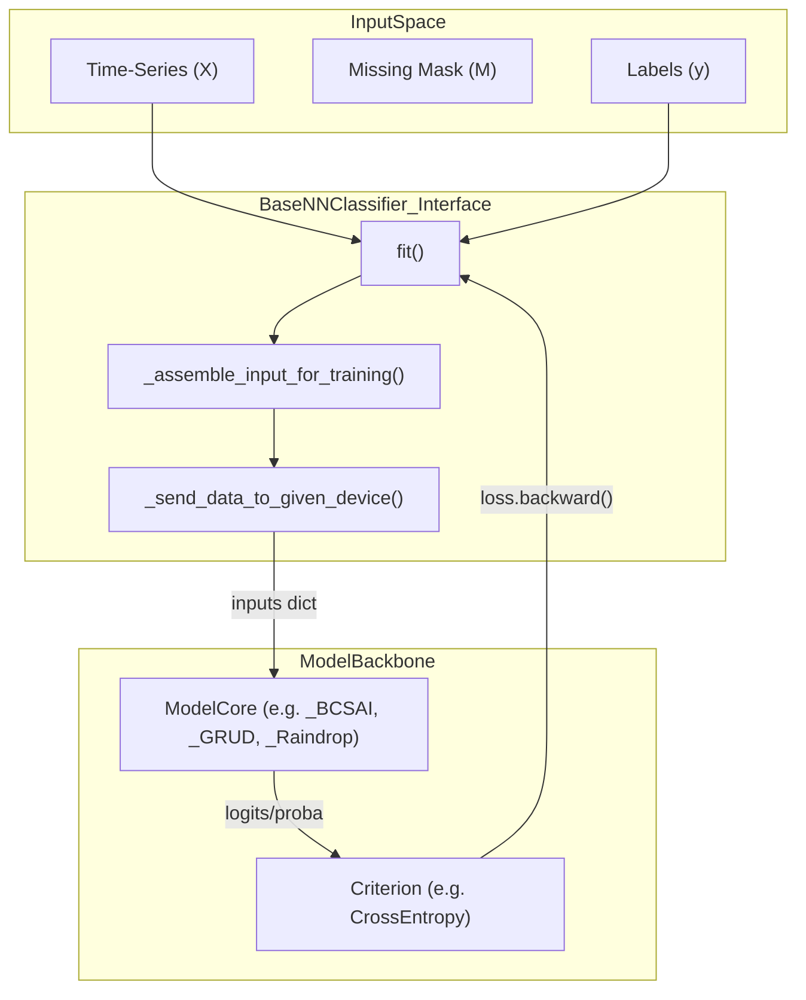
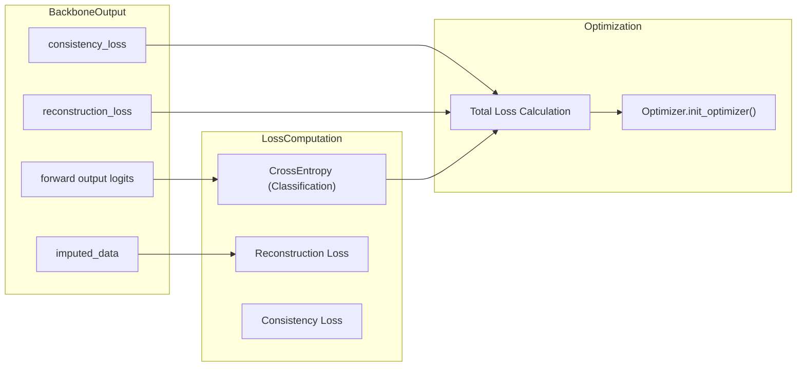

<!-- source: DeepWiki mcp.deepwiki.com · repo WenjieDu/PyPOTS · page 3.3 Classification · fetched 2026-10-21 -->

# Classification

Relevant source files

The following files were used as context for generating this wiki page:

- [pypots/classification/__init__.py](pypots/classification/__init__.py)
- [pypots/classification/autoformer/__init__.py](pypots/classification/autoformer/__init__.py)
- [pypots/classification/autoformer/core.py](pypots/classification/autoformer/core.py)
- [pypots/classification/autoformer/model.py](pypots/classification/autoformer/model.py)
- [pypots/classification/brits/model.py](pypots/classification/brits/model.py)
- [pypots/classification/csai/core.py](pypots/classification/csai/core.py)
- [pypots/classification/csai/model.py](pypots/classification/csai/model.py)
- [pypots/classification/grud/model.py](pypots/classification/grud/model.py)
- [pypots/classification/itransformer/model.py](pypots/classification/itransformer/model.py)
- [pypots/classification/patchtst/__init__.py](pypots/classification/patchtst/__init__.py)
- [pypots/classification/patchtst/core.py](pypots/classification/patchtst/core.py)
- [pypots/classification/patchtst/model.py](pypots/classification/patchtst/model.py)
- [pypots/classification/raindrop/model.py](pypots/classification/raindrop/model.py)
- [pypots/classification/saits/__init__.py](pypots/classification/saits/__init__.py)
- [pypots/classification/saits/core.py](pypots/classification/saits/core.py)
- [pypots/classification/saits/model.py](pypots/classification/saits/model.py)
- [pypots/classification/seft/__init__.py](pypots/classification/seft/__init__.py)
- [pypots/classification/seft/core.py](pypots/classification/seft/core.py)
- [pypots/classification/tefn/model.py](pypots/classification/tefn/model.py)
- [pypots/classification/timesnet/__init__.py](pypots/classification/timesnet/__init__.py)
- [pypots/classification/timesnet/core.py](pypots/classification/timesnet/core.py)
- [pypots/classification/timesnet/model.py](pypots/classification/timesnet/model.py)
- [pypots/classification/ts2vec/__init__.py](pypots/classification/ts2vec/__init__.py)
- [pypots/classification/ts2vec/model.py](pypots/classification/ts2vec/model.py)
- [pypots/imputation/brits/model.py](pypots/imputation/brits/model.py)
- [pypots/imputation/csai/core.py](pypots/imputation/csai/core.py)
- [pypots/imputation/csai/data.py](pypots/imputation/csai/data.py)
- [pypots/imputation/csai/model.py](pypots/imputation/csai/model.py)
- [pypots/imputation/mrnn/model.py](pypots/imputation/mrnn/model.py)
- [pypots/imputation/saits/model.py](pypots/imputation/saits/model.py)
- [pypots/imputation/transformer/model.py](pypots/imputation/transformer/model.py)
- [pypots/nn/modules/csai/backbone.py](pypots/nn/modules/csai/backbone.py)
- [pypots/nn/modules/csai/layers.py](pypots/nn/modules/csai/layers.py)
- [pypots/nn/modules/seft/__init__.py](pypots/nn/modules/seft/__init__.py)
- [pypots/nn/modules/seft/backbone.py](pypots/nn/modules/seft/backbone.py)
- [pypots/nn/modules/ts2vec/__init__.py](pypots/nn/modules/ts2vec/__init__.py)
- [pypots/nn/modules/ts2vec/backbone.py](pypots/nn/modules/ts2vec/backbone.py)
- [pypots/nn/modules/ts2vec/layers.py](pypots/nn/modules/ts2vec/layers.py)
- [pypots/nn/modules/ts2vec/losses.py](pypots/nn/modules/ts2vec/losses.py)
- [pypots/nn/modules/ts2vec/utils.py](pypots/nn/modules/ts2vec/utils.py)
- [tests/classification/csai.py](tests/classification/csai.py)
- [tests/classification/itransformer.py](tests/classification/itransformer.py)
- [tests/classification/saits.py](tests/classification/saits.py)
- [tests/classification/seft.py](tests/classification/seft.py)
- [tests/classification/tefn.py](tests/classification/tefn.py)
- [tests/classification/timesnet.py](tests/classification/timesnet.py)
- [tests/classification/ts2vec.py](tests/classification/ts2vec.py)
- [tests/imputation/csai.py](tests/imputation/csai.py)

The `pypots.classification` module provides a comprehensive suite of models for time-series classification, specifically designed to handle the challenges of **partially-observed data** (missing values) and **irregular sampling**.

## Model Catalog

PyPOTS includes a diverse range of classification architectures, from classic RNN-based approaches to state-of-the-art Transformers and representation learning frameworks.

| Model | Description | Handling of Irregularity/Missingness |
| :--- | :--- | :--- |
| **BRITS** | Bidirectional Recurrent Imputation for Time Series [pypots/classification/brits/model.py:25-26]() | Uses bidirectional RNNs with a decay mechanism and joint imputation-classification loss [pypots/classification/brits/model.py:141-145](). |
| **GRUD** | GRU with Decay [pypots/classification/grud/model.py:25-26]() | Incorporates decay rates into GRU gates to handle missing intervals and inform the model of missingness [pypots/classification/grud/model.py:162-170](). |
| **Raindrop** | Graph-based Transformer [pypots/classification/raindrop/model.py:25-26]() | Models sensors as nodes in a graph to capture dependencies in irregularly sampled data [pypots/classification/raindrop/model.py:58-62](). |
| **SAITS** | Self-Attention Imputation Time Series [pypots/classification/saits/model.py:26-27]() | Leverages dual-attention blocks to capture both temporal and feature-wise dependencies [pypots/imputation/saits/model.py:36-38](). |
| **TS2Vec** | Time-Series to Vector [pypots/classification/ts2vec/model.py:48-49]() | A representation learning framework that learns embeddings via hierarchical contrastive learning [pypots/classification/ts2vec/model.py:61-63](). |
| **CSAI** | Consistent Sequential Imputation [pypots/classification/csai/model.py:24-25]() | Employs forward and backward GRUs with consistency loss to ensure robust classification [pypots/classification/csai/model.py:162-174](). |
| **SeFT** | Set Functions for Time Series [pypots/classification/__init__.py:16]() | Treats time series as sets of observations, inherently handling irregular sampling. |
| **TimesNet** | Task-General Time Series Backbone [pypots/classification/__init__.py:18]() | Transforms 1D time series into 2D variations to capture multi-periodicity. |
| **iTransformer** | Inverted Transformer [pypots/classification/__init__.py:12]() | Inverts the attention mechanism to capture multivariate correlations more effectively. |
| **TEFN** | Time-Series Evidence Fusion Network [pypots/classification/__init__.py:17]() | Utilizes Evidence Theory (Dempster-Shafer) for fusion and classification of temporal features. |
| **PatchTST** | Patch-based Time Series Transformer [pypots/classification/__init__.py:13]() | Segments time series into sub-series patches to capture local semantic information. |
| **Autoformer** | Auto-Correlation Transformer [pypots/classification/__init__.py:8]() | Uses an Auto-Correlation mechanism and series decomposition for complex time series. |

**Sources:** [pypots/classification/__init__.py:8-34](), [pypots/classification/ts2vec/model.py:48-115](), [pypots/classification/csai/model.py:23-110](), [pypots/classification/brits/model.py:24-96](), [pypots/classification/grud/model.py:24-90]().

---

## The Classification Interface

All classification models in PyPOTS inherit from `BaseNNClassifier` and implement a standardized interface for training and inference.

### Core Methods
- `fit(train_set, val_set)`: Trains the model. It supports both dictionary-based inputs and paths to HDF5 files for lazy loading [pypots/classification/grud/model.py:196-202]().
- `classify(test_set)`: Returns the predicted class labels (hard assignments) by calling `predict()` internally [tests/classification/ts2vec.py:126]().
- `predict_proba(test_set)`: Returns the probability distributions over classes (soft assignments) [tests/classification/ts2vec.py:125]().

### Data Flow and Input Assembly
The classification pipeline involves assembling raw data into a format digestible by the neural network `ModelCore`.

#### Diagram: Classification Data Flow (Natural Language to Code Entity)
"This diagram illustrates how raw time-series data is processed through the `BaseNNClassifier` interface into the model backbone."

**Sources:** [pypots/classification/grud/model.py:148-170](), [pypots/classification/raindrop/model.py:188-205](), [pypots/classification/brits/model.py:160-188]().

---

## Handling Irregularity and Missingness

PyPOTS models use specific strategies to manage data that is not sampled at regular intervals or contains missing features.

### 1. Decay and Interval Mechanisms (GRUD, BRITS, CSAI)
Models like `GRUD` and `BRITS` calculate `deltas` (time intervals between observations) to inform the model about the duration of missingness.
- `GRUD` uses `X_filledLOCF` and `deltas` in its `_assemble_input_for_training` [pypots/classification/grud/model.py:161-169]().
- `BRITS` processes both `forward` and `backward` directions, including `deltas` for each [pypots/classification/brits/model.py:177-186]().

### 2. Masking and Imputation (SAITS, CSAI)
Models like `SAITS` and `CSAI` perform internal imputation. They calculate a reconstruction loss alongside the classification loss.
- `CSAI` uses `imputation_weight` and `consistency_weight` to balance these tasks during training [pypots/classification/csai/model.py:165-168]().
- `SAITS` leverages `ORT_weight` and `MIT_weight` for its dual-attention imputation backbone [pypots/imputation/saits/model.py:186-187]().

### 3. Representation Learning (TS2Vec)
`TS2Vec` handles missingness by masking. In its `_assemble_input_for_training`, it uses `torch.masked_fill` to replace missing values with `NaN` before encoding [pypots/classification/ts2vec/model.py:196](). It supports downstream classifiers like `lr` (linear regression), `svm`, or `knn` [pypots/classification/ts2vec/model.py:23-44]().

#### Diagram: Multi-Task Loss Integration (Natural Language to Code Entity)
"This diagram shows how models like CSAI combine classification and reconstruction objectives."

**Sources:** [pypots/classification/csai/model.py:115-118](), [pypots/classification/csai/model.py:162-174](), [pypots/classification/brits/model.py:139-148]().

---

## Implementation Details: CSAI Example

The `CSAI` model illustrates the complexity of the classification task in PyPOTS. It uses a core module to generate imputed values and hidden states, which are then used for classification.

### Key Class Structure
- **Model Wrapper**: `CSAI` (inherits `BaseNNClassifier`) [pypots/classification/csai/model.py:23]().
- **Core Module**: `_BCSAI` (the neural network backbone) [pypots/classification/csai/model.py:162]().
- **Data Handler**: `DatasetForCSAI` [pypots/classification/csai/model.py:15]().

The core module returns a dictionary containing classification results and various losses. During training, the total loss is calculated by weighting `consistency_weight`, `imputation_weight`, and `classification_weight` [pypots/classification/csai/model.py:116-119]().

**Sources:** [pypots/classification/csai/model.py:111-185](), [pypots/classification/brits/model.py:139-158](), [pypots/classification/ts2vec/model.py:158-175]().

---

