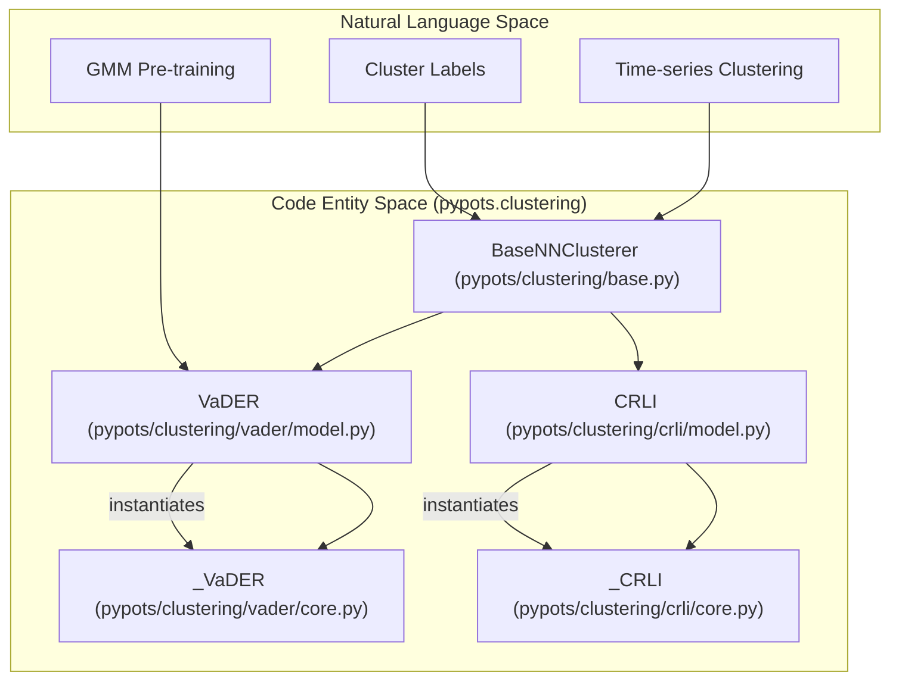
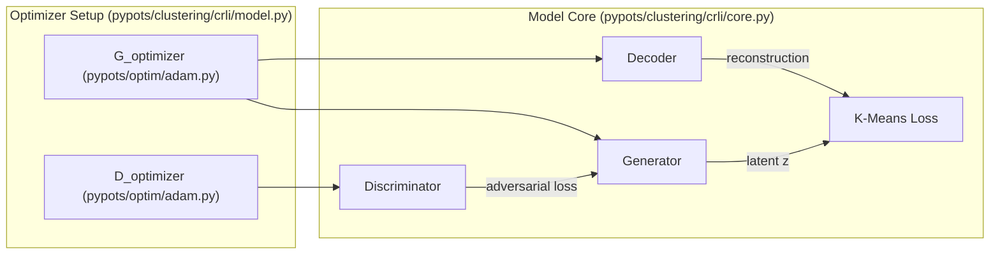

<!-- source: DeepWiki mcp.deepwiki.com · repo WenjieDu/PyPOTS · page 3.4 Clustering · fetched 2026-10-21 -->

# Clustering

<details>
<summary>Relevant source files</summary>

The following files were used as context for generating this wiki page:

- [pypots/base.py](pypots/base.py)
- [pypots/classification/base.py](pypots/classification/base.py)
- [pypots/classification/template/model.py](pypots/classification/template/model.py)
- [pypots/clustering/base.py](pypots/clustering/base.py)
- [pypots/clustering/crli/model.py](pypots/clustering/crli/model.py)
- [pypots/clustering/template/model.py](pypots/clustering/template/model.py)
- [pypots/clustering/vader/model.py](pypots/clustering/vader/model.py)
- [pypots/forecasting/base.py](pypots/forecasting/base.py)
- [pypots/forecasting/template/model.py](pypots/forecasting/template/model.py)
- [pypots/imputation/base.py](pypots/imputation/base.py)
- [pypots/imputation/csdi/model.py](pypots/imputation/csdi/model.py)
- [pypots/imputation/gpvae/model.py](pypots/imputation/gpvae/model.py)
- [pypots/imputation/template/model.py](pypots/imputation/template/model.py)
- [pypots/imputation/usgan/model.py](pypots/imputation/usgan/model.py)
- [pypots/utils/visual/__init__.py](pypots/utils/visual/__init__.py)
- [pypots/utils/visual/clustering.py](pypots/utils/visual/clustering.py)
- [pypots/utils/visual/data.py](pypots/utils/visual/data.py)
- [tests/classification/brits.py](tests/classification/brits.py)
- [tests/classification/grud.py](tests/classification/grud.py)
- [tests/clustering/crli.py](tests/clustering/crli.py)
- [tests/clustering/vader.py](tests/clustering/vader.py)
- [tests/forecasting/bttf.py](tests/forecasting/bttf.py)
- [tests/imputation/patchtst.py](tests/imputation/patchtst.py)
- [tests/utils/visual.py](tests/utils/visual.py)

</details>


The clustering module in PyPOTS provides specialized models and utilities for grouping partially-observed time-series data. Unlike standard clustering algorithms, these models are designed to handle missing values inherently during the learning process, often by combining representation learning with clustering objectives.

## Base Architecture

All clustering models in PyPOTS inherit from a structured hierarchy that ensures a consistent interface across different algorithms.

### BaseNNClusterer
The `BaseNNClusterer` class [[pypots/clustering/base.py:159-160]]() is the abstract foundation for all neural-network-based clustering models. It extends `BaseNNModel` [[pypots/clustering/base.py:159]]() and enforces the implementation of the clustering lifecycle.

Key methods include:
*   `fit()`: Trains the model on the provided dataset [[pypots/clustering/base.py:69-100]]().
*   `predict()`: Returns a dictionary containing clustering assignments and potential latent variables [[pypots/clustering/base.py:103-130]]().
*   `cluster()`: A convenience wrapper around `predict()` [[pypots/clustering/base.py:154]]() that directly returns the NumPy array of cluster assignments [[pypots/clustering/base.py:132-156]]().

### Data Flow and Entity Mapping
The following diagram illustrates how high-level clustering concepts map to specific code entities and the data flow during a typical `fit()` and `cluster()` cycle.

**Clustering System Entity Map**

Sources: [[pypots/clustering/base.py:18-159]](), [[pypots/clustering/vader/model.py:27-130]](), [[pypots/clustering/crli/model.py:26-162]]()

---

## Model Catalog

### VaDER (Variational Deep Embedding)
VaDER [[pypots/clustering/vader/model.py:27-28]]() is a generative model for clustering incomplete time series. It utilizes a Variational Autoencoder (VAE) architecture where the latent space is modeled as a Gaussian Mixture Model (GMM).

#### GMM Pre-training Phase
VaDER employs a unique two-stage training process [[pypots/clustering/vader/model.py:159-250]]():
1.  **Pre-training**: The model is trained for `pretrain_epochs` [[pypots/clustering/vader/model.py:100]]() to initialize the VAE parameters. During this phase, `self.model(inputs, pretrain=True)` is called [[pypots/clustering/vader/model.py:180]]().
2.  **GMM Initialization**: After pre-training, the model uses `sklearn.mixture.GaussianMixture` [[pypots/clustering/vader/model.py:15]]() to initialize the GMM components (mu, stddev, and weights) based on embeddings sampled from the encoder [[pypots/clustering/vader/model.py:189-221]]().
3.  **Joint Training**: The entire model is then optimized using the Evidence Lower Bound (ELBO) via the `self.optimizer` [[pypots/clustering/vader/model.py:226-250]]().

### CRLI (Clustering Representation Learning on Incomplete time-series)
CRLI [[pypots/clustering/crli/model.py:26-27]]() approaches clustering through Generative Adversarial Networks (GANs). It learns robust representations by competing a generator against a discriminator while simultaneously optimizing a k-means objective in the latent space.

#### Dual-Optimizer Training
CRLI implements a training loop involving two distinct optimizers: `G_optimizer` and `D_optimizer` [[pypots/clustering/crli/model.py:124-125]]().
*   **Generator Step**: Updates the generator and decoder to minimize reconstruction loss and the k-means loss [[pypots/clustering/crli/model.py:187-190]]().
*   **Discriminator Step**: Updates the discriminator to distinguish between real and generated sequences [[pypots/clustering/crli/model.py:191]]().
*   **K-Means Weighting**: The parameter `lambda_kmeans` [[pypots/clustering/crli/model.py:117]]() controls the influence of the clustering objective on the learned representations.

**CRLI Training Architecture**

Sources: [[pypots/clustering/crli/model.py:109-191]](), [[pypots/clustering/crli/model.py:187-191]]()

---

## Visualization and Evaluation Utilities

PyPOTS provides specialized tools for interpreting clustering results on time-series data. Evaluation is typically performed using both external metrics (comparing against ground truth labels) and internal metrics (evaluating the latent space structure).

| Utility Category | Code Entity / Function | Purpose |
| :--- | :--- | :--- |
| **External Validation** | `calc_external_cluster_validation_metrics` | Calculates Rand Index, Adjusted Rand Index, NMI, and Purity [[tests/clustering/crli.py:16-17]](). |
| **Internal Validation** | `calc_internal_cluster_validation_metrics` | Evaluates Silhouette, CHS, and DBS on latent embeddings [[tests/clustering/crli.py:18-19]](). |
| **Visualization** | `pypots.utils.visual` | Contains functions to visualize cluster trajectories and memberships [[pypots/utils/visual/__init__.py]](). |

Sources: [[tests/clustering/crli.py:107-124]](), [[pypots/clustering/crli/model.py:228-261]](), [[pypots/utils/visual/clustering.py]]().

## Usage Example

The standard interface allows switching between models with minimal code changes. The following snippet demonstrates the common `fit()` and `cluster()` pattern:

```python
from pypots.clustering import VaDER, CRLI
from pypots.optim import Adam

# Initialize CRLI with dual optimizers
g_opt = Adam(lr=0.001)
d_opt = Adam(lr=0.001)
crli = CRLI(
    n_steps=24, 
    n_features=10, 
    n_clusters=5, 
    n_generator_layers=2,
    rnn_hidden_size=64,
    G_optimizer=g_opt,
    D_optimizer=d_opt
)

# Train the model
crli.fit(train_set) # train_set contains 'X' [[pypots/clustering/base.py:80]]()

# Get cluster assignments directly
cluster_assignments = crli.cluster(test_set) # returns np.ndarray [[pypots/clustering/base.py:155]]()
```
Sources: [[pypots/clustering/crli/model.py:109-144]](), [[pypots/clustering/base.py:132-156]](), [[tests/clustering/crli.py:43-73]]()

---

