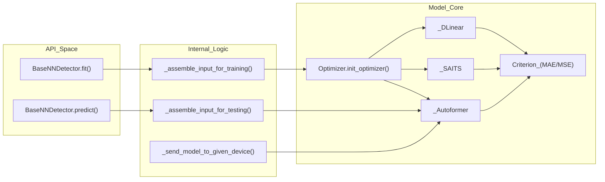
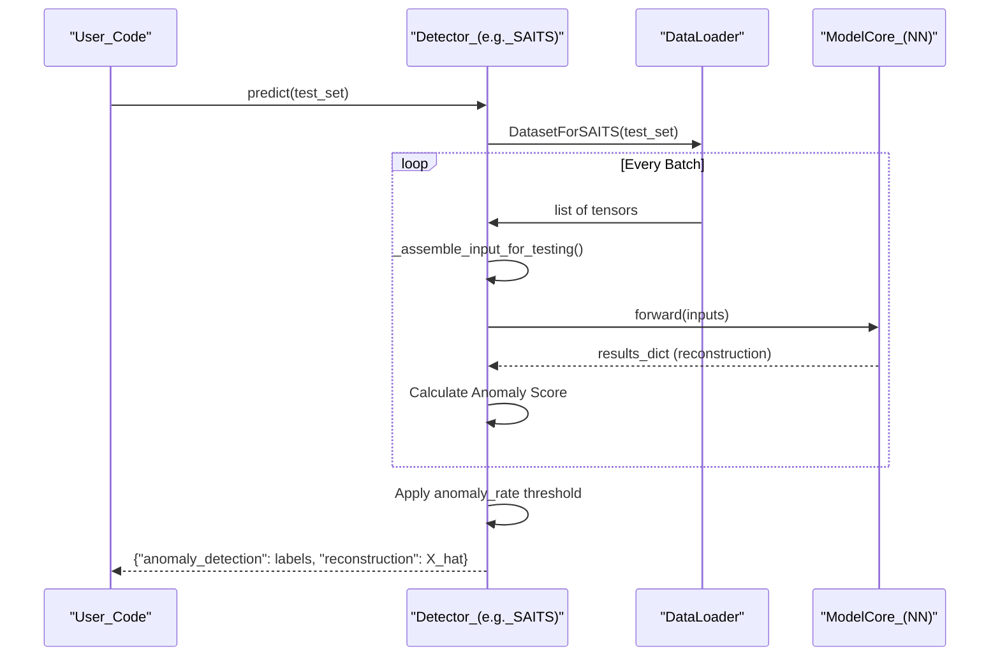

<!-- source: DeepWiki mcp.deepwiki.com · repo WenjieDu/PyPOTS · page 3.5 Anomaly Detection · fetched 2026-10-21 -->

# Anomaly Detection

<details>
<summary>Relevant source files</summary>

The following files were used as context for generating this wiki page:

- [pypots/anomaly_detection/__init__.py](pypots/anomaly_detection/__init__.py)
- [pypots/anomaly_detection/autoformer/__init__.py](pypots/anomaly_detection/autoformer/__init__.py)
- [pypots/anomaly_detection/autoformer/model.py](pypots/anomaly_detection/autoformer/model.py)
- [pypots/anomaly_detection/crossformer/__init__.py](pypots/anomaly_detection/crossformer/__init__.py)
- [pypots/anomaly_detection/dlinear/__init__.py](pypots/anomaly_detection/dlinear/__init__.py)
- [pypots/anomaly_detection/dlinear/model.py](pypots/anomaly_detection/dlinear/model.py)
- [pypots/anomaly_detection/fedformer/model.py](pypots/anomaly_detection/fedformer/model.py)
- [pypots/anomaly_detection/imputeformer/__init__.py](pypots/anomaly_detection/imputeformer/__init__.py)
- [pypots/anomaly_detection/imputeformer/model.py](pypots/anomaly_detection/imputeformer/model.py)
- [pypots/anomaly_detection/informer/model.py](pypots/anomaly_detection/informer/model.py)
- [pypots/anomaly_detection/itransformer/__init__.py](pypots/anomaly_detection/itransformer/__init__.py)
- [pypots/anomaly_detection/itransformer/model.py](pypots/anomaly_detection/itransformer/model.py)
- [pypots/anomaly_detection/patchtst/__init__.py](pypots/anomaly_detection/patchtst/__init__.py)
- [pypots/anomaly_detection/patchtst/model.py](pypots/anomaly_detection/patchtst/model.py)
- [pypots/anomaly_detection/reformer/__init__.py](pypots/anomaly_detection/reformer/__init__.py)
- [pypots/anomaly_detection/reformer/model.py](pypots/anomaly_detection/reformer/model.py)
- [pypots/anomaly_detection/saits/__init__.py](pypots/anomaly_detection/saits/__init__.py)
- [pypots/anomaly_detection/saits/model.py](pypots/anomaly_detection/saits/model.py)
- [pypots/anomaly_detection/scinet/__init__.py](pypots/anomaly_detection/scinet/__init__.py)
- [pypots/anomaly_detection/scinet/model.py](pypots/anomaly_detection/scinet/model.py)
- [pypots/anomaly_detection/segrnn/__init__.py](pypots/anomaly_detection/segrnn/__init__.py)
- [pypots/anomaly_detection/tefn/__init__.py](pypots/anomaly_detection/tefn/__init__.py)
- [pypots/anomaly_detection/timemixer/model.py](pypots/anomaly_detection/timemixer/model.py)
- [pypots/anomaly_detection/timesnet/__init__.py](pypots/anomaly_detection/timesnet/__init__.py)
- [pypots/anomaly_detection/timesnet/model.py](pypots/anomaly_detection/timesnet/model.py)
- [pypots/classification/tefn/__init__.py](pypots/classification/tefn/__init__.py)
- [pypots/data/__init__.py](pypots/data/__init__.py)
- [pypots/data/utils.py](pypots/data/utils.py)
- [pypots/forecasting/tefn/__init__.py](pypots/forecasting/tefn/__init__.py)
- [pypots/imputation/mrnn/data.py](pypots/imputation/mrnn/data.py)
- [pypots/imputation/tefn/__init__.py](pypots/imputation/tefn/__init__.py)
- [tests/anomaly_detection/__init__.py](tests/anomaly_detection/__init__.py)
- [tests/anomaly_detection/autoformer.py](tests/anomaly_detection/autoformer.py)
- [tests/anomaly_detection/saits.py](tests/anomaly_detection/saits.py)
- [tests/anomaly_detection/tefn.py](tests/anomaly_detection/tefn.py)
- [tests/global_test_config.py](tests/global_test_config.py)
- [tests/representation/ts2vec.py](tests/representation/ts2vec.py)

</details>


The `pypots.anomaly_detection` module provides a suite of neural network models designed for detecting anomalies in multivariate time series [pypots/anomaly_detection/__init__.py:1-52](). Most models in this task domain utilize a **reconstruction-based approach**, where the model learns to reconstruct normal patterns, and anomalies are identified by high reconstruction errors relative to a defined `anomaly_rate` [pypots/anomaly_detection/autoformer/model.py:25-37]().

## Model Catalog

PyPOTS includes an expanded catalog of 21 neural network architectures adapted for anomaly detection, ranging from classic Transformers to state-of-the-art frequency-domain and linear models.

| Model | Reference | Key Characteristics |
| :--- | :--- | :--- |
| **SAITS** | Du et al., 2023 | Self-attention based, joint modeling of observed and missing values [pypots/anomaly_detection/saits/model.py:25-30](). |
| **Autoformer** | Wu et al., 2021 | Decomposition-based architecture with Auto-Correlation mechanism [pypots/anomaly_detection/autoformer/model.py:25-26](). |
| **TimesNet** | Wu et al., 2023 | Transforms 1D time series into 2D variations for multi-periodicity [pypots/anomaly_detection/timesnet/model.py:24-25](). |
| **DLinear** | Zeng et al., 2023 | Decomposition-based linear model; efficient and effective for long-term patterns [pypots/anomaly_detection/dlinear/model.py:25-26](). |
| **SCINet** | Liu et al., 2022 | Sample Convolution and Interaction Network for hierarchical modeling [pypots/anomaly_detection/scinet/model.py:24-25](). |
| **TEFN** | Zhan et al., 2025 | Time Evidence Fusion Network using multi-source views [pypots/anomaly_detection/tefn/__init__.py:5-8](). |
| **iTransformer** | Liu et al., 2024 | Inverted Transformer that embeds the entire dimension as a token [pypots/anomaly_detection/itransformer/model.py:24-25](). |
| **TimeMixerPP** | Wang et al., 2025 | Advanced multi-scale mixing architecture with channel independence options [pypots/anomaly_detection/timemixerpp/__init__.py:1-23](). |
| **ImputeFormer** | Nie et al., 2023 | Specifically designed for imputation-based anomaly detection tasks [pypots/anomaly_detection/imputeformer/model.py:1-10](). |
| **PatchTST** | Nie et al., 2023 | Patch-based time series Transformer for long-term dependencies [pypots/anomaly_detection/patchtst/model.py:1-10](). |

Other supported models include **SegRNN**, **Reformer**, **Informer**, **FEDformer**, **Crossformer**, **Pyraformer**, **ETSformer**, **TimeMixer**, **NonstationaryTransformer**, and **FiLM** [pypots/anomaly_detection/__init__.py:30-52]().

**Sources:** [pypots/anomaly_detection/__init__.py:30-52](), [pypots/anomaly_detection/autoformer/model.py:25-26](), [pypots/anomaly_detection/tefn/__init__.py:5-8](), [pypots/anomaly_detection/dlinear/model.py:25-26]()

## Reconstruction-Based Detection Logic

Anomaly detection in PyPOTS typically follows a reconstruction workflow. The model is trained to minimize the difference between the input $X$ and the reconstructed output $\hat{X}$.

### Detection Process
1.  **Reconstruction**: The model generates $\hat{X}$ for an input sample using its internal `ModelCore` (e.g., `_Autoformer`, `_DLinear`, or `_SAITS`) [pypots/anomaly_detection/autoformer/model.py:168-183](), [pypots/anomaly_detection/saits/model.py:155-170]().
2.  **Error Calculation**: The reconstruction error (e.g., MSE or MAE) is calculated per time step or per sample [pypots/anomaly_detection/autoformer/model.py:132-133]().
3.  **Thresholding**: An anomaly score is derived. Samples with errors in the top $k$ percentile (where $k$ is the `anomaly_rate`) are flagged as anomalies [pypots/anomaly_detection/autoformer/model.py:35-37]().

### The `anomaly_rate` Parameter
Every detector requires an `anomaly_rate` during initialization [pypots/anomaly_detection/autoformer/model.py:119](). This parameter defines the expected proportion of anomalies in the dataset and is used to calculate the threshold for the `predict()` method [pypots/anomaly_detection/autoformer/model.py:35-37]().

**Sources:** [pypots/anomaly_detection/autoformer/model.py:25-37](), [pypots/anomaly_detection/saits/model.py:131-184]()

## BaseNNDetector Lifecycle

All neural network detectors inherit from `BaseNNDetector`, which standardizes the training and detection pipeline [pypots/anomaly_detection/autoformer/model.py:14-24]().

### Training and Prediction Flow

The diagram below maps the high-level API calls to the internal model core components and loss functions.

**Anomaly Detection Entity Mapping**

**Sources:** [pypots/anomaly_detection/autoformer/model.py:141-194](), [pypots/anomaly_detection/saits/model.py:155-192]()

### Data Flow Implementation

The `BaseNNDetector` implementation handles the transition from raw NumPy arrays (or HDF5 files) to PyTorch tensors, leveraging `DatasetForSAITS` for unified data handling [pypots/anomaly_detection/autoformer/model.py:17-18]().

**Sequence Diagram: Detection Data Flow**

**Sources:** [pypots/anomaly_detection/autoformer/model.py:195-210](), [pypots/anomaly_detection/saits/model.py:184-200]()

## Implementation Example: SAITS for Detection

SAITS is frequently used as a backbone for anomaly detection due to its ability to handle missing values via joint modeling [pypots/anomaly_detection/saits/model.py:25-30]().

### Configuration and Usage
Detectors are initialized with structural hyperparameters and training parameters.

```python
from pypots.anomaly_detection import SAITS
from pypots.optim import Adam

# Initialize the detector
detector = SAITS(
    n_steps=24,
    n_features=10,
    anomaly_rate=0.05, 
    n_layers=2,
    d_model=32,
    n_heads=2,
    d_k=16,
    d_v=16,
    d_ffn=32,
    dropout=0.1,
    epochs=10,
    optimizer=Adam(lr=0.001),
    device="cuda"
)

# Train the model
detector.fit(train_set, val_set)

# Detect anomalies
results = detector.predict(test_set)
labels = results["anomaly_detection"] 
reconstruction = results["reconstruction"] 
```

### Key Functions
*   `fit(train_set, val_set)`: Trains the underlying `model` core using the provided `optimizer`. Inherited from `BaseNNDetector` [pypots/anomaly_detection/autoformer/model.py:141-153]().
*   `predict(test_set)`: Performs inference. It returns both the binary `anomaly_detection` labels (based on `anomaly_rate`) and the `reconstruction` values [pypots/anomaly_detection/autoformer/model.py:116-120]().
*   `_assemble_input_for_training(data)`: Prepares the input dictionary including `X`, `missing_mask`, `X_ori`, and `indicating_mask` [pypots/anomaly_detection/autoformer/model.py:195-210]().
*   `key_in_data_set(key, data_set)`: A utility used to verify that required data fields exist in the input dataset before processing [pypots/anomaly_detection/autoformer/model.py:15]().

**Sources:** [pypots/anomaly_detection/autoformer/model.py:116-210](), [pypots/anomaly_detection/saits/model.py:25-200](), [tests/anomaly_detection/saits.py:43-77]()

---

