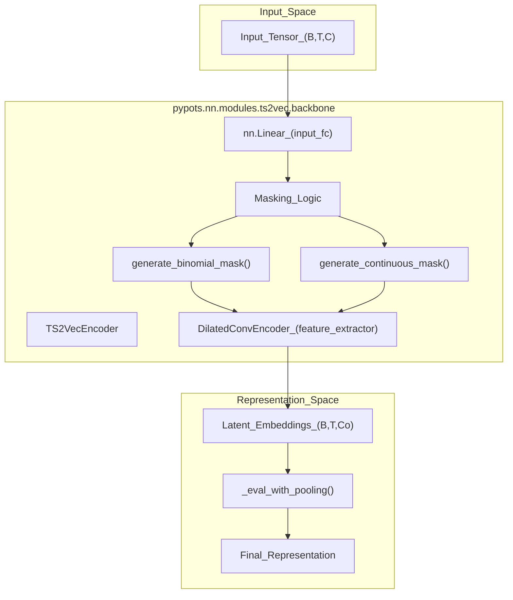
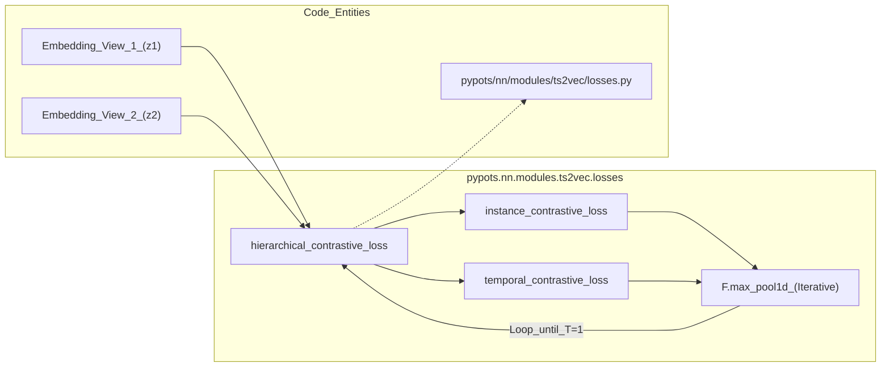

<!-- source: DeepWiki mcp.deepwiki.com · repo WenjieDu/PyPOTS · page 3.6 Representation Learning · fetched 2026-10-21 -->

# Representation Learning

<details>
<summary>Relevant source files</summary>

The following files were used as context for generating this wiki page:

- [pypots/classification/ts2vec/model.py](pypots/classification/ts2vec/model.py)
- [pypots/data/__init__.py](pypots/data/__init__.py)
- [pypots/data/utils.py](pypots/data/utils.py)
- [pypots/imputation/mrnn/data.py](pypots/imputation/mrnn/data.py)
- [pypots/nn/modules/ts2vec/__init__.py](pypots/nn/modules/ts2vec/__init__.py)
- [pypots/nn/modules/ts2vec/backbone.py](pypots/nn/modules/ts2vec/backbone.py)
- [pypots/nn/modules/ts2vec/layers.py](pypots/nn/modules/ts2vec/layers.py)
- [pypots/nn/modules/ts2vec/losses.py](pypots/nn/modules/ts2vec/losses.py)
- [pypots/nn/modules/ts2vec/utils.py](pypots/nn/modules/ts2vec/utils.py)
- [tests/anomaly_detection/__init__.py](tests/anomaly_detection/__init__.py)
- [tests/anomaly_detection/autoformer.py](tests/anomaly_detection/autoformer.py)
- [tests/anomaly_detection/saits.py](tests/anomaly_detection/saits.py)
- [tests/anomaly_detection/tefn.py](tests/anomaly_detection/tefn.py)
- [tests/classification/ts2vec.py](tests/classification/ts2vec.py)
- [tests/global_test_config.py](tests/global_test_config.py)
- [tests/representation/ts2vec.py](tests/representation/ts2vec.py)

</details>


Representation learning in PyPOTS focuses on extracting meaningful, low-dimensional embeddings from raw time-series data, even in the presence of missing values. These embeddings (or representations) serve as a compressed numerical summary of the input sequences, which can then be utilized for various downstream tasks such as classification, clustering, or visualization.

The primary model for this task in PyPOTS is **TS2Vec**, which utilizes hierarchical contrastive learning to capture both instance-level and temporal-level features.

## Base Architecture

The representation learning module follows the standard PyPOTS neural network hierarchy. Models in this domain typically inherit from task-specific base classes. While task-specific behaviors are defined in classes like `BaseNNClassifier` [pypots/classification/ts2vec/model.py:47](), the representation logic is often provided via a specialized `represent()` interface.

### The `represent()` Interface
Unlike other tasks that return predictions in the same space as the input (like imputation), representation models provide a `represent()` method [pypots/nn/modules/ts2vec/backbone.py:125-164](). This method is designed to output embeddings with specific pooling strategies:
*   `full_series`: Returns a single vector per sample by max-pooling over the entire time dimension [pypots/nn/modules/ts2vec/backbone.py:88-94]().
*   `multiscale`: Returns hierarchical features by concatenating max-pooled representations at different temporal scales [pypots/nn/modules/ts2vec/backbone.py:105-116]().
*   `integer`: Uses a specific pooling kernel size for local feature extraction [pypots/nn/modules/ts2vec/backbone.py:96-104]().

**Sources:**
- [pypots/nn/modules/ts2vec/backbone.py:86-122]()
- [pypots/nn/modules/ts2vec/backbone.py:125-198]()

---

## TS2Vec Implementation

TS2Vec (Time-Series to Vector) is a universal framework for learning representations of time series. It treats the time series at various scales and uses a hierarchical contrastive loss to learn robust embeddings.

### Data Flow and Encoding
The encoding process involves a linear projection followed by a dilated convolutional encoder. During training, masks (binomial or continuous) are applied to the input to encourage the model to learn context-aware features [pypots/nn/modules/ts2vec/backbone.py:52-84]().

#### System Architecture: TS2Vec Entity Mapping
The following diagram maps the logical components of the TS2Vec representation process to their specific code entities.


**Sources:**
- [pypots/nn/modules/ts2vec/backbone.py:32-84]()
- [pypots/nn/modules/ts2vec/backbone.py:86-122]()
- [pypots/nn/modules/ts2vec/utils.py:10-30]()
- [pypots/classification/ts2vec/model.py:158-165]()

### Hierarchical Contrastive Loss
The core of TS2Vec's learning is the hierarchical contrastive loss. This loss function combines two types of contrastive signals:
1.  **Instance Contrastive Loss**: Pulls representations of the same sample (under different augmentations/masks) together while pushing different samples apart.
2.  **Temporal Contrastive Loss**: Pulls representations of the same timestamp (under different contexts) together.

These losses are calculated across multiple temporal scales using iterative max-pooling until the sequence length is reduced to 1.


**Sources:**
- [pypots/nn/modules/ts2vec/backbone.py:32-50]()
- [pypots/classification/ts2vec/model.py:158-165]()
- [pypots/nn/modules/ts2vec/losses.py:1-50]()

---

## Downstream Applications

Learned embeddings from `pypots.representation` are frequently used as inputs for external algorithms or other PyPOTS modules.

### Classification and Clustering
Once a model like `TS2Vec` is trained using `fit()` [pypots/classification/ts2vec/model.py:209-223](), the `represent()` method can transform raw time series into fixed-length vectors. In the classification variant, PyPOTS supports several standard classifiers to be trained on top of these embeddings including Logistic Regression (`lr`), SVM (`svm`), and KNN (`knn`) [pypots/classification/ts2vec/model.py:23-44]().

| Task | Interface | Strategy |
| :--- | :--- | :--- |
| **Clustering** | `model.represent(X, encoding_window='full_series')` | Use resulting vectors as input to `KMeans` or `DBSCAN`. |
| **Classification** | `model.predict(X, classifier_type='svm')` | Use vectors to train/predict with `lr`, `svm`, or `knn` [pypots/classification/ts2vec/model.py:23-44](). |
| **Anomaly Detection** | `model.predict(X)` | Use reconstruction or embedding distance to identify outliers. |

**Sources:**
- [pypots/nn/modules/ts2vec/backbone.py:145-148]()
- [pypots/classification/ts2vec/model.py:23-44]()
- [tests/classification/ts2vec.py:62-92]()

### Usage Example
In the test suite, the `TS2Vec` model is initialized with a specific `n_output_dims`. After training, it can produce both sequence-level and timestamp-level embeddings [tests/classification/ts2vec.py:43-55]().

```python
from pypots.representation import TS2Vec
from pypots.optim import Adam

# Initialize TS2Vec for representation task
ts2vec = TS2Vec(
    n_steps=DATA["n_steps"],
    n_features=DATA["n_features"],
    n_output_dims=2, # Dimension of the learned embedding
    d_hidden=64,
    n_layers=2,
    epochs=5,
    optimizer=Adam(lr=0.001),
)

# Train the model
ts2vec.fit(TRAIN_SET, VAL_SET)

# Extract representations (downstream via predict in classification context)
results = ts2vec.predict(TEST_SET, classifier_type="svm")
```

**Sources:**
- [tests/classification/ts2vec.py:43-55]()
- [tests/classification/ts2vec.py:62-64]()

---

## Summary of Components

| Component | Role | Code Entity |
| :--- | :--- | :--- |
| **Encoder** | Maps raw series to hidden states | `TS2VecEncoder` [pypots/nn/modules/ts2vec/backbone.py:32]() |
| **Backbone** | Dilated convolutions for temporal features | `DilatedConvEncoder` [pypots/nn/modules/ts2vec/backbone.py:49]() |
| **Pooling** | Strategy for final embedding shape | `_eval_with_pooling` [pypots/nn/modules/ts2vec/backbone.py:86]() |
| **Masking** | Augmentation via binomial/continuous masks | `generate_binomial_mask`, `generate_continuous_mask` [pypots/nn/modules/ts2vec/utils.py:10-28]() |
| **Optimization** | Gradient descent implementation | `pypots.optim.Adam` [pypots/classification/ts2vec/model.py:19]() |

**Sources:**
- [pypots/nn/modules/ts2vec/backbone.py:32-122]()
- [pypots/nn/modules/ts2vec/utils.py:10-28]()
- [pypots/classification/ts2vec/model.py:117-148]()

---

