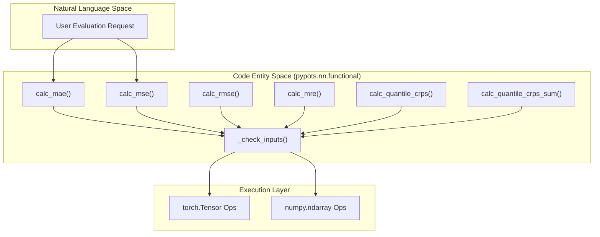
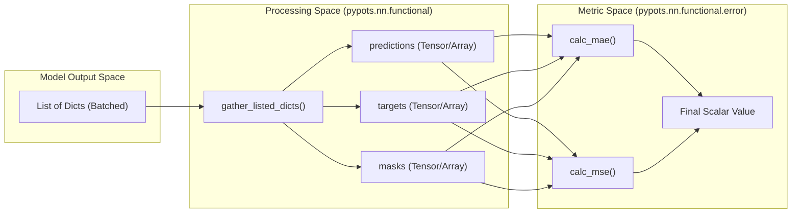

<!-- source: DeepWiki mcp.deepwiki.com · repo WenjieDu/PyPOTS · page 4.1 Error & Regression Metrics · fetched 2026-10-21 -->

# Error & Regression Metrics

<details>
<summary>Relevant source files</summary>

The following files were used as context for generating this wiki page:

- [pypots/nn/functional/__init__.py](pypots/nn/functional/__init__.py)
- [pypots/nn/functional/error.py](pypots/nn/functional/error.py)
- [pypots/nn/functional/gathering.py](pypots/nn/functional/gathering.py)
- [pypots/nn/functional/normalization.py](pypots/nn/functional/normalization.py)
- [pypots/utils/metrics/__init__.py](pypots/utils/metrics/__init__.py)
- [pypots/utils/metrics/classification.py](pypots/utils/metrics/classification.py)
- [pypots/utils/metrics/clustering.py](pypots/utils/metrics/clustering.py)
- [pypots/utils/metrics/error.py](pypots/utils/metrics/error.py)
- [tests/functional/__init__.py](tests/functional/__init__.py)
- [tests/functional/metrics.py](tests/functional/metrics.py)

</details>


This page provides a detailed technical reference for the error and regression metrics implemented in PyPOTS. These metrics are primarily used for evaluating performance in **imputation** and **forecasting** tasks. PyPOTS supports a dual-backend approach, allowing these functions to operate on both NumPy arrays and PyTorch tensors seamlessly.

## Migration Path

The metrics system has undergone a structural migration to consolidate functional operations under the `pypots.nn` namespace. 

*   **Deprecated Path:** `pypots.utils.metrics.error` [pypots/utils/metrics/error.py:1-28]()
*   **Current Path:** `pypots.nn.functional.error` [pypots/nn/functional/error.py:1-161]()

The legacy module `pypots.utils.metrics` now serves as a wrapper that issues a deprecation warning and imports from the new functional location [pypots/utils/metrics/__init__.py:34-35](). The package `pypots.utils.metrics.error` specifically warns users to migrate to the `pypots.nn.functional.error` namespace [pypots/utils/metrics/error.py:18-19]().

### Metric Architecture Overview

The following diagram illustrates how the metric calculation logic is bridged from the user-facing utility space to the functional implementation space.

**Figure 1: Metric Logic Flow**

Sources: [pypots/nn/functional/error.py:14-161](), [pypots/nn/functional/__init__.py:25-32](), [pypots/utils/metrics/error.py:9-16]()

---

## Core Implementation Logic

### Input Validation and Backend Selection
Every error metric in PyPOTS calls the internal helper `_check_inputs` [pypots/nn/functional/error.py:14-53](). This function performs several critical tasks:
1.  **Type Matching:** Ensures `predictions`, `targets`, and `masks` (if provided) are of the same type (either all NumPy or all PyTorch) [pypots/nn/functional/error.py:21-24](), [pypots/nn/functional/error.py:39-42]().
2.  **Shape Validation:** Confirms that the shapes of all inputs match to prevent broadcasting errors [pypots/nn/functional/error.py:27-32](), [pypots/nn/functional/error.py:44-48]().
3.  **Numerical Integrity:** Scans for `NaN` values in the inputs using `lib.isnan()`, raising an assertion if any are detected, as metrics require clean numeric inputs [pypots/nn/functional/error.py:34-35](), [pypots/nn/functional/error.py:50]().
4.  **Backend Dispatch:** Returns the appropriate library module (`np` or `torch`) based on the input type, enabling polymorphic execution [pypots/nn/functional/error.py:25-52]().

### Masking Logic & Numerical Stability
For time-series imputation, metrics are often calculated only on specific observed values (the "ground truth" for missing values). PyPOTS handles this via a `masks` parameter:
*   **Logic:** When `masks` is provided, the error is multiplied by the mask before summation. Only positions where `masks == 1` contribute to the numerator and denominator [pypots/nn/functional/error.py:101]().
*   **Epsilon:** To prevent division-by-zero errors when a mask contains no active elements (all zeros), PyPOTS adds an epsilon of `1e-12` to the denominator [pypots/nn/functional/error.py:101](), [pypots/nn/functional/error.py:152]().

---

## Supported Metrics

### Standard Regression Metrics

| Metric | Function | Description |
| :--- | :--- | :--- |
| **MAE** | `calc_mae` | Mean Absolute Error. Calculates `lib.abs(predictions - targets)`. Supports masking [pypots/nn/functional/error.py:55-104](). |
| **MSE** | `calc_mse` | Mean Squared Error. Calculates `lib.square(predictions - targets)`. Supports masking [pypots/nn/functional/error.py:106-155](). |
| **RMSE** | `calc_rmse` | Root Mean Squared Error. The square root of MSE [pypots/nn/functional/error.py:157-161](). |
| **MRE** | `calc_mre` | Mean Relative Error. Evaluates error relative to the magnitude of the targets [pypots/nn/functional/error.py:13](). |

Sources: [pypots/nn/functional/error.py:55-161](), [pypots/utils/metrics/error.py:9-16]()

### Distributional Evaluation (CRPS)
For probabilistic models, PyPOTS provides Continuous Ranked Probability Score (CRPS) variants to evaluate quantile-based distributional accuracy. These are tested for device compatibility (CPU, CUDA, MPS) [tests/functional/metrics.py:18-29]():
*   **`calc_quantile_crps`**: Evaluates the quality of predicted quantiles against targets [pypots/nn/functional/error.py:14]().
*   **`calc_quantile_crps_sum`**: Aggregated version of CRPS for overall distributional fit [pypots/nn/functional/error.py:15]().

---

## Data Flow in Metric Calculation

The following diagram maps the data flow from raw model outputs to the final metric scalar, highlighting the role of `gather_listed_dicts` and the functional error modules.

**Figure 2: Data Flow from Model to Metric**

Sources: [pypots/nn/functional/gathering.py:12-43](), [pypots/nn/functional/error.py:55-155]()

### Implementation Details: MAE & MSE

The implementation of MAE and MSE demonstrates the conditional logic for masking and the use of the `1e-12` epsilon for stability:

```python
# MAE Implementation Detail [pypots/nn/functional/error.py:100-103]
if masks is not None:
    return lib.sum(lib.abs(predictions - targets) * masks) / (lib.sum(masks) + 1e-12)
else:
    return lib.mean(lib.abs(predictions - targets))
```

```python
# MSE Implementation Detail [pypots/nn/functional/error.py:151-154]
if masks is not None:
    return lib.sum(lib.square(predictions - targets) * masks) / (lib.sum(masks) + 1e-12)
else:
    return lib.mean(lib.square(predictions - targets))
```

## Summary of Metric Utilities

| Module | Purpose | Key Entities |
| :--- | :--- | :--- |
| `pypots.nn.functional.error` | Core math for regression/imputation | `calc_mae`, `calc_mse`, `calc_rmse`, `calc_mre` |
| `pypots.nn.functional.gathering` | Aggregating results across batches | `gather_listed_dicts` [pypots/nn/functional/gathering.py:12-25]() |
| `pypots.nn.functional.normalization` | Data scaling impacting error scale | `nonstationary_norm`, `nonstationary_denorm` [pypots/nn/functional/normalization.py:13-98]() |

Sources: [pypots/nn/functional/__init__.py:25-35](), [pypots/nn/functional/gathering.py:12-25](), [pypots/nn/functional/normalization.py:13-60]()

---

