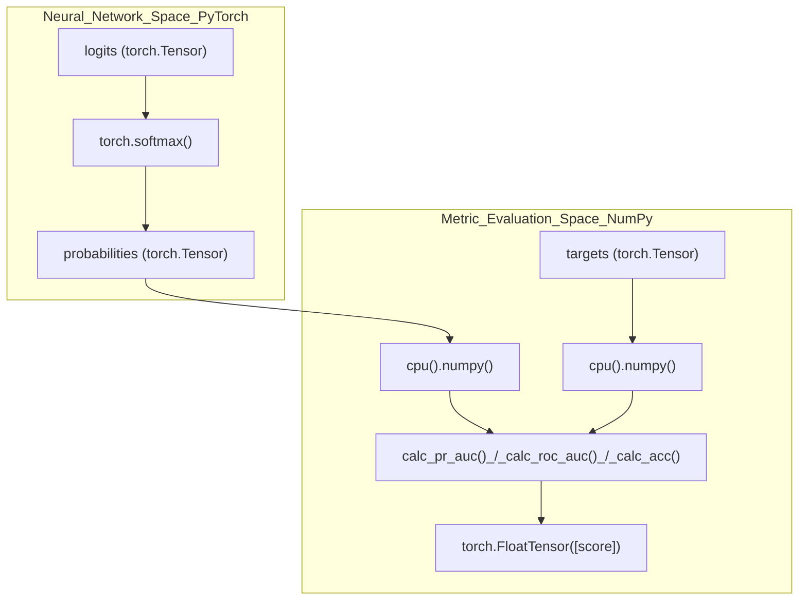
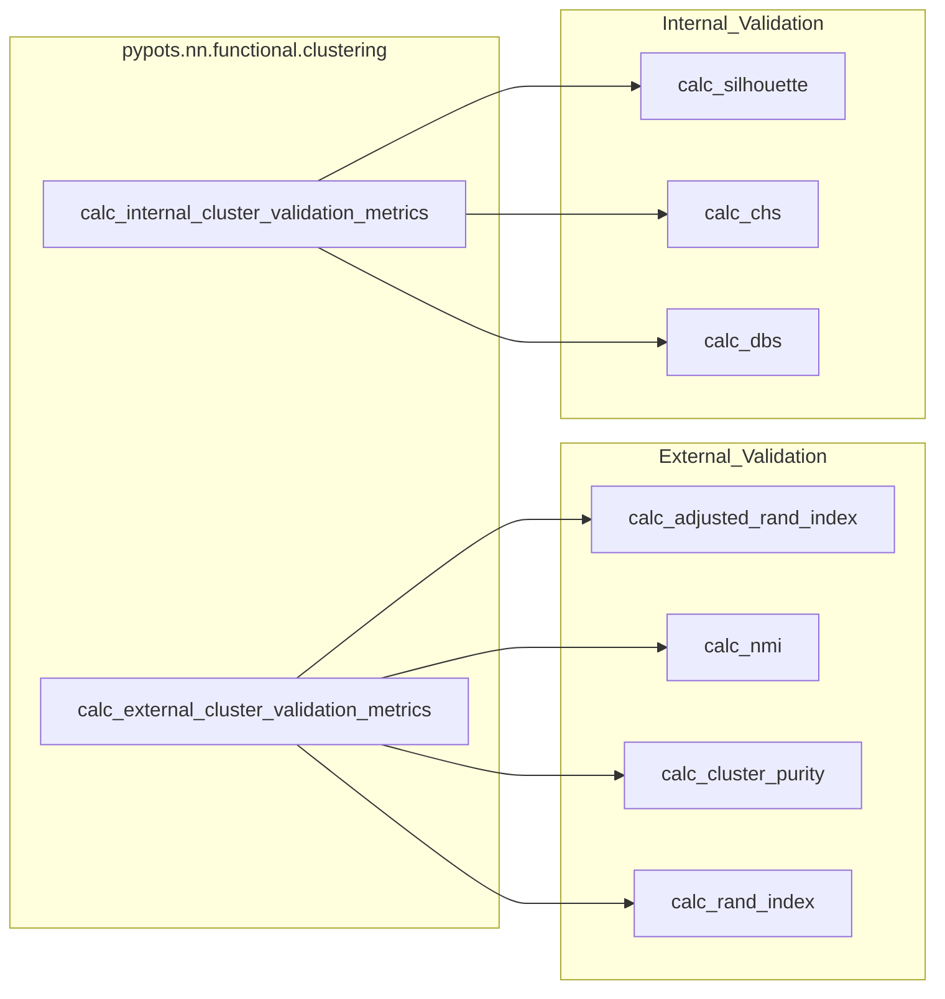
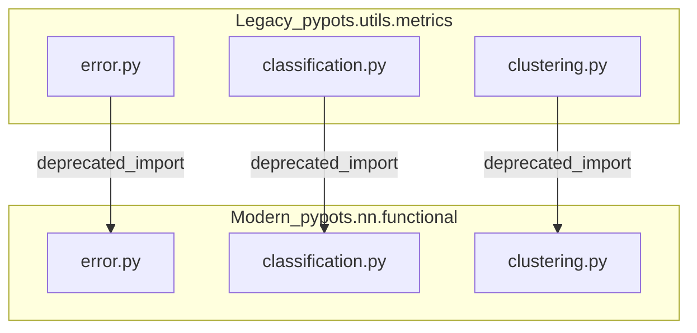

<!-- source: DeepWiki mcp.deepwiki.com · repo WenjieDu/PyPOTS · page 4.2 Classification & Clustering Metrics · fetched 2026-10-21 -->

# Classification & Clustering Metrics

<details>
<summary>Relevant source files</summary>

The following files were used as context for generating this wiki page:

- [pypots/nn/functional/error.py](pypots/nn/functional/error.py)
- [pypots/nn/modules/loss.py](pypots/nn/modules/loss.py)
- [pypots/nn/modules/metric.py](pypots/nn/modules/metric.py)
- [pypots/utils/metrics/__init__.py](pypots/utils/metrics/__init__.py)
- [pypots/utils/metrics/classification.py](pypots/utils/metrics/classification.py)
- [pypots/utils/metrics/clustering.py](pypots/utils/metrics/clustering.py)
- [pypots/utils/metrics/error.py](pypots/utils/metrics/error.py)
- [tests/functional/__init__.py](tests/functional/__init__.py)
- [tests/functional/metrics.py](tests/functional/metrics.py)

</details>


This page provides a technical reference for the classification and clustering metrics implemented in PyPOTS. These metrics are used to evaluate model performance across different task domains, specifically within the `pypots.classification` and `pypots.clustering` modules. PyPOTS maintains a dual-backend approach, offering functional implementations in both NumPy and PyTorch, while providing high-level `Criterion` classes for integration into neural network training loops.

## Classification Metrics

Classification metrics in PyPOTS evaluate the quality of categorical predictions. The system handles both hard labels (for accuracy and F1) and soft probabilities (for AUC metrics).

### Core Classification Functions
The functional implementations reside in `pypots.nn.functional.classification`. These functions are designed to work with either NumPy arrays or PyTorch tensors.

*   **Accuracy (`calc_acc`)**: Calculates the proportion of correct predictions [pypots/nn/functional/classification.py:14-14]().
*   **PR-AUC (`calc_pr_auc`)**: Computes the Area Under the Precision-Recall Curve, which is particularly useful for imbalanced datasets [pypots/nn/functional/classification.py:12-12]().
*   **ROC-AUC (`calc_roc_auc`)**: Computes the Area Under the Receiver Operating Characteristic Curve [pypots/nn/functional/classification.py:13-13]().
*   **Precision, Recall, and F1 (`calc_precision_recall_f1`)**: Standard metrics for binary and multi-class classification [pypots/nn/functional/classification.py:11-11]().
*   **Binary Metrics (`calc_binary_classification_metrics`)**: A convenience wrapper to compute all binary classification metrics at once [pypots/nn/functional/classification.py:10-10]().

Sources: [pypots/nn/functional/classification.py:9-15](), [pypots/utils/metrics/classification.py:9-15]()

### Softmax-to-Numpy Pipeline
For neural network evaluation, PyPOTS models typically output unnormalized logits. The metrics classes handle the conversion from these logits to probabilities and then to NumPy for calculation using standard libraries (like Scikit-Learn) wrapped in the functional layer.

**Data Flow: Logits to Metric Score**

Sources: [pypots/nn/modules/metric.py:27-34](), [pypots/nn/modules/metric.py:47-50](), [pypots/nn/modules/metric.py:62-66]()

### Classification Criterion Classes
PyPOTS wraps these functional calls into `Criterion` subclasses in `pypots.nn.modules.metric.py`. These classes inherit from `pypots.nn.modules.loss.Criterion`, setting `lower_better=False` because higher values indicate better performance [pypots/nn/modules/metric.py:19-21]().

| Class | Functionality | Implementation Detail |
| :--- | :--- | :--- |
| `Accuracy` | Categorical Accuracy | Uses `np.argmax` on probabilities [pypots/nn/modules/metric.py:63-65]() |
| `PR_AUC` | Precision-Recall AUC | Requires `pos_label` (default 1) [pypots/nn/modules/metric.py:18-20]() |
| `ROC_AUC` | ROC AUC | Handles multi-class via functional wrapper [pypots/nn/modules/metric.py:38-40]() |

Sources: [pypots/nn/modules/metric.py:17-67](), [pypots/nn/modules/loss.py:17-31]()

---

## Clustering Metrics

Clustering evaluation in PyPOTS is divided into **External Validation** (comparing against ground truth labels) and **Internal Validation** (evaluating cluster structure without labels).

### External Validation Metrics
These metrics require ground truth labels and are used when evaluating models on labeled datasets where the labels were hidden during training.

*   **Rand Index (RI) & Adjusted Rand Index (ARI)**: Measures similarity between two clusterings [pypots/nn/functional/clustering.py:10-11]().
*   **Normalized Mutual Information (NMI)**: Information-theoretic measure of cluster agreement [pypots/nn/functional/clustering.py:13-13]().
*   **Cluster Purity**: The extent to which clusters contain a single class [pypots/nn/functional/clustering.py:12-12]().

### Internal Validation Metrics
These metrics evaluate the quality of clustering based on the data's intrinsic properties (compactness and separation).

*   **Silhouette Coefficient**: Measures how similar an object is to its own cluster compared to other clusters [pypots/nn/functional/clustering.py:16-16]().
*   **Calinski-Harabasz Score (CHS)**: Ratio of the sum of between-clusters dispersion and of within-cluster dispersion [pypots/nn/functional/clustering.py:14-14]().
*   **Davies-Bouldin Score (DBS)**: Average similarity measure of each cluster with its most similar cluster [pypots/nn/functional/clustering.py:15-15]().

**Clustering Metric Architecture**

Sources: [pypots/nn/functional/clustering.py:10-18](), [pypots/utils/metrics/clustering.py:9-19]()

---

## Technical Implementation Details

### The Criterion Base Class
All metrics and loss functions inherit from `pypots.nn.modules.loss.Criterion`, which itself extends `torch.nn.modules.loss._Loss` [pypots/nn/modules/loss.py:17-17](). This base class introduces the `lower_better` attribute, which is critical for automated model selection and early stopping mechanisms in PyPOTS [pypots/nn/modules/loss.py:18-33]().

### Masking Logic in Error Metrics
While primarily used for imputation, error metrics like `MAE`, `MSE`, `RMSE`, and `MRE` also exist as `Criterion` classes in `pypots.nn.modules.loss.py` [pypots/nn/modules/loss.py:54-108](). They support a `masks` parameter to filter specific values from evaluation [pypots/nn/modules/loss.py:62-62](). The implementation uses a small epsilon (`1e-12`) to ensure numerical stability during division [pypots/nn/functional/error.py:101-101]().

```python
# Internal implementation of masked MAE in pypots.nn.functional.error
if masks is not None:
    return lib.sum(lib.abs(predictions - targets) * masks) / (lib.sum(masks) + 1e-12)
```
Sources: [pypots/nn/functional/error.py:100-101](), [pypots/nn/modules/loss.py:68-79]()

### Input Validation
The `_check_inputs` utility in `pypots.nn.functional.error.py` ensures that predictions, targets, and optional masks are compatible in type (NumPy vs. PyTorch) and shape, and verifies the absence of NaN values before metric calculation [pypots/nn/functional/error.py:14-52]().

### Deprecation & Migration Path
The library has migrated from `pypots.utils.metrics` to `pypots.nn.functional`. Users should import directly from the functional or module paths to avoid deprecation warnings [pypots/utils/metrics/__init__.py:34-34]().

**Namespace Mapping**


| Legacy Path | Modern Path |
| :--- | :--- |
| `pypots.utils.metrics.error` | `pypots.nn.functional.error` [pypots/utils/metrics/error.py:9-16]() |
| `pypots.utils.metrics.classification` | `pypots.nn.functional.classification` [pypots/utils/metrics/classification.py:9-15]() |
| `pypots.utils.metrics.clustering` | `pypots.nn.functional.clustering` [pypots/utils/metrics/clustering.py:9-19]() |

Sources: [pypots/utils/metrics/__init__.py:1-60](), [pypots/utils/metrics/classification.py:1-28](), [pypots/utils/metrics/clustering.py:1-34](), [pypots/utils/metrics/error.py:1-28]()

---

