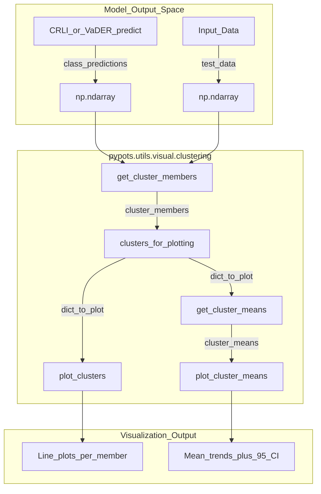
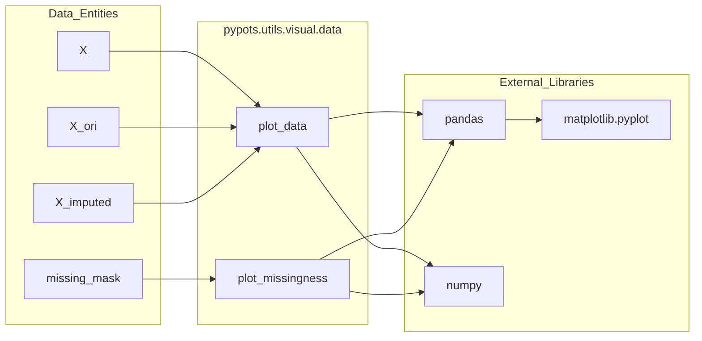

<!-- source: DeepWiki mcp.deepwiki.com · repo WenjieDu/PyPOTS · page 4.3 Visualization Utilities · fetched 2026-10-21 -->

# Visualization Utilities

Relevant source files

The following files were used as context for generating this wiki page:

- [pypots/utils/visual/__init__.py](pypots/utils/visual/__init__.py)
- [pypots/utils/visual/clustering.py](pypots/utils/visual/clustering.py)
- [pypots/utils/visual/data.py](pypots/utils/visual/data.py)
- [tests/utils/visual.py](tests/utils/visual.py)

The `pypots.utils.visual` package provides a suite of specialized tools for diagnosing time-series models. These utilities are divided into two primary categories: data-centric visualizations for imputation and missingness analysis, and pipeline-centric visualizations for interpreting clustering results.

## Data Visualization for Imputation

The `pypots.utils.visual.data` module contains functions to evaluate the quality of imputation and the structure of missingness within datasets.

### Imputation Diagnostics (`plot_data`)

The `plot_data()` function provides a visual comparison between original values, observed values, and the model's imputed outputs [[pypots/utils/visual/data.py:17-25]](). It is designed to handle multivariate time series by creating a grid of subplots (defined by `n_rows` and `n_cols`) where each subplot represents a single feature [[pypots/utils/visual/data.py:66-70]]().

The visualization uses the following convention:
*   **Observed Values**: Red 'x' markers [[pypots/utils/visual/data.py:78]]().
*   **Evaluated (Original) Values**: Blue 'o' markers [[pypots/utils/visual/data.py:79]]().
*   **Imputed Values**: Solid green line [[pypots/utils/visual/data.py:80]]().

If no `sample_idx` is provided, the function selects a random sample from the batch for visualization and logs a warning [[pypots/utils/visual/data.py:59-62]]().

### Missingness Analysis (`plot_missingness`)

The `plot_missingness()` function analyzes the sparsity of the dataset [[pypots/utils/visual/data.py:89-94]](). It accepts either a 3D array (multiple samples) or a 2D array (single sample) [[pypots/utils/visual/data.py:113-131]](). It produces a two-panel figure:
1.  **Arrival Times Scatter Plot**: Visualizes exactly when observations occur for each feature. Observed timestamps are marked with blue '|' markers [[pypots/utils/visual/data.py:144-145]]().
2.  **Sequence Length Histogram**: Shows the distribution of the number of observed timestamps (sequence length) across all features in the sample [[pypots/utils/visual/data.py:95-97, 154-163]]().

**Sources:**
* [[pypots/utils/visual/data.py:17-88]]()
* [[pypots/utils/visual/data.py:89-166]]()
* [[tests/utils/visual.py:24-32]]()

---

## Clustering Visualization Pipeline

The `pypots.utils.visual.clustering` module provides a pipeline to transform raw clustering predictions into interpretable plots, including mean trends with confidence intervals.

### Data Flow for Clustering Visualization

The pipeline follows a specific transformation sequence to prepare 3D time-series arrays for Matplotlib:

#### 1. Membership Extraction
`get_cluster_members()` takes the input `test_data` and the `class_predictions` (from models like `VaDER` or `CRLI`) to group time-series samples by their assigned cluster ID using `np.unique` [[pypots/utils/visual/clustering.py:17-37]]().

#### 2. Plotting Preparation
`clusters_for_plotting()` reorganizes the grouped data into a nested dictionary structure [[pypots/utils/visual/clustering.py:40-42]](). It converts cluster members into a format where each variable (feature) can be accessed across all members of a specific cluster by iterating through `cluster_members` and converting them to `pd.DataFrame` objects [[pypots/utils/visual/clustering.py:75-86]]().

#### 3. Statistical Aggregation
`get_cluster_means()` calculates the mean trajectory and the 95% confidence interval (CI) for every feature within each cluster [[pypots/utils/visual/clustering.py:128-189]](). It uses `pd.DataFrame.mean` for the trend and `scipy.stats` to compute the CI bounds based on the standard error of the mean [[pypots/utils/visual/clustering.py:186-189]]().

### Code Entity Association: Clustering Pipeline

The following diagram illustrates how the functional entities in `pypots.utils.visual.clustering` process the output from a clusterer (e.g. `CRLI` or `VaDER`).

**Clustering Visualization Data Flow**

**Sources:**
* [[pypots/utils/visual/clustering.py:17-37]]()
* [[pypots/utils/visual/clustering.py:40-86]]()
* [[pypots/utils/visual/clustering.py:128-189]]()

---

## Visualization System Architecture

The visualization utilities bridge the gap between raw NumPy/PyTorch tensors and human-readable diagnostics.

**Imputation and Missingness Visualization Architecture**

### Key Function Summary

| Function | Purpose | Key Parameters |
| :--- | :--- | :--- |
| `plot_data` | Overlays observed, ground truth, and imputed values. | `X`, `X_ori`, `X_imputed`, `sample_idx` [[pypots/utils/visual/data.py:17-25]]() |
| `plot_missingness` | Visualizes arrival patterns and sequence length distribution. | `missing_mask`, `max_step`, `sample_idx` [[pypots/utils/visual/data.py:89-94]]() |
| `get_cluster_members` | Filters samples by predicted cluster ID. | `test_data`, `class_predictions` [[pypots/utils/visual/clustering.py:17-28]]() |
| `clusters_for_plotting` | Organizes arrays into a variable-first nested dictionary. | `cluster_members` [[pypots/utils/visual/clustering.py:40-49]]() |
| `get_cluster_means` | Computes 95% CI and mean trajectories for clusters. | `dict_to_plot` [[pypots/utils/visual/clustering.py:128-135]]() |
| `plot_clusters` | Renders individual member trajectories for each cluster. | `dict_to_plot` [[pypots/utils/visual/clustering.py:89-96]]() |

**Sources:**
* [[pypots/utils/visual/data.py:17-166]]()
* [[pypots/utils/visual/clustering.py:17-189]]()
* [[pypots/utils/visual/__init__.py:1-12]]()

---

