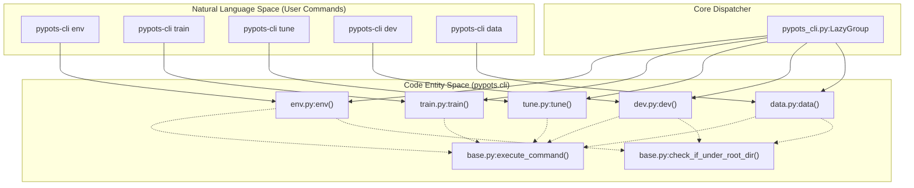
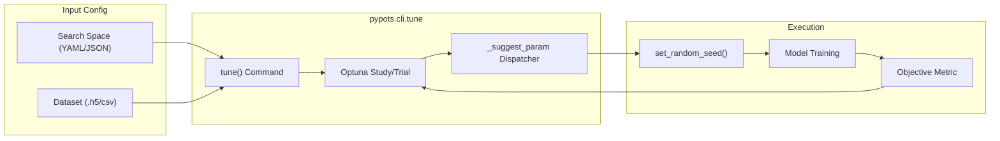

<!-- source: DeepWiki mcp.deepwiki.com · repo WenjieDu/PyPOTS · page 5 CLI & Workflow Tools · fetched 2026-10-21 -->

# CLI & Workflow Tools

Relevant source files

The following files were used as context for generating this wiki page:

- [pypots/cli/base.py](pypots/cli/base.py)
- [pypots/cli/dev.py](pypots/cli/dev.py)
- [pypots/cli/doc.py](pypots/cli/doc.py)
- [pypots/cli/env.py](pypots/cli/env.py)
- [pypots/cli/pypots_cli.py](pypots/cli/pypots_cli.py)
- [pypots/utils/random.py](pypots/utils/random.py)
- [tests/cli/dev.py](tests/cli/dev.py)
- [tests/cli/doc.py](tests/cli/doc.py)
- [tests/cli/env.py](tests/cli/env.py)
- [tests/utils/random.py](tests/utils/random.py)

The PyPOTS ecosystem provides a unified command-line interface, `pypots-cli`, to streamline the entire machine learning workflow—from environment setup and data preparation to model training, benchmarking, and large-scale hyperparameter optimization (HPO). The CLI has evolved into a comprehensive toolset that leverages a `LazyGroup` architecture to ensure fast performance even with heavy dependencies like PyTorch and NumPy installed.

### The pypots-cli Interface

The `pypots-cli` tool is the primary entry point for interacting with the library's utility functions. It is built using the Click library and utilizes a lazy-loading mechanism defined in `pypots.cli.pypots_cli.LazyGroup` [pypots/cli/pypots_cli.py:34-49](). This ensures that heavy libraries are only imported when a specific command is executed, keeping `pypots-cli --help` responsive.

The CLI covers a broad range of commands managed via the `_COMMAND_MAP` [pypots/cli/pypots_cli.py:18-31]():
*   **Workflow:** `data`, `train`, `predict`, `evaluate`, `tune`, `recommend`, `benchmark`.
*   **Infrastructure:** `env`, `info`, `model`.
*   **Development:** `dev`, `doc`.

#### Command Architecture and Code Entities

The following diagram illustrates how the CLI maps user commands to specific modules and how shared utilities like `execute_command` [pypots/cli/base.py:30-86]() and `check_if_under_root_dir` [pypots/cli/base.py:89-119]() support these operations.

**CLI Command Mapping**

**Sources:** [pypots/cli/pypots_cli.py:18-49](), [pypots/cli/base.py:30-119](), [pypots/cli/env.py:13-29](), [pypots/cli/dev.py:22-67](), [pypots/cli/doc.py:45-84]()

For a detailed breakdown of every available subcommand and their arguments, see **[CLI Commands Reference](#5.1)**.

---

### Hyperparameter Optimization (HPO) with Optuna

PyPOTS has migrated its HPO system to utilize **Optuna**, replacing the legacy NNI-based implementation. This transition provides a more integrated and flexible experience for searching hyperparameter spaces. The HPO workflow is primarily managed through the `pypots-cli tune` command [pypots/cli/pypots_cli.py:30]().

The system supports a variety of samplers (TPE, Random, CmaEs, Grid) and pruners (Median, Hyperband) to efficiently navigate the search space defined in YAML or JSON configuration files.

#### HPO Workflow Integration

The HPO system bridges configuration files and model execution, handling everything from trial suggestions to reproducible seeding via `set_random_seed` [pypots/utils/random.py:19-34]().

**HPO System Flow**

**Sources:** [pypots/cli/pypots_cli.py:30](), [pypots/utils/random.py:19-34]().

#### Key Workflow Features:
*   **Reproducibility:** Global random state management using `set_random_seed` which configures Python, NumPy, and PyTorch (including CUDA) seeds [pypots/utils/random.py:19-34](). The current seed can be retrieved via `get_random_seed` [pypots/utils/random.py:37-46]().
*   **Environment Management:** The `env` command automates the installation of complex dependencies like `pytorch-geometric` and `pytorch-sparse` using either `conda` [pypots/cli/env.py:40-45]() or `pip` [pypots/cli/env.py:47-59](). It handles hardware-specific CPU/GPU versions of Torch automatically [pypots/cli/env.py:50-56]().
*   **Developer Automation:** The `dev` command provides a one-stop-shop for building wheels [pypots/cli/dev.py:95-96](), running tests with `pytest` and `coverage` [pypots/cli/dev.py:97-102](), and linting code with `ruff` [pypots/cli/dev.py:103-107]().
*   **Doc Generation:** The `doc` command automates the `sphinx-apidoc` process [pypots/cli/doc.py:125-128](), including downloading the latest code from specific GitHub branches [pypots/cli/doc.py:102-124]() to ensure documentation stays current. It also supports local deployment for previewing [pypots/cli/doc.py:144-149]().

For a step-by-step guide on configuring Optuna and running HPO trials, see **[Hyperparameter Optimization with Optuna](#5.2)**.

---

### Summary of Child Pages

*   **[CLI Commands Reference](#5.1)**: Comprehensive documentation for all subcommands. Covers environment installation strategies for different hardware [pypots/cli/env.py:40-60](), developer tools for code quality [pypots/cli/dev.py:103-107](), and automated local documentation deployment [pypots/cli/doc.py:144-149]().
*   **[Hyperparameter Optimization with Optuna](#5.2)**: Detailed workflow for the `tune` command, including search space configuration, sampler/pruner selection, and the internal parameter suggestion dispatch system.

**Sources:**
* [pypots/cli/pypots_cli.py:1-64]()
* [pypots/cli/base.py:1-120]()
* [pypots/cli/env.py:1-61]()
* [pypots/cli/dev.py:1-114]()
* [pypots/cli/doc.py:1-155]()
* [pypots/utils/random.py:1-47]()

---

