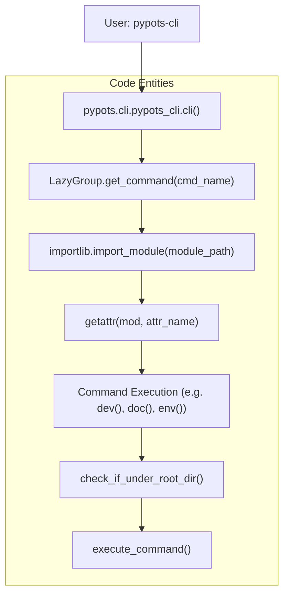
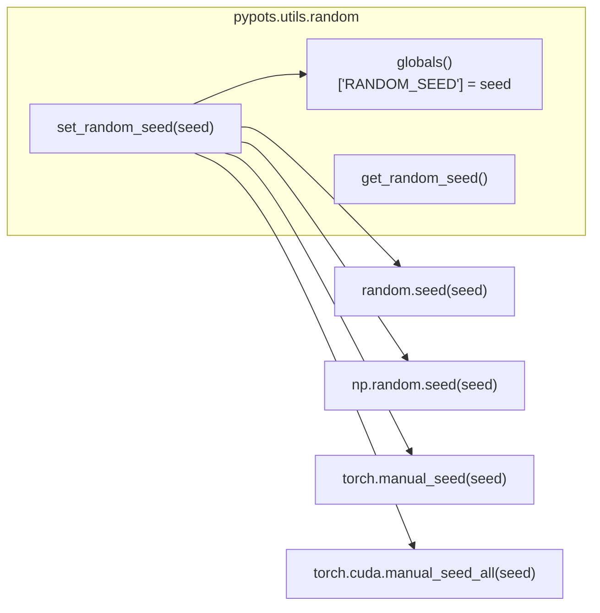

<!-- source: DeepWiki mcp.deepwiki.com · repo WenjieDu/PyPOTS · page 5.1 CLI Commands Reference · fetched 2026-10-21 -->

# CLI Commands Reference

Relevant source files

The following files were used as context for generating this wiki page:

- [pypots/cli/base.py](pypots/cli/base.py)
- [pypots/cli/dev.py](pypots/cli/dev.py)
- [pypots/cli/doc.py](pypots/cli/doc.py)
- [pypots/cli/env.py](pypots/cli/env.py)
- [pypots/cli/pypots_cli.py](pypots/cli/pypots_cli.py)
- [pypots/utils/random.py](pypots/utils/random.py)
- [tests/cli/dev.py](tests/cli/dev.py)
- [tests/cli/doc.py](tests/cli/doc.py)
- [tests/cli/env.py](tests/cli/env.py)
- [tests/utils/random.py](tests/utils/random.py)

The PyPOTS Command-Line Interface (CLI), invoked via `pypots-cli`, provides a comprehensive suite of tools for managing the full machine learning lifecycle—from environment setup and data preparation to training, inference, evaluation, and hyperparameter optimization.

## Architecture and Design Patterns

The CLI is built using a **Lazy-Loading Architecture** based on the `click` library. This ensures that the top-level `pypots-cli --help` command remains fast by avoiding the immediate import of heavyweight dependencies like `torch`, `numpy`, or `transformers` [pypots/cli/pypots_cli.py:1-6]().

### LazyGroup Implementation
The core of this architecture is the `LazyGroup` class, which inherits from `click.Group`. It maps command names to their respective module paths and attribute names in the `_COMMAND_MAP` dictionary [pypots/cli/pypots_cli.py:18-31]().

| Method | Description |
| :--- | :--- |
| `list_commands(ctx)` | Returns a sorted list of all registered command names [pypots/cli/pypots_cli.py:41-42](). |
| `get_command(ctx, cmd_name)` | Dynamically imports the required module using `importlib.import_module` and returns the command object only when invoked [pypots/cli/pypots_cli.py:44-49](). |

### Shared CLI Utilities
The `pypots.cli.base` module provides common functions used across multiple subcommands to interact with the shell and filesystem.

*   **`execute_command(command, verbose)`**: Runs a shell command using `subprocess.Popen`. It handles real-time output streaming to `stdout`/`stderr`. If the streams are in-memory (e.g., during tests using `CliRunner`), it detects the lack of a real file descriptor via `_has_real_fileno()` and captures output via `subprocess.PIPE` for manual forwarding [pypots/cli/base.py:14-86]().
*   **`check_if_under_root_dir(strict)`**: Verifies if the current working directory is the PyPOTS project root by checking for the existence of `.github`, `docs`, `pypots`, and `pyproject.toml` [pypots/cli/base.py:89-119]().

### CLI Command Execution Flow
The following diagram illustrates how a command is resolved and executed through the `LazyGroup` mechanism.

**CLI Command Resolution and Execution**

**Sources:** [pypots/cli/pypots_cli.py:34-53](), [pypots/cli/base.py:30-119]()

---

## Subcommand: `env` (Environment Setup)

The `env` command automates the installation of PyPOTS and its specialized dependencies (like PyG for GNN models). It performs strict directory checks via `check_if_under_root_dir(strict=True)` [pypots/cli/env.py:36]().

### Arguments
*   `--install`: Specifies the dependency scope. Choices: `dev`, `full`, `doc`, `test`, `optional` [pypots/cli/env.py:17-22]().
*   `--tool`: Selects the package manager. Choices: `conda`, `pip` [pypots/cli/env.py:23-28]().

### Implementation Logic
*   **Conda**: Executes `conda install pyg pytorch-scatter pytorch-sparse -c pyg` after verifying conda is available [pypots/cli/env.py:40-45]().
*   **Pip**: Detects the PyTorch version via `torch.__version__`. If no CUDA is available (`torch.cuda.is_available()`), it appends `+cpu` to the version string to fetch the correct wheels from the PyG index [pypots/cli/env.py:48-56](). It then installs the specified scope using `pip install -e '.[scope]'` [pypots/cli/env.py:58-59]().

**Sources:** [pypots/cli/env.py:13-61]()

---

## Subcommand: `dev` (Developer Utilities)

The `dev` command provides a unified interface for core development tasks. It requires the command to be run from the project root [pypots/cli/dev.py:72]().

### Operations
*   **`--build`**: Builds the project into a wheel and source distribution using `python -m build` [pypots/cli/dev.py:24-27](), [pypots/cli/dev.py:95-96]().
*   **`--run_tests`**: Executes `pytest`. Supports the `-k` argument for filtering tests and `--show-coverage` to generate a coverage report via `coverage run -m pytest` [pypots/cli/dev.py:35-60](), [pypots/cli/dev.py:97-102]().
*   **`--lint-code`**: Uses `ruff` to format (`ruff format .`) and check (`ruff check .`) the codebase [pypots/cli/dev.py:62-66](), [pypots/cli/dev.py:103-107]().
*   **`--cleanup`**: Removes build artifacts (`build/`, `dist/`, `pypots.egg-info`) and the `.pytest_cache` [pypots/cli/dev.py:29-33](), [pypots/cli/dev.py:91-94](), [pypots/cli/dev.py:112-113]().

**Sources:** [pypots/cli/dev.py:22-113]()

---

## Subcommand: `doc` (Documentation Generation)

The `doc` command manages the generation and local deployment of the Sphinx documentation.

### Workflow
1.  **`--gene-rst`**: Downloads the latest code from the specified GitHub branch (`main` or `dev`) using `tsdb.utils.downloading._download_and_extract`, extracts it into a temporary directory `temp_pypots_latest`, and runs `sphinx-apidoc` to generate reStructuredText files [pypots/cli/doc.py:46-58](), [pypots/cli/doc.py:102-138]().
2.  **`--gene-html`**: Builds the static HTML site by executing `make html` within the `docs` directory after purging temporary files [pypots/cli/doc.py:59-64](), [pypots/cli/doc.py:139-142]().
3.  **`--view-doc`**: Deploys a local web server (default port 9075) using `python -m http.server` to serve the generated HTML files from `docs/_build/html` [pypots/cli/doc.py:65-77](), [pypots/cli/doc.py:144-149]().
4.  **`--cleanup`**: Purges the `docs/_build` and `temp_pypots_latest` directories via `purge_temp_files()` [pypots/cli/doc.py:78-83](), [pypots/cli/doc.py:37-42]().

**Sources:** [pypots/cli/doc.py:15-150]()

---

## Command Reference Summary

The CLI supports the following subcommands, mapped to their implementation modules in `_COMMAND_MAP` [pypots/cli/pypots_cli.py:18-31]():

| Command | Purpose | Implementation Module |
| :--- | :--- | :--- |
| `env` | Setup Python environments and install dependencies | `pypots.cli.env` |
| `dev` | Developer tools for building, testing, and linting | `pypots.cli.dev` |
| `doc` | Build and view documentation | `pypots.cli.doc` |
| `data` | Data profiling, preparation, and conversion | `pypots.cli.data` |
| `train` | Train models using YAML/JSON configuration files | `pypots.cli.train` |
| `predict` | Perform inference with saved models | `pypots.cli.predict` |
| `evaluate` | Compute metrics for model outputs | `pypots.cli.evaluate` |
| `benchmark` | Compare multiple models on datasets | `pypots.cli.benchmark` |
| `tune` | Hyperparameter optimization using Optuna | `pypots.cli.tune` |
| `recommend` | Get hyperparameter suggestions | `pypots.cli.recommend` |
| `model` | Get information about available models | `pypots.cli.model` |
| `info` | Display system and environment information | `pypots.cli.info` |

**Sources:** [pypots/cli/pypots_cli.py:18-31]()

---

## Random Seed Management

Reproducibility across CLI commands is handled by the `pypots.utils.random` utility. The default seed is `2022`, corresponding to the birth year of PyPOTS [pypots/utils/random.py:16]().

### Code-to-System Mapping: Randomization
This diagram bridges the natural language concept of "Random Seed" to the specific code entities that manage state across libraries.

**Random Seed Propagation**

*   **`set_random_seed(random_seed)`**: Synchronizes the seed across Python's built-in `random`, `numpy`, and `torch` (both CPU and all CUDA devices) [pypots/utils/random.py:19-34]().
*   **`get_random_seed()`**: Retrieves the current global `RANDOM_SEED` used within the library [pypots/utils/random.py:37-46]().

**Sources:** [pypots/utils/random.py:1-46]()

---

