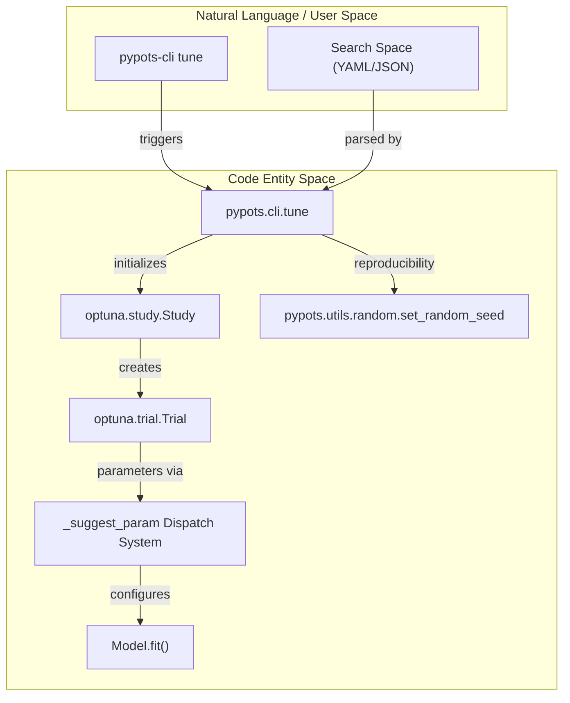
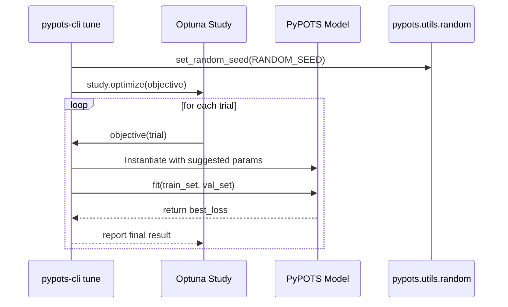

<!-- source: DeepWiki mcp.deepwiki.com · repo WenjieDu/PyPOTS · page 5.2 Hyperparameter Optimization with Optuna · fetched 2026-10-21 -->

# Hyperparameter Optimization with Optuna

<details>
<summary>Relevant source files</summary>

The following files were used as context for generating this wiki page:

- [pypots/cli/base.py](pypots/cli/base.py)
- [pypots/cli/dev.py](pypots/cli/dev.py)
- [pypots/cli/doc.py](pypots/cli/doc.py)
- [pypots/cli/env.py](pypots/cli/env.py)
- [pypots/cli/pypots_cli.py](pypots/cli/pypots_cli.py)
- [pypots/utils/random.py](pypots/utils/random.py)
- [tests/cli/dev.py](tests/cli/dev.py)
- [tests/cli/doc.py](tests/cli/doc.py)
- [tests/cli/env.py](tests/cli/env.py)
- [tests/utils/random.py](tests/utils/random.py)

</details>


Hyperparameter Optimization (HPO) in PyPOTS has transitioned from the legacy NNI-based system to a modern, integrated **Optuna**-based framework. This system allows for automated searching of optimal model configurations—such as hidden layer dimensions, learning rates, and dropout ratios—using sophisticated Bayesian optimization and pruning strategies. The integration is managed via the `pypots-cli tune` command, which orchestrates the lifecycle of HPO experiments [pypots/cli/pypots_cli.py:30-30]().

## HPO Workflow Overview

The HPO workflow is centered around the `tune` subcommand, which is lazily loaded by the `LazyGroup` CLI architecture to maintain fast help-menu response times [pypots/cli/pypots_cli.py:34-49](). Unlike the previous NNI implementation, the Optuna-based system is deeply integrated into the PyPOTS ecosystem, allowing for native handling of search spaces and trial management through a standardized YAML configuration format.

### System Architecture and Data Flow

The following diagram illustrates how the HPO system bridges the gap between the user's YAML configuration and the internal Optuna study.

**Optuna HPO System Architecture**

Sources: [pypots/cli/pypots_cli.py:18-31](), [pypots/utils/random.py:19-34]()

## Implementation Details

### Optuna Trial and Study Setup
The HPO system utilizes Optuna's `Study` object to manage a collection of `Trials`. Each trial represents a single execution of the model training pipeline with a specific set of hyperparameters. 

*   **Sampler Selection**: PyPOTS supports multiple Optuna samplers for parameter suggestion, including:
    *   **TPE (Tree-structured Parzen Estimator)**: The default Bayesian optimization approach.
    *   **Random**: Useful for baseline comparisons.
    *   **CmaEs**: Covariance Matrix Adaptation Evolution Strategy.
    *   **Grid**: Exhaustive search over a discrete space.
*   **Pruner Configuration**: To save computational resources, PyPOTS integrates Optuna pruners like `MedianPruner` and `HyperbandPruner`. These monitor intermediate results (e.g., validation loss) and terminate unpromising trials early based on pre-defined heuristics.

### The _suggest_param Dispatch System
PyPOTS implements a internal dispatch system to map YAML-defined search spaces to Optuna's suggestion API. This system handles various parameter types by calling the corresponding trial methods:
- **Categorical**: `trial.suggest_categorical(name, choices)`
- **Integer**: `trial.suggest_int(name, low, high, step, log)`
- **Float**: `trial.suggest_float(name, low, high, step, log)`

### GAN and Dual-Optimizer Handling
For complex models like `USGAN` or `CRLI`, which utilize dual-optimizer setups (e.g., Generator and Discriminator), the HPO system allows for independent tuning of both optimizers. The search space configuration can define separate learning rates and weight decays for `G_optimizer` and `D_optimizer`, which are then correctly dispatched to the model's initialization logic.

## Configuration and Execution

### YAML Search Space Format
Users define the hyperparameter search space in a YAML file. This format allows for hierarchical organization and clear definition of ranges and distributions.

```yaml
# Example Search Space Config
model: pypots.imputation.SAITS
n_steps: 24
n_features: 37
d_model:
  suggest_int: [64, 512, 64]
n_layers:
  suggest_int: [1, 4]
lr:
  suggest_float: [1e-4, 1e-2, log]
```

### Running End-to-End Search
To execute the HPO process, the `pypots-cli tune` command is used. It requires the configuration file and the paths to the datasets.

```bash
pypots-cli tune --config path/to/search_space.yaml --train_set data/train.h5 --val_set data/val.h5
```

The CLI handles:
1.  **Environment Validation**: Ensuring all dependencies (like `torch` and `optuna`) are met [pypots/cli/env.py:13-29]().
2.  **Reproducibility**: Setting the global random seed via `set_random_seed` to ensure trial results are consistent across identical configurations [pypots/utils/random.py:19-34]().
3.  **Command Execution**: Utilizing `execute_command` to manage the training subprocesses and stream logs to `stdout`/`stderr` [pypots/cli/base.py:30-45]().

**Trial Execution Sequence**

Sources: [pypots/utils/random.py:19-34](), [pypots/cli/base.py:30-45](), [pypots/cli/pypots_cli.py:34-49]()

## Developer Utilities for HPO

PyPOTS provides several CLI tools to assist in the development and maintenance of the HPO system:
- **`pypots-cli dev --run_tests`**: Runs the test suite to ensure HPO logic remains functional during updates [pypots/cli/dev.py:35-39]().
- **`pypots-cli env --install`**: Quickly sets up the environment with necessary HPO dependencies using `pip` or `conda` [pypots/cli/env.py:17-22]().
- **`pypots-cli doc`**: Generates documentation for new HPO modules using `sphinx-apidoc` [pypots/cli/doc.py:125-128]().

### Random Seed Management
To ensure that HPO results are reproducible, PyPOTS provides `set_random_seed` [pypots/utils/random.py:19-34](), which synchronizes the seeds for:
- Python's built-in `random` module [pypots/utils/random.py:29-29]().
- `numpy.random` [pypots/utils/random.py:30-30]().
- `torch.manual_seed` [pypots/utils/random.py:31-31]().
- `torch.cuda.manual_seed_all` [pypots/utils/random.py:32-32]().

The default seed is set to `2022`, the birth year of PyPOTS [pypots/utils/random.py:16-16](). Developers can verify the current seed using `get_random_seed` [pypots/utils/random.py:37-46]().

Sources: [pypots/cli/dev.py:22-67](), [pypots/cli/env.py:13-29](), [pypots/cli/pypots_cli.py:18-31](), [pypots/utils/random.py:1-46](), [pypots/cli/doc.py:45-84]()

---

