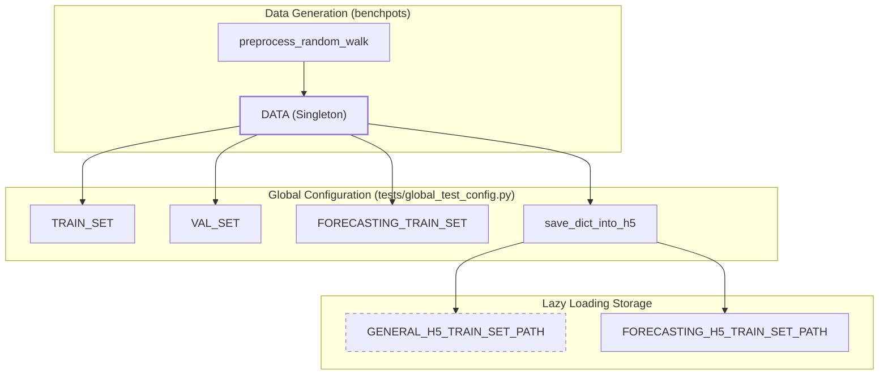
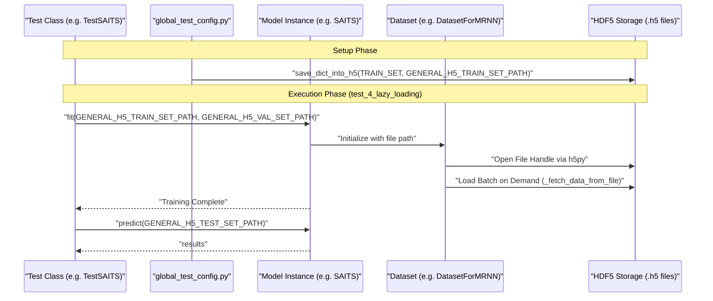

<!-- source: DeepWiki mcp.deepwiki.com · repo WenjieDu/PyPOTS · page 6.1 Test Architecture & Global Configuration · fetched 2026-10-21 -->

# Test Architecture & Global Configuration

Relevant source files

The following files were used as context for generating this wiki page:

- [pypots/data/__init__.py](pypots/data/__init__.py)
- [pypots/data/utils.py](pypots/data/utils.py)
- [pypots/imputation/csdi/data.py](pypots/imputation/csdi/data.py)
- [pypots/imputation/locf/model.py](pypots/imputation/locf/model.py)
- [pypots/imputation/mrnn/data.py](pypots/imputation/mrnn/data.py)
- [tests/anomaly_detection/__init__.py](tests/anomaly_detection/__init__.py)
- [tests/anomaly_detection/autoformer.py](tests/anomaly_detection/autoformer.py)
- [tests/anomaly_detection/saits.py](tests/anomaly_detection/saits.py)
- [tests/anomaly_detection/tefn.py](tests/anomaly_detection/tefn.py)
- [tests/base/test_model_loading.py](tests/base/test_model_loading.py)
- [tests/classification/brits.py](tests/classification/brits.py)
- [tests/classification/grud.py](tests/classification/grud.py)
- [tests/classification/raindrop.py](tests/classification/raindrop.py)
- [tests/clustering/crli.py](tests/clustering/crli.py)
- [tests/clustering/vader.py](tests/clustering/vader.py)
- [tests/forecasting/bttf.py](tests/forecasting/bttf.py)
- [tests/global_test_config.py](tests/global_test_config.py)
- [tests/imputation/brits.py](tests/imputation/brits.py)
- [tests/imputation/csdi.py](tests/imputation/csdi.py)
- [tests/imputation/gpvae.py](tests/imputation/gpvae.py)
- [tests/imputation/locf.py](tests/imputation/locf.py)
- [tests/imputation/mrnn.py](tests/imputation/mrnn.py)
- [tests/imputation/patchtst.py](tests/imputation/patchtst.py)
- [tests/imputation/saits.py](tests/imputation/saits.py)
- [tests/imputation/timesnet.py](tests/imputation/timesnet.py)
- [tests/imputation/transformer.py](tests/imputation/transformer.py)
- [tests/imputation/usgan.py](tests/imputation/usgan.py)
- [tests/representation/ts2vec.py](tests/representation/ts2vec.py)

The PyPOTS test architecture provides a unified framework for validating model performance, training stability, and data pipeline integrity across all task domains (imputation, forecasting, classification, clustering, and anomaly detection). It leverages a global configuration to ensure consistency and supports advanced testing features like parallel execution and lazy-loading validation.

## Global Configuration (`global_test_config.py`)

The file `tests/global_test_config.py` acts as the central repository for constants and shared data objects used throughout the test suite. It initializes the environment, sets random seeds for reproducibility, and generates the synthetic datasets used by individual test classes [tests/global_test_config.py:1-52]().

### Key Constants
| Constant | Purpose | Value |
| :--- | :--- | :--- |
| `RANDOM_SEED` | Ensures deterministic behavior across tests [tests/global_test_config.py:19]() | 2023 |
| `EPOCHS` | Number of training iterations for test models [tests/global_test_config.py:21]() | 2 |
| `N_STEPS` | Number of time steps in the input sequence [tests/global_test_config.py:23]() | 6 |
| `N_PRED_STEPS` | Steps to predict for forecasting tasks [tests/global_test_config.py:24]() | 2 |
| `ANOMALY_RATE` | Ratio of anomalies in the generated data [tests/global_test_config.py:28]() | 0.05 |
| `DEVICE` | Automatically detected CUDA device or None [tests/global_test_config.py:105-113]() | Variable |

### Singleton Data Generation
To prevent race conditions and file-locking issues during parallel testing with `pytest-xdist`, PyPOTS generates a singleton `DATA` object using a random walk approach [tests/global_test_config.py:56-65]().

**Data Flow from Generation to Task Sets:**
The `DATA` object is partitioned into task-specific dictionaries:
*   **General Tasks:** `TRAIN_SET`, `VAL_SET`, and `TEST_SET` contain `X`, `y`, and `anomaly_y` for classification, clustering, and anomaly detection [tests/global_test_config.py:74-90]().
*   **Forecasting Tasks:** `FORECASTING_TRAIN_SET`, `FORECASTING_VAL_SET`, and `FORECASTING_TEST_SET` split the sequence into input `X` and ground-truth prediction `X_pred` based on `N_PRED_STEPS` [tests/global_test_config.py:92-103]().

**Sources:** [tests/global_test_config.py:1-113]()

## Data Generation Approach

PyPOTS utilizes `benchpots.datasets.preprocess_random_walk` to create synthetic time-series data. This ensures that tests do not depend on external network access or large static files while still providing realistic properties like missingness and anomalies [tests/global_test_config.py:12,58-65]().

### Data Preprocessing Logic
1.  **Missingness:** A `MISSING_RATE` (default 0.1) is applied to simulate real-world data gaps [tests/global_test_config.py:29,64]().
2.  **Indicating Mask:** The system calculates `test_X_indicating_mask` by comparing the missing values in `test_X` against the original values in `test_X_ori` using XOR logic [tests/global_test_config.py:70]().
3.  **Anomalies:** Anomalies are injected at an `ANOMALY_RATE` of 0.05 to validate detection models [tests/global_test_config.py:28,63]().
4.  **Time-Gap Matrices:** Many models require time-gap (delta) matrices, which are generated via `pypots.data.utils.parse_delta` or its backend-specific implementations `_parse_delta_torch` and `_parse_delta_numpy` [pypots/data/utils.py:32-158]().

**Data Generation Entity Map:**
"Natural Language Space" to "Code Entity Space"

**Sources:** [tests/global_test_config.py:58-103](), [tests/global_test_config.py:132-145](), [pypots/data/utils.py:128-158]()

## Test Execution & Parallelization

PyPOTS uses `pytest-xdist` to parallelize test execution. To manage resource-intensive model training, tests are organized into groups using the `@pytest.mark.xdist_group` marker.

### Grouping Strategy
Individual model tests are grouped by task and model name to ensure that related tests (e.g., `test_0_fit`, `test_1_impute`, `test_3_saving_path`) run sequentially on the same worker, preventing conflicts in file I/O or GPU memory.

*   **Example (CRLI):** `@pytest.mark.xdist_group(name="clustering-crli")` [tests/clustering/crli.py:75]().
*   **Example (SAITS):** `@pytest.mark.xdist_group(name="imputation-saits")` [tests/imputation/saits.py:61]().
*   **Example (BTTF):** `@pytest.mark.xdist_group(name="forecasting-bttf")` [tests/forecasting/bttf.py:34]().

### GPU Management
The test suite detects multiple CUDA devices using `torch.cuda.device_count()` and randomly assigns a device to the `DEVICE` constant if more than one is available [tests/global_test_config.py:106-110](). This distributes the computational load across available hardware.

**Sources:** [tests/global_test_config.py:105-113](), [tests/clustering/crli.py:75-106](), [tests/imputation/saits.py:61-65](), [tests/forecasting/bttf.py:34-35]()

## Lazy-Loading Test Patterns

A critical component of the PyPOTS test suite is validating the HDF5 lazy-loading strategy. This ensures that models can handle datasets larger than system memory by reading from disk on demand.

### HDF5 Integration
During the initialization of the test environment (specifically when running `global_test_config.py` as `__main__`), the generated dictionaries are saved into HDF5 files using `pypots.data.saving.save_dict_into_h5` [tests/global_test_config.py:132-145]().

### Test Implementation
Every neural network model test class includes a `test_4_lazy_loading` method. This method passes file paths (e.g., `GENERAL_H5_TRAIN_SET_PATH`) instead of in-memory dictionaries to the model's `fit()` and `predict()` methods [tests/imputation/saits.py:110-112](), [tests/clustering/vader.py:106-108]().

**Lazy-Loading Validation Sequence:**

**Sources:** [tests/global_test_config.py:132-145](), [tests/imputation/saits.py:110-122](), [tests/clustering/vader.py:106-115](), [pypots/imputation/mrnn/data.py:133-188]()

## Model Lifecycle Validation

Standardized test methods are implemented across all model types to ensure a consistent API and behavior:

1.  **`test_0_fit`**: Validates the training loop, loss convergence, and validation monitoring [tests/imputation/saits.py:62-63]().
2.  **`test_1_impute` / `test_1_cluster`**: Validates the primary task execution and calculates metrics using `pypots.nn.functional` utilities like `calc_mse` [tests/imputation/saits.py:72]() or `calc_external_cluster_validation_metrics` [tests/clustering/crli.py:110]().
3.  **`test_2_parameters`**: Checks for the existence of critical model attributes like `best_loss`, `best_model_dict`, and the associated `optimizer` [tests/imputation/saits.py:84-92]().
4.  **`test_3_saving_path`**: Verifies that TensorBoard logs and `.pypots` checkpoint files are correctly saved and can be reloaded using `model.save()` and `model.load()` [tests/imputation/saits.py:95-108]().
5.  **`check_tb_and_model_checkpoints_existence`**: A shared utility in `global_test_config.py` that inspects the `saving_path` to confirm the presence of training artifacts [tests/global_test_config.py:121-130]().

### Naive Method Testing
For methods like `LOCF` that do not require training, the test suite verifies that `fit()` issues a warning and that `predict()` functions correctly across different `first_step_imputation` strategies (e.g., `zero`, `backward`, `median`, `nan`) [tests/imputation/locf.py:29-97](), [pypots/imputation/locf/model.py:53-70]().

### Example Script Validation
The system includes validation for auto-generated example scripts. Scripts like `run_all_examples.py` are used to execute each example as a subprocess to ensure that user-facing code remains functional as the core library evolves.

**Sources:** [tests/global_test_config.py:121-130](), [tests/imputation/saits.py:61-108](), [tests/clustering/crli.py:107-116](), [pypots/imputation/locf/model.py:20-102]()

---

