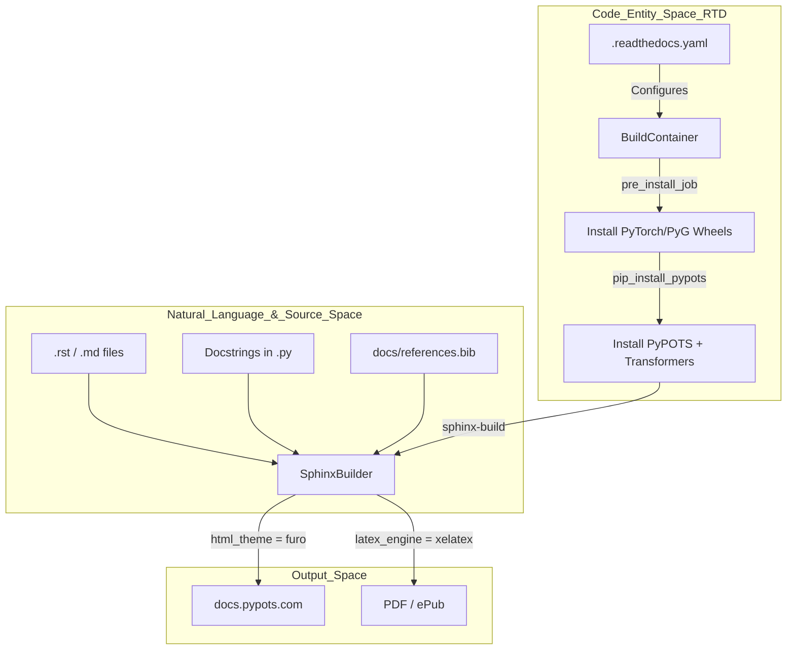
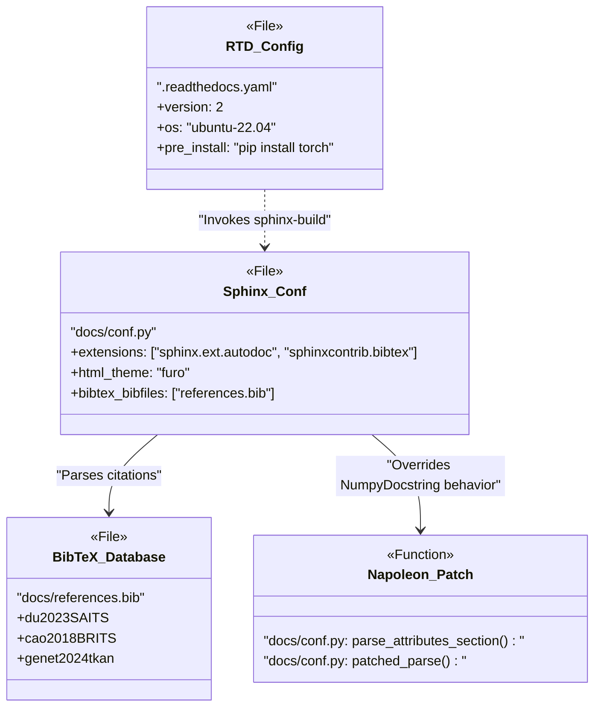

<!-- source: DeepWiki mcp.deepwiki.com · repo WenjieDu/PyPOTS · page 6.3 Documentation Build (ReadTheDocs & Sphinx) · fetched 2026-10-21 -->

# Documentation Build (ReadTheDocs & Sphinx)

Relevant source files

The following files were used as context for generating this wiki page:

- [.readthedocs.yaml](.readthedocs.yaml)
- [CITATION.cff](CITATION.cff)
- [docs/benchpots.rst](docs/benchpots.rst)
- [docs/conf.py](docs/conf.py)
- [docs/dev_architecture.rst](docs/dev_architecture.rst)
- [docs/dev_base_classes.rst](docs/dev_base_classes.rst)
- [docs/dev_codebase_map.rst](docs/dev_codebase_map.rst)
- [docs/dev_common_mistakes.rst](docs/dev_common_mistakes.rst)
- [docs/dev_complex_nn.rst](docs/dev_complex_nn.rst)
- [docs/dev_data_flow.rst](docs/dev_data_flow.rst)
- [docs/dev_getting_started.rst](docs/dev_getting_started.rst)
- [docs/dev_integration_guide.rst](docs/dev_integration_guide.rst)
- [docs/dev_non_nn.rst](docs/dev_non_nn.rst)
- [docs/dev_quality.rst](docs/dev_quality.rst)
- [docs/pygrinder.rst](docs/pygrinder.rst)
- [docs/tsdb.rst](docs/tsdb.rst)

The PyPOTS documentation system is designed to provide comprehensive, automated, and mathematically rigorous technical references for the library. The pipeline integrates **Sphinx** for documentation generation, **ReadTheDocs (RTD)** for hosting and continuous deployment, and several specialized extensions to handle academic citations and modern UI themes.

## Build Pipeline & Configuration

The documentation build is managed by `.readthedocs.yaml`, which defines the environment and the sequence of jobs required to satisfy PyPOTS's complex dependency tree, including PyTorch and PyTorch Geometric.

### Build Environment
The pipeline runs on `ubuntu-22.04` using `python: "3.10"` [.readthedocs.yaml:16-19](). It generates documentation in HTML, PDF, and ePub formats [.readthedocs.yaml:6-9]().

### Job Sequence (Pre-Install & Post-Install)
PyPOTS utilizes custom build hooks to ensure the documentation environment matches the library's runtime requirements, specifically handling CPU-only versions of deep learning frameworks to minimize build time and resource usage.

1.  **`pre_install`**: 
    *   Upgrades `pip` and installs `torch==1.13.1` (CPU version) [.readthedocs.yaml:23-24]().
    *   Installs PyTorch Geometric (PyG) and its dependencies (`torch-scatter`, `torch-sparse`) using the specialized PyG wheel URL [.readthedocs.yaml:25]().
    *   Installs the core PyPOTS ecosystem libraries directly from GitHub to ensure the documentation reflects the latest cross-project integrations: `TSDB`, `PyGrinder`, and `BenchPOTS` [.readthedocs.yaml:29-31]().
    *   Installs Sphinx and necessary extensions, including `furo`, `sphinxcontrib-bibtex`, `sphinx-autodoc-typehints`, and `transformers==4.49.0` [.readthedocs.yaml:28]().
    *   Installs the local PyPOTS package in editable mode [.readthedocs.yaml:32]().
2.  **`post_install`**: 
    *   Enforces specific versions of `sphinx==7.4.7` and `docutils==0.21.2` [.readthedocs.yaml:37-40](). This is a critical workaround to resolve CSS compatibility issues where `furo` might fail to find its stylesheet if `docutils` is overwritten by other packages during the installation of secondary dependencies [.readthedocs.yaml:35-39]().

### Build Workflow Diagram

The following diagram illustrates the flow from source files to the final hosted documentation on ReadTheDocs.

**Documentation Data Flow**

Sources: [.readthedocs.yaml:1-41](), [docs/conf.py:1-53](), [docs/conf.py:96-101]()

## Sphinx Configuration (`conf.py`)

The `docs/conf.py` file acts as the central logic for the Sphinx engine, controlling how Python entities are mapped to the documentation.

### Core Extensions
PyPOTS utilizes a robust set of extensions to automate documentation:
*   `sphinx.ext.autodoc`: Automatically generates documentation from docstrings [docs/conf.py:43]().
*   `sphinx.ext.napoleon`: Enables parsing of **NumPy-style docstrings**, which are the standard for PyPOTS models [docs/conf.py:49]().
*   `sphinx_autodoc_typehints`: Automatically extracts Python type hints into the documentation [docs/conf.py:50]().
*   `sphinxcontrib.bibtex`: Manages academic citations using the `references.bib` file, following the `unsrt` style [docs/conf.py:51, 75-77]().
*   `sphinxcontrib.gtagjs`: Integrates Google Analytics tracking (ID: `G-HT18SK09XE`) [docs/conf.py:52, 79-82]().

### Visual and Mathematical Rendering
*   **Theme**: The documentation uses the `furo` theme [docs/conf.py:101]().
*   **Math**: Equations are rendered using `imgmath` in `svg` format for clarity, with a font size of 16 [docs/conf.py:70-72]().
*   **Syntax Highlighting**: Uses the `sphinx` Pygments style [docs/conf.py:93]().

### Docstring Patching
To improve the rendering of model attributes (crucial for neural network parameters), PyPOTS implements a monkey-patch for the `NumpyDocstring` class. This ensures that sections like "Attributes", "Keys", and "Class Attributes" are formatted correctly in the output by injecting custom formatting logic into the `NumpyDocstring._parse` method [docs/conf.py:128-156]().

Sources: [docs/conf.py:1-157]()

## Developer Documentation & Architecture

The PyPOTS documentation includes a dedicated section for developers to ensure architectural consistency. These files explain the underlying contracts that every model must follow.

*   **`dev_getting_started.rst`**: Recommends a reading route starting from contracts rather than model folders [docs/dev_getting_started.rst:9-22](). It defines the three-layer architecture (Wrapper, Core, Dataset) [docs/dev_getting_started.rst:49-70]().
*   **`dev_architecture.rst`**: Provides a ground-up explanation of the codebase layout and data flow.
*   **`dev_base_classes.rst`**: Details the "Inheritance Stack," explaining the responsibilities of `BaseModel`, `BaseNNModel`, and task-specific base classes [docs/dev_base_classes.rst:10-28](). It defines what each layer "owns," such as `BaseModel` owning device setup and `BaseNNModel` owning the training loop state [docs/dev_base_classes.rst:42-61]().
*   **`dev_integration_guide.rst`**: Categorizes model integration into three paths: Standard NN, Complex NN (e.g., GANs), and Non-NN (statistical/algorithmic) [docs/dev_integration_guide.rst:7-16]().
*   **`dev_data_flow.rst`**: Maps the transition from `Dataset` samples to the `Wrapper` input dictionary and finally to the `Core.forward()` method [docs/dev_data_flow.rst:8-26]().
*   **`dev_codebase_map.rst`**: Explains the directory structure, distinguishing between task packages (e.g., `pypots/imputation/`) and shared infrastructure like `pypots/nn/` [docs/dev_codebase_map.rst:13-46]().
*   **`dev_common_mistakes.rst`**: A quality assurance guide detailing common failures such as breaking checkpoint semantics or choosing the wrong integration path [docs/dev_common_mistakes.rst:67-126]().

Sources: [docs/dev_getting_started.rst:1-223](), [docs/dev_base_classes.rst:1-180](), [docs/dev_integration_guide.rst:1-17](), [docs/dev_data_flow.rst:1-220](), [docs/dev_codebase_map.rst:1-189](), [docs/dev_common_mistakes.rst:1-223]()

## System Entity Mapping

The following diagram bridges the documentation configuration to the physical code entities responsible for the build process.

**Documentation Configuration Mapping**

Sources: [.readthedocs.yaml:4-12](), [docs/conf.py:42-53](), [docs/conf.py:128-156]()

## Summary of Workarounds

The build process includes specific technical debt management for documentation stability:

| Issue | Workaround | Location |
| :--- | :--- | :--- |
| **Furo CSS Exception** | Force re-install of `sphinx==7.4.7` and `docutils==0.21.2` in `post_install` to prevent version overwriting. | [.readthedocs.yaml:34-41]() |
| **Docstring Headers** | Monkey-patch `NumpyDocstring._parse` to handle "Attributes", "Keys", and "Class Attributes" sections. | [docs/conf.py:128-156]() |
| **Math Clarity** | Set `imgmath_image_format` to `"svg"` instead of `"png"`. | [docs/conf.py:72]() |
| **Build Speed** | Use `torch` CPU wheels via `-f https://download.pytorch.org/whl/cpu`. | [.readthedocs.yaml:24]() |

Sources: [.readthedocs.yaml:24-41](), [docs/conf.py:72-156]()

---

