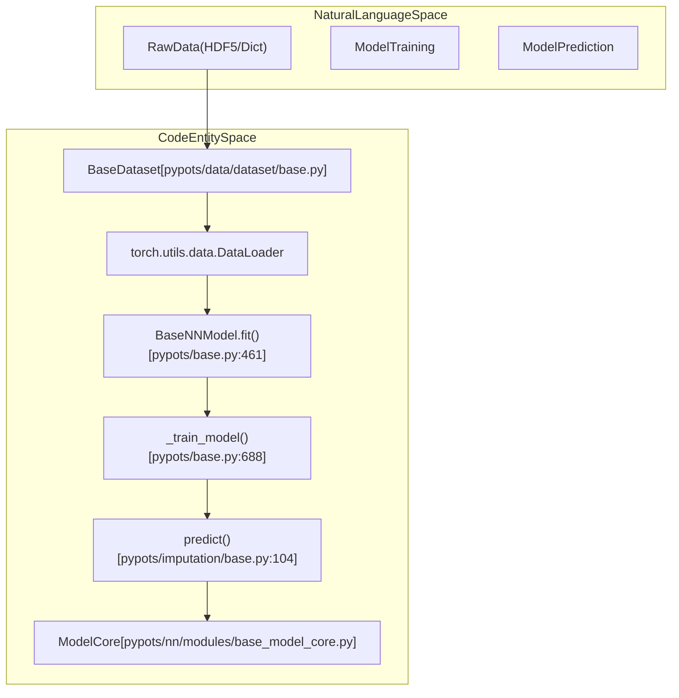
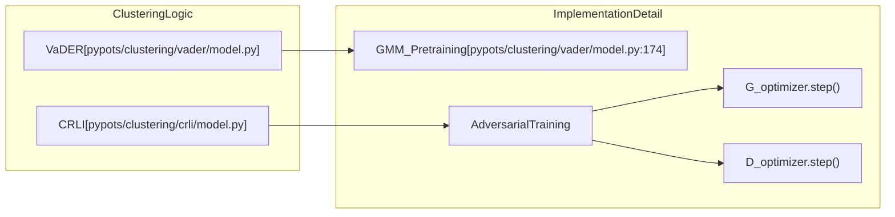

<!-- source: DeepWiki mcp.deepwiki.com · repo WenjieDu/PyPOTS · page 7 Glossary · fetched 2026-10-21 -->

# Glossary

Relevant source files

The following files were used as context for generating this wiki page:

- [README.md](README.md)
- [README_zh.md](README_zh.md)
- [docs/algo_table.rst](docs/algo_table.rst)
- [docs/faq.rst](docs/faq.rst)
- [docs/index.rst](docs/index.rst)
- [docs/install.rst](docs/install.rst)
- [docs/milestones.rst](docs/milestones.rst)
- [docs/model_api.rst](docs/model_api.rst)
- [docs/pypots.anomaly_detection.rst](docs/pypots.anomaly_detection.rst)
- [docs/pypots.classification.rst](docs/pypots.classification.rst)
- [docs/pypots.clustering.rst](docs/pypots.clustering.rst)
- [docs/pypots.data.rst](docs/pypots.data.rst)
- [docs/pypots.forecasting.rst](docs/pypots.forecasting.rst)
- [docs/pypots.imputation.rst](docs/pypots.imputation.rst)
- [docs/pypots.nn.rst](docs/pypots.nn.rst)
- [docs/pypots.rst](docs/pypots.rst)
- [docs/pypots.utils.rst](docs/pypots.utils.rst)
- [docs/references.bib](docs/references.bib)
- [pypots/__init__.py](pypots/__init__.py)
- [pypots/base.py](pypots/base.py)
- [pypots/classification/base.py](pypots/classification/base.py)
- [pypots/classification/brits/model.py](pypots/classification/brits/model.py)
- [pypots/classification/grud/model.py](pypots/classification/grud/model.py)
- [pypots/classification/raindrop/model.py](pypots/classification/raindrop/model.py)
- [pypots/clustering/__init__.py](pypots/clustering/__init__.py)
- [pypots/clustering/base.py](pypots/clustering/base.py)
- [pypots/clustering/crli/model.py](pypots/clustering/crli/model.py)
- [pypots/clustering/vader/model.py](pypots/clustering/vader/model.py)
- [pypots/data/__init__.py](pypots/data/__init__.py)
- [pypots/data/utils.py](pypots/data/utils.py)
- [pypots/forecasting/base.py](pypots/forecasting/base.py)
- [pypots/imputation/base.py](pypots/imputation/base.py)
- [pypots/imputation/brits/model.py](pypots/imputation/brits/model.py)
- [pypots/imputation/csdi/model.py](pypots/imputation/csdi/model.py)
- [pypots/imputation/gpvae/model.py](pypots/imputation/gpvae/model.py)
- [pypots/imputation/mrnn/data.py](pypots/imputation/mrnn/data.py)
- [pypots/imputation/mrnn/model.py](pypots/imputation/mrnn/model.py)
- [pypots/imputation/saits/model.py](pypots/imputation/saits/model.py)
- [pypots/imputation/transformer/model.py](pypots/imputation/transformer/model.py)
- [pypots/imputation/usgan/model.py](pypots/imputation/usgan/model.py)
- [pypots/nn/modules/__init__.py](pypots/nn/modules/__init__.py)
- [pypots/utils/__init__.py](pypots/utils/__init__.py)
- [pypots/version.py](pypots/version.py)
- [requirements/conda_dev_env.yml](requirements/conda_dev_env.yml)
- [requirements/conda_env.yml](requirements/conda_env.yml)
- [requirements/requirements.txt](requirements/requirements.txt)
- [requirements/requirements_dev.txt](requirements/requirements_dev.txt)
- [tests/anomaly_detection/__init__.py](tests/anomaly_detection/__init__.py)
- [tests/anomaly_detection/autoformer.py](tests/anomaly_detection/autoformer.py)
- [tests/anomaly_detection/saits.py](tests/anomaly_detection/saits.py)
- [tests/anomaly_detection/tefn.py](tests/anomaly_detection/tefn.py)
- [tests/global_test_config.py](tests/global_test_config.py)
- [tests/representation/ts2vec.py](tests/representation/ts2vec.py)

This glossary provides definitions for the specialized terminology, architectural components, and domain-specific concepts used within the PyPOTS codebase. It is intended to help onboarding engineers navigate the "coffee universe" of partially-observed time series (POTS) modeling.

## Core Concepts & Domain Terms

### POTS (Partially-Observed Time Series)
The central problem domain of the library. It refers to multivariate time series data where values are missing due to sensor failure, communication errors, or other malfunctions [README.md:68-72]().

### Missingness Mechanisms (MCAR, MAR, MNAR)
Types of missing data patterns simulated by the ecosystem (specifically PyGrinder):
*   **MCAR (Missing Completely At Random):** Missingness is independent of any data values [docs/references.bib:188-192]().
*   **MAR (Missing At Random):** Missingness depends on observed data.
*   **MNAR (Missing Not At Random):** Missingness depends on the missing values themselves [docs/references.bib:120-120]().

### ORT (Observed Reconstruction Task)
A training strategy where the model is tasked with reconstructing the values that are actually observed in the input data. This is used extensively for models not originally designed for POTS, such as standard Transformers, to make them applicable to missing data [README.md:104-108]().

### MIT (Masking Imputation Task)
A training strategy where a portion of the observed values is intentionally masked, and the model is required to predict these "pseudo-missing" values. Combined with ORT, it forms the training backbone for many neural network models in PyPOTS [README.md:104-108]().

---

## Technical & Architectural Terms

### Base Model Hierarchy
The structural foundation of all algorithms in PyPOTS.

| Class Name | Purpose | File Pointer |
| :--- | :--- | :--- |
| `BaseModel` | Top-level abstract class for all models, handling device management and saving paths. | [pypots/base.py:38-84]() |
| `BaseNNModel` | Extends `BaseModel` for neural networks, adding training loops and optimization logic. | [pypots/base.py:255-256]() |
| `BaseImputer` | Abstract class for all imputation models (statistical and neural). | [pypots/imputation/base.py:21-52]() |
| `BaseNNImputer` | Specifically for neural network-based imputation, handling batching and epochs. | [pypots/imputation/base.py:165-188]() |
| `BaseClassifier` | Abstract class for classification tasks on POTS. | [pypots/classification/base.py:21-51]() |
| `BaseForecaster` | Abstract class for forecasting tasks. | [pypots/forecasting/base.py:22-53]() |
| `BaseNNForecaster` | Abstract class for neural network-based forecasting. | [pypots/forecasting/base.py:165-188]() |
| `BaseNNClusterer` | Abstract class for neural network-based clustering. | [pypots/clustering/base.py:22-22]() |

### Data Tensors and Masks
*   **`X`**: The input feature matrix, potentially containing `NaN` values [pypots/imputation/base.py:82-85]().
*   **`X_ori`**: The original ground truth values used for calculating loss during MIT/ORT training [tests/global_test_config.py:71]().
*   **`X_pred`**: The target future values in forecasting tasks [tests/global_test_config.py:94]().
*   **`missing_mask`**: A binary mask where `0` indicates a missing value and `1` indicates an observed value [pypots/clustering/vader/model.py:144-149]().
*   **`indicating_mask`**: A mask used in models like SAITS to indicate which values were artificially masked for the MIT task [tests/global_test_config.py:70]().

**Data Flow Architecture**
Title: Data Flow from Raw Input to Model Core

Sources: [pypots/base.py:38-122](), [pypots/imputation/base.py:71-131](), [pypots/classification/base.py:72-135]().

### Model Saving Strategies
PyPOTS supports four distinct strategies for persisting model checkpoints during the training lifecycle, configured via the `model_saving_strategy` parameter [pypots/base.py:59-66]():
*   `None`: No model files are saved.
*   `best`: Saves only the model with the best validation performance at the end of training.
*   `better`: Saves the model whenever validation performance improves over previous epochs.
*   `all`: Saves a checkpoint after every epoch.

---

## Algorithm-Specific Terms

### VaDER (Variational Deep Embedding with RNN)
A clustering model that uses a Gaussian Mixture Model (GMM) layer for clustering latent representations. It includes a specific `pretrain_epochs` phase to initialize GMM parameters before the main clustering training [pypots/clustering/vader/model.py:28-108]().

### CRLI (Clustering Representation Learning on Incomplete time-series)
A GAN-based clustering model. It utilizes a dual-optimizer approach for the Generator/Decoder and Discriminator [pypots/clustering/crli/model.py]().

### TKAN (Temporal Kolmogorov-Arnold Networks)
An architecture integrating Kolmogorov-Arnold Networks (KAN) with temporal modeling for imputation and forecasting tasks [docs/references.bib:9-14]().

### TOTEM (VQ-VAE Tokenization)
A model that utilizes Vector Quantized-Variational Autoencoder (VQ-VAE) tokenization to transform continuous time-series into discrete tokens for imputation [docs/pypots.imputation.rst:139]().

### LLM Reprogramming (TimeLLM & GPT4TS)
A technique to adapt frozen Large Language Models to time-series tasks. It involves mapping time-series data into the LLM's expected input space using a reprogramming layer [docs/pypots.imputation.rst:67-84]().

### CSAI (Common and Specific Attribute Imputation)
An imputation model that explicitly models common and specific attributes across different time series to handle missingness [docs/pypots.imputation.rst:40]().

### GRUD (Gated Recurrent Unit with Decay)
A recurrent architecture designed specifically for multivariate time series with missing values, utilizing decay mechanisms for both input and hidden states [docs/references.bib:49-63]().

### HELIX (Hybrid Encoding with Learnable Identity and Cross-dimensional Synthesis)
A state-of-the-art imputation model (ICML 2026) that uses hybrid encoding and cross-dimensional synthesis [docs/references.bib:1-7]().

**Clustering Logic Mapping**
Title: Implementation Specifics for Clustering Models

Sources: [pypots/clustering/vader/model.py:159-188]().

---

## Abbreviations & Utility Terms

| Abbreviation | Full Term | Context |
| :--- | :--- | :--- |
| **IMPT** | Imputation | Filling in missing values [README.md:111](). |
| **FCST** | Forecasting | Predicting future time steps [README.md:112](). |
| **CLAF** | Classification | Assigning labels to sequences [README.md:113](). |
| **CLUS** | Clustering | Grouping similar sequences [README.md:114](). |
| **ANOD** | Anomaly Detection | Identifying outlier sequences/steps [README.md:115](). |
| **AMP** | Automatic Mixed Precision | Training optimization for large models [pypots/base.py:51-54](). |
| **HPO** | Hyperparameter Optimization | Using Optuna (v2+) to tune models [README.md:98-102](). |
| **LOCF** | Last Observation Carried Forward | Naive imputation method [pypots/imputation/__init__.py:55](). |
| **NOCB** | Next Observation Carried Backward | Naive imputation method. |
| **Lerp** | Linear Interpolation | Mathematical imputation method [pypots/imputation/__init__.py:58](). |
| **n_pred_steps** | Number of Prediction Steps | Number of future time steps to forecast [pypots/forecasting/base.py:153](). |
| **anomaly_rate** | Anomaly Rate | Threshold or ratio for anomaly detection tasks [tests/global_test_config.py:28](). |
| **parse_delta** | Delta Parsing | Utility for calculating time gaps between observations [pypots/data/utils.py](). |
| **sliding_window** | Sliding Window | Data augmentation/processing technique to segment time series [pypots/data/utils.py](). |
| **SAMPLE_ID** | Sample Identifier | Unique ID for each sample in the `ai4ts` protocol. |
| **CLAF_TARGET** | Classification Target | Label key used in classification data protocols. |

### TimeSeriesAI Client
A specialized interface (`TimeSeriesAI`) integrated into the ecosystem for high-level interaction with LLM and TSFM models [pypots/__init__.py:50-54]().

### Lazy Loading
PyPOTS submodules are lazy-loaded on first access to keep `import pypots` fast and avoid pulling in heavy dependencies like `torch` prematurely [pypots/__init__.py:4-7]().

### .pypots File Format
The default format used by PyPOTS for saving and loading model checkpoints, containing model weights and metadata [pypots/base.py:31-35]().

### CLI Workflow (Optuna & LazyGroup)
*   **Optuna tune**: Replaces legacy NNI for hyperparameter optimization [README.md:98-102]().
*   **LazyGroup CLI**: A Click-based architecture for the `pypots-cli` to ensure subcommands only load dependencies when invoked.

Sources: [README.md:98-120](), [pypots/base.py:38-112](), [pypots/imputation/base.py:21-52](), [pypots/forecasting/base.py:153-154](), [pypots/__init__.py:28-56](), [tests/global_test_config.py:23-28]().