# Page: PyPOTS Overview

# PyPOTS Overview

<details>
<summary>Relevant source files</summary>

The following files were used as context for generating this wiki page:

- [README.md](README.md)
- [README_zh.md](README_zh.md)
- [docs/algo_table.rst](docs/algo_table.rst)
- [docs/faq.rst](docs/faq.rst)
- [docs/index.rst](docs/index.rst)
- [docs/install.rst](docs/install.rst)
- [docs/milestones.rst](docs/milestones.rst)
- [docs/model_api.rst](docs/model_api.rst)
- [docs/pypots.anomaly_detection.rst](docs/pypots.anomaly_detection.rst)
- [docs/pypots.classification.rst](docs/pypots.classification.rst)
- [docs/pypots.clustering.rst](docs/pypots.clustering.rst)
- [docs/pypots.data.rst](docs/pypots.data.rst)
- [docs/pypots.forecasting.rst](docs/pypots.forecasting.rst)
- [docs/pypots.imputation.rst](docs/pypots.imputation.rst)
- [docs/pypots.nn.rst](docs/pypots.nn.rst)
- [docs/pypots.rst](docs/pypots.rst)
- [docs/pypots.utils.rst](docs/pypots.utils.rst)
- [docs/references.bib](docs/references.bib)
- [pypots/__init__.py](pypots/__init__.py)
- [pypots/clustering/__init__.py](pypots/clustering/__init__.py)
- [pypots/nn/modules/__init__.py](pypots/nn/modules/__init__.py)
- [pypots/utils/__init__.py](pypots/utils/__init__.py)
- [pypots/version.py](pypots/version.py)
- [requirements/conda_dev_env.yml](requirements/conda_dev_env.yml)
- [requirements/conda_env.yml](requirements/conda_env.yml)
- [requirements/requirements.txt](requirements/requirements.txt)
- [requirements/requirements_dev.txt](requirements/requirements_dev.txt)

</details>


PyPOTS (pronounced **"Pie Pots"**) is a comprehensive Python toolbox designed for machine learning on **Partially-Observed Time Series (POTS)**. In real-world scenarios, time-series data often suffer from missing values due to sensor failures, communication errors, or malfunctions [README.md:68-72](). PyPOTS fills the gap in the data mining ecosystem by providing a unified framework for imputation, forecasting, classification, clustering, and anomaly detection specifically tailored for incomplete multivariate time series [README.md:74-80]().

### Mission and Core Philosophy
The mission of PyPOTS is to make machine learning on POTS easy rather than tedious. It allows researchers and engineers to focus on core modeling problems by providing standardized APIs and state-of-the-art (SOTA) algorithms [README.md:74-79](). 

A key feature of the library is the adaptation of standard neural architectures (like Transformers) to POTS data. Models not originally designed for missing data (marked with `🧑‍🔧` in the documentation) are integrated using the **Observed Reconstruction Task (ORT)** and **Masked Imputation Task (MIT)** strategy introduced in the SAITS paper [README.md:104-108]().

---

## The PyPOTS Ecosystem: The "Coffee Universe"

PyPOTS is part of a broader ecosystem designed to handle the entire lifecycle of time-series analysis, from data simulation to benchmarking.

| Project | Role | Integration Point |
| :--- | :--- | :--- |
| **TSDB** | Time-Series Data Beans | Dataset loading and preprocessing [README.md:129-131]() |
| **PyGrinder** | Missing value simulation | Creating MCAR/MAR/MNAR patterns [README.md:129-131]() |
| **BenchPOTS** | Benchmarking | Standardized evaluation of POTS models [README.md:129-131]() |
| **BrewPOTS** | Tutorials | Interactive examples and usage guides [README.md:78-79]() |

For a deep dive into these related projects, see **[Ecosystem & Related Projects](#1.2)**.

**Sources:** [README.md:129-131](), [docs/index.rst:100-103]()

---

## Supported Tasks & Model Catalog

PyPOTS organizes its functionality into specialized task modules, all accessible via the top-level package `pypots`. Submodules are lazy-loaded to ensure fast imports [pypots/__init__.py:1-7, 14-26]().

### Functional Architecture
The following diagram illustrates how the high-level task modules relate to the underlying code entities and specific implementation classes.

**Diagram 1: Task to Code Mapping**
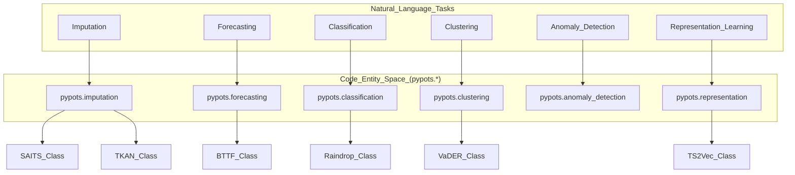
**Sources:** [pypots/__init__.py:14-39](), [README.md:90-117](), [docs/pypots.imputation.rst:1-150](), [docs/pypots.anomaly_detection.rst:1-12]()

### Model Summary Table
PyPOTS includes a vast library of models, ranging from classical statistical methods to modern Foundation Models (TSFMs) and LLM-based approaches [README.md:113-121]().

| Task | Key Models |
| :--- | :--- |
| **Imputation** | SAITS, Transformer, CSDI, USGAN, TimesNet, iTransformer, TKAN, TOTEM, TSLANet, HELIX [docs/pypots.imputation.rst]() |
| **Forecasting** | BTTF, TimeMixer, DLinear, PatchTST, MICN, TimeLLM, GPT4TS, MOMENT, MixLinear [docs/pypots.forecasting.rst]() |
| **Classification** | BRITS, GRUD, Raindrop, SeFT, CSAI, TEFN [docs/pypots.classification.rst]() |
| **Clustering** | CRLI, VaDER [pypots/clustering/__init__.py:1-40](), [docs/pypots.clustering.rst]() |
| **Anomaly Detection** | Reconstruction-based: Autoformer, TimesNet, DLinear, iTransformer, SAITS, SegRNN [docs/pypots.anomaly_detection.rst]() |

---

## System Integration & Optimization

PyPOTS is built on PyTorch and supports extensive hardware acceleration and hyperparameter optimization via the `pypots.optim` and `pypots-cli` components.

**Diagram 2: System Stack & Optimization Flow**
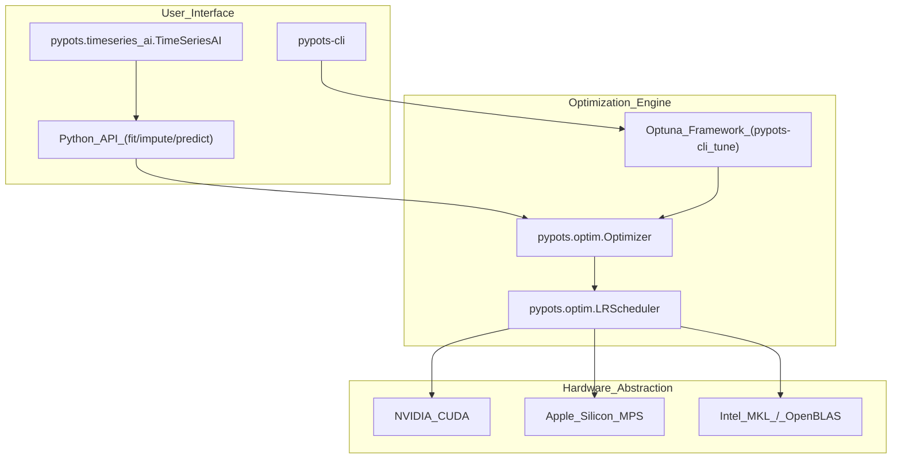
**Sources:** [README.md:98-103](), [pypots/__init__.py:14-54](), [pypots/version.py:22]()

### Key Technical Features
*   **Hyperparameter Optimization (HPO):** Since v2.0, the functionality is implemented with the **Optuna** framework via `pypots-cli tune` [README.md:98-103]().
*   **Hardware Acceleration:** Supports CUDA for NVIDIA GPUs, MPS for Apple Silicon, and MKL/OpenBLAS for Intel/AMD CPUs [docs/install.rst:69-90]().
*   **LLM & TSFM Support:** Advanced support for adapting frozen LLMs (e.g., GPT-2, LLaMA via `GPT4TS` or `TimeLLM`) and Foundation Models (e.g. `MOMENT`) [docs/pypots.imputation.rst:49-76](), [docs/pypots.forecasting.rst:22-48]().
*   **TimeSeriesAI:** An emerging integration point for the Time-Series.AI platform [pypots/__init__.py:50-54]().

For detailed setup instructions, see **[Getting Started: Installation & Configuration](#1.1)**.

---

## Navigating the Wiki

This wiki is structured to take you from a novice user to a contributor:

1.  **[Getting Started: Installation & Configuration](#1.1)**: Install the library and configure your environment for your specific hardware.
2.  **[Ecosystem & Related Projects](#1.2)**: Understand how to use TSDB for data and PyGrinder for simulating missingness.
3.  **Core Architecture**: (Section 2) Learn about the base class hierarchy, data pipelines, and the `pypots.nn` module structure.
4.  **Task Modules**: (Section 3) Deep dives into specific algorithms for Imputation, Forecasting, Classification, Clustering, and Anomaly Detection.
5.  **Evaluation & Metrics**: (Section 4) How to measure model performance and use visualization utilities.
6.  **CLI & Workflow Tools**: (Section 5) Automating experiments with `pypots-cli` and the Optuna-based tuning system.
7.  **Testing & CI/CD**: (Section 6) Overview of the quality assurance process and build pipelines.

**Sources:** [README.md:81-88](), [docs/index.rst:105-112](), [pypots/__init__.py:14-26]()

---

# Page: Getting Started: Installation & Configuration

# Getting Started: Installation & Configuration

<details>
<summary>Relevant source files</summary>

The following files were used as context for generating this wiki page:

- [.pre-commit-config.yaml](.pre-commit-config.yaml)
- [README.md](README.md)
- [README_zh.md](README_zh.md)
- [docs/algo_table.rst](docs/algo_table.rst)
- [docs/faq.rst](docs/faq.rst)
- [docs/index.rst](docs/index.rst)
- [docs/install.rst](docs/install.rst)
- [docs/milestones.rst](docs/milestones.rst)
- [docs/model_api.rst](docs/model_api.rst)
- [docs/pypots.anomaly_detection.rst](docs/pypots.anomaly_detection.rst)
- [docs/pypots.classification.rst](docs/pypots.classification.rst)
- [docs/pypots.clustering.rst](docs/pypots.clustering.rst)
- [docs/pypots.data.rst](docs/pypots.data.rst)
- [docs/pypots.forecasting.rst](docs/pypots.forecasting.rst)
- [docs/pypots.imputation.rst](docs/pypots.imputation.rst)
- [docs/pypots.nn.rst](docs/pypots.nn.rst)
- [docs/pypots.rst](docs/pypots.rst)
- [docs/pypots.utils.rst](docs/pypots.utils.rst)
- [docs/references.bib](docs/references.bib)
- [pypots/nn/modules/__init__.py](pypots/nn/modules/__init__.py)
- [pyproject.toml](pyproject.toml)
- [requirements/conda_dev_env.yml](requirements/conda_dev_env.yml)
- [requirements/conda_env.yml](requirements/conda_env.yml)
- [requirements/requirements.txt](requirements/requirements.txt)
- [requirements/requirements_dev.txt](requirements/requirements_dev.txt)

</details>


This page provides a technical guide for setting up the PyPOTS environment. PyPOTS is designed to handle **Partially-Observed Time Series (POTS)** and requires a specific stack of dependencies to support its neural network models, optimization routines, and data processing pipelines [docs/install.rst:1-4]().

## Installation Methods

PyPOTS can be installed via standard Python package managers or isolated containers.

### 1. Via pip
The simplest method to install the stable version from PyPI:
```bash
pip install pypots            # the first time installation
pip install pypots --upgrade  # update pypots to the latest version
```
To access the latest features (development branch):
```bash
pip install https://github.com/WenjieDu/PyPOTS/archive/main.zip
```
[docs/install.rst:10-14]()

### 2. Via Conda
PyPOTS is available on the `conda-forge` channel. The project provides `conda_env.yml` for environment reproducibility [requirements/conda_env.yml:1-28]().
```bash
conda install conda-forge::pypots  # the first time installation
conda update  conda-forge::pypots  # update pypots to the latest version
```
[docs/install.rst:16-18]() [requirements/conda_env.yml:3-5]()

### 3. Via Docker
Official images are maintained on DockerHub. Users can pull the pre-configured environment to avoid dependency conflicts [docs/install.rst:20-21]().
```bash
docker run -it --name pypots wenjiedu/pypots  # docker will auto pull our built image and run a instance for you
```
[docs/install.rst:20-21]()

Sources: [docs/install.rst:1-25](), [requirements/conda_env.yml:1-28]()

---

## Hardware-Specific Optimizations

PyPOTS leverages PyTorch for neural network operations and can be accelerated across various hardware backends.

### GPU Acceleration (NVIDIA CUDA)
PyPOTS supports CUDA-enabled GPUs for training and inference [docs/install.rst:71-74]().
*   **Activation**: Set the `device` argument to `"cuda"` during model initialization.
*   **Automatic Detection**: If `device` is not specified, PyPOTS automatically detects and uses the default CUDA device if available [docs/install.rst:75-77]().

### CPU & Apple Silicon Acceleration
For non-CUDA environments, performance can be improved by using optimized BLAS/MKL libraries via Conda:

| Platform | Recommended Optimization Command |
| :--- | :--- |
| **Apple Silicon** | `conda install numpy scipy scikit-learn numexpr "libblas=*=*accelerate"` |
| **Intel CPUs** | `conda install numpy scipy scikit-learn numexpr "libblas=*=*mkl"` |
| **AMD CPUs** | | `conda install -c conda-forge numpy scipy scikit-learn numexpr "libblas=*=*openblas"` |

[docs/install.rst:78-90]()

Sources: [docs/install.rst:71-90]()

---

## Dependency Management & Versioning

PyPOTS enforces specific version constraints to ensure compatibility across its ecosystem (TSDB, PyGrinder, BenchPOTS).

### Core Dependencies
*   **Python >= 3.8**: Required because Python 3.7 reached end-of-life in 2023 and to maintain compatibility with `torch-geometric` [docs/install.rst:57-64](). 
*   **PyTorch >= 1.10.0**: Necessary for compatibility with `pytorch_sparse` [docs/install.rst:65-68]().
*   **Data Ecosystem**: Requires `tsdb >= 0.8`, `pygrinder >= 0.7`, and `benchpots >= 1` [requirements/requirements.txt:15-17]().
*   **CLI & HPO**: Requires `click` for the command-line interface and `optuna` for hyperparameter optimization [requirements/requirements.txt:1, 4]().

### Optional Dependencies (Task-Specific)
Certain models require additional libraries that are not installed by default:
*   **GNN Models** (e.g., `Raindrop`): Requires `torch-geometric`, `torch-scatter`, and `torch-sparse` [docs/install.rst:48-52]().
*   **LLM Models** (e.g., `TimeLLM`, `GPT4TS`): Requires `transformers <= 4.57.6` [requirements/requirements.txt:13]().

### Dependency Flow Diagram
The following diagram illustrates how PyPOTS components relate to external dependencies and task-specific requirements.

**Title: PyPOTS Dependency and Entity Mapping**
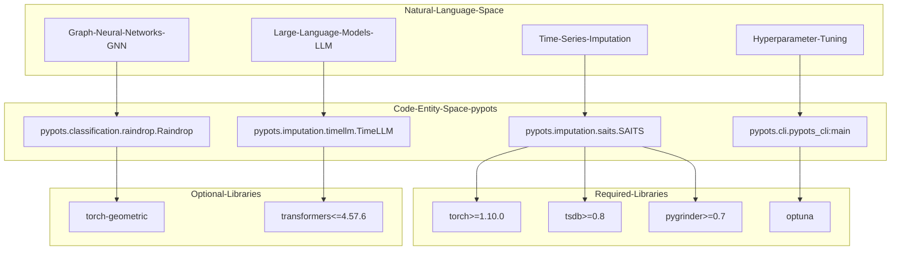
Sources: [docs/install.rst:27-52](), [requirements/requirements.txt:1-18](), [docs/pypots.imputation.rst:4-7](), [docs/pypots.classification.rst:94-97]()

---

## Environment Verification

To verify the installation and check the current hardware environment, PyPOTS provides the `pypots-cli` tool.

**Title: CLI Environment Initialization Flow**
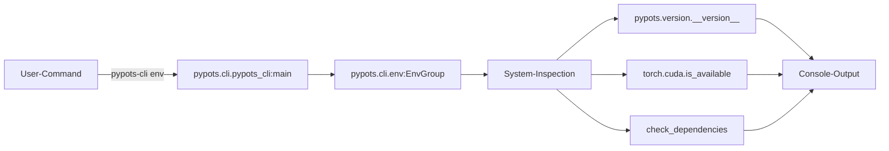
Sources: [requirements/requirements.txt:1](), [docs/install.rst:71-77](), [README.md:98-102]()

### Version Pinning Rationale
PyPOTS strictly pins certain dependencies to maintain stability:
*   **`numpy < 2.0`**: Prevents breaking changes in tensor math operations [requirements/conda_env.yml:13]().
*   **`torch >= 1.10.0`**: Specifically required due to `pytorch_sparse` compatibility issues in earlier versions [docs/install.rst:65-68]().
*   **`transformers <= 4.57.6`**: Version limited to ensure compatibility with LLM-based time-series models [requirements/requirements.txt:13]().
*   **`tsdb >= 0.8` & `benchpots >= 1`**: Ensures support for the latest data loading and benchmarking protocols [requirements/requirements.txt:15, 17]().

Sources:
- [docs/install.rst:1-90]()
- [requirements/conda_env.yml:1-28]()
- [requirements/requirements.txt:1-18]()
- [README.md:68-80]()

---

# Page: Ecosystem & Related Projects

# Ecosystem & Related Projects

<details>
<summary>Relevant source files</summary>

The following files were used as context for generating this wiki page:

- [README.md](README.md)
- [README_zh.md](README_zh.md)
- [docs/index.rst](docs/index.rst)
- [docs/model_api.rst](docs/model_api.rst)
- [docs/pypots.anomaly_detection.rst](docs/pypots.anomaly_detection.rst)
- [docs/pypots.classification.rst](docs/pypots.classification.rst)
- [docs/pypots.clustering.rst](docs/pypots.clustering.rst)
- [docs/pypots.data.rst](docs/pypots.data.rst)
- [docs/pypots.forecasting.rst](docs/pypots.forecasting.rst)
- [docs/pypots.imputation.rst](docs/pypots.imputation.rst)
- [docs/pypots.rst](docs/pypots.rst)
- [docs/pypots.utils.rst](docs/pypots.utils.rst)
- [docs/references.bib](docs/references.bib)
- [examples/anomaly_detection/crossformer_anomalydetection_example.py](examples/anomaly_detection/crossformer_anomalydetection_example.py)
- [examples/anomaly_detection/etsformer_anomalydetection_example.py](examples/anomaly_detection/etsformer_anomalydetection_example.py)
- [examples/anomaly_detection/fedformer_anomalydetection_example.py](examples/anomaly_detection/fedformer_anomalydetection_example.py)
- [examples/anomaly_detection/film_anomalydetection_example.py](examples/anomaly_detection/film_anomalydetection_example.py)
- [examples/anomaly_detection/informer_anomalydetection_example.py](examples/anomaly_detection/informer_anomalydetection_example.py)
- [examples/anomaly_detection/itransformer_anomalydetection_example.py](examples/anomaly_detection/itransformer_anomalydetection_example.py)
- [examples/anomaly_detection/nonstationary_transformer_anomalydetection_example.py](examples/anomaly_detection/nonstationary_transformer_anomalydetection_example.py)
- [examples/anomaly_detection/pyraformer_anomalydetection_example.py](examples/anomaly_detection/pyraformer_anomalydetection_example.py)
- [pypots/__init__.py](pypots/__init__.py)
- [pypots/clustering/__init__.py](pypots/clustering/__init__.py)
- [pypots/utils/__init__.py](pypots/utils/__init__.py)
- [pypots/version.py](pypots/version.py)

</details>


The PyPOTS ecosystem, often referred to as the "coffee universe," consists of several specialized libraries designed to streamline the lifecycle of machine learning on Partially-Observed Time Series (POTS). While the core PyPOTS library focuses on model implementation and training, its related projects handle data acquisition, missingness simulation, benchmarking, and educational tutorials.

### The Coffee Universe Architecture

The integration of these projects creates a unified pipeline from raw data to benchmarked results. The following diagram illustrates the data flow between the core entities, moving from the "Natural Language Space" of project names to the "Code Entity Space" of packages and classes.

**Diagram: PyPOTS Ecosystem Data Flow & Entity Mapping**
```mermaid
graph TD
    subgraph "External_World" ["External World"]
        "RawDatasets"["Raw Datasets (PhysioNet, UCI, etc.)"]
    end

    subgraph "Data_Preparation_Layer" ["Data Preparation Layer"]
        "TSDB"["TSDB (Dataset Loading)"]
        "PyGrinder"["PyGrinder (Missingness Simulation)"]
    end

    subgraph "Core_Modeling_Layer" ["Core Modeling Layer"]
        "PyPOTS"["PyPOTS Core Library"]
        "Time_Series_AI"["Time-Series.AI (Cloud/LLM Service)"]
    end

    subgraph "Evaluation_Learning_Layer" ["Evaluation & Learning Layer"]
        "BenchPOTS"["BenchPOTS (Benchmarking)"]
        "BrewPOTS"["BrewPOTS (Tutorials)"]
    end

    "RawDatasets" --> "TSDB"
    "TSDB" -- "Clean Data" --> "PyGrinder"
    "PyGrinder" -- "POTS Data (X, Mask)" --> "PyPOTS"
    "PyPOTS" -- "Results/Metrics" --> "BenchPOTS"
    "BrewPOTS" -- "Usage Patterns" --> "PyPOTS"
    "Time_Series_AI" -.-> "PyPOTS"

    %% Code Entity Mapping
    "TSDB" -.-> "tsdb_package"["package: tsdb"]
    "PyGrinder" -.-> "pygrinder_package"["package: pygrinder"]
    "PyPOTS" -.-> "pypots_package"["package: pypots"]
    "Time_Series_AI" -.-> "tsai_client"["pypots.TimeSeriesAI"]
```
**Sources:** [pypots/__init__.py:14-26](), [pypots/__init__.py:50-54](), [README.md:82-88](), [README_zh.md:115-115]()

---

### TSDB: Time-Series Data Beans
**TSDB** (`tsdb`) is the data-loading engine of the ecosystem. It simplifies the process of downloading and preprocessing public time-series datasets into formats compatible with PyPOTS.

*   **Role**: Acts as a repository for "data beans."
*   **Integration**: PyPOTS utilizes TSDB to fetch datasets for testing and benchmarking. It is often used to provide the source data for the `pypots.data` pipeline [[pypots/__init__.py:37-37]()].
*   **Key Functionality**: Provides standardized loaders for datasets, ensuring data is ready for modeling tasks like imputation and classification [[README.md:110-117]()].

**Sources:** [pypots/__init__.py:37-37](), [README.md:110-117]()

---

### PyGrinder: Data Munging & Missingness Simulation
**PyGrinder** (`pygrinder`) is responsible for "grinding" clean datasets into partially-observed ones. It is essential for evaluating imputation and classification models where ground truth is required for missing values.

*   **Missingness Mechanisms**: Implements simulation for MCAR (Missing Completely At Random), MAR (Missing At Random), and MNAR (Missing Not At Random).
*   **Data Flow**: It takes complete arrays and returns data corrupted with missing values. This simulation is a prerequisite for the training strategies used in various PyPOTS models, particularly those using the **ORT (Observed Reconstruction Task)** and **MIT (Missing Information Task)** approaches [[README.md:104-108]()].

**Sources:** [README.md:104-108](), [README_zh.md:99-102]()

---

### BenchPOTS: The Benchmarking Standard
**BenchPOTS** (`benchpots`) provides a standardized framework for evaluating POTS algorithms across various tasks (Imputation, Classification, Forecasting, Anomaly Detection, etc.) to ensure fair comparison.

*   **Implementation**: It is used extensively for data generation in PyPOTS examples and tests. Specifically, the `preprocess_random_walk` function is a standard way to create synthetic datasets for minimalist examples [[examples/anomaly_detection/fedformer_anomalydetection_example.py:6-6]()].
*   **Research Integration**: PyPOTS utilizes BenchPOTS to ensure that performance metrics are calculated over consistent data splits, supporting the academic rigor of the toolbox [[README.md:63-65]()].

**Sources:** [examples/anomaly_detection/fedformer_anomalydetection_example.py:6-6](), [README.md:63-65]()

---

### BrewPOTS: Interactive Tutorials
**BrewPOTS** serves as the educational arm, providing Jupyter notebooks and interactive examples.

*   **Purpose**: Demonstrates how to "brew" a solution using the toolbox.
*   **Auto-generated Examples**: PyPOTS includes a suite of standalone examples in the `examples/` directory. These scripts demonstrate how to initialize, train, and evaluate models using `benchpots` for data generation.
    *   **Usage**: To run an example, execute the script directly, e.g., `python examples/anomaly_detection/fedformer_anomalydetection_example.py` [[examples/anomaly_detection/fedformer_anomalydetection_example.py:1-56]()].
    *   **Coverage**: Examples cover tasks such as Anomaly Detection with models like FEDformer [[examples/anomaly_detection/fedformer_anomalydetection_example.py:1-56]()][examples/anomaly_detection/fedformer_anomalydetection_example.py:1-56]() and iTransformer [[examples/anomaly_detection/itransformer_anomalydetection_example.py:1-54]()].

**Sources:** [examples/anomaly_detection/fedformer_anomalydetection_example.py:1-56](), [examples/anomaly_detection/itransformer_anomalydetection_example.py:1-54]()

---

### Time-Series.AI: TSFM & LLM Integration
**Time-Series.AI** provides advanced Large Language Model (LLM) and Time-Series Foundation Model (TSFM) capabilities, serving as an emerging integration point for PyPOTS.

*   **Integration**: Accessed via the `pypots.TimeSeriesAI` class [[pypots/__init__.py:50-54]()].
*   **Lazy Loading**: The `TimeSeriesAI` client is lazy-loaded on first access to keep the initial `import pypots` fast and lightweight [[pypots/__init__.py:4-7]()].
*   **Task Support**: Extends PyPOTS capabilities to state-of-the-art foundation models, supporting core tasks like `IMPT`, `FCST`, `CLAF`, `CLUS`, and `ANOD` through a unified client interface [[README_zh.md:115-115]()].

**Sources:** [pypots/__init__.py:4-7](), [pypots/__init__.py:50-54](), [README_zh.md:115-115]()

---

### Integration and Dependency Management

The ecosystem is designed for modularity but maintains tight versioning to ensure compatibility across the different "beans" and "pots."

| Project | Code Entity / Package | Primary Purpose | Supported Tasks |
| :--- | :--- | :--- | :--- |
| **PyPOTS** | `pypots` | Core algorithms and training logic | IMPT, FCST, CLAF, CLUS, ANOD [[pypots/__init__.py:14-26]()] |
| **TSDB** | `tsdb` | Dataset collection and preprocessing | Data Loading [[pypots/__init__.py:37-37]()] |
| **PyGrinder** | `pygrinder` | Missingness simulation | Data Augmentation [[README.md:104-108]()] |
| **BenchPOTS** | `benchpots` | Reproducible benchmarking | Evaluation & Testing [[examples/anomaly_detection/fedformer_anomalydetection_example.py:6-6]()] |
| **Time-Series.AI**| `pypots.TimeSeriesAI` | LLM-based foundation models | TSFM Integration [[pypots/__init__.py:50]()] |

**Diagram: Code Entity Association**
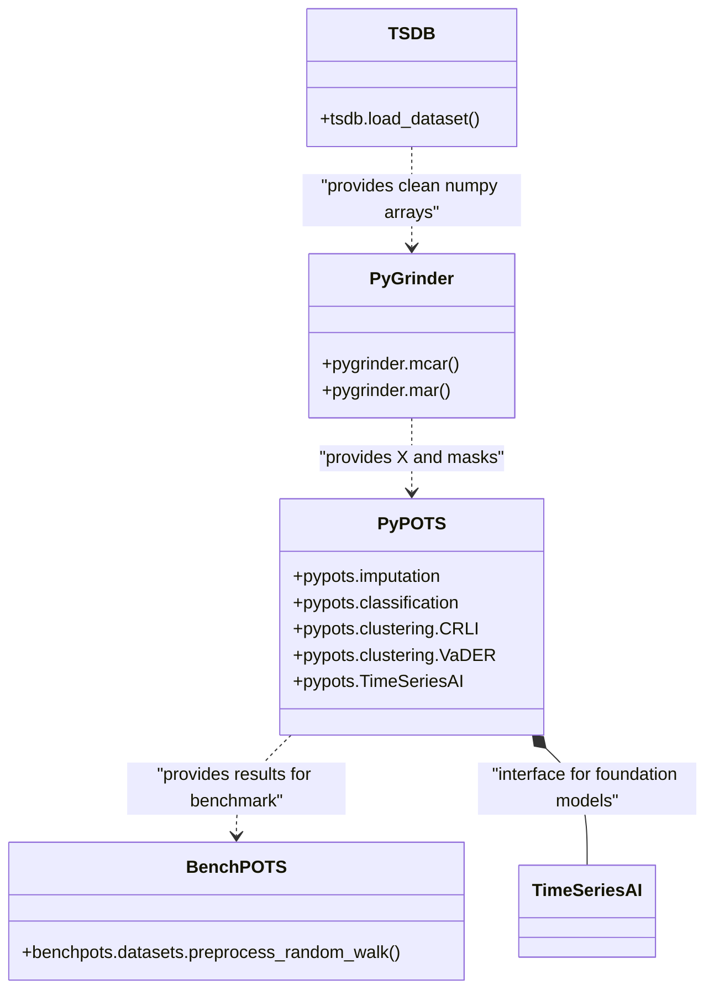

**Sources:** [pypots/__init__.py:14-56](), [pypots/clustering/__init__.py:8-14](), [README.md:110-117](), [examples/anomaly_detection/fedformer_anomalydetection_example.py:6-6]()

---

# Page: Core Architecture

# Core Architecture

<details>
<summary>Relevant source files</summary>

The following files were used as context for generating this wiki page:

- [pypots/__init__.py](pypots/__init__.py)
- [pypots/base.py](pypots/base.py)
- [pypots/classification/base.py](pypots/classification/base.py)
- [pypots/clustering/__init__.py](pypots/clustering/__init__.py)
- [pypots/clustering/base.py](pypots/clustering/base.py)
- [pypots/clustering/crli/model.py](pypots/clustering/crli/model.py)
- [pypots/clustering/vader/model.py](pypots/clustering/vader/model.py)
- [pypots/forecasting/base.py](pypots/forecasting/base.py)
- [pypots/imputation/base.py](pypots/imputation/base.py)
- [pypots/imputation/csdi/model.py](pypots/imputation/csdi/model.py)
- [pypots/imputation/gpvae/model.py](pypots/imputation/gpvae/model.py)
- [pypots/imputation/usgan/model.py](pypots/imputation/usgan/model.py)
- [pypots/utils/__init__.py](pypots/utils/__init__.py)
- [pypots/version.py](pypots/version.py)

</details>


PyPOTS is designed with a layered, object-oriented architecture that abstracts the complexities of time-series modeling while providing a consistent interface across different tasks like imputation, forecasting, classification, clustering, and representation learning. The system follows a clear separation of concerns between high-level model management and low-level neural network operations.

### High-Level Layered Design

The architecture is divided into three primary layers:
1.  **Interface Layer (`BaseModel`)**: Manages the model lifecycle, including device placement (CPU/GPU), logging, and persistence [pypots/base.py:38-93]().
2.  **Task Layer (e.g., `BaseImputer`, `BaseClassifier`)**: Defines task-specific APIs such as `impute()`, `forecast()`, or `classify()` [pypots/imputation/base.py:21-52](), [pypots/classification/base.py:21-51](), [pypots/forecasting/base.py:22-53](), [pypots/clustering/base.py:18-48]().
3.  **Neural Network Layer (`BaseNNModel` & `ModelCore`)**: Orchestrates the PyTorch training loop, validation, early stopping, and automatic mixed precision (AMP) [pypots/base.py:107-108]().

### Code Entity Relationship Diagram

The following diagram illustrates how the core base classes relate to specific model implementations and the underlying PyTorch modules.

**Model Class Hierarchy and Execution Flow**
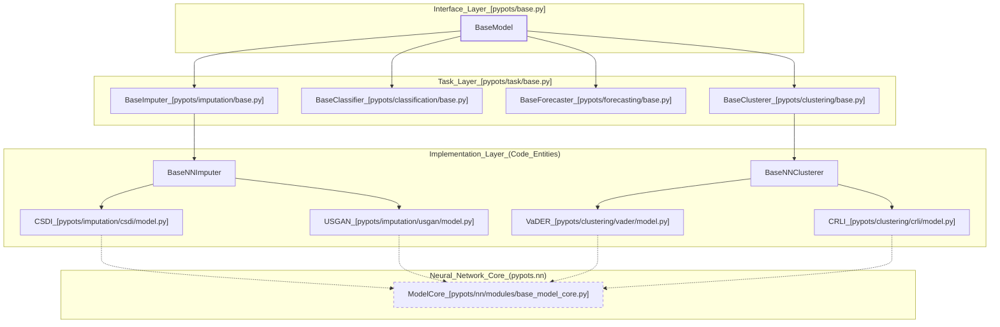
**Sources:** [pypots/base.py:38-176](), [pypots/imputation/base.py:21-165](), [pypots/classification/base.py:21-168](), [pypots/clustering/base.py:18-159](), [pypots/forecasting/base.py:22-165]().

---

### Base Class Hierarchy

The foundation of PyPOTS is a hierarchical inheritance structure that ensures all models behave predictably.

*   **`BaseModel`**: The root abstract class. It handles device management via `_setup_device` [pypots/base.py:122-163](), directory creation for saving results via `_setup_path` [pypots/base.py:120](), and verbosity settings [pypots/base.py:110-111]().
*   **`BaseNNModel`**: Extends `BaseModel` for neural networks. It introduces the `fit()` and `predict()` orchestration, manages the `Optimizer` and `LRScheduler` wrappers, and implements the training loop with optional early stopping.
*   **Task-Specific Base Classes**: These classes bridge the gap between generic NN training and specific time-series tasks. For example, `BaseNNImputer` provides the `impute()` method as a wrapper around `predict()` to return raw NumPy arrays [pypots/imputation/base.py:133-162](). Similarly, `BaseNNForecaster` provides `forecast()` [pypots/forecasting/base.py:134-162]() and `BaseNNClassifier` provides `classify()` and `predict_proba()` [pypots/classification/base.py:137-190]().

For details, see [Base Class Hierarchy](#2.1).

---

### Model Lifecycle (Fit / Predict / Save)

PyPOTS models follow a unified lifecycle pattern, regardless of whether they are GANs, Diffusions, or Transformers.

**Standard Model Lifecycle**
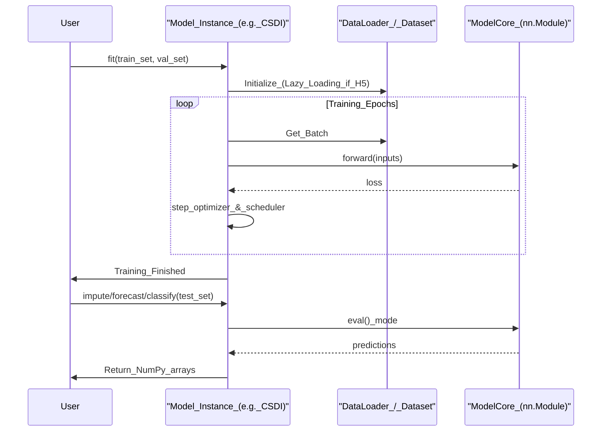

1.  **Initialization**: Models are initialized with hyperparameters and a `device`. During initialization, the `ModelCore` (e.g., `_CSDI` or `_VaDER`) is instantiated and sent to the specified device [pypots/imputation/csdi/model.py:159-174](), [pypots/clustering/vader/model.py:130-131]().
2.  **Fitting**: The `fit()` method accepts dictionaries or file paths. If a path is provided, PyPOTS uses lazy loading to handle datasets larger than memory [pypots/imputation/base.py:71-101](). Fitting involves an internal `_train_model` call which executes the epoch loop [pypots/clustering/vader/model.py:159-163]().
3.  **Persistence**: Models support saving and loading. The `model_saving_strategy` parameter allows users to save the "best" model based on validation performance, "better" models during training, or "all" checkpoints [pypots/base.py:59-66](). PyPOTS uses a custom loader `_load_model_file` to handle weight-only restrictions in newer PyTorch versions by manually setting `weights_only=False` to load supplementary PyPOTS metadata [pypots/base.py:29-35]().

---

### Device & Resource Management

PyPOTS provides robust support for modern hardware acceleration:
*   **Device Flexibility**: Supports `cpu`, `cuda`, and multi-GPU setups via `DataParallel` [pypots/base.py:122-163]().
*   **Automatic Mixed Precision (AMP)**: Enabled via `enable_amp=True` to reduce memory footprint and speed up training on compatible GPUs [pypots/base.py:51-54]().
*   **Parallel Training**: If a list of devices is provided (e.g. `['cuda:0', 'cuda:1']`), the model is automatically wrapped in `torch.nn.DataParallel` [pypots/base.py:143-163]().

**Sources:** [pypots/base.py:122-176](), [pypots/base.py:51-54]().

---

### Data Pipeline & Optimization

The architecture integrates tightly with a specialized data pipeline and optimization wrapper system:

*   **Data Pipeline**: Uses task-specific datasets (e.g. `DatasetForCSDI`, `DatasetForVaDER`) to handle missing values, masks (`missing_mask`, `indicating_mask`), and time-series specific features like `deltas` [pypots/imputation/csdi/model.py:184-198](), [pypots/imputation/usgan/model.py:172-195](). For details, see [Data Pipeline & Dataset Abstractions](#2.2).
*   **Optimization**: Instead of passing raw PyTorch optimizers, PyPOTS uses a wrapper system (`pypots.optim`) that allows for a two-stage initialization: parameter-independent config followed by parameter-binding via `init_optimizer()` [pypots/clustering/vader/model.py:135-140](), [pypots/imputation/csdi/model.py:177-182](). This is particularly useful for complex models like `USGAN` or `CRLI` which require multiple optimizers for Generators and Discriminators [pypots/imputation/usgan/model.py:154-170](), [pypots/clustering/crli/model.py:167-191](). For details, see [Optimization & Learning Rate Scheduling](#2.3).
*   **Neural Modules**: Shared components like Attention, backbones (Transformer, TimesNet), and various loss functions are centralized in `pypots.nn`. For details, see [Neural Network Modules (pypots.nn)](#2.4).

**Sources:** [pypots/imputation/usgan/model.py:172-195](), [pypots/clustering/vader/model.py:135-140](), [pypots/imputation/csdi/model.py:177-182](), [pypots/clustering/crli/model.py:167-191]().

---

# Page: Base Class Hierarchy

# Base Class Hierarchy

<details>
<summary>Relevant source files</summary>

The following files were used as context for generating this wiki page:

- [pypots/base.py](pypots/base.py)
- [pypots/classification/base.py](pypots/classification/base.py)
- [pypots/classification/brits/model.py](pypots/classification/brits/model.py)
- [pypots/classification/grud/model.py](pypots/classification/grud/model.py)
- [pypots/classification/raindrop/model.py](pypots/classification/raindrop/model.py)
- [pypots/classification/template/model.py](pypots/classification/template/model.py)
- [pypots/clustering/base.py](pypots/clustering/base.py)
- [pypots/clustering/crli/model.py](pypots/clustering/crli/model.py)
- [pypots/clustering/template/model.py](pypots/clustering/template/model.py)
- [pypots/clustering/vader/model.py](pypots/clustering/vader/model.py)
- [pypots/forecasting/base.py](pypots/forecasting/base.py)
- [pypots/forecasting/template/model.py](pypots/forecasting/template/model.py)
- [pypots/imputation/base.py](pypots/imputation/base.py)
- [pypots/imputation/brits/model.py](pypots/imputation/brits/model.py)
- [pypots/imputation/csdi/model.py](pypots/imputation/csdi/model.py)
- [pypots/imputation/gpvae/model.py](pypots/imputation/gpvae/model.py)
- [pypots/imputation/mrnn/model.py](pypots/imputation/mrnn/model.py)
- [pypots/imputation/saits/model.py](pypots/imputation/saits/model.py)
- [pypots/imputation/template/model.py](pypots/imputation/template/model.py)
- [pypots/imputation/transformer/model.py](pypots/imputation/transformer/model.py)
- [pypots/imputation/usgan/model.py](pypots/imputation/usgan/model.py)

</details>


The PyPOTS framework is built upon a structured hierarchy of abstract base classes designed to standardize the lifecycle of machine learning models for time-series analysis. This hierarchy ensures consistency across different tasks—such as imputation, classification, forecasting, clustering, and anomaly detection—while providing built-in support for advanced features like Automatic Mixed Precision (AMP), multi-GPU training, and early stopping.

## 1. Top-Level Abstract Classes

The foundation of every model in PyPOTS consists of two primary base classes: `BaseModel` and `BaseNNModel`.

### BaseModel
`BaseModel` is the root abstract class for all implementations [pypots/base.py:38](). It handles environment-level configurations including:
*   **Device Management**: Automatically detects CUDA or CPU availability if not specified [pypots/base.py:123-130](). It supports single strings, `torch.device` objects, or lists for parallel training [pypots/base.py:131-163]().
*   **Path Setup**: Initializes directories for saving checkpoints and TensorBoard logs via `SummaryWriter` [pypots/base.py:114-121]().
*   **Saving Strategies**: Implements logic for `None`, `"best"`, `"better"`, and `"all"` checkpointing strategies [pypots/base.py:94-97]().

### BaseNNModel
Inheriting from `BaseModel`, `BaseNNModel` provides the infrastructure specifically for neural network-based models [pypots/base.py:214](). It manages:
*   **Optimization**: Wraps `pypots.optim` objects and handles parameter initialization through `init_optimizer()` [pypots/base.py:269-275]().
*   **Training Loop**: Implements the standard `_train_model` method, which iterates through epochs, handles batch processing, and executes backpropagation [pypots/base.py:461-558]().
*   **Early Stopping**: Monitors validation performance and terminates training if no improvement is seen within the `patience` window [pypots/base.py:494-510]().
*   **Data Parallelism**: Automatically wraps the model core with `torch.nn.DataParallel` when multiple CUDA devices are provided [pypots/base.py:437-446]().

### Natural Language to Code Entity Mapping: Core Lifecycle
The following diagram maps high-level training concepts to the specific methods and attributes defined in the base classes.

**Core Lifecycle Method/Attribute Mapping**
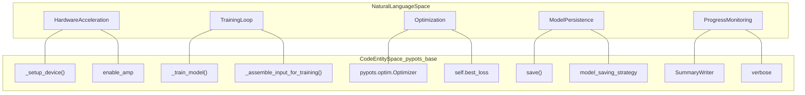
**Sources:** [pypots/base.py:38-100](), [pypots/base.py:123-163](), [pypots/base.py:214-275](), [pypots/base.py:461-558]()

---

## 2. Task-Specific Base Classes

PyPOTS extends `BaseNNModel` into task-specific abstractions. These classes define the standard interface (e.g., `fit()`, `predict()`) that users interact with across different domains.

| Task | Base Class | Primary Interface Methods |
| :--- | :--- | :--- |
| **Imputation** | `BaseNNImputer` | `fit()`, `predict()`, `impute()` [pypots/imputation/base.py:165]() |
| **Classification** | `BaseNNClassifier` | `fit()`, `predict()`, `classify()`, `predict_proba()` [pypots/classification/base.py:214]() |
| **Forecasting** | `BaseNNForecaster` | `fit()`, `predict()`, `forecast()` [pypots/forecasting/base.py:165]() |
| **Clustering** | `BaseNNClusterer` | `fit()`, `predict()`, `cluster()` [pypots/clustering/base.py:159]() |

### Task-Specific Logic Examples
*   **Imputation**: The `impute()` method is a convenience wrapper around `predict()`, specifically returning the `imputation` key from the result dictionary [pypots/imputation/base.py:133-162]().
*   **Classification**: The `classify()` method handles the conversion of model logits into discrete class labels, while `predict_proba()` returns raw probabilities [pypots/classification/base.py:137-191]().
*   **Forecasting**: The `forecast()` method extracts the `forecasting` key, typically of shape `[n_samples, n_pred_steps, n_features]` [pypots/forecasting/base.py:134-162]().
*   **Clustering**: Models like `VaDER` implement a custom `_train_model` to handle Gaussian Mixture Model (GMM) pre-training phases [pypots/clustering/vader/model.py:159-224](). `CRLI` utilizes dual optimizers (`G_optimizer` and `D_optimizer`) to handle adversarial training [pypots/clustering/crli/model.py:167-185]().

**Sources:** [pypots/imputation/base.py:133-165](), [pypots/classification/base.py:137-214](), [pypots/forecasting/base.py:134-165](), [pypots/clustering/base.py:132-159](), [pypots/clustering/vader/model.py:159-224](), [pypots/clustering/crli/model.py:167-185]()

---

## 3. Training Infrastructure

### Automatic Mixed Precision (AMP)
PyPOTS utilizes `torch.cuda.amp` via a custom `autocast` wrapper [pypots/base.py:20](). When `enable_amp=True` is passed to the constructor, the training loop executes forward passes and loss calculations within the autocast context to reduce memory footprint and increase speed on compatible hardware [pypots/base.py:476-483]().

### Multi-GPU Support
If a list of devices is provided (e.g. `device=['cuda:0', 'cuda:1']`), the model is wrapped in `torch.nn.DataParallel` [pypots/base.py:437-446](). PyPOTS handles the necessary attribute redirection (e.g. accessing `self.model.module` for saved weights or optimizer initialization) automatically [pypots/base.py:447-450](). For example, `USGAN` and `CRLI` check if `self.device` is a list to correctly target parameters in the `module.backbone` [pypots/imputation/usgan/model.py:165-170](), [pypots/clustering/crli/model.py:178-185]().

### Early Stopping and Validation
The training loop evaluates the model on the `val_set` at the end of each epoch [pypots/base.py:485-492]().
1.  If the `validation_metric` improves, the `best_model_dict` is updated with a deep copy of the state [pypots/base.py:494-500]().
2.  If no improvement is seen for `patience` consecutive epochs, the loop breaks [pypots/base.py:504-510]().
3.  Upon completion, the best weights are restored to the model [pypots/base.py:521-522]().

### Model Saving Strategies
Checkpointing is governed by the `model_saving_strategy` attribute [pypots/base.py:59-66]():
| Strategy | Behavior |
| :--- | :--- |
| `None` | No checkpoints are saved to disk [pypots/base.py:61](). |
| `"best"` | Only the version with the lowest validation loss is saved at the end of training [pypots/base.py:62](). |
| `"better"` | Saves a new checkpoint whenever the validation metric improves during training [pypots/base.py:63](). |
| `"all"` | Saves a checkpoint after every single epoch [pypots/base.py:65](). |

**Sources:** [pypots/base.py:20](), [pypots/base.py:59-66](), [pypots/base.py:437-450](), [pypots/base.py:476-522](), [pypots/imputation/usgan/model.py:165-170](), [pypots/clustering/crli/model.py:178-185]()

---

## 4. Implementation Hierarchy Diagram

This diagram shows how concrete models (like `CSDI`, `VaDER`, or `CRLI`) inherit from the base infrastructure to provide specialized functionality.

**Entity Relationship Hierarchy**
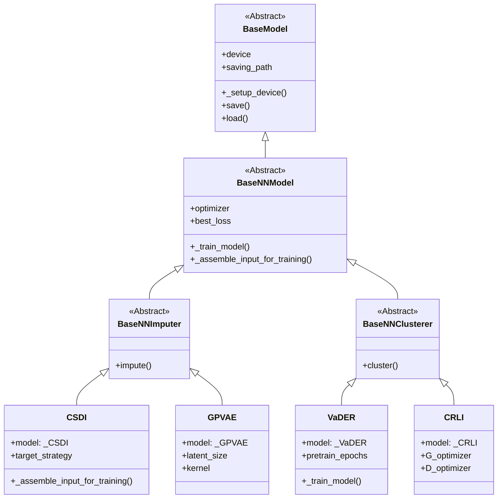
**Sources:** [pypots/base.py:38](), [pypots/base.py:214](), [pypots/imputation/base.py:165](), [pypots/imputation/csdi/model.py:25](), [pypots/imputation/gpvae/model.py:24](), [pypots/clustering/base.py:159](), [pypots/clustering/vader/model.py:27](), [pypots/clustering/crli/model.py:26]()

---

# Page: Data Pipeline & Dataset Abstractions

# Data Pipeline & Dataset Abstractions

<details>
<summary>Relevant source files</summary>

The following files were used as context for generating this wiki page:

- [pypots/classification/grud/data.py](pypots/classification/grud/data.py)
- [pypots/clustering/crli/data.py](pypots/clustering/crli/data.py)
- [pypots/clustering/vader/data.py](pypots/clustering/vader/data.py)
- [pypots/data/__init__.py](pypots/data/__init__.py)
- [pypots/data/dataset/base.py](pypots/data/dataset/base.py)
- [pypots/data/saving/__init__.py](pypots/data/saving/__init__.py)
- [pypots/data/saving/h5.py](pypots/data/saving/h5.py)
- [pypots/data/saving/pickle.py](pypots/data/saving/pickle.py)
- [pypots/data/utils.py](pypots/data/utils.py)
- [pypots/imputation/brits/data.py](pypots/imputation/brits/data.py)
- [pypots/imputation/mrnn/data.py](pypots/imputation/mrnn/data.py)
- [pypots/imputation/saits/data.py](pypots/imputation/saits/data.py)
- [pypots/nn/modules/etsformer/layers.py](pypots/nn/modules/etsformer/layers.py)
- [pypots/utils/file.py](pypots/utils/file.py)
- [tests/anomaly_detection/__init__.py](tests/anomaly_detection/__init__.py)
- [tests/anomaly_detection/autoformer.py](tests/anomaly_detection/autoformer.py)
- [tests/anomaly_detection/saits.py](tests/anomaly_detection/saits.py)
- [tests/anomaly_detection/tefn.py](tests/anomaly_detection/tefn.py)
- [tests/data/saving.py](tests/data/saving.py)
- [tests/data/utils.py](tests/data/utils.py)
- [tests/global_test_config.py](tests/global_test_config.py)
- [tests/representation/ts2vec.py](tests/representation/ts2vec.py)

</details>


The PyPOTS data pipeline is designed to handle diverse time-series data formats, ranging from small in-memory dictionaries to massive datasets requiring lazy-loading from disk. The core abstraction is the `BaseDataset`, which provides a unified interface for all PyPOTS models while managing complex data flows including missingness masks and time-gap (delta) calculations.

### The BaseDataset Abstraction

The `BaseDataset` class [pypots/data/dataset/base.py:23-23]() extends `torch.utils.data.Dataset` to provide a standardized structure for time-series tasks. It supports two primary modes of operation: **Array-based** (loading all data into RAM) and **File-based** (lazy-loading from HDF5 or Pickle files) [pypots/data/dataset/base.py:106-132]().

#### Key Data Components
The pipeline manages several critical tensors that flow through the system:
*   `X`: The input time-series data, potentially containing missing values (NaNs). Shape: `[n_samples, n_steps, n_features]` [pypots/data/dataset/base.py:32-33]().
*   `X_ori`: The original "ground truth" data. Used primarily in imputation tasks to calculate loss on artificially masked values [pypots/data/dataset/base.py:34-36]().
*   `missing_mask`: A binary mask where `0` indicates a missing value and `1` indicates an observed value [pypots/data/utils.py:135-135]().
*   `indicating_mask`: Specifically used in models like SAITS; it represents the difference between `X_ori`'s mask and `X`'s mask, highlighting which values were artificially masked for training [pypots/imputation/mrnn/data.py:181-182]().
*   `X_pred`: The target sequence for forecasting tasks [pypots/data/dataset/base.py:37-41]().

#### Data Flow and Initialization
The diagram below illustrates how raw input data is processed into the internal representation used by the `BaseDataset`.

**Title: Data Initialization Flow in BaseDataset**
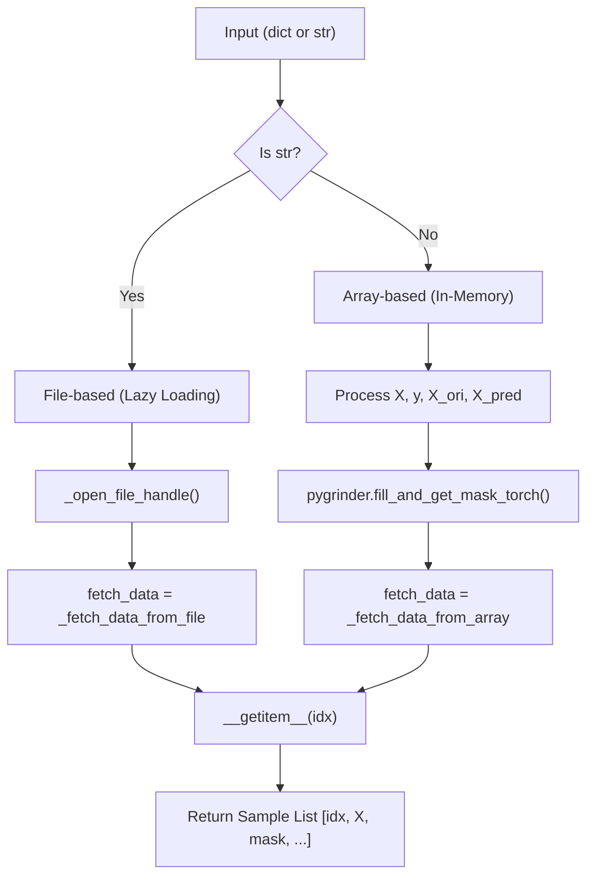
Sources: [pypots/data/dataset/base.py:106-131](), [pypots/imputation/mrnn/data.py:85-188]()

### Supported Formats and Lazy Loading

PyPOTS supports HDF5 and Pickle formats for persistent storage [pypots/data/dataset/base.py:18-18](). The variable `SUPPORTED_DATASET_FILE_FORMATS` defines the allowed extensions [pypots/data/dataset/base.py:108-111]().

*   **HDF5 (`.h5`, `.hdf5`)**: Preferred for large datasets. The `_fetch_data_from_file` method [pypots/imputation/mrnn/data.py:133-188]() uses the H5 file handle to read only the required slice `idx` into memory, preventing OOM (Out-of-Memory) errors during training on massive datasets.
*   **Pickle (`.pkl`)**: Supported for smaller, serialized Python objects via `pickle_dump` and `pickle_load` [pypots/data/saving/pickle.py:16-68]().

#### Saving and Loading Utilities
The `pypots.data.saving` module provides wrappers to simplify these operations:
*   `save_dict_into_h5`: Recursively saves nested dictionaries into HDF5 groups and datasets [pypots/data/saving/h5.py:19-81](). It automatically creates parent directories using `create_dir_if_not_exist` [pypots/data/saving/h5.py:74-74]().
*   `load_dict_from_h5`: Reconstructs a Python dictionary from an H5 file [pypots/data/saving/h5.py:84-129]().
*   `pickle_dump` / `pickle_load`: Standardized pickling with automatic directory creation and support for `pandas` pickle reading if version >= 2.0.0 [pypots/data/saving/pickle.py:16-68]().

Sources: [pypots/data/saving/h5.py:1-129](), [pypots/data/saving/pickle.py:1-69](), [pypots/data/dataset/base.py:106-131](), [pypots/data/saving/__init__.py:9-14]()

### Irregular Time Series: parse_delta

For models that handle irregular sampling (e.g., BRITS, GRU-D, M-RNN), PyPOTS provides `parse_delta`. This function calculates the time-gap matrix $\delta$, which represents the amount of time since the last observation for each feature.

Implementation details:
*   **Math Definition**: Based on Che et al. (2018) [pypots/data/utils.py:32-52]().
*   **Logic**: For the first step, $\delta_1 = 0$ [pypots/data/utils.py:59-59](). For subsequent steps $t > 1$:
    $\delta_t = 1 + (1 - m_{t-1}) \odot \delta_{t-1}$
    where $m$ is the missing mask [pypots/data/utils.py:62-62]().
*   **Backends**: PyPOTS implements this for both NumPy (`_parse_delta_numpy`) [pypots/data/utils.py:81-125]() and PyTorch (`_parse_delta_torch`) [pypots/data/utils.py:32-78](). The entry point `parse_delta` automatically dispatches to the correct backend [pypots/data/utils.py:152-158]().

Sources: [pypots/data/utils.py:128-158](), [pypots/imputation/mrnn/data.py:67-70](), [pypots/classification/grud/data.py:61-61]()

### Sliding Window Transforms

To transform long univariate or multivariate time series into fixed-length samples for deep learning models, PyPOTS utilizes sliding window utilities.

*   `sliding_window`: Truncates a series of shape `[total_length, n_features]` into samples of shape `[n_samples, window_len, n_features]` [pypots/data/utils.py:161-196](). This function wraps the `benchpots` implementation [pypots/data/utils.py:192-196]().
*   `inverse_sliding_window`: Reconstructs the original sequence from overlapped windows [pypots/data/utils.py:199-199]().

Sources: [pypots/data/utils.py:161-199]()

### Data Flow in Task-Specific Datstractions

Task-specific datasets, such as `DatasetForMRNN` [pypots/imputation/mrnn/data.py:17-17]() and `DatasetForGRUD` [pypots/classification/grud/data.py:18-18](), extend `BaseDataset` to perform specialized preprocessing. For instance, M-RNN requires both forward and backward temporal views of the data.

**Title: Entity Relationship & Data Flow for M-RNN Dataset**
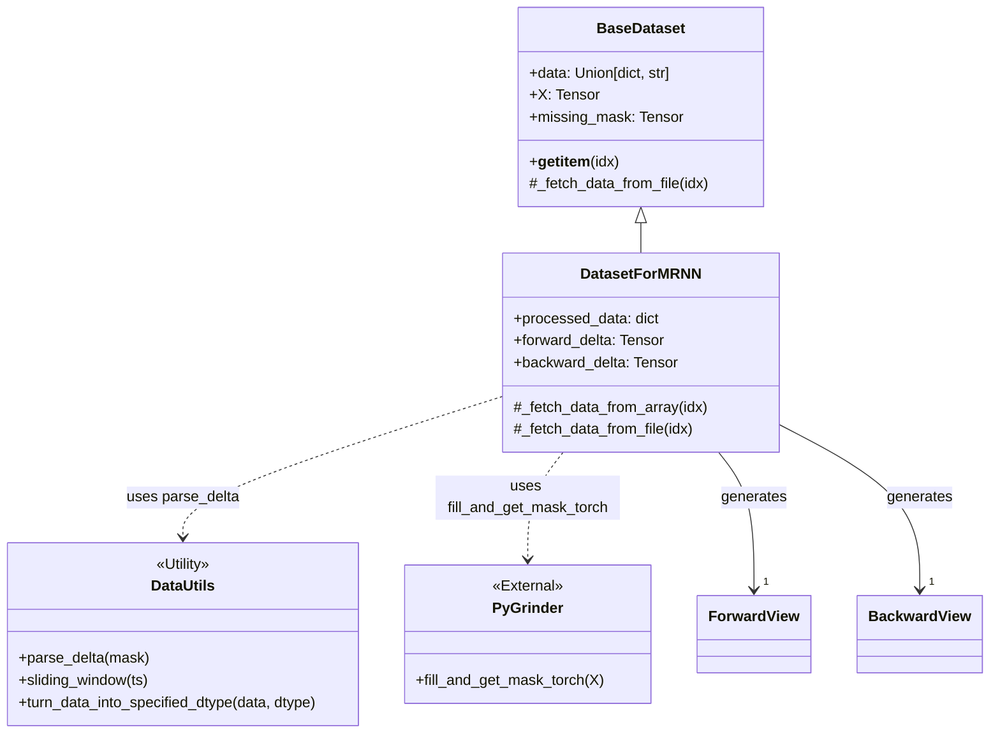

In `DatasetForMRNN`, the `__init__` method generates backward sequences using `torch.flip` [pypots/imputation/mrnn/data.py:68-70]() and calculates deltas for both directions. When `__getitem__` is called, it returns a collated list containing the index, forward X, forward mask, forward delta, and their backward counterparts [pypots/imputation/mrnn/data.py:113-123](). For file-based data, it opens the handle lazily [pypots/imputation/mrnn/data.py:148-149]() and calculates these features on-the-fly [pypots/imputation/mrnn/data.py:151-164]().

In `DatasetForGRUD`, the pipeline includes calculating the empirical mean of features for imputation [pypots/classification/grud/data.py:62-66]() and filling missing values with Last Observation Carried Forward (LOCF) using `locf_torch` [pypots/classification/grud/data.py:59-59]().

### Data Integrity Utilities
PyPOTS includes utilities to ensure data consistency during the pipeline flow:
*   `turn_data_into_specified_dtype`: A unified interface to convert data between `list`, `np.ndarray`, and `torch.Tensor` [pypots/data/utils.py:15-29]().
*   `key_in_data_set`: A checking utility used in `BaseDataset` to verify that mandatory keys like `X` are present in the input dictionary or file [pypots/data/dataset/base.py:116-145]().

Sources: [pypots/imputation/mrnn/data.py:17-188](), [pypots/classification/grud/data.py:18-151](), [pypots/data/dataset/base.py:23-78](), [pypots/data/utils.py:15-29]()

---

# Page: Optimization & Learning Rate Scheduling

# Optimization & Learning Rate Scheduling

<details>
<summary>Relevant source files</summary>

The following files were used as context for generating this wiki page:

- [docs/pypots.optim.rst](docs/pypots.optim.rst)
- [pypots/optim/__init__.py](pypots/optim/__init__.py)
- [pypots/optim/adadelta.py](pypots/optim/adadelta.py)
- [pypots/optim/adagrad.py](pypots/optim/adagrad.py)
- [pypots/optim/adam.py](pypots/optim/adam.py)
- [pypots/optim/adamw.py](pypots/optim/adamw.py)
- [pypots/optim/base.py](pypots/optim/base.py)
- [pypots/optim/lr_scheduler/__init__.py](pypots/optim/lr_scheduler/__init__.py)
- [pypots/optim/lr_scheduler/base.py](pypots/optim/lr_scheduler/base.py)
- [pypots/optim/lr_scheduler/constant_lrs.py](pypots/optim/lr_scheduler/constant_lrs.py)
- [pypots/optim/lr_scheduler/exponential_lrs.py](pypots/optim/lr_scheduler/exponential_lrs.py)
- [pypots/optim/lr_scheduler/lambda_lrs.py](pypots/optim/lr_scheduler/lambda_lrs.py)
- [pypots/optim/lr_scheduler/linear_lrs.py](pypots/optim/lr_scheduler/linear_lrs.py)
- [pypots/optim/lr_scheduler/multiplicative_lrs.py](pypots/optim/lr_scheduler/multiplicative_lrs.py)
- [pypots/optim/lr_scheduler/multistep_lrs.py](pypots/optim/lr_scheduler/multistep_lrs.py)
- [pypots/optim/lr_scheduler/step_lrs.py](pypots/optim/lr_scheduler/step_lrs.py)
- [pypots/optim/rmsprop.py](pypots/optim/rmsprop.py)
- [pypots/optim/sgd.py](pypots/optim/sgd.py)
- [tests/optim/adadelta.py](tests/optim/adadelta.py)
- [tests/optim/adagrad.py](tests/optim/adagrad.py)
- [tests/optim/adam.py](tests/optim/adam.py)
- [tests/optim/adamw.py](tests/optim/adamw.py)
- [tests/optim/lr_schedulers.py](tests/optim/lr_schedulers.py)
- [tests/optim/rmsprop.py](tests/optim/rmsprop.py)
- [tests/optim/sgd.py](tests/optim/sgd.py)

</details>


The `pypots.optim` module provides a specialized wrapper system for PyTorch optimizers and learning rate schedulers. Its primary purpose is to decouple model architecture hyperparameters from optimization settings, ensuring cleaner code and improved readability [pypots/optim/base.py:1-14](). By providing a two-stage initialization pattern, PyPOTS allows users to define optimization strategies independently of the neural network parameters they will eventually manage.

## The Optimizer Wrapper System

All optimizers in PyPOTS inherit from the `Optimizer` base class [pypots/optim/base.py:25-26](). Unlike standard PyTorch optimizers that require model parameters at instantiation, PyPOTS optimizers are initialized with hyperparameters first, and the target parameters are bound later via the `init_optimizer` method [pypots/optim/base.py:49-57]().

### Core Components

| Component | Role | Code Entity |
| :--- | :--- | :--- |
| **Base Class** | Defines the interface for all PyPOTS optimizers. | `pypots.optim.base.Optimizer` [pypots/optim/base.py:25]() |
| **Concrete Wrappers** | Implementations for Adam, AdamW, SGD, etc. | `pypots.optim.adam.Adam`, `pypots.optim.sgd.SGD`, etc. [pypots/optim/__init__.py:8-13]() |
| **Internal Engine** | The actual `torch.optim` instance. | `self.torch_optimizer` [pypots/optim/base.py:38-41]() |
| **Scheduler Link** | Optional integrated learning rate scheduler. | `self.lr_scheduler` [pypots/optim/base.py:46]() |

### Two-Stage Initialization Pattern

The initialization of a PyPOTS optimizer follows a specific flow to bridge the gap between user configuration and the PyTorch backend:

1.  **Lazy Configuration**: The user instantiates a PyPOTS optimizer (e.g., `Adam`) with hyperparameters like `lr` and `weight_decay` [pypots/optim/adam.py:43-51]().
2.  **Parameter Binding**: Inside the model's setup phase, `init_optimizer(params)` is called [pypots/optim/base.py:49-57]().
3.  **Backend Instantiation**: The wrapper creates the real `torch.optim` object and initializes the `LRScheduler` if one was provided [pypots/optim/adam.py:61-76]().

**Optimization Pipeline Architecture**

Title: "Optimization Pipeline Architecture"
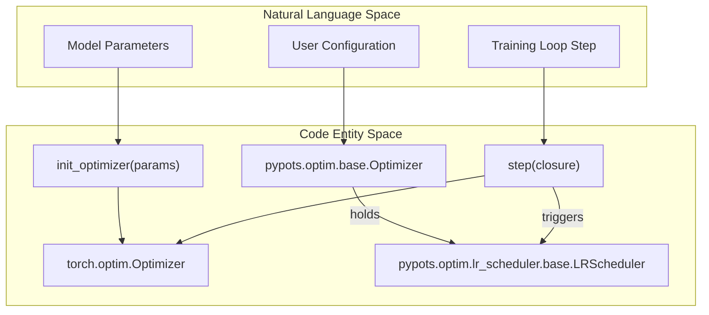
Sources: [pypots/optim/base.py:25-58](), [pypots/optim/base.py:94-108](), [pypots/optim/adam.py:61-76]()

---

## Concrete Optimizer Implementations

PyPOTS wraps the most commonly used PyTorch optimization algorithms. Each wrapper ensures that the `torch_optimizer` is correctly instantiated with the specific arguments required by the underlying algorithm [pypots/optim/__init__.py:8-22]().

| PyPOTS Class | PyTorch Backend | Key Parameters |
| :--- | :--- | :--- |
| `Adam` | `torch.optim.Adam` | `lr`, `betas`, `eps`, `weight_decay`, `amsgrad` [pypots/optim/adam.py:43-51]() |
| `AdamW` | `torch.optim.AdamW` | `lr`, `betas`, `eps`, `weight_decay`, `amsgrad` [pypots/optim/adamw.py:44-51]() |
| `SGD` | `torch.optim.SGD` | `lr`, `momentum`, `weight_decay`, `dampening`, `nesterov` [pypots/optim/sgd.py:43-50]() |
| `RMSprop` | `torch.optim.RMSprop` | `lr`, `momentum`, `alpha`, `eps`, `centered` [pypots/optim/rmsprop.py:47-55]() |
| `Adagrad` | `torch.optim.Adagrad` | `lr`, `lr_decay`, `weight_decay`, `initial_accumulator_value` [pypots/optim/adagrad.py:43-51]() |
| `Adadelta` | `torch.optim.Adadelta` | `lr`, `rho`, `eps`, `weight_decay` [pypots/optim/adadelta.py:40-47]() |

### Example: Adagrad Implementation
The `Adagrad` wrapper demonstrates the pattern of storing hyperparameters in `__init__` [pypots/optim/adagrad.py:42-55]() and passing them to the backend in `init_optimizer` [pypots/optim/adagrad.py:57-77](). Note that PyPOTS sets a default `initial_accumulator_value` of 0.01 to avoid division by zero issues, differing from the PyTorch default [pypots/optim/adagrad.py:47]().

Sources: [pypots/optim/__init__.py:8-22](), [pypots/optim/adagrad.py:17-77](), [pypots/optim/adamw.py:17-77](), [pypots/optim/sgd.py:17-77](), [pypots/optim/adadelta.py:17-71](), [pypots/optim/rmsprop.py:17-83]()

---

## Learning Rate Scheduling

PyPOTS includes a sub-system for learning rate scheduling under `pypots.optim.lr_scheduler`. These classes are adapted from PyTorch but modified to support the two-stage initialization pattern, meaning you don't have to pass the optimizer immediately upon instantiation [pypots/optim/lr_scheduler/__init__.py:1-7]().

### Integrated Stepping
A key feature of the PyPOTS optimizer wrapper is the automatic handling of scheduler steps. When `Optimizer.step()` is called, it first executes the parameter update via the torch backend and then immediately calls `self.lr_scheduler.step()` if a scheduler is present [pypots/optim/base.py:105-108]().

### Scheduler Lifecycle

Title: "LRScheduler Initialization and Execution Lifecycle"
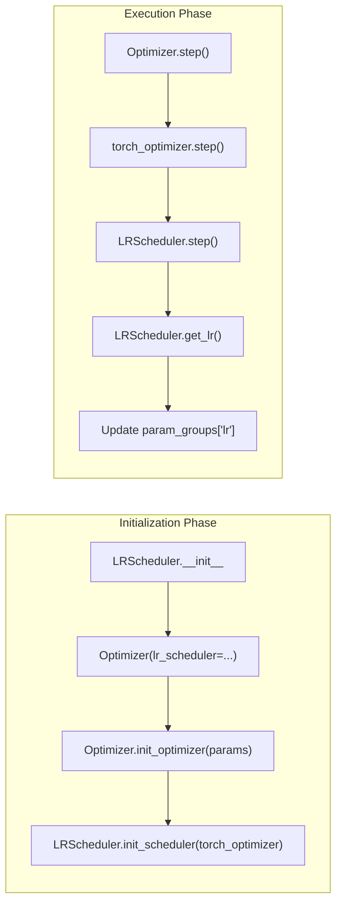
Sources: [pypots/optim/lr_scheduler/base.py:39-58](), [pypots/optim/lr_scheduler/base.py:118-167](), [pypots/optim/base.py:105-108]()

### Available Schedulers
The following schedulers are available and can be passed to any PyPOTS optimizer [pypots/optim/lr_scheduler/__init__.py:20-28]():
*   `LambdaLR`: Sets the learning rate to the initial LR times a given function [tests/optim/lr_schedulers.py:34]().
*   `MultiplicativeLR`: Multiplies the learning rate by a factor given in the lambda function [tests/optim/lr_schedulers.py:37]().
*   `StepLR`: Decays the learning rate by `gamma` every `step_size` epochs [tests/optim/lr_schedulers.py:40]().
*   `MultiStepLR`: Decays the learning rate by `gamma` once the number of epochs reaches one of the milestones [tests/optim/lr_schedulers.py:43]().
*   `ExponentialLR`: Decays the learning rate by `gamma` every epoch [tests/optim/lr_schedulers.py:52]().
*   `LinearLR`: Decays the learning rate linearly for a set number of iterations [tests/optim/lr_schedulers.py:49]().
*   `ConstantLR`: Decays the learning rate by a constant factor until a milestone is reached [tests/optim/lr_schedulers.py:46]().

### Safety Mechanisms
The `LRScheduler` base class includes a `with_counter` wrapper for the optimizer's step method [pypots/optim/lr_scheduler/base.py:74-101](). This ensures that `lr_scheduler.step()` is called after `optimizer.step()`, adhering to PyTorch's requirements. If the order is violated or if the optimizer step is overridden incorrectly, the system logs a warning to the user [pypots/optim/lr_scheduler/base.py:125-144]().

Sources: [pypots/optim/lr_scheduler/base.py:18-167](), [tests/optim/lr_schedulers.py:30-53](), [pypots/optim/lr_scheduler/__init__.py:1-28]()

---

# Page: Neural Network Modules (pypots.nn)

# Neural Network Modules (pypots.nn)

<details>
<summary>Relevant source files</summary>

The following files were used as context for generating this wiki page:

- [docs/algo_table.rst](docs/algo_table.rst)
- [docs/faq.rst](docs/faq.rst)
- [docs/install.rst](docs/install.rst)
- [docs/milestones.rst](docs/milestones.rst)
- [docs/pypots.nn.rst](docs/pypots.nn.rst)
- [pypots/nn/functional/__init__.py](pypots/nn/functional/__init__.py)
- [pypots/nn/functional/gathering.py](pypots/nn/functional/gathering.py)
- [pypots/nn/functional/normalization.py](pypots/nn/functional/normalization.py)
- [pypots/nn/modules/__init__.py](pypots/nn/modules/__init__.py)
- [pypots/nn/modules/brits/__init__.py](pypots/nn/modules/brits/__init__.py)
- [pypots/nn/modules/grud/__init__.py](pypots/nn/modules/grud/__init__.py)
- [pypots/nn/modules/loss.py](pypots/nn/modules/loss.py)
- [pypots/nn/modules/metric.py](pypots/nn/modules/metric.py)
- [pypots/nn/modules/patchtst/__init__.py](pypots/nn/modules/patchtst/__init__.py)
- [pypots/nn/modules/saits/__init__.py](pypots/nn/modules/saits/__init__.py)
- [pypots/nn/modules/saits/backbone.py](pypots/nn/modules/saits/backbone.py)
- [pypots/nn/modules/saits/embedding.py](pypots/nn/modules/saits/embedding.py)
- [pypots/nn/modules/transformer/__init__.py](pypots/nn/modules/transformer/__init__.py)
- [pypots/nn/modules/transformer/attention.py](pypots/nn/modules/transformer/attention.py)
- [pypots/nn/modules/transformer/layers.py](pypots/nn/modules/transformer/layers.py)
- [pypots/nn/modules/usgan/__init__.py](pypots/nn/modules/usgan/__init__.py)
- [requirements/conda_dev_env.yml](requirements/conda_dev_env.yml)
- [requirements/conda_env.yml](requirements/conda_env.yml)
- [requirements/requirements.txt](requirements/requirements.txt)
- [requirements/requirements_dev.txt](requirements/requirements_dev.txt)

</details>


The `pypots.nn` package provides the foundational building blocks for all neural network models in the PyPOTS ecosystem. It includes core base classes for model logic, shared backbone architectures (like Transformers, SAITS, BRITS, and TimeMixer), a standardized hierarchy for loss functions and metrics, and functional utilities for data manipulation and normalization.

## Model Core and Base Architecture

In PyPOTS, the `ModelCore` class serves as the primary container for the PyTorch-based neural network logic. While high-level task classes (e.g. `BaseNNImputer`) handle the training loop and device management, the core modules define the specific `forward()` pass and internal parameter state [pypots/nn/modules/base_model_core.py:8-14]().

### System Entity Mapping: Model Logic Flow
The following diagram illustrates how high-level PyPOTS components interact with the internal neural network modules and backbones.

Title: PyPOTS Neural Network Entity Association
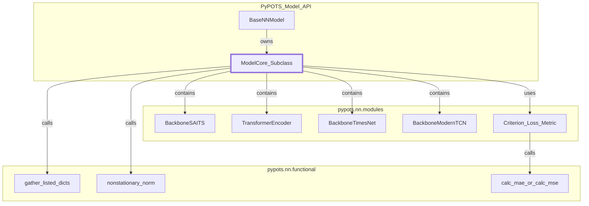
**Sources:** [pypots/nn/modules/saits/backbone.py:19-27](), [pypots/nn/modules/loss.py:17-31](), [pypots/nn/modules/base_model_core.py:8-14]()

---

## Shared Backbone Modules

PyPOTS provides highly modular implementations of popular time-series backbones. These are often reused across imputation, classification, and forecasting tasks.

### Transformer Components
The Transformer implementation is split into granular sub-modules to allow for flexible architecture design, used in models like SAITS and Transformer-based imputers.

| Class | Role | File Reference |
| :--- | :--- | :--- |
| `AttentionOperator` | Abstract base for attention mechanisms. | [pypots/nn/modules/transformer/attention.py:22-40]() |
| `ScaledDotProductAttention` | Standard dot-product attention with scaling and dropout. | [pypots/nn/modules/transformer/attention.py:42-117]() |
| `MultiHeadAttention` | Multi-head wrapper that projects queries, keys, and values. | [pypots/nn/modules/transformer/attention.py:119-220]() |
| `PositionWiseFeedForward` | FFN with residual connection and LayerNorm. | [pypots/nn/modules/transformer/layers.py:15-64]() |
| `TransformerEncoderLayer` | A single encoder block combining MHA and FFN. | [pypots/nn/modules/transformer/layers.py:66-158]() |
| `TransformerDecoderLayer` | A single decoder block with self-attention and encoder-attention. | [pypots/nn/modules/transformer/layers.py:160-273]() |

### Modern Time-Series Backbones
PyPOTS includes several state-of-the-art backbones designed for multi-scale and decomposition-based modeling:

*   **BackboneTimesNet**: Utilizes `TimesBlock` to capture multi-periodicity by transforming 1D time series into 2D variations using FFT [pypots/nn/modules/timesnet/__init__.py]().
*   **BackboneModernTCN**: A hierarchical TCN backbone using `Stage` modules, downsampling layers, and multi-scale fusing [pypots/nn/modules/moderntcn/__init__.py]().
*   **BackboneSAITS**: A specialized self-attention backbone that integrates an embedding layer with a transformer encoder for imputation tasks [pypots/nn/modules/saits/backbone.py:19-27]().
*   **RevIN**: A Reversible Instance Normalization module that handles distribution shift, with a PyPOTS-specific implementation to handle `missing_mask` during mean/variance calculation [pypots/nn/modules/revin/__init__.py]().

### Multi-Head Attention Data Flow
The `MultiHeadAttention` module manages the transformation of input tensors into multiple subspaces.

Title: MultiHeadAttention Tensor Transformation Flow
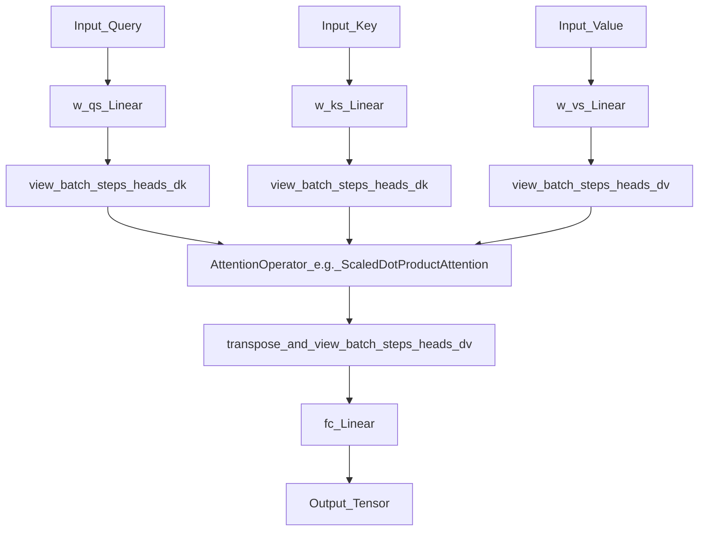
**Sources:** [pypots/nn/modules/transformer/attention.py:155-219](), [pypots/nn/modules/transformer/layers.py:105-111]()

---

## Functional Utilities (`pypots.nn.functional`)

The functional package contains stateless operations used for data gathering, normalization, and error calculation.

### Data Gathering
The `gather_listed_dicts` function is a critical utility for post-processing model outputs. It takes a list of dictionaries (usually from batch-wise forward passes) and concatenates their values into a single dictionary of NumPy arrays [pypots/nn/functional/gathering.py:12-41]().

### Normalization & Error
- **`nonstationary_norm`**: Implements normalization from Non-stationary Transformer. It calculates mean and standard deviation while respecting the `missing_mask` to handle distribution shift in incomplete data [pypots/nn/functional/normalization.py:14-62]().
- **`nonstationary_denorm`**: Reverses the normalization using the stored means and standard deviations [pypots/nn/functional/normalization.py:64-98]().
- **Error Calculations**: Provides optimized functions for `calc_mae`, `calc_mse`, `calc_rmse`, and `calc_mre` which handle masking to ignore missing values during error computation [pypots/nn/functional/__init__.py:10-14]().

---

## Criterion Hierarchy (Loss & Metrics)

PyPOTS uses a unified `Criterion` base class for both training loss functions and evaluation metrics. This hierarchy inherits from PyTorch's `_Loss` class [pypots/nn/modules/loss.py:17-33]().

### Class Hierarchy: Criterion & Metrics
The design ensures that all evaluation and optimization logic follows a consistent interface: `forward(logits, targets)`.

Title: PyPOTS Criterion and Metric Class Hierarchy
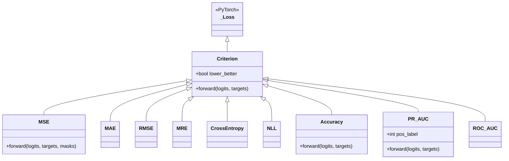
**Sources:** [pypots/nn/modules/loss.py:17-134](), [pypots/nn/modules/metric.py:17-67]()

### Implementation Details
- **Base Class**: `Criterion` includes a `lower_better` flag. For `MSE`, `MAE`, or `CrossEntropy`, this is `True` [pypots/nn/modules/loss.py:20-33](). For `Accuracy`, `PR_AUC`, or `ROC_AUC`, it is `False` [pypots/nn/modules/metric.py:19-55]().
- **Regression Metrics**: `MSE`, `MAE`, `RMSE`, and `MRE` support an optional `masks` parameter to calculate errors specifically on indicated values by calling functional counterparts [pypots/nn/modules/loss.py:54-108]().
- **Classification Metrics**: `Accuracy`, `PR_AUC`, and `ROC_AUC` internally apply `softmax` to `logits`, then convert to NumPy to utilize specialized implementations like `calc_pr_auc` or `calc_acc` [pypots/nn/modules/metric.py:28-34](), [pypots/nn/modules/metric.py:62-66]().
- **Loss Functions**: `CrossEntropy` and `NLL` wrap standard `torch.nn.functional` implementations within the PyPOTS `Criterion` interface [pypots/nn/modules/loss.py:110-133]().

**Sources:** [pypots/nn/modules/loss.py:1-134](), [pypots/nn/modules/metric.py:1-67](), [pypots/nn/functional/__init__.py:10-14]()

---

# Page: Task Modules

# Task Modules

<details>
<summary>Relevant source files</summary>

The following files were used as context for generating this wiki page:

- [.gitignore](.gitignore)
- [README.md](README.md)
- [README_zh.md](README_zh.md)
- [docs/index.rst](docs/index.rst)
- [docs/model_api.rst](docs/model_api.rst)
- [docs/pypots.anomaly_detection.rst](docs/pypots.anomaly_detection.rst)
- [docs/pypots.classification.rst](docs/pypots.classification.rst)
- [docs/pypots.clustering.rst](docs/pypots.clustering.rst)
- [docs/pypots.data.rst](docs/pypots.data.rst)
- [docs/pypots.forecasting.rst](docs/pypots.forecasting.rst)
- [docs/pypots.imputation.rst](docs/pypots.imputation.rst)
- [docs/pypots.rst](docs/pypots.rst)
- [docs/pypots.utils.rst](docs/pypots.utils.rst)
- [docs/references.bib](docs/references.bib)
- [pypots/anomaly_detection/__init__.py](pypots/anomaly_detection/__init__.py)
- [pypots/anomaly_detection/dlinear/__init__.py](pypots/anomaly_detection/dlinear/__init__.py)
- [pypots/anomaly_detection/dlinear/model.py](pypots/anomaly_detection/dlinear/model.py)
- [pypots/anomaly_detection/reformer/__init__.py](pypots/anomaly_detection/reformer/__init__.py)
- [pypots/anomaly_detection/reformer/model.py](pypots/anomaly_detection/reformer/model.py)
- [pypots/anomaly_detection/scinet/__init__.py](pypots/anomaly_detection/scinet/__init__.py)
- [pypots/anomaly_detection/scinet/model.py](pypots/anomaly_detection/scinet/model.py)
- [pypots/anomaly_detection/segrnn/__init__.py](pypots/anomaly_detection/segrnn/__init__.py)
- [pypots/anomaly_detection/timesnet/__init__.py](pypots/anomaly_detection/timesnet/__init__.py)
- [pypots/anomaly_detection/timesnet/model.py](pypots/anomaly_detection/timesnet/model.py)
- [pypots/classification/__init__.py](pypots/classification/__init__.py)
- [pypots/classification/autoformer/__init__.py](pypots/classification/autoformer/__init__.py)
- [pypots/classification/autoformer/core.py](pypots/classification/autoformer/core.py)
- [pypots/classification/autoformer/model.py](pypots/classification/autoformer/model.py)
- [pypots/classification/patchtst/__init__.py](pypots/classification/patchtst/__init__.py)
- [pypots/classification/patchtst/core.py](pypots/classification/patchtst/core.py)
- [pypots/classification/patchtst/model.py](pypots/classification/patchtst/model.py)
- [pypots/forecasting/__init__.py](pypots/forecasting/__init__.py)
- [pypots/forecasting/dlinear/__init__.py](pypots/forecasting/dlinear/__init__.py)
- [pypots/forecasting/dlinear/core.py](pypots/forecasting/dlinear/core.py)
- [pypots/forecasting/dlinear/model.py](pypots/forecasting/dlinear/model.py)
- [pypots/forecasting/film/__init__.py](pypots/forecasting/film/__init__.py)
- [pypots/forecasting/film/core.py](pypots/forecasting/film/core.py)
- [pypots/forecasting/film/model.py](pypots/forecasting/film/model.py)
- [pypots/forecasting/micn/__init__.py](pypots/forecasting/micn/__init__.py)
- [pypots/forecasting/micn/core.py](pypots/forecasting/micn/core.py)
- [pypots/forecasting/micn/model.py](pypots/forecasting/micn/model.py)
- [pypots/imputation/__init__.py](pypots/imputation/__init__.py)
- [pypots/imputation/helix/__init__.py](pypots/imputation/helix/__init__.py)
- [pypots/imputation/helix/core.py](pypots/imputation/helix/core.py)
- [pypots/imputation/helix/model.py](pypots/imputation/helix/model.py)
- [tests/imputation/fits.py](tests/imputation/fits.py)

</details>


PyPOTS is organized into specialized task modules, each targeting a specific analytical challenge in the domain of Partially-Observed Time Series (POTS). While many models are multi-purpose, the library provides task-specific wrappers and interfaces to ensure a unified user experience across imputation, forecasting, classification, clustering, and anomaly detection.

The following diagram illustrates the relationship between the core `pypots` base classes and the primary task-oriented subpackages.

### Task Module Architecture
```mermaid
graph TD
    subgraph "PyPOTS Task Modules"
        ["pypots.imputation"] --> ["BaseNNImputer"]
        ["pypots.forecasting"] --> ["BaseNNForecaster"]
        ["pypots.classification"] --> ["BaseNNClassifier"]
        ["pypots.clustering"] --> ["BaseNNClusterer"]
        ["pypots.anomaly_detection"] --> ["BaseNNDetector"]
        ["pypots.representation"] --> ["BaseNNRepresentor"]
    end

    ["pypots.nn"] -.-> |"Provides ModelCore backbones"| "PyPOTS Task Modules"
    ["pypots.optim"] -.-> |"Provides Optimizer wrappers"| "PyPOTS Task Modules"

    style ["pypots.imputation"] stroke-dasharray: 5 5
    style ["pypots.forecasting"] stroke-dasharray: 5 5
```
Sources: [pypots/imputation/__init__.py:1-112](), [pypots/classification/__init__.py:1-34](), [pypots/forecasting/__init__.py:1-44](), [pypots/anomaly_detection/__init__.py:1-52]()

---

## Imputation (`pypots.imputation`)
The imputation module is the cornerstone of PyPOTS, designed to fill missing values in multivariate time series. It features a massive catalog of over 40 models, including classical methods like `LOCF`, `Mean`, `Median`, and `Lerp`, and advanced neural networks like `SAITS`, `CSDI`, `TimesNet`, and newer additions like `TKAN` (Temporal Kolmogorov-Arnold Networks), `HELIX`, and `TOTEM` (VQ-VAE tokenization).

Many models (marked with `🧑‍🔧` in documentation) are adapted for POTS using the **ORT (Observed Reconstruction Task)** and **MIT (Masking Imputation Task)** training strategies originally proposed in the SAITS paper.

For details, see [Imputation](#3.1).

Sources: [README.md:104-108](), [pypots/imputation/__init__.py:8-58](), [docs/pypots.imputation.rst:1-316](), [docs/references.bib:137-147]()

## Forecasting (`pypots.forecasting`)
The forecasting module handles the prediction of future time steps based on historical, partially-observed data. PyPOTS models are built to be robust against missingness in the input sequence. Key models include `TimeMixer`, `DLinear`, `MixLinear` (extreme low-resource), and foundation models like `TimeLLM`, `GPT4TS`, and `MOMENT`. The interface centers on the `forecast()` method and the `n_pred_steps` parameter.

For details, see [Forecasting](#3.2).

Sources: [pypots/forecasting/__init__.py:8-24](), [README.md:117](), [docs/pypots.forecasting.rst:1-156](), [docs/references.bib:16-22]()

## Classification (`pypots.classification`)
This module focuses on assigning labels to time-series sequences. It includes models specifically designed for irregular sampling and missing values, such as `Raindrop`, `GRUD`, and `SeFT`. The module provides standard `classify()` and `predict_proba()` interfaces, inheriting from task-specific base classes.

For details, see [Classification](#3.3).

Sources: [pypots/classification/__init__.py:8-19](), [README.md:113](), [docs/pypots.classification.rst:1-111](), [docs/references.bib:158-171]()

## Clustering (`pypots.clustering`)
The clustering module provides tools for unsupervised grouping of time-series trajectories. It features `VaDER` (Variational Deep Embedding with Recurrent neural networks) and `CRLI` (Clustering and Representation Learning for Incomplete time series). These models handle the dual challenge of imputing missing data while learning cluster assignments.

For details, see [Clustering](#3.4).

Sources: [README.md:114](), [docs/index.rst:134](), [docs/references.bib:123-135]()

## Anomaly Detection (`pypots.anomaly_detection`)
Anomaly detection in PyPOTS is largely reconstruction-based. The module includes an expanded catalog of 21 models, such as `Autoformer`, `TimesNet`, `PatchTST`, `SegRNN`, and `iTransformer`. These models learn the normal patterns of the data; observations that deviate significantly from their reconstructed versions are flagged. Users can tune detection sensitivity via the `anomaly_rate` threshold.

For details, see [Anomaly Detection](#3.5).

Sources: [pypots/anomaly_detection/__init__.py:8-29](), [README.md:115](), [docs/pypots.anomaly_detection.rst:1-192]()

## Representation Learning (`pypots.representation`)
Representation learning aims to map raw, partially-observed time series into a continuous latent space (embeddings). The primary model here is `TS2Vec`, which learns representations that can be used for various downstream tasks like classification or clustering.

For details, see [Representation Learning](#3.6).

Sources: [README.md:116](), [docs/index.rst:135](), [pypots/classification/__init__.py:19]()

---

### Task-Model Entity Mapping

The following diagram maps high-level task concepts to specific code entities and their respective base classes within the PyPOTS hierarchy.

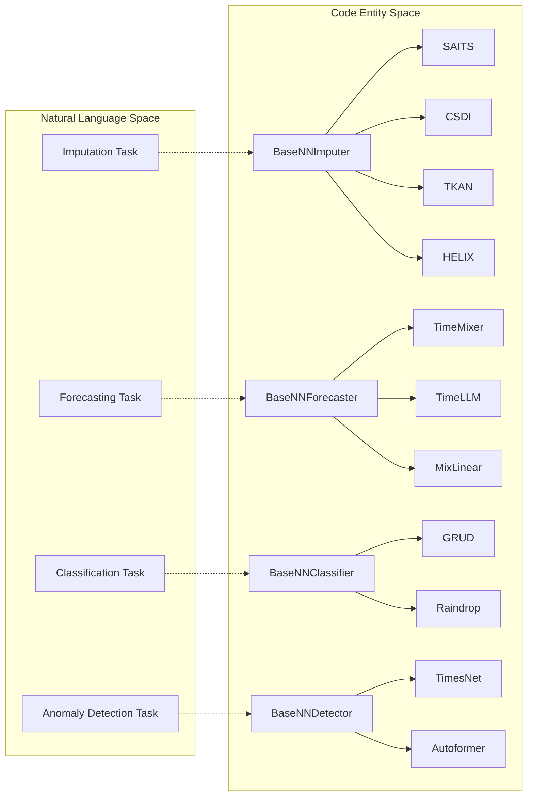
Sources: [pypots/imputation/__init__.py:13-52](), [pypots/forecasting/__init__.py:8-24](), [pypots/classification/__init__.py:11-14](), [pypots/anomaly_detection/__init__.py:8-18]()

### Task Summary Table

| Task Domain | Base Class | Key Model Entities | Interface Method |
| :--- | :--- | :--- | :--- |
| **Imputation** | `BaseNNImputer` | `SAITS`, `CSDI`, `TKAN`, `HELIX` | `impute()` |
| **Forecasting** | `BaseNNForecaster` | `TimeMixer`, `DLinear`, `TimeLLM`, `MixLinear` | `forecast()` |
| **Classification** | `BaseNNClassifier` | `GRUD`, `Raindrop`, `SeFT` | `classify()` |
| **Clustering** | `BaseNNClusterer` | `VaDER`, `CRLI` | `cluster()` |
| **Anomaly Detection** | `BaseNNDetector` | `TimesNet`, `PatchTST`, `Autoformer` | `detect()` |
| **Representation** | `BaseNNRepresentor` | `TS2Vec` | `represent()` |

Sources: [pypots/imputation/__init__.py:60-112](), [pypots/forecasting/__init__.py:26-44](), [pypots/classification/__init__.py:21-34](), [pypots/anomaly_detection/__init__.py:30-52]()

---

# Page: Imputation

# Imputation

<details>
<summary>Relevant source files</summary>

The following files were used as context for generating this wiki page:

- [.gitignore](.gitignore)
- [pypots/anomaly_detection/segrnn/model.py](pypots/anomaly_detection/segrnn/model.py)
- [pypots/anomaly_detection/tefn/model.py](pypots/anomaly_detection/tefn/model.py)
- [pypots/classification/brits/model.py](pypots/classification/brits/model.py)
- [pypots/classification/csai/core.py](pypots/classification/csai/core.py)
- [pypots/classification/csai/model.py](pypots/classification/csai/model.py)
- [pypots/classification/grud/model.py](pypots/classification/grud/model.py)
- [pypots/classification/raindrop/model.py](pypots/classification/raindrop/model.py)
- [pypots/forecasting/segrnn/__init__.py](pypots/forecasting/segrnn/__init__.py)
- [pypots/forecasting/segrnn/core.py](pypots/forecasting/segrnn/core.py)
- [pypots/forecasting/segrnn/model.py](pypots/forecasting/segrnn/model.py)
- [pypots/forecasting/tefn/model.py](pypots/forecasting/tefn/model.py)
- [pypots/imputation/__init__.py](pypots/imputation/__init__.py)
- [pypots/imputation/autoformer/model.py](pypots/imputation/autoformer/model.py)
- [pypots/imputation/brits/model.py](pypots/imputation/brits/model.py)
- [pypots/imputation/crossformer/model.py](pypots/imputation/crossformer/model.py)
- [pypots/imputation/csai/core.py](pypots/imputation/csai/core.py)
- [pypots/imputation/csai/data.py](pypots/imputation/csai/data.py)
- [pypots/imputation/csai/model.py](pypots/imputation/csai/model.py)
- [pypots/imputation/csdi/data.py](pypots/imputation/csdi/data.py)
- [pypots/imputation/dlinear/model.py](pypots/imputation/dlinear/model.py)
- [pypots/imputation/etsformer/model.py](pypots/imputation/etsformer/model.py)
- [pypots/imputation/fedformer/model.py](pypots/imputation/fedformer/model.py)
- [pypots/imputation/film/__init__.py](pypots/imputation/film/__init__.py)
- [pypots/imputation/film/model.py](pypots/imputation/film/model.py)
- [pypots/imputation/helix/__init__.py](pypots/imputation/helix/__init__.py)
- [pypots/imputation/helix/core.py](pypots/imputation/helix/core.py)
- [pypots/imputation/helix/model.py](pypots/imputation/helix/model.py)
- [pypots/imputation/informer/model.py](pypots/imputation/informer/model.py)
- [pypots/imputation/koopa/model.py](pypots/imputation/koopa/model.py)
- [pypots/imputation/lerp/__init__.py](pypots/imputation/lerp/__init__.py)
- [pypots/imputation/lerp/model.py](pypots/imputation/lerp/model.py)
- [pypots/imputation/locf/model.py](pypots/imputation/locf/model.py)
- [pypots/imputation/mean/__init__.py](pypots/imputation/mean/__init__.py)
- [pypots/imputation/mean/model.py](pypots/imputation/mean/model.py)
- [pypots/imputation/median/__init__.py](pypots/imputation/median/__init__.py)
- [pypots/imputation/median/model.py](pypots/imputation/median/model.py)
- [pypots/imputation/micn/model.py](pypots/imputation/micn/model.py)
- [pypots/imputation/mrnn/model.py](pypots/imputation/mrnn/model.py)
- [pypots/imputation/patchtst/model.py](pypots/imputation/patchtst/model.py)
- [pypots/imputation/reformer/model.py](pypots/imputation/reformer/model.py)
- [pypots/imputation/revinscinet/model.py](pypots/imputation/revinscinet/model.py)
- [pypots/imputation/saits/model.py](pypots/imputation/saits/model.py)
- [pypots/imputation/scinet/model.py](pypots/imputation/scinet/model.py)
- [pypots/imputation/segrnn/core.py](pypots/imputation/segrnn/core.py)
- [pypots/imputation/segrnn/model.py](pypots/imputation/segrnn/model.py)
- [pypots/imputation/stemgnn/model.py](pypots/imputation/stemgnn/model.py)
- [pypots/imputation/tcn/model.py](pypots/imputation/tcn/model.py)
- [pypots/imputation/tefn/core.py](pypots/imputation/tefn/core.py)
- [pypots/imputation/tefn/model.py](pypots/imputation/tefn/model.py)
- [pypots/imputation/tide/model.py](pypots/imputation/tide/model.py)
- [pypots/imputation/timesnet/model.py](pypots/imputation/timesnet/model.py)
- [pypots/imputation/tkan/__init__.py](pypots/imputation/tkan/__init__.py)
- [pypots/imputation/tkan/core.py](pypots/imputation/tkan/core.py)
- [pypots/imputation/tkan/model.py](pypots/imputation/tkan/model.py)
- [pypots/imputation/totem/__init__.py](pypots/imputation/totem/__init__.py)
- [pypots/imputation/totem/core.py](pypots/imputation/totem/core.py)
- [pypots/imputation/totem/model.py](pypots/imputation/totem/model.py)
- [pypots/imputation/transformer/model.py](pypots/imputation/transformer/model.py)
- [pypots/imputation/trmf/__init__.py](pypots/imputation/trmf/__init__.py)
- [pypots/imputation/trmf/core.py](pypots/imputation/trmf/core.py)
- [pypots/imputation/trmf/data.py](pypots/imputation/trmf/data.py)
- [pypots/imputation/trmf/model.py](pypots/imputation/trmf/model.py)
- [pypots/imputation/tslanet/__init__.py](pypots/imputation/tslanet/__init__.py)
- [pypots/imputation/tslanet/core.py](pypots/imputation/tslanet/core.py)
- [pypots/imputation/tslanet/model.py](pypots/imputation/tslanet/model.py)
- [pypots/nn/modules/csai/backbone.py](pypots/nn/modules/csai/backbone.py)
- [pypots/nn/modules/csai/layers.py](pypots/nn/modules/csai/layers.py)
- [pypots/nn/modules/segrnn/backbone.py](pypots/nn/modules/segrnn/backbone.py)
- [pypots/nn/modules/tefn/backbone.py](pypots/nn/modules/tefn/backbone.py)
- [pypots/nn/modules/tefn/layers.py](pypots/nn/modules/tefn/layers.py)
- [pypots/nn/modules/tkan/__init__.py](pypots/nn/modules/tkan/__init__.py)
- [pypots/nn/modules/tkan/backbone.py](pypots/nn/modules/tkan/backbone.py)
- [pypots/nn/modules/tkan/layers.py](pypots/nn/modules/tkan/layers.py)
- [pypots/nn/modules/trmf/__init__.py](pypots/nn/modules/trmf/__init__.py)
- [pypots/nn/modules/trmf/backbone.py](pypots/nn/modules/trmf/backbone.py)
- [tests/classification/csai.py](tests/classification/csai.py)
- [tests/classification/raindrop.py](tests/classification/raindrop.py)
- [tests/imputation/brits.py](tests/imputation/brits.py)
- [tests/imputation/csai.py](tests/imputation/csai.py)
- [tests/imputation/csdi.py](tests/imputation/csdi.py)
- [tests/imputation/film.py](tests/imputation/film.py)
- [tests/imputation/fits.py](tests/imputation/fits.py)
- [tests/imputation/gpvae.py](tests/imputation/gpvae.py)
- [tests/imputation/lerp.py](tests/imputation/lerp.py)
- [tests/imputation/locf.py](tests/imputation/locf.py)
- [tests/imputation/mean.py](tests/imputation/mean.py)
- [tests/imputation/median.py](tests/imputation/median.py)
- [tests/imputation/mrnn.py](tests/imputation/mrnn.py)
- [tests/imputation/saits.py](tests/imputation/saits.py)
- [tests/imputation/timesnet.py](tests/imputation/timesnet.py)
- [tests/imputation/tkan.py](tests/imputation/tkan.py)
- [tests/imputation/transformer.py](tests/imputation/transformer.py)
- [tests/imputation/usgan.py](tests/imputation/usgan.py)

</details>


The `pypots.imputation` module is the core component of the PyPOTS library, providing a comprehensive suite of algorithms to fill missing values in partially-observed time-series data. It supports a wide range of methods, from classic statistical approaches to state-of-the-art deep learning architectures including Transformers, RNNs, GANs, Diffusion models, and KAN-based networks.

### Model Catalog

PyPOTS categorizes imputation models into two main groups: Neural Network (NN) based models and Naive (statistical) models [pypots/imputation/__init__.py:61-112]().

#### Neural Network Models
These models inherit from `BaseNNImputer` [pypots/imputation/saits/model.py:17-17]() and implement the standard `fit()` and `predict()` (which serves as the `impute()` functionality) interface.

| Model Class | Description | Key Features |
| :--- | :--- | :--- |
| `SAITS` | Self-Attention-based Imputation | DMSA mechanism, ORT and MIT training strategy [pypots/imputation/saits/model.py:25-124]() |
| `Transformer` | Vanilla Transformer for Imputation | Multi-head self-attention applied to time-series [pypots/imputation/transformer/model.py:24-122]() |
| `BRITS` | Bidirectional RNNs | Handles missing values in recurrent dynamics via dual-directional decay [pypots/imputation/brits/model.py:24-87]() |
| `TimesNet` | Multi-periodicity Analysis | Transforms 1D time-series into 2D variations using FFT [pypots/imputation/timesnet/model.py:23-106]() |
| `PatchTST` | Patch-based Time Series Transformer | Processes time-series as patches to capture local semantic [pypots/imputation/patchtst/model.py:28-127]() |
| `TKAN` | Kolmogorov-Arnold Network Imputer | Uses KAN-based layers for non-linear temporal modeling [pypots/imputation/__init__.py:52-52]() |
| `TOTEM` | VQ-VAE Tokenization | Imputation via vector-quantized tokenization [pypots/imputation/__init__.py:50-50]() |
| `TSLANet` | Adaptive Spectral Network | Adaptive spectral filters for time-series modeling [pypots/imputation/__init__.py:51-51]() |
| `TRMF` | Temporal Regularized Matrix Factorization | Matrix factorization with temporal dependencies [pypots/imputation/__init__.py:45-45]() |
| `CSDI` | Conditional Score-based Diffusion | Probabilistic imputation using score-based diffusion models [pypots/imputation/__init__.py:10-10]() |
| `MRNN` | Multi-directional RNN | Uses correlations between different feature streams [pypots/imputation/mrnn/model.py:25-88]() |
| `GPVAE` | Gaussian Process VAE | Combines VAEs with Gaussian Process priors [pypots/imputation/__init__.py:11-11]() |
| `USGAN` | Unsupervised GAN | GAN-based imputation for time-series [pypots/imputation/__init__.py:31-31]() |
| `CSAI` | Consistent Sequential Imputation | Bidirectional GRU with consistency and reconstruction losses [pypots/imputation/csai/model.py:25-112]() |
| `GRUD` | Gated Recurrent Unit with Decay | RNN-based model designed for irregularly sampled time series [pypots/imputation/__init__.py:37-37]() |
| `HELIX` | HELIX Imputation Model | Recurrent architecture for handling irregular time series [pypots/imputation/__init__.py:38-38]() |
| `iTransformer` | Inverted Transformer | Applies attention across features instead of time steps [pypots/imputation/__init__.py:15-15]() |
| `DLinear` | Decomposition Linear Model | Simple yet effective linear model for time-series [pypots/imputation/__init__.py:29-29]() |
| `TimeMixer` | Multi-scale Mixing | Decomposes time series into different scales for imputation [pypots/imputation/__init__.py:41-41]() |

#### Naive Models
These models provide simple baselines and do not require training (the `fit()` method is a no-op that issues a warning [pypots/imputation/locf/model.py:61-70]()).

| Model Class | Strategy | Description |
| :--- | :--- | :--- |
| `LOCF` | Last Observed Carried Forward | Fills missing values with the last known observation; supports NOCB via backward strategy [pypots/imputation/locf/model.py:20-42]() |
| `Mean` | Mean Imputation | Fills missing values with the feature-wise mean [pypots/imputation/__init__.py:56-56]() |
| `Median` | Median Imputation | Fills missing values with the feature-wise median [pypots/imputation/__init__.py:57-57]() |
| `Lerp` | Linear Interpolation | Fills missing values using linear gradients between observed points [pypots/imputation/__init__.py:58-58]() |

**Sources:** [pypots/imputation/__init__.py:1-112](), [pypots/imputation/saits/model.py:25-124](), [pypots/imputation/locf/model.py:20-42](), [pypots/imputation/mrnn/model.py:25-88](), [pypots/imputation/timesnet/model.py:23-106](), [pypots/imputation/csai/model.py:25-112]()

### Training Strategy: ORT & MIT

Many advanced models in PyPOTS (like `SAITS`, `Transformer`, and `PatchTST`) utilize a dual-loss training strategy to improve imputation accuracy and model robustness.

*   **ORT (Observed Reconstruction Task):** Forces the model to reconstruct the actually observed values.
*   **MIT (Masked Imputation Task):** Randomly masks some observed values during training and forces the model to predict them, simulating the imputation of unknown values.

In the `SAITS` implementation, these are controlled via `ORT_weight` and `MIT_weight` parameters [pypots/imputation/saits/model.py:69-74]().

### Data Pipeline

Imputation models typically use specific Dataset classes to handle the complexities of missingness, such as generating masks or calculating time deltas.

*   **`DatasetForSAITS`**: A general-purpose dataset for Transformer-based models (e.g. `SAITS`, `Transformer`, `TimesNet`, `PatchTST`) that provides `X`, `missing_mask`, and `indicating_mask` [pypots/imputation/saits/data.py:16-16](), [pypots/imputation/saits/model.py:16-16]().
*   **`DatasetForBRITS`**: Specifically designed for RNN models that require forward and backward sequences and time `deltas` [pypots/imputation/brits/data.py:15-15](), [pypots/imputation/brits/model.py:15-15]().
*   **`DatasetForMRNN`**: Specialized for multi-directional RNN requirements including backward sequences [pypots/imputation/mrnn/data.py:15-15](), [pypots/imputation/mrnn/model.py:15-16]().
*   **`DatasetForGRUD`**: Handles datasets for GRU-D and Raindrop, calculating `deltas` and `empirical_mean` [pypots/classification/grud/data.py:16-16](), [pypots/classification/raindrop/model.py:16-16]().
*   **`DatasetForCSAI`**: Handles consistency-based bidirectional sequences and specific removal strategies [pypots/imputation/csai/data.py:14-14](), [pypots/imputation/csai/model.py:14-14]().

#### Code Entity Mapping: Imputation Flow

The following diagram illustrates how high-level imputer classes interact with their internal neural network cores and data loaders.

High-level Imputation Architecture
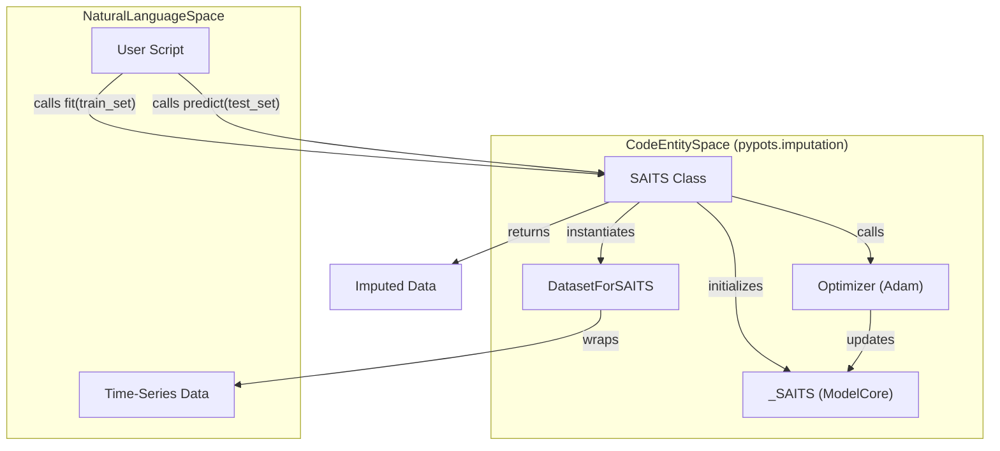
**Sources:** [pypots/imputation/saits/model.py:15-21](), [pypots/imputation/saits/model.py:126-164](), [pypots/imputation/saits/model.py:190-205]()

#### Code Entity Mapping: Specialized RNN Model Structure (BRITS)

The diagram below shows how recurrent models like BRITS handle bidirectional temporal dependencies.

BRITS Model Internals
```mermaid
graph TD
    subgraph "pypots.imputation.brits"
        BRITS_IM["BRITS (BaseNNImputer)"]
        BRITS_CORE["_BRITS (ModelCore)"]
        BRITS_DSET["DatasetForBRITS"]
    end

    subgraph "InternalProcessing"
        FW["Forward RNN"]
        BW["Backward RNN"]
    end

    BRITS_IM -- "owns" --> BRITS_CORE
    BRITS_IM -- "uses" --> BRITS_DSET
    BRITS_CORE -- "executes" --> FW
    BRITS_CORE -- "executes" --> BW
    FW -- "produces" --> Loss["Combined Loss"]
    BW -- "produces" --> Loss
```
**Sources:** [pypots/imputation/brits/model.py:24-87](), [pypots/imputation/brits/model.py:141-168](), [pypots/imputation/brits/model.py:170-200]()

### Basic Usage

The standard workflow for using a PyPOTS imputer involves initializing the model, calling `fit()` for training, and `predict()` for generating imputations.

```python
from pypots.imputation import SAITS

# Initialize the model
imputer = SAITS(n_steps=24, n_features=10, n_layers=2, d_model=64, n_heads=4, d_k=16, d_v=16, d_ffn=128)

# Train the model
imputer.fit(train_set) # train_set can be a dict or path to HDF5

# Impute missing values
predictions = imputer.predict(test_set)
imputed_data = predictions["imputation"]
```
**Sources:** [pypots/imputation/saits/model.py:126-164](), [pypots/imputation/saits/model.py:255-265]()

### Advanced Imputation

PyPOTS also supports cutting-edge approaches such as Large Language Model (LLM) reprogramming and Foundation Models for time-series.

*   **LLM-Based Imputation**: Models like `TimeLLM` and `GPT4TS` leverage frozen language model backbones (e.g., GPT-2, LLaMA) to perform imputation via cross-domain reprogramming [pypots/imputation/__init__.py:46-47]().
*   **Foundation Models**: `MOMENT` (T5-based) provides pre-trained representations for zero-shot or fine-tuned imputation [pypots/imputation/__init__.py:48-48]().

For details, see [LLM-Based Imputation (TimeLLM, GPT4TS & MOMENT)](#3.1.1).

**Sources:** [pypots/imputation/__init__.py:46-48](), [pypots/imputation/saits/model.py:25-124]()

---

# Page: LLM-Based Imputation (TimeLLM, GPT4TS & MOMENT)

# LLM-Based Imputation (TimeLLM, GPT4TS & MOMENT)

<details>
<summary>Relevant source files</summary>

The following files were used as context for generating this wiki page:

- [.github/workflows/linting.yml](.github/workflows/linting.yml)
- [.github/workflows/publish_to_PyPI.yml](.github/workflows/publish_to_PyPI.yml)
- [.github/workflows/testing_ci.yml](.github/workflows/testing_ci.yml)
- [.github/workflows/testing_daily.yml](.github/workflows/testing_daily.yml)
- [pypots/forecasting/gpt4ts/core.py](pypots/forecasting/gpt4ts/core.py)
- [pypots/forecasting/gpt4ts/model.py](pypots/forecasting/gpt4ts/model.py)
- [pypots/forecasting/timellm/core.py](pypots/forecasting/timellm/core.py)
- [pypots/forecasting/timellm/model.py](pypots/forecasting/timellm/model.py)
- [pypots/imputation/gpt4ts/__init__.py](pypots/imputation/gpt4ts/__init__.py)
- [pypots/imputation/gpt4ts/core.py](pypots/imputation/gpt4ts/core.py)
- [pypots/imputation/gpt4ts/model.py](pypots/imputation/gpt4ts/model.py)
- [pypots/imputation/moment/__init__.py](pypots/imputation/moment/__init__.py)
- [pypots/imputation/moment/core.py](pypots/imputation/moment/core.py)
- [pypots/imputation/moment/model.py](pypots/imputation/moment/model.py)
- [pypots/imputation/timellm/__init__.py](pypots/imputation/timellm/__init__.py)
- [pypots/imputation/timellm/core.py](pypots/imputation/timellm/core.py)
- [pypots/imputation/timellm/model.py](pypots/imputation/timellm/model.py)
- [pypots/nn/modules/gpt4ts/__init__.py](pypots/nn/modules/gpt4ts/__init__.py)
- [pypots/nn/modules/gpt4ts/backbone.py](pypots/nn/modules/gpt4ts/backbone.py)
- [pypots/nn/modules/moment/__init__.py](pypots/nn/modules/moment/__init__.py)
- [pypots/nn/modules/moment/backbone.py](pypots/nn/modules/moment/backbone.py)
- [pypots/nn/modules/moment/masking.py](pypots/nn/modules/moment/masking.py)
- [pypots/nn/modules/moment/modules.py](pypots/nn/modules/moment/modules.py)
- [pypots/nn/modules/patchtst/layers.py](pypots/nn/modules/patchtst/layers.py)
- [pypots/nn/modules/timellm/__init__.py](pypots/nn/modules/timellm/__init__.py)
- [pypots/nn/modules/timellm/backbone.py](pypots/nn/modules/timellm/backbone.py)
- [tests/imputation/llms/__init__.py](tests/imputation/llms/__init__.py)
- [tests/imputation/llms/timellm.py](tests/imputation/llms/timellm.py)

</details>


This page provides a technical deep dive into the Large Language Model (LLM) adaptation strategies implemented in PyPOTS for time-series imputation. Specifically, it covers **TimeLLM**, **GPT4TS**, and the **MOMENT** foundation model, all of which leverage pre-trained transformer architectures to capture complex temporal dependencies.

## 1. Overview of the Reprogramming Approach

The core philosophy behind LLM-based models in PyPOTS is to treat time-series data as a sequence of tokens that can be understood by a pre-trained LLM (like LLaMA, GPT-2, or BERT). Instead of training these massive models from scratch, PyPOTS uses a "frozen" backbone and trains lightweight adapter layers to map time-series patches into the LLM's latent space.

### Key Components
- **Frozen Backbone**: The LLM weights are kept static to preserve learned general sequence knowledge by setting `requires_grad = False` [pypots/nn/modules/timellm/backbone.py:109-110]().
- **Patching**: Time-series steps are grouped into patches to reduce sequence length and capture local context using `PatchEmbedding` [pypots/nn/modules/patchtst/layers.py:12-47]().
- **Reprogramming/Mapping**: Aligning the patch embeddings with the LLM's word embedding space using a linear `mapping_layer` and a `ReprogrammingLayer` [pypots/nn/modules/timellm/backbone.py:125-126]().

**Sources:** [pypots/imputation/timellm/model.py:24-122](), [pypots/imputation/gpt4ts/model.py:24-109](), [pypots/nn/modules/timellm/backbone.py:38-139]()

---

## 2. TimeLLM Implementation

`TimeLLM` adapts LLMs by using domain-specific prompts and a specialized reprogramming layer to bridge the gap between numerical time series and natural language.

### Data Flow and Architecture
The following diagram illustrates how a time-series sample flows through the `BackboneTimeLLM`.

**TimeLLM Data Flow: Numerical to Latent Space**
```mermaid
graph TD
    X["Input Time Series (X)"] --> RevIN["RevIN (Normalization)"]
    RevIN --> Patching["PatchEmbedding (unfold + Linear)"]
    
    subgraph "Prompt Engineering"
        Stats["Calc Stats (min, max, lags, trend)"]
        Domain["Domain Prompt Content"]
        Tokenizer["LLM Tokenizer"]
        Stats --> Tokenizer
        Domain --> Tokenizer
        Tokenizer --> PromptEmbeds["Prompt Embeddings"]
    end
    
    Patching --> Reprog["ReprogrammingLayer (Cross-Attention)"]
    PromptEmbeds --> Reprog
    
    Reprog --> FrozenLLM["Frozen LLM (LLaMA/GPT2/BERT)"]
    FrozenLLM --> OutProj["FlattenHead (Output Projection)"]
    OutProj --> RevIN_Denorm["RevIN (Denormalization)"]
    RevIN_Denorm --> Reconstruction["Reconstructed Series"]
```
**Sources:** [pypots/nn/modules/timellm/backbone.py:149-200](), [pypots/nn/modules/patchtst/layers.py:150-190]()

### Key Classes
1.  **`BackboneTimeLLM`**: The main module managing the LLM lifecycle. It supports `LLaMA`, `GPT2`, and `BERT` [pypots/nn/modules/timellm/backbone.py:38-99]().
2.  **`ReprogrammingLayer`**: Implements cross-attention between the time-series patches and the LLM's word embeddings to "reprogram" the LLM's understanding [pypots/nn/modules/timellm/backbone.py:126]().
3.  **`RevIN`**: Reversible Instance Normalization used to handle non-stationary data by normalizing the input and denormalizing the output [pypots/nn/modules/timellm/backbone.py:128, 150]().

### Prompting Strategy
TimeLLM generates a text-based prompt for every batch [pypots/nn/modules/timellm/backbone.py:163-196](), including:
- **Dataset Description**: Provided via `domain_prompt_content` [pypots/imputation/timellm/model.py:179]().
- **Statistics**: Min, max, median, and trend (upward/downward) [pypots/nn/modules/timellm/backbone.py:157-161]().
- **Lags**: Top-5 lags calculated via Fast Fourier Transform (FFT) in `calc_lags` [pypots/nn/modules/timellm/backbone.py:140-147]().

**Sources:** [pypots/nn/modules/timellm/backbone.py:140-196](), [pypots/imputation/timellm/model.py:124-151]()

---

## 3. GPT4TS Implementation

`GPT4TS` (GPT-2 for Time Series) is a streamlined approach specifically optimized for the GPT-2 architecture, originally proposed by Zhou et al. [pypots/imputation/gpt4ts/model.py:25-26](). It is supported for both imputation [pypots/imputation/gpt4ts/model.py:24]() and forecasting [pypots/forecasting/gpt4ts/model.py:21]().

### Memory-Saving Checkpoint Strategy
One of the most critical features of the PyPOTS implementation of GPT4TS (and TimeLLM) is the `_organize_content_to_save` method. Since the LLM backbone is frozen and weighs several gigabytes, PyPOTS excludes these weights from the saved checkpoint to save disk space.

| Action | Logic | Code Reference |
| :--- | :--- | :--- |
| **State Dict Filtering** | Removes all keys containing "gpt2" or "llm_model" | [pypots/imputation/gpt4ts/model.py:194](), [pypots/imputation/timellm/model.py:221]() |
| **Model Restoration** | Re-downloads/loads the backbone from HuggingFace, then injects trained adapter weights | [pypots/nn/modules/timellm/backbone.py:72-97]() |

**Sources:** [pypots/imputation/gpt4ts/model.py:186-198](), [pypots/imputation/timellm/model.py:215-227]()

---

## 4. MOMENT Foundation Model

PyPOTS includes support for **MOMENT**, a multi-modal time-series foundation model based on the T5 architecture [pypots/nn/modules/moment/backbone.py:180]().

### MOMENT Configuration
MOMENT utilizes a core backbone `BackboneMOMENT` which assembles the model for multiple tasks including imputation [pypots/nn/modules/moment/backbone.py:56]().

- **Backbone Variants**: Supports T5 variants including `t5-small`, `t5-base`, `google/flan-t5-large`, etc [pypots/nn/modules/moment/backbone.py:30-41]().
- **Tuning Modes**: Supports `linear-probing`, `end-to-end`, and `zero-shot` fine-tuning [pypots/nn/modules/moment/backbone.py:43-47]().
- **Normalization**: Features `RevIN` for instance normalization with optional affine parameters [pypots/nn/modules/moment/backbone.py:74]().
- **Patching**: Uses `Patching` and `PatchEmbedding` modules to tokenize time-series data [pypots/nn/modules/moment/backbone.py:75-76]().

**Sources:** [pypots/nn/modules/moment/backbone.py:56-130](), [pypots/nn/modules/moment/modules.py:1-20]()

---

## 5. Imputation Logic & Loss Functions

Both models inherit from task-specific base classes and utilize a `ModelCore` wrapper (`_TimeLLM`, `_GPT4TS`) to handle the forward pass.

### The SAITS Strategy for LLMs
PyPOTS applies the **SAITS** training strategy (Overlapping Reconstruction and Masked Imputation Tasks) to the TimeLLM backbone [pypots/imputation/timellm/core.py:57]().

- **ORT Loss**: Reconstruction loss on the observed values [pypots/imputation/timellm/core.py:85]().
- **MIT Loss**: Reconstruction loss on the values masked by the `indicating_mask` [pypots/imputation/timellm/core.py:85]().

**Entity Mapping: Imputation Workflow**
```mermaid
graph LR
    subgraph "pypots.imputation.timellm"
        M["TimeLLM (Class)"] --> C["_TimeLLM (Core)"]
    end
    
    subgraph "pypots.nn.modules"
        C --> B["BackboneTimeLLM"]
        C --> L["SaitsLoss"]
    end
    
    inputs["inputs: dict"] --> C
    C --> B
    B --> reconstruction["reconstruction"]
    reconstruction --> L
    L --> loss["Final Loss (ORT + MIT)"]
```
**Sources:** [pypots/imputation/timellm/core.py:15-93](), [pypots/imputation/timellm/model.py:185-202]()

---

## 6. Technical Specifications

### Patching and Embedding
The `PatchEmbedding` layer transforms the raw time series into patches using `unfold` [pypots/nn/modules/patchtst/layers.py:40]().

| Parameter | Description |
| :--- | :--- |
| `patch_size` | Length of the window for each patch [pypots/nn/modules/patchtst/layers.py:24]() |
| `patch_stride` | Overlap between patches [pypots/nn/modules/patchtst/layers.py:25]() |
| `d_model` | Projection dimension for the LLM input [pypots/nn/modules/patchtst/layers.py:28]() |

### Supported Backbones
PyPOTS currently supports the following LLM types via the `llm_model_type` parameter in `BackboneTimeLLM`:
- **LLaMA**: Loads `huggyllama/llama-7b` [pypots/nn/modules/timellm/backbone.py:71-79]().
- **GPT2**: Loads `openai-community/gpt2` [pypots/nn/modules/timellm/backbone.py:81-88]().
- **BERT**: Loads `google-bert/bert-base-uncased` [pypots/nn/modules/timellm/backbone.py:90-97]().

**Sources:** [pypots/nn/modules/timellm/backbone.py:23-27, 71-97](), [pypots/imputation/timellm/model.py:36-50]()

---

# Page: Forecasting

# Forecasting

<details>
<summary>Relevant source files</summary>

The following files were used as context for generating this wiki page:

- [pypots/anomaly_detection/segrnn/model.py](pypots/anomaly_detection/segrnn/model.py)
- [pypots/classification/brits/core.py](pypots/classification/brits/core.py)
- [pypots/forecasting/__init__.py](pypots/forecasting/__init__.py)
- [pypots/forecasting/bttf/core.py](pypots/forecasting/bttf/core.py)
- [pypots/forecasting/bttf/model.py](pypots/forecasting/bttf/model.py)
- [pypots/forecasting/bttf/submodules.py](pypots/forecasting/bttf/submodules.py)
- [pypots/forecasting/csdi/__init__.py](pypots/forecasting/csdi/__init__.py)
- [pypots/forecasting/csdi/core.py](pypots/forecasting/csdi/core.py)
- [pypots/forecasting/csdi/data.py](pypots/forecasting/csdi/data.py)
- [pypots/forecasting/csdi/model.py](pypots/forecasting/csdi/model.py)
- [pypots/forecasting/dlinear/__init__.py](pypots/forecasting/dlinear/__init__.py)
- [pypots/forecasting/dlinear/core.py](pypots/forecasting/dlinear/core.py)
- [pypots/forecasting/dlinear/model.py](pypots/forecasting/dlinear/model.py)
- [pypots/forecasting/film/__init__.py](pypots/forecasting/film/__init__.py)
- [pypots/forecasting/film/core.py](pypots/forecasting/film/core.py)
- [pypots/forecasting/film/model.py](pypots/forecasting/film/model.py)
- [pypots/forecasting/fits/__init__.py](pypots/forecasting/fits/__init__.py)
- [pypots/forecasting/fits/core.py](pypots/forecasting/fits/core.py)
- [pypots/forecasting/gpt4ts/__init__.py](pypots/forecasting/gpt4ts/__init__.py)
- [pypots/forecasting/micn/__init__.py](pypots/forecasting/micn/__init__.py)
- [pypots/forecasting/micn/core.py](pypots/forecasting/micn/core.py)
- [pypots/forecasting/micn/model.py](pypots/forecasting/micn/model.py)
- [pypots/forecasting/moment/__init__.py](pypots/forecasting/moment/__init__.py)
- [pypots/forecasting/moment/core.py](pypots/forecasting/moment/core.py)
- [pypots/forecasting/moment/model.py](pypots/forecasting/moment/model.py)
- [pypots/forecasting/segrnn/__init__.py](pypots/forecasting/segrnn/__init__.py)
- [pypots/forecasting/segrnn/core.py](pypots/forecasting/segrnn/core.py)
- [pypots/forecasting/segrnn/model.py](pypots/forecasting/segrnn/model.py)
- [pypots/forecasting/tefn/core.py](pypots/forecasting/tefn/core.py)
- [pypots/forecasting/timellm/__init__.py](pypots/forecasting/timellm/__init__.py)
- [pypots/forecasting/timemixer/__init__.py](pypots/forecasting/timemixer/__init__.py)
- [pypots/forecasting/timemixer/core.py](pypots/forecasting/timemixer/core.py)
- [pypots/forecasting/timemixer/model.py](pypots/forecasting/timemixer/model.py)
- [pypots/forecasting/timemixerpp/__init__.py](pypots/forecasting/timemixerpp/__init__.py)
- [pypots/forecasting/timemixerpp/core.py](pypots/forecasting/timemixerpp/core.py)
- [pypots/forecasting/timemixerpp/model.py](pypots/forecasting/timemixerpp/model.py)
- [pypots/forecasting/timesnet/__init__.py](pypots/forecasting/timesnet/__init__.py)
- [pypots/forecasting/timesnet/core.py](pypots/forecasting/timesnet/core.py)
- [pypots/forecasting/timesnet/model.py](pypots/forecasting/timesnet/model.py)
- [pypots/forecasting/transformer/__init__.py](pypots/forecasting/transformer/__init__.py)
- [pypots/imputation/locf/core.py](pypots/imputation/locf/core.py)
- [pypots/imputation/segrnn/core.py](pypots/imputation/segrnn/core.py)
- [pypots/imputation/segrnn/model.py](pypots/imputation/segrnn/model.py)
- [pypots/nn/modules/segrnn/backbone.py](pypots/nn/modules/segrnn/backbone.py)
- [tests/forecasting/csdi.py](tests/forecasting/csdi.py)
- [tests/forecasting/fits.py](tests/forecasting/fits.py)
- [tests/forecasting/llms/gpt4ts.py](tests/forecasting/llms/gpt4ts.py)
- [tests/forecasting/tefn.py](tests/forecasting/tefn.py)
- [tests/forecasting/timemixer.py](tests/forecasting/timemixer.py)
- [tests/forecasting/timemixerpp.py](tests/forecasting/timemixerpp.py)
- [tests/forecasting/transformer.py](tests/forecasting/transformer.py)

</details>


The `pypots.forecasting` module provides a comprehensive suite of models for time-series forecasting, specifically designed to handle challenges like missing values in historical data. Unlike traditional forecasting libraries, PyPOTS forecasting models are built to perform "partially-observed time-series forecasting," where the input sequence may contain gaps.

## Model Catalog

PyPOTS includes a diverse range of forecasting architectures, from Bayesian tensor factorization to state-of-the-art deep learning models and adapted Large Language Models (LLMs).

| Model Category | Models |
| :--- | :--- |
| **Probabilistic/Diffusion** | `CSDI` |
| **Matrix/Tensor Factorization** | `BTTF` |
| **Linear/MLP-based** | `DLinear`, `MixLinear`, `FITS`, `FiLM` |
| **Convolutional/TCN** | `MICN`, `ModernTCN`, `TimesNet` |
| **Recurrent/RNN** | `SegRNN` |
| **Attention/Transformer** | `Transformer`, `TimeMixer`, `TimeMixerPP`, `TEFN` |
| **LLM-based** | `MOMENT`, `TimeLLM`, `GPT4TS` |

**Sources:** [pypots/forecasting/__init__.py:8-44]()

## Data Flow and Interface

Forecasting in PyPOTS is defined by the relationship between an input sequence and a target prediction sequence.

### Dataset Differences
Forecasting datasets differ from imputation datasets in their structure:
*   **Imputation:** The model fills in missing values within the input sequence `X`.
*   **Forecasting:** The model uses input sequence `X` (of length `n_steps`) to predict a future sequence `X_pred` (of length `n_pred_steps`).
*   **Missingness:** In PyPOTS, both the historical input `X` and the future target `X_pred` can contain missing values (represented by `missing_mask` and `X_pred_missing_mask` respectively).

### The `n_pred_steps` Interface
Every forecaster in PyPOTS requires the specification of `n_pred_steps` during initialization. This defines the fixed horizon the model will predict.

**Example Initialization (TimeMixer):**
```python
timemixer = TimeMixer(
    n_steps=DATA["n_steps"] - N_PRED_STEPS, # Length of historical context
    n_features=DATA["n_features"],
    n_pred_steps=N_PRED_STEPS,              # The forecasting horizon
    n_pred_features=DATA["n_features"],
    term="short",
    # ... other hyperparameters
)
```
**Sources:** [pypots/forecasting/csdi/model.py:120-147](), [pypots/forecasting/timemixer/core.py:41-42](), [tests/forecasting/timemixer.py:45-65]()

### Code Entity Mapping: Forecaster Lifecycle
The following diagram illustrates how the high-level `BaseNNForecaster` API maps to internal core components during the training and prediction phases.

**Forecasting System Architecture**
```mermaid
graph TD
    subgraph "Public_API_[pypots.forecasting]"
        A["Forecaster_Class_[e.g._CSDI,_TimeMixer]"] -->|calls| B["fit()"]
        A -->|calls| C["predict()"]
    end

    subgraph "Internal_Core_[pypots.forecasting.model_name.core]"
        B -->|assembles| D["_assemble_input_for_training()"]
        D -->|passes_to| E["_ModelCore.forward()"]
        C -->|assembles| F["_assemble_input_for_testing()"]
        F -->|passes_to| E
    end

    subgraph "Neural_Network_[pypots.nn.modules]"
        E -->|uses| G["Backbone_[e.g._BackboneTimeMixer]"]
        E -->|calculates| H["Criterion_[Loss/Metric]"]
    end

    H -->|returns| B
    G -->|returns| C
```
**Sources:** [pypots/forecasting/csdi/model.py:24-187](), [pypots/forecasting/timemixer/core.py:17-103](), [pypots/forecasting/timesnet/core.py:14-104]()

## Implementation Details

### Model Core Logic
PyPOTS forecasters typically wrap a backbone module inside a `ModelCore` (e.g., `_TimeMixer`, `_TimesNet`). The `forward` method handles the data transformation and criterion calculation.

1.  **Input Handling:** Takes a dictionary containing `X` (historical data) and potentially `missing_mask` [pypots/forecasting/timemixer/core.py:80-81]().
2.  **Backbone Execution:** Passes processed inputs to the neural backbone (e.g. `self.model.forecast`) [pypots/forecasting/timemixer/core.py:84]().
3.  **Projection:** Often uses an `nn.Linear` layer to project the backbone output to the required `n_pred_features` and `n_pred_steps` [pypots/forecasting/timemixer/core.py:73](), [pypots/forecasting/timemixer/core.py:87-89]().
4.  **Loss Calculation:** During training, compares the output against `X_pred` using the `training_loss` [pypots/forecasting/timemixer/core.py:96-99]().

**Sources:** [pypots/forecasting/timemixer/core.py:75-103](), [pypots/forecasting/timesnet/core.py:66-104]()

### Example: TimesNet Forecasting
`TimesNet` transforms 1D time series into 2D variations based on multiple periods, capturing both intra-period and inter-period variations.

**TimesNet Data Flow**
```mermaid
graph TD
    subgraph "Internal_TimesNet_[pypots.forecasting.timesnet.core._TimesNet]"
        In["Input_X_[B,T,C]"] --> Norm["nonstationary_norm"]
        Norm --> Emb["DataEmbedding"]
        Emb --> Linear["predict_linear_[align_temporal_dim]"]
        Linear --> BB["BackboneTimesNet"]
        BB --> Proj["projection_[nn.Linear]"]
        Proj --> Denorm["nonstationary_denorm"]
        Denorm --> Slice["Slice_last_n_pred_steps"]
        Slice --> Out["forecasting_result"]
    end
```
**Sources:** [pypots/forecasting/timesnet/core.py:14-104](), [pypots/nn/functional.py:8-8]()

### Example: TimeMixer and TimeMixerPP
`TimeMixer` and its successor `TimeMixerPP` use multi-scale mixing. `TimeMixerPP` introduces `MixerBlock` and optional `channel_mixing_attention`.

**TimeMixerPP Backbone Architecture**
```mermaid
graph TD
    subgraph "BackboneTimeMixerPP_[pypots.nn.modules.timemixerpp.backbone]"
        In["Input_X"] --> MultiScale["__multi_scale_process_inputs"]
        MultiScale --> RevIN["RevIN_Normalization"]
        RevIN --> Mixer["Encoder_MixerBlock_Layers"]
        Mixer --> Attn["channel_mixing_attention_[Optional]"]
        Attn --> Proj["projection_layer"]
        Proj --> Pred["predict_layers_[Linear]"]
        Pred --> Out["Forecasting_Result"]
    end
```
**Sources:** [pypots/forecasting/timemixerpp/core.py:18-103](), [pypots/forecasting/timemixer/core.py:17-103]()

### Example: MOMENT Foundation Model
`MOMENT` utilizes a pre-trained transformer backbone. It applies `SaitsEmbedding` and handles temporal padding before passing data to the `BackboneMOMENT`.

**MOMENT Data Flow**
```mermaid
graph TD
    subgraph "MOMENT_Core_[pypots.forecasting.moment.core._MOMENT]"
        In["Input_X/Mask"] --> Emb["SaitsEmbedding"]
        Emb --> Pad["nn.functional.pad_[n_pred_steps]"]
        Pad --> BB["BackboneMOMENT.forecast"]
        BB --> Proj["Slice_n_pred_features"]
        Proj --> Out["forecasting_result"]
    end
```
**Sources:** [pypots/forecasting/moment/core.py:19-121]()

### Example: SegRNN Forecasting
`SegRNN` (Segment Recurrent Neural Network) processes the input sequence in segments. The `BackboneSegRNN` uses a `GRU` to encode input segments and another `GRU` combined with position and channel embeddings to generate the forecast segments.

**SegRNN Internal Flow**
```mermaid
graph TD
    subgraph "SegRNN_Backbone_[pypots.nn.modules.segrnn.backbone.BackboneSegRNN]"
        X["Input_X_[B,S,C]"] --> Norm["seq_last_subtraction"]
        Norm --> ValEmb["valueEmbedding_[Linear+ReLU]"]
        ValEmb --> GRU_Enc["rnn_[GRU_Encoder]"]
        
        Pos["pos_emb"] --> Cat["torch.cat"]
        Chan["channel_emb"] --> Cat
        Cat --> GRU_Dec["rnn_[GRU_Decoder]"]
        
        GRU_Enc -->|hn| GRU_Dec
        GRU_Dec --> Pred["predict_[Dropout+Linear]"]
        Pred --> DeNorm["seq_last_addition"]
        DeNorm --> Out["Forecasting_Result"]
    end
```
**Sources:** [pypots/forecasting/segrnn/model.py:20-156](), [pypots/nn/modules/segrnn/backbone.py:9-88]()

### Non-Neural Forecasters: BTTF
`BTTF` (Bayesian Temporal Tensor Factorization) is a unique case in PyPOTS as it does not require a training phase (`fit()`). It performs inference directly on the test set using Gibbs sampling and temporal lags via the `BTTF_forecast` core function.

**Sources:** [pypots/forecasting/bttf/model.py:92-106](), [pypots/forecasting/bttf/model.py:108-136](), [pypots/forecasting/bttf/core.py:24-97]()

### Example: DLinear and FiLM
`DLinear` uses a series decomposition block to separate seasonal and trend components, which are then processed by a `BackboneDLinear` [pypots/forecasting/dlinear/core.py:35-36](). `FiLM` utilizes a frequency-improved Legendre memory model, employing `SaitsEmbedding` before passing data to the `BackboneFiLM` [pypots/forecasting/film/core.py:33-47]().

**DLinear Data Flow**
```mermaid
graph TD
    subgraph "DLinear_Core_[pypots.forecasting.dlinear.core._DLinear]"
        In["Input_X/Mask"] --> Decomp["SeriesDecompositionBlock"]
        Decomp --> Seasonal["seasonal_init"]
        Decomp --> Trend["trend_init"]
        Seasonal --> S_Emb["seasonal_saits_embedding"]
        Trend --> T_Emb["trend_saits_embedding"]
        S_Emb --> BB["BackboneDLinear"]
        T_Emb --> BB
        BB --> S_Out["linear_seasonal_output"]
        BB --> T_Out["linear_trend_output"]
        S_Out --> Sum["Add_Components"]
        T_Out --> Sum
        Sum --> Slice["Slice_last_n_pred_steps"]
        Slice --> Out["forecasting_result"]
    end
```
**Sources:** [pypots/forecasting/dlinear/core.py:14-88](), [pypots/forecasting/film/core.py:13-84]()

## Key Functions and Classes

| Entity | Role | Location |
| :--- | :--- | :--- |
| `BaseNNForecaster` | Base class for all neural-network-based forecasters. | `pypots/forecasting/base.py` |
| `_CSDI` | Core logic for the diffusion-based forecasting model. | [pypots/forecasting/csdi/model.py:173]() |
| `BackboneTimeMixer` | The underlying architecture for multi-scale mixing. | [pypots/forecasting/timemixer/core.py:52]() |
| `DatasetForCSDI` | Specialized dataset handler for diffusion inputs. | [pypots/forecasting/csdi/data.py:16]() |
| `BTTF_forecast` | Implementation of the Bayesian tensor factorization algorithm. | [pypots/forecasting/bttf/model.py:16]() |
| `_TimesNet` | Wrapper for the multi-period convolutional forecasting model. | [pypots/forecasting/timesnet/core.py:14]() |
| `_MOMENT` | Core for the MOMENT foundation model adaptation. | [pypots/forecasting/moment/core.py:19]() |
| `_DLinear` | Core logic for the decomposition-based linear model. | [pypots/forecasting/dlinear/core.py:14]() |
| `_FiLM` | Core logic for the frequency-improved forecasting model. | [pypots/forecasting/film/core.py:13]() |
| `BackboneSegRNN` | Segmented RNN architecture for efficient temporal modeling. | [pypots/nn/modules/segrnn/backbone.py:9]() |

**Sources:** [pypots/forecasting/csdi/model.py:24](), [pypots/forecasting/timemixer/core.py:17](), [pypots/forecasting/bttf/model.py:20](), [pypots/forecasting/timesnet/core.py:14](), [pypots/forecasting/moment/model.py:21](), [pypots/forecasting/dlinear/model.py:19](), [pypots/forecasting/film/model.py:19](), [pypots/forecasting/segrnn/model.py:20]()

---

# Page: Classification

# Classification

<details>
<summary>Relevant source files</summary>

The following files were used as context for generating this wiki page:

- [pypots/classification/__init__.py](pypots/classification/__init__.py)
- [pypots/classification/autoformer/__init__.py](pypots/classification/autoformer/__init__.py)
- [pypots/classification/autoformer/core.py](pypots/classification/autoformer/core.py)
- [pypots/classification/autoformer/model.py](pypots/classification/autoformer/model.py)
- [pypots/classification/brits/model.py](pypots/classification/brits/model.py)
- [pypots/classification/csai/core.py](pypots/classification/csai/core.py)
- [pypots/classification/csai/model.py](pypots/classification/csai/model.py)
- [pypots/classification/grud/model.py](pypots/classification/grud/model.py)
- [pypots/classification/itransformer/model.py](pypots/classification/itransformer/model.py)
- [pypots/classification/patchtst/__init__.py](pypots/classification/patchtst/__init__.py)
- [pypots/classification/patchtst/core.py](pypots/classification/patchtst/core.py)
- [pypots/classification/patchtst/model.py](pypots/classification/patchtst/model.py)
- [pypots/classification/raindrop/model.py](pypots/classification/raindrop/model.py)
- [pypots/classification/saits/__init__.py](pypots/classification/saits/__init__.py)
- [pypots/classification/saits/core.py](pypots/classification/saits/core.py)
- [pypots/classification/saits/model.py](pypots/classification/saits/model.py)
- [pypots/classification/seft/__init__.py](pypots/classification/seft/__init__.py)
- [pypots/classification/seft/core.py](pypots/classification/seft/core.py)
- [pypots/classification/tefn/model.py](pypots/classification/tefn/model.py)
- [pypots/classification/timesnet/__init__.py](pypots/classification/timesnet/__init__.py)
- [pypots/classification/timesnet/core.py](pypots/classification/timesnet/core.py)
- [pypots/classification/timesnet/model.py](pypots/classification/timesnet/model.py)
- [pypots/classification/ts2vec/__init__.py](pypots/classification/ts2vec/__init__.py)
- [pypots/classification/ts2vec/model.py](pypots/classification/ts2vec/model.py)
- [pypots/imputation/brits/model.py](pypots/imputation/brits/model.py)
- [pypots/imputation/csai/core.py](pypots/imputation/csai/core.py)
- [pypots/imputation/csai/data.py](pypots/imputation/csai/data.py)
- [pypots/imputation/csai/model.py](pypots/imputation/csai/model.py)
- [pypots/imputation/mrnn/model.py](pypots/imputation/mrnn/model.py)
- [pypots/imputation/saits/model.py](pypots/imputation/saits/model.py)
- [pypots/imputation/transformer/model.py](pypots/imputation/transformer/model.py)
- [pypots/nn/modules/csai/backbone.py](pypots/nn/modules/csai/backbone.py)
- [pypots/nn/modules/csai/layers.py](pypots/nn/modules/csai/layers.py)
- [pypots/nn/modules/seft/__init__.py](pypots/nn/modules/seft/__init__.py)
- [pypots/nn/modules/seft/backbone.py](pypots/nn/modules/seft/backbone.py)
- [pypots/nn/modules/ts2vec/__init__.py](pypots/nn/modules/ts2vec/__init__.py)
- [pypots/nn/modules/ts2vec/backbone.py](pypots/nn/modules/ts2vec/backbone.py)
- [pypots/nn/modules/ts2vec/layers.py](pypots/nn/modules/ts2vec/layers.py)
- [pypots/nn/modules/ts2vec/losses.py](pypots/nn/modules/ts2vec/losses.py)
- [pypots/nn/modules/ts2vec/utils.py](pypots/nn/modules/ts2vec/utils.py)
- [tests/classification/csai.py](tests/classification/csai.py)
- [tests/classification/itransformer.py](tests/classification/itransformer.py)
- [tests/classification/saits.py](tests/classification/saits.py)
- [tests/classification/seft.py](tests/classification/seft.py)
- [tests/classification/tefn.py](tests/classification/tefn.py)
- [tests/classification/timesnet.py](tests/classification/timesnet.py)
- [tests/classification/ts2vec.py](tests/classification/ts2vec.py)
- [tests/imputation/csai.py](tests/imputation/csai.py)

</details>


The `pypots.classification` module provides a comprehensive suite of models for time-series classification, specifically designed to handle the challenges of **partially-observed data** (missing values) and **irregular sampling**.

## Model Catalog

PyPOTS includes a diverse range of classification architectures, from classic RNN-based approaches to state-of-the-art Transformers and representation learning frameworks.

| Model | Description | Handling of Irregularity/Missingness |
| :--- | :--- | :--- |
| **BRITS** | Bidirectional Recurrent Imputation for Time Series [pypots/classification/brits/model.py:25-26]() | Uses bidirectional RNNs with a decay mechanism and joint imputation-classification loss [pypots/classification/brits/model.py:141-145](). |
| **GRUD** | GRU with Decay [pypots/classification/grud/model.py:25-26]() | Incorporates decay rates into GRU gates to handle missing intervals and inform the model of missingness [pypots/classification/grud/model.py:162-170](). |
| **Raindrop** | Graph-based Transformer [pypots/classification/raindrop/model.py:25-26]() | Models sensors as nodes in a graph to capture dependencies in irregularly sampled data [pypots/classification/raindrop/model.py:58-62](). |
| **SAITS** | Self-Attention Imputation Time Series [pypots/classification/saits/model.py:26-27]() | Leverages dual-attention blocks to capture both temporal and feature-wise dependencies [pypots/imputation/saits/model.py:36-38](). |
| **TS2Vec** | Time-Series to Vector [pypots/classification/ts2vec/model.py:48-49]() | A representation learning framework that learns embeddings via hierarchical contrastive learning [pypots/classification/ts2vec/model.py:61-63](). |
| **CSAI** | Consistent Sequential Imputation [pypots/classification/csai/model.py:24-25]() | Employs forward and backward GRUs with consistency loss to ensure robust classification [pypots/classification/csai/model.py:162-174](). |
| **SeFT** | Set Functions for Time Series [pypots/classification/__init__.py:16]() | Treats time series as sets of observations, inherently handling irregular sampling. |
| **TimesNet** | Task-General Time Series Backbone [pypots/classification/__init__.py:18]() | Transforms 1D time series into 2D variations to capture multi-periodicity. |
| **iTransformer** | Inverted Transformer [pypots/classification/__init__.py:12]() | Inverts the attention mechanism to capture multivariate correlations more effectively. |
| **TEFN** | Time-Series Evidence Fusion Network [pypots/classification/__init__.py:17]() | Utilizes Evidence Theory (Dempster-Shafer) for fusion and classification of temporal features. |
| **PatchTST** | Patch-based Time Series Transformer [pypots/classification/__init__.py:13]() | Segments time series into sub-series patches to capture local semantic information. |
| **Autoformer** | Auto-Correlation Transformer [pypots/classification/__init__.py:8]() | Uses an Auto-Correlation mechanism and series decomposition for complex time series. |

**Sources:** [pypots/classification/__init__.py:8-34](), [pypots/classification/ts2vec/model.py:48-115](), [pypots/classification/csai/model.py:23-110](), [pypots/classification/brits/model.py:24-96](), [pypots/classification/grud/model.py:24-90]().

---

## The Classification Interface

All classification models in PyPOTS inherit from `BaseNNClassifier` and implement a standardized interface for training and inference.

### Core Methods
- `fit(train_set, val_set)`: Trains the model. It supports both dictionary-based inputs and paths to HDF5 files for lazy loading [pypots/classification/grud/model.py:196-202]().
- `classify(test_set)`: Returns the predicted class labels (hard assignments) by calling `predict()` internally [tests/classification/ts2vec.py:126]().
- `predict_proba(test_set)`: Returns the probability distributions over classes (soft assignments) [tests/classification/ts2vec.py:125]().

### Data Flow and Input Assembly
The classification pipeline involves assembling raw data into a format digestible by the neural network `ModelCore`.

#### Diagram: Classification Data Flow (Natural Language to Code Entity)
"This diagram illustrates how raw time-series data is processed through the `BaseNNClassifier` interface into the model backbone."

```mermaid
graph TD
    subgraph "InputSpace"
        TS["Time-Series (X)"]
        Mask["Missing Mask (M)"]
        Label["Labels (y)"]
    end

    subgraph "BaseNNClassifier_Interface"
        Fit["fit()"]
        Asm["_assemble_input_for_training()"]
        Send["_send_data_to_given_device()"]
    end

    subgraph "ModelBackbone"
        Core["ModelCore (e.g. _BCSAI, _GRUD, _Raindrop)"]
        Crit["Criterion (e.g. CrossEntropy)"]
    end

    TS --> Fit
    Label --> Fit
    Fit --> Asm
    Asm --> Send
    Send -->|"inputs dict"| Core
    Core -->|"logits/proba"| Crit
    Crit -->|"loss.backward()"| Fit
```
**Sources:** [pypots/classification/grud/model.py:148-170](), [pypots/classification/raindrop/model.py:188-205](), [pypots/classification/brits/model.py:160-188]().

---

## Handling Irregularity and Missingness

PyPOTS models use specific strategies to manage data that is not sampled at regular intervals or contains missing features.

### 1. Decay and Interval Mechanisms (GRUD, BRITS, CSAI)
Models like `GRUD` and `BRITS` calculate `deltas` (time intervals between observations) to inform the model about the duration of missingness.
- `GRUD` uses `X_filledLOCF` and `deltas` in its `_assemble_input_for_training` [pypots/classification/grud/model.py:161-169]().
- `BRITS` processes both `forward` and `backward` directions, including `deltas` for each [pypots/classification/brits/model.py:177-186]().

### 2. Masking and Imputation (SAITS, CSAI)
Models like `SAITS` and `CSAI` perform internal imputation. They calculate a reconstruction loss alongside the classification loss.
- `CSAI` uses `imputation_weight` and `consistency_weight` to balance these tasks during training [pypots/classification/csai/model.py:165-168]().
- `SAITS` leverages `ORT_weight` and `MIT_weight` for its dual-attention imputation backbone [pypots/imputation/saits/model.py:186-187]().

### 3. Representation Learning (TS2Vec)
`TS2Vec` handles missingness by masking. In its `_assemble_input_for_training`, it uses `torch.masked_fill` to replace missing values with `NaN` before encoding [pypots/classification/ts2vec/model.py:196](). It supports downstream classifiers like `lr` (linear regression), `svm`, or `knn` [pypots/classification/ts2vec/model.py:23-44]().

#### Diagram: Multi-Task Loss Integration (Natural Language to Code Entity)
"This diagram shows how models like CSAI combine classification and reconstruction objectives."

```mermaid
graph LR
    subgraph "BackboneOutput"
        Pred["forward output logits"]
        Impute["imputed_data"]
        ConsLoss["consistency_loss"]
        RecLoss["reconstruction_loss"]
    end

    subgraph "LossComputation"
        CE["CrossEntropy (Classification)"]
        REC["Reconstruction Loss"]
        CONS["Consistency Loss"]
    end

    subgraph "Optimization"
        TotalLoss["Total Loss Calculation"]
        Opt["Optimizer.init_optimizer()"]
    end

    Pred --> CE
    Impute --> REC
    ConsLoss --> TotalLoss
    RecLoss --> TotalLoss
    CE --> TotalLoss
    TotalLoss --> Opt
```
**Sources:** [pypots/classification/csai/model.py:115-118](), [pypots/classification/csai/model.py:162-174](), [pypots/classification/brits/model.py:139-148]().

---

## Implementation Details: CSAI Example

The `CSAI` model illustrates the complexity of the classification task in PyPOTS. It uses a core module to generate imputed values and hidden states, which are then used for classification.

### Key Class Structure
- **Model Wrapper**: `CSAI` (inherits `BaseNNClassifier`) [pypots/classification/csai/model.py:23]().
- **Core Module**: `_BCSAI` (the neural network backbone) [pypots/classification/csai/model.py:162]().
- **Data Handler**: `DatasetForCSAI` [pypots/classification/csai/model.py:15]().

The core module returns a dictionary containing classification results and various losses. During training, the total loss is calculated by weighting `consistency_weight`, `imputation_weight`, and `classification_weight` [pypots/classification/csai/model.py:116-119]().

**Sources:** [pypots/classification/csai/model.py:111-185](), [pypots/classification/brits/model.py:139-158](), [pypots/classification/ts2vec/model.py:158-175]().

---

# Page: Clustering

# Clustering

<details>
<summary>Relevant source files</summary>

The following files were used as context for generating this wiki page:

- [pypots/base.py](pypots/base.py)
- [pypots/classification/base.py](pypots/classification/base.py)
- [pypots/classification/template/model.py](pypots/classification/template/model.py)
- [pypots/clustering/base.py](pypots/clustering/base.py)
- [pypots/clustering/crli/model.py](pypots/clustering/crli/model.py)
- [pypots/clustering/template/model.py](pypots/clustering/template/model.py)
- [pypots/clustering/vader/model.py](pypots/clustering/vader/model.py)
- [pypots/forecasting/base.py](pypots/forecasting/base.py)
- [pypots/forecasting/template/model.py](pypots/forecasting/template/model.py)
- [pypots/imputation/base.py](pypots/imputation/base.py)
- [pypots/imputation/csdi/model.py](pypots/imputation/csdi/model.py)
- [pypots/imputation/gpvae/model.py](pypots/imputation/gpvae/model.py)
- [pypots/imputation/template/model.py](pypots/imputation/template/model.py)
- [pypots/imputation/usgan/model.py](pypots/imputation/usgan/model.py)
- [pypots/utils/visual/__init__.py](pypots/utils/visual/__init__.py)
- [pypots/utils/visual/clustering.py](pypots/utils/visual/clustering.py)
- [pypots/utils/visual/data.py](pypots/utils/visual/data.py)
- [tests/classification/brits.py](tests/classification/brits.py)
- [tests/classification/grud.py](tests/classification/grud.py)
- [tests/clustering/crli.py](tests/clustering/crli.py)
- [tests/clustering/vader.py](tests/clustering/vader.py)
- [tests/forecasting/bttf.py](tests/forecasting/bttf.py)
- [tests/imputation/patchtst.py](tests/imputation/patchtst.py)
- [tests/utils/visual.py](tests/utils/visual.py)

</details>


The clustering module in PyPOTS provides specialized models and utilities for grouping partially-observed time-series data. Unlike standard clustering algorithms, these models are designed to handle missing values inherently during the learning process, often by combining representation learning with clustering objectives.

## Base Architecture

All clustering models in PyPOTS inherit from a structured hierarchy that ensures a consistent interface across different algorithms.

### BaseNNClusterer
The `BaseNNClusterer` class [[pypots/clustering/base.py:159-160]]() is the abstract foundation for all neural-network-based clustering models. It extends `BaseNNModel` [[pypots/clustering/base.py:159]]() and enforces the implementation of the clustering lifecycle.

Key methods include:
*   `fit()`: Trains the model on the provided dataset [[pypots/clustering/base.py:69-100]]().
*   `predict()`: Returns a dictionary containing clustering assignments and potential latent variables [[pypots/clustering/base.py:103-130]]().
*   `cluster()`: A convenience wrapper around `predict()` [[pypots/clustering/base.py:154]]() that directly returns the NumPy array of cluster assignments [[pypots/clustering/base.py:132-156]]().

### Data Flow and Entity Mapping
The following diagram illustrates how high-level clustering concepts map to specific code entities and the data flow during a typical `fit()` and `cluster()` cycle.

**Clustering System Entity Map**
```mermaid
graph TD
    subgraph "Natural Language Space"
        Task["Time-series Clustering"]
        Pretrain["GMM Pre-training"]
        Assignments["Cluster Labels"]
    end

    subgraph "Code Entity Space (pypots.clustering)"
        Base["BaseNNClusterer (pypots/clustering/base.py)"]
        VaDER_Model["VaDER (pypots/clustering/vader/model.py)"]
        CRLI_Model["CRLI (pypots/clustering/crli/model.py)"]
        Core_VaDER["_VaDER (pypots/clustering/vader/core.py)"]
        Core_CRLI["_CRLI (pypots/clustering/crli/core.py)"]
    end

    Task --> Base
    Base --> VaDER_Model
    Base --> CRLI_Model
    VaDER_Model --> Core_VaDER
    CRLI_Model --> Core_CRLI
    Pretrain --> VaDER_Model
    Assignments --> Base
    
    VaDER_Model -- "instantiates" --> Core_VaDER
    CRLI_Model -- "instantiates" --> Core_CRLI
```
Sources: [[pypots/clustering/base.py:18-159]](), [[pypots/clustering/vader/model.py:27-130]](), [[pypots/clustering/crli/model.py:26-162]]()

---

## Model Catalog

### VaDER (Variational Deep Embedding)
VaDER [[pypots/clustering/vader/model.py:27-28]]() is a generative model for clustering incomplete time series. It utilizes a Variational Autoencoder (VAE) architecture where the latent space is modeled as a Gaussian Mixture Model (GMM).

#### GMM Pre-training Phase
VaDER employs a unique two-stage training process [[pypots/clustering/vader/model.py:159-250]]():
1.  **Pre-training**: The model is trained for `pretrain_epochs` [[pypots/clustering/vader/model.py:100]]() to initialize the VAE parameters. During this phase, `self.model(inputs, pretrain=True)` is called [[pypots/clustering/vader/model.py:180]]().
2.  **GMM Initialization**: After pre-training, the model uses `sklearn.mixture.GaussianMixture` [[pypots/clustering/vader/model.py:15]]() to initialize the GMM components (mu, stddev, and weights) based on embeddings sampled from the encoder [[pypots/clustering/vader/model.py:189-221]]().
3.  **Joint Training**: The entire model is then optimized using the Evidence Lower Bound (ELBO) via the `self.optimizer` [[pypots/clustering/vader/model.py:226-250]]().

### CRLI (Clustering Representation Learning on Incomplete time-series)
CRLI [[pypots/clustering/crli/model.py:26-27]]() approaches clustering through Generative Adversarial Networks (GANs). It learns robust representations by competing a generator against a discriminator while simultaneously optimizing a k-means objective in the latent space.

#### Dual-Optimizer Training
CRLI implements a training loop involving two distinct optimizers: `G_optimizer` and `D_optimizer` [[pypots/clustering/crli/model.py:124-125]]().
*   **Generator Step**: Updates the generator and decoder to minimize reconstruction loss and the k-means loss [[pypots/clustering/crli/model.py:187-190]]().
*   **Discriminator Step**: Updates the discriminator to distinguish between real and generated sequences [[pypots/clustering/crli/model.py:191]]().
*   **K-Means Weighting**: The parameter `lambda_kmeans` [[pypots/clustering/crli/model.py:117]]() controls the influence of the clustering objective on the learned representations.

**CRLI Training Architecture**
```mermaid
graph LR
    subgraph "Optimizer Setup (pypots/clustering/crli/model.py)"
        G_Opt["G_optimizer (pypots/optim/adam.py)"]
        D_Opt["D_optimizer (pypots/optim/adam.py)"]
    end

    subgraph "Model Core (pypots/clustering/crli/core.py)"
        Gen["Generator"]
        Dec["Decoder"]
        Dis["Discriminator"]
        KMeans["K-Means Loss"]
    end

    G_Opt --> Gen
    G_Opt --> Dec
    D_Opt --> Dis
    
    Gen -- "latent z" --> KMeans
    Dec -- "reconstruction" --> KMeans
    Dis -- "adversarial loss" --> Gen
```
Sources: [[pypots/clustering/crli/model.py:109-191]](), [[pypots/clustering/crli/model.py:187-191]]()

---

## Visualization and Evaluation Utilities

PyPOTS provides specialized tools for interpreting clustering results on time-series data. Evaluation is typically performed using both external metrics (comparing against ground truth labels) and internal metrics (evaluating the latent space structure).

| Utility Category | Code Entity / Function | Purpose |
| :--- | :--- | :--- |
| **External Validation** | `calc_external_cluster_validation_metrics` | Calculates Rand Index, Adjusted Rand Index, NMI, and Purity [[tests/clustering/crli.py:16-17]](). |
| **Internal Validation** | `calc_internal_cluster_validation_metrics` | Evaluates Silhouette, CHS, and DBS on latent embeddings [[tests/clustering/crli.py:18-19]](). |
| **Visualization** | `pypots.utils.visual` | Contains functions to visualize cluster trajectories and memberships [[pypots/utils/visual/__init__.py]](). |

Sources: [[tests/clustering/crli.py:107-124]](), [[pypots/clustering/crli/model.py:228-261]](), [[pypots/utils/visual/clustering.py]]().

## Usage Example

The standard interface allows switching between models with minimal code changes. The following snippet demonstrates the common `fit()` and `cluster()` pattern:

```python
from pypots.clustering import VaDER, CRLI
from pypots.optim import Adam

# Initialize CRLI with dual optimizers
g_opt = Adam(lr=0.001)
d_opt = Adam(lr=0.001)
crli = CRLI(
    n_steps=24, 
    n_features=10, 
    n_clusters=5, 
    n_generator_layers=2,
    rnn_hidden_size=64,
    G_optimizer=g_opt,
    D_optimizer=d_opt
)

# Train the model
crli.fit(train_set) # train_set contains 'X' [[pypots/clustering/base.py:80]]()

# Get cluster assignments directly
cluster_assignments = crli.cluster(test_set) # returns np.ndarray [[pypots/clustering/base.py:155]]()
```
Sources: [[pypots/clustering/crli/model.py:109-144]](), [[pypots/clustering/base.py:132-156]](), [[tests/clustering/crli.py:43-73]]()

---

# Page: Anomaly Detection

# Anomaly Detection

<details>
<summary>Relevant source files</summary>

The following files were used as context for generating this wiki page:

- [pypots/anomaly_detection/__init__.py](pypots/anomaly_detection/__init__.py)
- [pypots/anomaly_detection/autoformer/__init__.py](pypots/anomaly_detection/autoformer/__init__.py)
- [pypots/anomaly_detection/autoformer/model.py](pypots/anomaly_detection/autoformer/model.py)
- [pypots/anomaly_detection/crossformer/__init__.py](pypots/anomaly_detection/crossformer/__init__.py)
- [pypots/anomaly_detection/dlinear/__init__.py](pypots/anomaly_detection/dlinear/__init__.py)
- [pypots/anomaly_detection/dlinear/model.py](pypots/anomaly_detection/dlinear/model.py)
- [pypots/anomaly_detection/fedformer/model.py](pypots/anomaly_detection/fedformer/model.py)
- [pypots/anomaly_detection/imputeformer/__init__.py](pypots/anomaly_detection/imputeformer/__init__.py)
- [pypots/anomaly_detection/imputeformer/model.py](pypots/anomaly_detection/imputeformer/model.py)
- [pypots/anomaly_detection/informer/model.py](pypots/anomaly_detection/informer/model.py)
- [pypots/anomaly_detection/itransformer/__init__.py](pypots/anomaly_detection/itransformer/__init__.py)
- [pypots/anomaly_detection/itransformer/model.py](pypots/anomaly_detection/itransformer/model.py)
- [pypots/anomaly_detection/patchtst/__init__.py](pypots/anomaly_detection/patchtst/__init__.py)
- [pypots/anomaly_detection/patchtst/model.py](pypots/anomaly_detection/patchtst/model.py)
- [pypots/anomaly_detection/reformer/__init__.py](pypots/anomaly_detection/reformer/__init__.py)
- [pypots/anomaly_detection/reformer/model.py](pypots/anomaly_detection/reformer/model.py)
- [pypots/anomaly_detection/saits/__init__.py](pypots/anomaly_detection/saits/__init__.py)
- [pypots/anomaly_detection/saits/model.py](pypots/anomaly_detection/saits/model.py)
- [pypots/anomaly_detection/scinet/__init__.py](pypots/anomaly_detection/scinet/__init__.py)
- [pypots/anomaly_detection/scinet/model.py](pypots/anomaly_detection/scinet/model.py)
- [pypots/anomaly_detection/segrnn/__init__.py](pypots/anomaly_detection/segrnn/__init__.py)
- [pypots/anomaly_detection/tefn/__init__.py](pypots/anomaly_detection/tefn/__init__.py)
- [pypots/anomaly_detection/timemixer/model.py](pypots/anomaly_detection/timemixer/model.py)
- [pypots/anomaly_detection/timesnet/__init__.py](pypots/anomaly_detection/timesnet/__init__.py)
- [pypots/anomaly_detection/timesnet/model.py](pypots/anomaly_detection/timesnet/model.py)
- [pypots/classification/tefn/__init__.py](pypots/classification/tefn/__init__.py)
- [pypots/data/__init__.py](pypots/data/__init__.py)
- [pypots/data/utils.py](pypots/data/utils.py)
- [pypots/forecasting/tefn/__init__.py](pypots/forecasting/tefn/__init__.py)
- [pypots/imputation/mrnn/data.py](pypots/imputation/mrnn/data.py)
- [pypots/imputation/tefn/__init__.py](pypots/imputation/tefn/__init__.py)
- [tests/anomaly_detection/__init__.py](tests/anomaly_detection/__init__.py)
- [tests/anomaly_detection/autoformer.py](tests/anomaly_detection/autoformer.py)
- [tests/anomaly_detection/saits.py](tests/anomaly_detection/saits.py)
- [tests/anomaly_detection/tefn.py](tests/anomaly_detection/tefn.py)
- [tests/global_test_config.py](tests/global_test_config.py)
- [tests/representation/ts2vec.py](tests/representation/ts2vec.py)

</details>


The `pypots.anomaly_detection` module provides a suite of neural network models designed for detecting anomalies in multivariate time series [pypots/anomaly_detection/__init__.py:1-52](). Most models in this task domain utilize a **reconstruction-based approach**, where the model learns to reconstruct normal patterns, and anomalies are identified by high reconstruction errors relative to a defined `anomaly_rate` [pypots/anomaly_detection/autoformer/model.py:25-37]().

## Model Catalog

PyPOTS includes an expanded catalog of 21 neural network architectures adapted for anomaly detection, ranging from classic Transformers to state-of-the-art frequency-domain and linear models.

| Model | Reference | Key Characteristics |
| :--- | :--- | :--- |
| **SAITS** | Du et al., 2023 | Self-attention based, joint modeling of observed and missing values [pypots/anomaly_detection/saits/model.py:25-30](). |
| **Autoformer** | Wu et al., 2021 | Decomposition-based architecture with Auto-Correlation mechanism [pypots/anomaly_detection/autoformer/model.py:25-26](). |
| **TimesNet** | Wu et al., 2023 | Transforms 1D time series into 2D variations for multi-periodicity [pypots/anomaly_detection/timesnet/model.py:24-25](). |
| **DLinear** | Zeng et al., 2023 | Decomposition-based linear model; efficient and effective for long-term patterns [pypots/anomaly_detection/dlinear/model.py:25-26](). |
| **SCINet** | Liu et al., 2022 | Sample Convolution and Interaction Network for hierarchical modeling [pypots/anomaly_detection/scinet/model.py:24-25](). |
| **TEFN** | Zhan et al., 2025 | Time Evidence Fusion Network using multi-source views [pypots/anomaly_detection/tefn/__init__.py:5-8](). |
| **iTransformer** | Liu et al., 2024 | Inverted Transformer that embeds the entire dimension as a token [pypots/anomaly_detection/itransformer/model.py:24-25](). |
| **TimeMixerPP** | Wang et al., 2025 | Advanced multi-scale mixing architecture with channel independence options [pypots/anomaly_detection/timemixerpp/__init__.py:1-23](). |
| **ImputeFormer** | Nie et al., 2023 | Specifically designed for imputation-based anomaly detection tasks [pypots/anomaly_detection/imputeformer/model.py:1-10](). |
| **PatchTST** | Nie et al., 2023 | Patch-based time series Transformer for long-term dependencies [pypots/anomaly_detection/patchtst/model.py:1-10](). |

Other supported models include **SegRNN**, **Reformer**, **Informer**, **FEDformer**, **Crossformer**, **Pyraformer**, **ETSformer**, **TimeMixer**, **NonstationaryTransformer**, and **FiLM** [pypots/anomaly_detection/__init__.py:30-52]().

**Sources:** [pypots/anomaly_detection/__init__.py:30-52](), [pypots/anomaly_detection/autoformer/model.py:25-26](), [pypots/anomaly_detection/tefn/__init__.py:5-8](), [pypots/anomaly_detection/dlinear/model.py:25-26]()

## Reconstruction-Based Detection Logic

Anomaly detection in PyPOTS typically follows a reconstruction workflow. The model is trained to minimize the difference between the input $X$ and the reconstructed output $\hat{X}$.

### Detection Process
1.  **Reconstruction**: The model generates $\hat{X}$ for an input sample using its internal `ModelCore` (e.g., `_Autoformer`, `_DLinear`, or `_SAITS`) [pypots/anomaly_detection/autoformer/model.py:168-183](), [pypots/anomaly_detection/saits/model.py:155-170]().
2.  **Error Calculation**: The reconstruction error (e.g., MSE or MAE) is calculated per time step or per sample [pypots/anomaly_detection/autoformer/model.py:132-133]().
3.  **Thresholding**: An anomaly score is derived. Samples with errors in the top $k$ percentile (where $k$ is the `anomaly_rate`) are flagged as anomalies [pypots/anomaly_detection/autoformer/model.py:35-37]().

### The `anomaly_rate` Parameter
Every detector requires an `anomaly_rate` during initialization [pypots/anomaly_detection/autoformer/model.py:119](). This parameter defines the expected proportion of anomalies in the dataset and is used to calculate the threshold for the `predict()` method [pypots/anomaly_detection/autoformer/model.py:35-37]().

**Sources:** [pypots/anomaly_detection/autoformer/model.py:25-37](), [pypots/anomaly_detection/saits/model.py:131-184]()

## BaseNNDetector Lifecycle

All neural network detectors inherit from `BaseNNDetector`, which standardizes the training and detection pipeline [pypots/anomaly_detection/autoformer/model.py:14-24]().

### Training and Prediction Flow

The diagram below maps the high-level API calls to the internal model core components and loss functions.

**Anomaly Detection Entity Mapping**
```mermaid
graph LR
    subgraph "API_Space"
        A["BaseNNDetector.fit()"]
        B["BaseNNDetector.predict()"]
    end

    subgraph "Internal_Logic"
        C["_assemble_input_for_training()"]
        D["_assemble_input_for_testing()"]
        E["_send_model_to_given_device()"]
    end

    subgraph "Model_Core"
        F["_Autoformer"]
        F1["_SAITS"]
        F2["_DLinear"]
        G["Criterion_(MAE/MSE)"]
        H["Optimizer.init_optimizer()"]
    end

    A --> C
    C --> H
    H --> F
    H --> F1
    H --> F2
    F --> G
    F1 --> G
    F2 --> G
    B --> D
    D --> F
    E --> F
```
**Sources:** [pypots/anomaly_detection/autoformer/model.py:141-194](), [pypots/anomaly_detection/saits/model.py:155-192]()

### Data Flow Implementation

The `BaseNNDetector` implementation handles the transition from raw NumPy arrays (or HDF5 files) to PyTorch tensors, leveraging `DatasetForSAITS` for unified data handling [pypots/anomaly_detection/autoformer/model.py:17-18]().

**Sequence Diagram: Detection Data Flow**
```mermaid
sequenceDiagram
    participant U as "User_Code"
    participant D as "Detector_(e.g._SAITS)"
    participant DL as "DataLoader"
    participant MC as "ModelCore_(NN)"

    U->>D: predict(test_set)
    D->>DL: DatasetForSAITS(test_set)
    loop Every Batch
        DL->>D: list of tensors
        D->>D: _assemble_input_for_testing()
        D->>MC: forward(inputs)
        MC-->>D: results_dict (reconstruction)
        D->>D: Calculate Anomaly Score
    end
    D->>D: Apply anomaly_rate threshold
    D-->>U: {"anomaly_detection": labels, "reconstruction": X_hat}
```
**Sources:** [pypots/anomaly_detection/autoformer/model.py:195-210](), [pypots/anomaly_detection/saits/model.py:184-200]()

## Implementation Example: SAITS for Detection

SAITS is frequently used as a backbone for anomaly detection due to its ability to handle missing values via joint modeling [pypots/anomaly_detection/saits/model.py:25-30]().

### Configuration and Usage
Detectors are initialized with structural hyperparameters and training parameters.

```python
from pypots.anomaly_detection import SAITS
from pypots.optim import Adam

# Initialize the detector
detector = SAITS(
    n_steps=24,
    n_features=10,
    anomaly_rate=0.05, 
    n_layers=2,
    d_model=32,
    n_heads=2,
    d_k=16,
    d_v=16,
    d_ffn=32,
    dropout=0.1,
    epochs=10,
    optimizer=Adam(lr=0.001),
    device="cuda"
)

# Train the model
detector.fit(train_set, val_set)

# Detect anomalies
results = detector.predict(test_set)
labels = results["anomaly_detection"] 
reconstruction = results["reconstruction"] 
```

### Key Functions
*   `fit(train_set, val_set)`: Trains the underlying `model` core using the provided `optimizer`. Inherited from `BaseNNDetector` [pypots/anomaly_detection/autoformer/model.py:141-153]().
*   `predict(test_set)`: Performs inference. It returns both the binary `anomaly_detection` labels (based on `anomaly_rate`) and the `reconstruction` values [pypots/anomaly_detection/autoformer/model.py:116-120]().
*   `_assemble_input_for_training(data)`: Prepares the input dictionary including `X`, `missing_mask`, `X_ori`, and `indicating_mask` [pypots/anomaly_detection/autoformer/model.py:195-210]().
*   `key_in_data_set(key, data_set)`: A utility used to verify that required data fields exist in the input dataset before processing [pypots/anomaly_detection/autoformer/model.py:15]().

**Sources:** [pypots/anomaly_detection/autoformer/model.py:116-210](), [pypots/anomaly_detection/saits/model.py:25-200](), [tests/anomaly_detection/saits.py:43-77]()

---

# Page: Representation Learning

# Representation Learning

<details>
<summary>Relevant source files</summary>

The following files were used as context for generating this wiki page:

- [pypots/classification/ts2vec/model.py](pypots/classification/ts2vec/model.py)
- [pypots/data/__init__.py](pypots/data/__init__.py)
- [pypots/data/utils.py](pypots/data/utils.py)
- [pypots/imputation/mrnn/data.py](pypots/imputation/mrnn/data.py)
- [pypots/nn/modules/ts2vec/__init__.py](pypots/nn/modules/ts2vec/__init__.py)
- [pypots/nn/modules/ts2vec/backbone.py](pypots/nn/modules/ts2vec/backbone.py)
- [pypots/nn/modules/ts2vec/layers.py](pypots/nn/modules/ts2vec/layers.py)
- [pypots/nn/modules/ts2vec/losses.py](pypots/nn/modules/ts2vec/losses.py)
- [pypots/nn/modules/ts2vec/utils.py](pypots/nn/modules/ts2vec/utils.py)
- [tests/anomaly_detection/__init__.py](tests/anomaly_detection/__init__.py)
- [tests/anomaly_detection/autoformer.py](tests/anomaly_detection/autoformer.py)
- [tests/anomaly_detection/saits.py](tests/anomaly_detection/saits.py)
- [tests/anomaly_detection/tefn.py](tests/anomaly_detection/tefn.py)
- [tests/classification/ts2vec.py](tests/classification/ts2vec.py)
- [tests/global_test_config.py](tests/global_test_config.py)
- [tests/representation/ts2vec.py](tests/representation/ts2vec.py)

</details>


Representation learning in PyPOTS focuses on extracting meaningful, low-dimensional embeddings from raw time-series data, even in the presence of missing values. These embeddings (or representations) serve as a compressed numerical summary of the input sequences, which can then be utilized for various downstream tasks such as classification, clustering, or visualization.

The primary model for this task in PyPOTS is **TS2Vec**, which utilizes hierarchical contrastive learning to capture both instance-level and temporal-level features.

## Base Architecture

The representation learning module follows the standard PyPOTS neural network hierarchy. Models in this domain typically inherit from task-specific base classes. While task-specific behaviors are defined in classes like `BaseNNClassifier` [pypots/classification/ts2vec/model.py:47](), the representation logic is often provided via a specialized `represent()` interface.

### The `represent()` Interface
Unlike other tasks that return predictions in the same space as the input (like imputation), representation models provide a `represent()` method [pypots/nn/modules/ts2vec/backbone.py:125-164](). This method is designed to output embeddings with specific pooling strategies:
*   `full_series`: Returns a single vector per sample by max-pooling over the entire time dimension [pypots/nn/modules/ts2vec/backbone.py:88-94]().
*   `multiscale`: Returns hierarchical features by concatenating max-pooled representations at different temporal scales [pypots/nn/modules/ts2vec/backbone.py:105-116]().
*   `integer`: Uses a specific pooling kernel size for local feature extraction [pypots/nn/modules/ts2vec/backbone.py:96-104]().

**Sources:**
- [pypots/nn/modules/ts2vec/backbone.py:86-122]()
- [pypots/nn/modules/ts2vec/backbone.py:125-198]()

---

## TS2Vec Implementation

TS2Vec (Time-Series to Vector) is a universal framework for learning representations of time series. It treats the time series at various scales and uses a hierarchical contrastive loss to learn robust embeddings.

### Data Flow and Encoding
The encoding process involves a linear projection followed by a dilated convolutional encoder. During training, masks (binomial or continuous) are applied to the input to encourage the model to learn context-aware features [pypots/nn/modules/ts2vec/backbone.py:52-84]().

#### System Architecture: TS2Vec Entity Mapping
The following diagram maps the logical components of the TS2Vec representation process to their specific code entities.

```mermaid
graph TD
    subgraph "Input_Space"
        X["Input_Tensor_(B,T,C)"]
    end

    subgraph "pypots.nn.modules.ts2vec.backbone"
        ENC["TS2VecEncoder"]
        FC["nn.Linear_(input_fc)"]
        DCE["DilatedConvEncoder_(feature_extractor)"]
        MASK_LOGIC["Masking_Logic"]
        BINOM["generate_binomial_mask()"]
        CONT["generate_continuous_mask()"]
    end

    subgraph "Representation_Space"
        Z["Latent_Embeddings_(B,T,Co)"]
        POOL["_eval_with_pooling()"]
        OUT["Final_Representation"]
    end

    X --> FC
    FC --> MASK_LOGIC
    MASK_LOGIC --> BINOM
    MASK_LOGIC --> CONT
    BINOM --> DCE
    CONT --> DCE
    DCE --> Z
    Z --> POOL
    POOL --> OUT
```
**Sources:**
- [pypots/nn/modules/ts2vec/backbone.py:32-84]()
- [pypots/nn/modules/ts2vec/backbone.py:86-122]()
- [pypots/nn/modules/ts2vec/utils.py:10-30]()
- [pypots/classification/ts2vec/model.py:158-165]()

### Hierarchical Contrastive Loss
The core of TS2Vec's learning is the hierarchical contrastive loss. This loss function combines two types of contrastive signals:
1.  **Instance Contrastive Loss**: Pulls representations of the same sample (under different augmentations/masks) together while pushing different samples apart.
2.  **Temporal Contrastive Loss**: Pulls representations of the same timestamp (under different contexts) together.

These losses are calculated across multiple temporal scales using iterative max-pooling until the sequence length is reduced to 1.

```mermaid
graph LR
    subgraph "pypots.nn.modules.ts2vec.losses"
        HCL["hierarchical_contrastive_loss"]
        ICL["instance_contrastive_loss"]
        TCL["temporal_contrastive_loss"]
        POOL["F.max_pool1d_(Iterative)"]
    end

    subgraph "Code_Entities"
        Z1["Embedding_View_1_(z1)"]
        Z2["Embedding_View_2_(z2)"]
        LOSS_PY["pypots/nn/modules/ts2vec/losses.py"]
    end

    Z1 --> HCL
    Z2 --> HCL
    
    HCL --> ICL
    HCL --> TCL
    
    ICL --> POOL
    TCL --> POOL
    POOL -->|"Loop_until_T=1"| HCL
    HCL -.-> LOSS_PY
```
**Sources:**
- [pypots/nn/modules/ts2vec/backbone.py:32-50]()
- [pypots/classification/ts2vec/model.py:158-165]()
- [pypots/nn/modules/ts2vec/losses.py:1-50]()

---

## Downstream Applications

Learned embeddings from `pypots.representation` are frequently used as inputs for external algorithms or other PyPOTS modules.

### Classification and Clustering
Once a model like `TS2Vec` is trained using `fit()` [pypots/classification/ts2vec/model.py:209-223](), the `represent()` method can transform raw time series into fixed-length vectors. In the classification variant, PyPOTS supports several standard classifiers to be trained on top of these embeddings including Logistic Regression (`lr`), SVM (`svm`), and KNN (`knn`) [pypots/classification/ts2vec/model.py:23-44]().

| Task | Interface | Strategy |
| :--- | :--- | :--- |
| **Clustering** | `model.represent(X, encoding_window='full_series')` | Use resulting vectors as input to `KMeans` or `DBSCAN`. |
| **Classification** | `model.predict(X, classifier_type='svm')` | Use vectors to train/predict with `lr`, `svm`, or `knn` [pypots/classification/ts2vec/model.py:23-44](). |
| **Anomaly Detection** | `model.predict(X)` | Use reconstruction or embedding distance to identify outliers. |

**Sources:**
- [pypots/nn/modules/ts2vec/backbone.py:145-148]()
- [pypots/classification/ts2vec/model.py:23-44]()
- [tests/classification/ts2vec.py:62-92]()

### Usage Example
In the test suite, the `TS2Vec` model is initialized with a specific `n_output_dims`. After training, it can produce both sequence-level and timestamp-level embeddings [tests/classification/ts2vec.py:43-55]().

```python
from pypots.representation import TS2Vec
from pypots.optim import Adam

# Initialize TS2Vec for representation task
ts2vec = TS2Vec(
    n_steps=DATA["n_steps"],
    n_features=DATA["n_features"],
    n_output_dims=2, # Dimension of the learned embedding
    d_hidden=64,
    n_layers=2,
    epochs=5,
    optimizer=Adam(lr=0.001),
)

# Train the model
ts2vec.fit(TRAIN_SET, VAL_SET)

# Extract representations (downstream via predict in classification context)
results = ts2vec.predict(TEST_SET, classifier_type="svm")
```

**Sources:**
- [tests/classification/ts2vec.py:43-55]()
- [tests/classification/ts2vec.py:62-64]()

---

## Summary of Components

| Component | Role | Code Entity |
| :--- | :--- | :--- |
| **Encoder** | Maps raw series to hidden states | `TS2VecEncoder` [pypots/nn/modules/ts2vec/backbone.py:32]() |
| **Backbone** | Dilated convolutions for temporal features | `DilatedConvEncoder` [pypots/nn/modules/ts2vec/backbone.py:49]() |
| **Pooling** | Strategy for final embedding shape | `_eval_with_pooling` [pypots/nn/modules/ts2vec/backbone.py:86]() |
| **Masking** | Augmentation via binomial/continuous masks | `generate_binomial_mask`, `generate_continuous_mask` [pypots/nn/modules/ts2vec/utils.py:10-28]() |
| **Optimization** | Gradient descent implementation | `pypots.optim.Adam` [pypots/classification/ts2vec/model.py:19]() |

**Sources:**
- [pypots/nn/modules/ts2vec/backbone.py:32-122]()
- [pypots/nn/modules/ts2vec/utils.py:10-28]()
- [pypots/classification/ts2vec/model.py:117-148]()

---

# Page: Evaluation & Metrics

# Evaluation & Metrics

<details>
<summary>Relevant source files</summary>

The following files were used as context for generating this wiki page:

- [pypots/nn/functional/__init__.py](pypots/nn/functional/__init__.py)
- [pypots/nn/functional/error.py](pypots/nn/functional/error.py)
- [pypots/nn/functional/gathering.py](pypots/nn/functional/gathering.py)
- [pypots/nn/functional/normalization.py](pypots/nn/functional/normalization.py)
- [pypots/nn/modules/loss.py](pypots/nn/modules/loss.py)
- [pypots/nn/modules/metric.py](pypots/nn/modules/metric.py)
- [pypots/utils/metrics/__init__.py](pypots/utils/metrics/__init__.py)
- [pypots/utils/metrics/classification.py](pypots/utils/metrics/classification.py)
- [pypots/utils/metrics/clustering.py](pypots/utils/metrics/clustering.py)
- [pypots/utils/metrics/error.py](pypots/utils/metrics/error.py)

</details>


The PyPOTS evaluation framework provides a unified interface for calculating loss functions during training and performance metrics during validation and testing. The framework is designed with a dual-backend approach, supporting both **NumPy** for post-hoc evaluation and **PyTorch** for differentiable loss calculation within neural network modules.

## The Criterion Hierarchy

At the core of the evaluation system is the `Criterion` class, which extends PyTorch's `_Loss` [pypots/nn/modules/loss.py:17-34](). This base class introduces the `lower_better` attribute, allowing the system to understand whether a higher or lower value indicates superior model performance—a critical feature for automated model selection and hyperparameter optimization [pypots/nn/modules/loss.py:20-33]().

### Loss Functions vs. Performance Metrics

While both inherit from `Criterion`, PyPOTS distinguishes between them based on their typical use case:
*   **Loss Functions**: Implemented in `pypots.nn.modules.loss`, these are primarily used as optimization objectives (e.g., `MSE`, `MAE`, `RMSE`, `MRE`, `CrossEntropy`, `NLL`) [pypots/nn/modules/loss.py:54-134]().
*   **Performance Metrics**: Implemented in `pypots.nn.modules.metric`, these often involve non-differentiable operations or require CPU-side calculation (e.g., `Accuracy`, `PR_AUC`, `ROC_AUC`) [pypots/nn/modules/metric.py:17-67](). These classes typically perform a `torch.softmax` on logits and move data to the CPU via `.cpu().numpy()` before calling functional calculation utilities [pypots/nn/modules/metric.py:28-31](), [pypots/nn/modules/metric.py:47-48](), [pypots/nn/modules/metric.py:62-63]().

### Code Entity Map: Criterion System

```mermaid
graph TD
    subgraph "Base_Infrastructure"
        [torch.nn.modules.loss._Loss] --> [pypots.nn.modules.loss.Criterion]
        [pypots.nn.modules.loss.Criterion] -- "attr:lower_better" --> [Losses_&_Metrics]
    end

    subgraph "pypots.nn.modules.loss"
        [Losses_&_Metrics] --> [MSE]
        [Losses_&_Metrics] --> [MAE]
        [Losses_&_Metrics] --> [RMSE]
        [Losses_&_Metrics] --> [MRE]
        [Losses_&_Metrics] --> [CrossEntropy]
        [Losses_&_Metrics] --> [NLL]
    end

    subgraph "pypots.nn.modules.metric"
        [Losses_&_Metrics] --> [Accuracy]
        [Losses_&_Metrics] --> [PR_AUC]
        [Losses_&_Metrics] --> [ROC_AUC]
    end

    subgraph "pypots.nn.functional"
        [MSE] -. "calls" .-> [calc_mse]
        [Accuracy] -. "calls" .-> [calc_acc]
        [PR_AUC] -. "calls" .-> [calc_pr_auc]
        [ROC_AUC] -. "calls" .-> [calc_roc_auc]
    end
```
**Sources:** [pypots/nn/modules/loss.py:17-134](), [pypots/nn/modules/metric.py:17-67](), [pypots/nn/functional/error.py:106-155]()

---

## Dual-Backend Design

PyPOTS metrics are implemented to be backend-agnostic where possible. The internal `_check_inputs` utility [pypots/nn/functional/error.py:14-52]() automatically detects whether the inputs are NumPy arrays or PyTorch tensors and selects the appropriate library (`np` or `torch`) for computation [pypots/nn/functional/error.py:25]().

This design ensures that:
1.  **Training Efficiency**: Metrics can run on GPUs as PyTorch tensors during the training loop.
2.  **Flexible Evaluation**: Users can evaluate pre-computed NumPy results without needing to maintain a PyTorch environment or move data back to tensors.
3.  **Numerical Stability**: Imputation and regression metrics include a `1e-12` epsilon in denominators to prevent division-by-zero errors when masks are sparse [pypots/nn/functional/error.py:101-152]().

### Migration Note
The package `pypots.utils.metrics` is deprecated [pypots/utils/metrics/__init__.py:34](). All evaluation logic has been consolidated into `pypots.nn.functional` to provide a more consistent API for both functional calls and module-based criteria. Legacy imports in `pypots.utils.metrics` now trigger warnings and redirect to the functional implementations in `pypots.nn.functional.error`, `pypots.nn.functional.classification`, and `pypots.nn.functional.clustering` [pypots/utils/metrics/error.py:18-19](), [pypots/utils/metrics/classification.py:17-20](), [pypots/utils/metrics/clustering.py:21-22]().

---

## Metric Categories

Evaluation in PyPOTS is divided into three primary domains, each detailed in its own sub-page.

### Error & Regression Metrics
Used primarily for **Imputation** and **Forecasting** tasks. These metrics support boolean masking to evaluate models only on specific values (e.g. the "Observed-but-not-Input" strategy) [pypots/nn/functional/error.py:61-74]().
*   **Key Metrics**: `calc_mae`, `calc_mse`, `calc_rmse`, `calc_mre`, and `calc_quantile_crps` (Continuous Ranked Probability Score) for probabilistic/distributional evaluation [pypots/nn/functional/error.py:55-161](), [pypots/utils/metrics/error.py:21-28]().
*   For details, see [Error & Regression Metrics](#4.1).

### Classification & Clustering Metrics
Used for evaluating discrete label assignments and grouping performance.
*   **Classification**: Includes `calc_acc`, `calc_precision_recall_f1`, `calc_pr_auc`, and `calc_roc_auc` [pypots/utils/metrics/classification.py:22-28](). Classification metrics often involve a `torch.softmax` transformation of model logits before calculation in the `pypots.nn.modules.metric` wrappers [pypots/nn/modules/metric.py:28-62]().
*   **Clustering**: Includes both external validation (`calc_rand_index`, `calc_adjusted_rand_index`, `calc_nmi`, `calc_cluster_purity`) and internal validation (`calc_silhouette`, `calc_chs`, `calc_dbs`) [pypots/utils/metrics/clustering.py:24-34]().
*   For details, see [Classification & Clustering Metrics](#4.2).

### Visualization Utilities
Beyond scalar numbers, PyPOTS provides visual diagnostics to inspect model behavior via `pypots.utils.visual`.
*   **Imputation**: Overlaying observed, ground-truth, and imputed sequences to diagnose reconstruction quality.
*   **Clustering**: Visualizing cluster means with 95% confidence intervals and member distributions.
*   For details, see [Visualization Utilities](#4.3).

### Code Entity Map: Functional API

```mermaid
graph LR
    subgraph "User_Entry_Point"
        [pypots.nn.functional]
    end

    subgraph "pypots.nn.functional.error"
        [pypots.nn.functional] --> [calc_mae]
        [pypots.nn.functional] --> [calc_mse]
        [pypots.nn.functional] --> [calc_quantile_crps]
    end

    subgraph "pypots.nn.functional.classification"
        [pypots.nn.functional] --> [calc_acc]
        [pypots.nn.functional] --> [calc_roc_auc]
        [pypots.nn.functional] --> [calc_precision_recall_f1]
    end

    subgraph "pypots.nn.functional.clustering"
        [pypots.nn.functional] --> [calc_nmi]
        [pypots.nn.functional] --> [calc_rand_index]
        [pypots.nn.functional] --> [calc_internal_cluster_validation_metrics]
    end

    [calc_mae] --- [INPUTS_ERR]
    [calc_acc] --- [INPUTS_CLS]
    
    [INPUTS_ERR] -- "(predictions, targets, masks)" --> [Data]
    [INPUTS_CLS] -- "(predictions, targets)" --> [Data]
```
**Sources:** [pypots/nn/functional/error.py:55-161](), [pypots/utils/metrics/classification.py:9-28](), [pypots/utils/metrics/clustering.py:9-34](), [pypots/utils/metrics/__init__.py:36-60]()

---

# Page: Error & Regression Metrics

# Error & Regression Metrics

<details>
<summary>Relevant source files</summary>

The following files were used as context for generating this wiki page:

- [pypots/nn/functional/__init__.py](pypots/nn/functional/__init__.py)
- [pypots/nn/functional/error.py](pypots/nn/functional/error.py)
- [pypots/nn/functional/gathering.py](pypots/nn/functional/gathering.py)
- [pypots/nn/functional/normalization.py](pypots/nn/functional/normalization.py)
- [pypots/utils/metrics/__init__.py](pypots/utils/metrics/__init__.py)
- [pypots/utils/metrics/classification.py](pypots/utils/metrics/classification.py)
- [pypots/utils/metrics/clustering.py](pypots/utils/metrics/clustering.py)
- [pypots/utils/metrics/error.py](pypots/utils/metrics/error.py)
- [tests/functional/__init__.py](tests/functional/__init__.py)
- [tests/functional/metrics.py](tests/functional/metrics.py)

</details>


This page provides a detailed technical reference for the error and regression metrics implemented in PyPOTS. These metrics are primarily used for evaluating performance in **imputation** and **forecasting** tasks. PyPOTS supports a dual-backend approach, allowing these functions to operate on both NumPy arrays and PyTorch tensors seamlessly.

## Migration Path

The metrics system has undergone a structural migration to consolidate functional operations under the `pypots.nn` namespace. 

*   **Deprecated Path:** `pypots.utils.metrics.error` [pypots/utils/metrics/error.py:1-28]()
*   **Current Path:** `pypots.nn.functional.error` [pypots/nn/functional/error.py:1-161]()

The legacy module `pypots.utils.metrics` now serves as a wrapper that issues a deprecation warning and imports from the new functional location [pypots/utils/metrics/__init__.py:34-35](). The package `pypots.utils.metrics.error` specifically warns users to migrate to the `pypots.nn.functional.error` namespace [pypots/utils/metrics/error.py:18-19]().

### Metric Architecture Overview

The following diagram illustrates how the metric calculation logic is bridged from the user-facing utility space to the functional implementation space.

**Figure 1: Metric Logic Flow**
```mermaid
graph TD
    subgraph "Natural Language Space"
        A["User Evaluation Request"]
    end

    subgraph "Code Entity Space (pypots.nn.functional)"
        B["_check_inputs()"]
        C["calc_mae()"]
        D["calc_mse()"]
        E["calc_rmse()"]
        F["calc_mre()"]
        G["calc_quantile_crps()"]
        G2["calc_quantile_crps_sum()"]
    end

    A --> C
    A --> D
    C --> B
    D --> B
    E --> B
    F --> B
    G --> B
    G2 --> B

    subgraph "Execution Layer"
        H["torch.Tensor Ops"]
        I["numpy.ndarray Ops"]
    end

    B --> H
    B --> I
```
Sources: [pypots/nn/functional/error.py:14-161](), [pypots/nn/functional/__init__.py:25-32](), [pypots/utils/metrics/error.py:9-16]()

---

## Core Implementation Logic

### Input Validation and Backend Selection
Every error metric in PyPOTS calls the internal helper `_check_inputs` [pypots/nn/functional/error.py:14-53](). This function performs several critical tasks:
1.  **Type Matching:** Ensures `predictions`, `targets`, and `masks` (if provided) are of the same type (either all NumPy or all PyTorch) [pypots/nn/functional/error.py:21-24](), [pypots/nn/functional/error.py:39-42]().
2.  **Shape Validation:** Confirms that the shapes of all inputs match to prevent broadcasting errors [pypots/nn/functional/error.py:27-32](), [pypots/nn/functional/error.py:44-48]().
3.  **Numerical Integrity:** Scans for `NaN` values in the inputs using `lib.isnan()`, raising an assertion if any are detected, as metrics require clean numeric inputs [pypots/nn/functional/error.py:34-35](), [pypots/nn/functional/error.py:50]().
4.  **Backend Dispatch:** Returns the appropriate library module (`np` or `torch`) based on the input type, enabling polymorphic execution [pypots/nn/functional/error.py:25-52]().

### Masking Logic & Numerical Stability
For time-series imputation, metrics are often calculated only on specific observed values (the "ground truth" for missing values). PyPOTS handles this via a `masks` parameter:
*   **Logic:** When `masks` is provided, the error is multiplied by the mask before summation. Only positions where `masks == 1` contribute to the numerator and denominator [pypots/nn/functional/error.py:101]().
*   **Epsilon:** To prevent division-by-zero errors when a mask contains no active elements (all zeros), PyPOTS adds an epsilon of `1e-12` to the denominator [pypots/nn/functional/error.py:101](), [pypots/nn/functional/error.py:152]().

---

## Supported Metrics

### Standard Regression Metrics

| Metric | Function | Description |
| :--- | :--- | :--- |
| **MAE** | `calc_mae` | Mean Absolute Error. Calculates `lib.abs(predictions - targets)`. Supports masking [pypots/nn/functional/error.py:55-104](). |
| **MSE** | `calc_mse` | Mean Squared Error. Calculates `lib.square(predictions - targets)`. Supports masking [pypots/nn/functional/error.py:106-155](). |
| **RMSE** | `calc_rmse` | Root Mean Squared Error. The square root of MSE [pypots/nn/functional/error.py:157-161](). |
| **MRE** | `calc_mre` | Mean Relative Error. Evaluates error relative to the magnitude of the targets [pypots/nn/functional/error.py:13](). |

Sources: [pypots/nn/functional/error.py:55-161](), [pypots/utils/metrics/error.py:9-16]()

### Distributional Evaluation (CRPS)
For probabilistic models, PyPOTS provides Continuous Ranked Probability Score (CRPS) variants to evaluate quantile-based distributional accuracy. These are tested for device compatibility (CPU, CUDA, MPS) [tests/functional/metrics.py:18-29]():
*   **`calc_quantile_crps`**: Evaluates the quality of predicted quantiles against targets [pypots/nn/functional/error.py:14]().
*   **`calc_quantile_crps_sum`**: Aggregated version of CRPS for overall distributional fit [pypots/nn/functional/error.py:15]().

---

## Data Flow in Metric Calculation

The following diagram maps the data flow from raw model outputs to the final metric scalar, highlighting the role of `gather_listed_dicts` and the functional error modules.

**Figure 2: Data Flow from Model to Metric**
```mermaid
graph LR
    subgraph "Model Output Space"
        A["List of Dicts (Batched)"]
    end

    subgraph "Processing Space (pypots.nn.functional)"
        B["gather_listed_dicts()"]
        C["predictions (Tensor/Array)"]
        D["targets (Tensor/Array)"]
        E["masks (Tensor/Array)"]
    end

    subgraph "Metric Space (pypots.nn.functional.error)"
        F["calc_mae()"]
        G["calc_mse()"]
        H["Final Scalar Value"]
    end

    A --> B
    B --> C
    B --> D
    B --> E
    C --> F
    D --> F
    E --> F
    F --> H
    C --> G
    D --> G
    E --> G
    G --> H
```
Sources: [pypots/nn/functional/gathering.py:12-43](), [pypots/nn/functional/error.py:55-155]()

### Implementation Details: MAE & MSE

The implementation of MAE and MSE demonstrates the conditional logic for masking and the use of the `1e-12` epsilon for stability:

```python
# MAE Implementation Detail [pypots/nn/functional/error.py:100-103]
if masks is not None:
    return lib.sum(lib.abs(predictions - targets) * masks) / (lib.sum(masks) + 1e-12)
else:
    return lib.mean(lib.abs(predictions - targets))
```

```python
# MSE Implementation Detail [pypots/nn/functional/error.py:151-154]
if masks is not None:
    return lib.sum(lib.square(predictions - targets) * masks) / (lib.sum(masks) + 1e-12)
else:
    return lib.mean(lib.square(predictions - targets))
```

## Summary of Metric Utilities

| Module | Purpose | Key Entities |
| :--- | :--- | :--- |
| `pypots.nn.functional.error` | Core math for regression/imputation | `calc_mae`, `calc_mse`, `calc_rmse`, `calc_mre` |
| `pypots.nn.functional.gathering` | Aggregating results across batches | `gather_listed_dicts` [pypots/nn/functional/gathering.py:12-25]() |
| `pypots.nn.functional.normalization` | Data scaling impacting error scale | `nonstationary_norm`, `nonstationary_denorm` [pypots/nn/functional/normalization.py:13-98]() |

Sources: [pypots/nn/functional/__init__.py:25-35](), [pypots/nn/functional/gathering.py:12-25](), [pypots/nn/functional/normalization.py:13-60]()

---

# Page: Classification & Clustering Metrics

# Classification & Clustering Metrics

<details>
<summary>Relevant source files</summary>

The following files were used as context for generating this wiki page:

- [pypots/nn/functional/error.py](pypots/nn/functional/error.py)
- [pypots/nn/modules/loss.py](pypots/nn/modules/loss.py)
- [pypots/nn/modules/metric.py](pypots/nn/modules/metric.py)
- [pypots/utils/metrics/__init__.py](pypots/utils/metrics/__init__.py)
- [pypots/utils/metrics/classification.py](pypots/utils/metrics/classification.py)
- [pypots/utils/metrics/clustering.py](pypots/utils/metrics/clustering.py)
- [pypots/utils/metrics/error.py](pypots/utils/metrics/error.py)
- [tests/functional/__init__.py](tests/functional/__init__.py)
- [tests/functional/metrics.py](tests/functional/metrics.py)

</details>


This page provides a technical reference for the classification and clustering metrics implemented in PyPOTS. These metrics are used to evaluate model performance across different task domains, specifically within the `pypots.classification` and `pypots.clustering` modules. PyPOTS maintains a dual-backend approach, offering functional implementations in both NumPy and PyTorch, while providing high-level `Criterion` classes for integration into neural network training loops.

## Classification Metrics

Classification metrics in PyPOTS evaluate the quality of categorical predictions. The system handles both hard labels (for accuracy and F1) and soft probabilities (for AUC metrics).

### Core Classification Functions
The functional implementations reside in `pypots.nn.functional.classification`. These functions are designed to work with either NumPy arrays or PyTorch tensors.

*   **Accuracy (`calc_acc`)**: Calculates the proportion of correct predictions [pypots/nn/functional/classification.py:14-14]().
*   **PR-AUC (`calc_pr_auc`)**: Computes the Area Under the Precision-Recall Curve, which is particularly useful for imbalanced datasets [pypots/nn/functional/classification.py:12-12]().
*   **ROC-AUC (`calc_roc_auc`)**: Computes the Area Under the Receiver Operating Characteristic Curve [pypots/nn/functional/classification.py:13-13]().
*   **Precision, Recall, and F1 (`calc_precision_recall_f1`)**: Standard metrics for binary and multi-class classification [pypots/nn/functional/classification.py:11-11]().
*   **Binary Metrics (`calc_binary_classification_metrics`)**: A convenience wrapper to compute all binary classification metrics at once [pypots/nn/functional/classification.py:10-10]().

Sources: [pypots/nn/functional/classification.py:9-15](), [pypots/utils/metrics/classification.py:9-15]()

### Softmax-to-Numpy Pipeline
For neural network evaluation, PyPOTS models typically output unnormalized logits. The metrics classes handle the conversion from these logits to probabilities and then to NumPy for calculation using standard libraries (like Scikit-Learn) wrapped in the functional layer.

**Data Flow: Logits to Metric Score**
```mermaid
graph TD
    subgraph "Neural_Network_Space_PyTorch"
        A["logits (torch.Tensor)"] --> B["torch.softmax()"]
        B --> C["probabilities (torch.Tensor)"]
    end

    subgraph "Metric_Evaluation_Space_NumPy"
        C --> D["cpu().numpy()"]
        E["targets (torch.Tensor)"] --> F["cpu().numpy()"]
        D --> G["calc_pr_auc()_/_calc_roc_auc()_/_calc_acc()"]
        F --> G
        G --> H["torch.FloatTensor([score])"]
    end
```
Sources: [pypots/nn/modules/metric.py:27-34](), [pypots/nn/modules/metric.py:47-50](), [pypots/nn/modules/metric.py:62-66]()

### Classification Criterion Classes
PyPOTS wraps these functional calls into `Criterion` subclasses in `pypots.nn.modules.metric.py`. These classes inherit from `pypots.nn.modules.loss.Criterion`, setting `lower_better=False` because higher values indicate better performance [pypots/nn/modules/metric.py:19-21]().

| Class | Functionality | Implementation Detail |
| :--- | :--- | :--- |
| `Accuracy` | Categorical Accuracy | Uses `np.argmax` on probabilities [pypots/nn/modules/metric.py:63-65]() |
| `PR_AUC` | Precision-Recall AUC | Requires `pos_label` (default 1) [pypots/nn/modules/metric.py:18-20]() |
| `ROC_AUC` | ROC AUC | Handles multi-class via functional wrapper [pypots/nn/modules/metric.py:38-40]() |

Sources: [pypots/nn/modules/metric.py:17-67](), [pypots/nn/modules/loss.py:17-31]()

---

## Clustering Metrics

Clustering evaluation in PyPOTS is divided into **External Validation** (comparing against ground truth labels) and **Internal Validation** (evaluating cluster structure without labels).

### External Validation Metrics
These metrics require ground truth labels and are used when evaluating models on labeled datasets where the labels were hidden during training.

*   **Rand Index (RI) & Adjusted Rand Index (ARI)**: Measures similarity between two clusterings [pypots/nn/functional/clustering.py:10-11]().
*   **Normalized Mutual Information (NMI)**: Information-theoretic measure of cluster agreement [pypots/nn/functional/clustering.py:13-13]().
*   **Cluster Purity**: The extent to which clusters contain a single class [pypots/nn/functional/clustering.py:12-12]().

### Internal Validation Metrics
These metrics evaluate the quality of clustering based on the data's intrinsic properties (compactness and separation).

*   **Silhouette Coefficient**: Measures how similar an object is to its own cluster compared to other clusters [pypots/nn/functional/clustering.py:16-16]().
*   **Calinski-Harabasz Score (CHS)**: Ratio of the sum of between-clusters dispersion and of within-cluster dispersion [pypots/nn/functional/clustering.py:14-14]().
*   **Davies-Bouldin Score (DBS)**: Average similarity measure of each cluster with its most similar cluster [pypots/nn/functional/clustering.py:15-15]().

**Clustering Metric Architecture**
```mermaid
graph LR
    subgraph "pypots.nn.functional.clustering"
        EXT["calc_external_cluster_validation_metrics"]
        INT["calc_internal_cluster_validation_metrics"]
    end

    subgraph "External_Validation"
        EXT --> ARI["calc_adjusted_rand_index"]
        EXT --> NMI["calc_nmi"]
        EXT --> PUR["calc_cluster_purity"]
        EXT --> RI["calc_rand_index"]
    end

    subgraph "Internal_Validation"
        INT --> SIL["calc_silhouette"]
        INT --> CHS["calc_chs"]
        INT --> DBS["calc_dbs"]
    end
```
Sources: [pypots/nn/functional/clustering.py:10-18](), [pypots/utils/metrics/clustering.py:9-19]()

---

## Technical Implementation Details

### The Criterion Base Class
All metrics and loss functions inherit from `pypots.nn.modules.loss.Criterion`, which itself extends `torch.nn.modules.loss._Loss` [pypots/nn/modules/loss.py:17-17](). This base class introduces the `lower_better` attribute, which is critical for automated model selection and early stopping mechanisms in PyPOTS [pypots/nn/modules/loss.py:18-33]().

### Masking Logic in Error Metrics
While primarily used for imputation, error metrics like `MAE`, `MSE`, `RMSE`, and `MRE` also exist as `Criterion` classes in `pypots.nn.modules.loss.py` [pypots/nn/modules/loss.py:54-108](). They support a `masks` parameter to filter specific values from evaluation [pypots/nn/modules/loss.py:62-62](). The implementation uses a small epsilon (`1e-12`) to ensure numerical stability during division [pypots/nn/functional/error.py:101-101]().

```python
# Internal implementation of masked MAE in pypots.nn.functional.error
if masks is not None:
    return lib.sum(lib.abs(predictions - targets) * masks) / (lib.sum(masks) + 1e-12)
```
Sources: [pypots/nn/functional/error.py:100-101](), [pypots/nn/modules/loss.py:68-79]()

### Input Validation
The `_check_inputs` utility in `pypots.nn.functional.error.py` ensures that predictions, targets, and optional masks are compatible in type (NumPy vs. PyTorch) and shape, and verifies the absence of NaN values before metric calculation [pypots/nn/functional/error.py:14-52]().

### Deprecation & Migration Path
The library has migrated from `pypots.utils.metrics` to `pypots.nn.functional`. Users should import directly from the functional or module paths to avoid deprecation warnings [pypots/utils/metrics/__init__.py:34-34]().

**Namespace Mapping**
```mermaid
graph TD
    subgraph "Legacy_pypots.utils.metrics"
        U_ERR["error.py"]
        U_CLS["classification.py"]
        U_CLU["clustering.py"]
    end

    subgraph "Modern_pypots.nn.functional"
        F_ERR["error.py"]
        F_CLS["classification.py"]
        F_CLU["clustering.py"]
    end

    U_ERR -- "deprecated_import" --> F_ERR
    U_CLS -- "deprecated_import" --> F_CLS
    U_CLU -- "deprecated_import" --> F_CLU
```

| Legacy Path | Modern Path |
| :--- | :--- |
| `pypots.utils.metrics.error` | `pypots.nn.functional.error` [pypots/utils/metrics/error.py:9-16]() |
| `pypots.utils.metrics.classification` | `pypots.nn.functional.classification` [pypots/utils/metrics/classification.py:9-15]() |
| `pypots.utils.metrics.clustering` | `pypots.nn.functional.clustering` [pypots/utils/metrics/clustering.py:9-19]() |

Sources: [pypots/utils/metrics/__init__.py:1-60](), [pypots/utils/metrics/classification.py:1-28](), [pypots/utils/metrics/clustering.py:1-34](), [pypots/utils/metrics/error.py:1-28]()

---

# Page: Visualization Utilities

# Visualization Utilities

<details>
<summary>Relevant source files</summary>

The following files were used as context for generating this wiki page:

- [pypots/utils/visual/__init__.py](pypots/utils/visual/__init__.py)
- [pypots/utils/visual/clustering.py](pypots/utils/visual/clustering.py)
- [pypots/utils/visual/data.py](pypots/utils/visual/data.py)
- [tests/utils/visual.py](tests/utils/visual.py)

</details>


The `pypots.utils.visual` package provides a suite of specialized tools for diagnosing time-series models. These utilities are divided into two primary categories: data-centric visualizations for imputation and missingness analysis, and pipeline-centric visualizations for interpreting clustering results.

## Data Visualization for Imputation

The `pypots.utils.visual.data` module contains functions to evaluate the quality of imputation and the structure of missingness within datasets.

### Imputation Diagnostics (`plot_data`)

The `plot_data()` function provides a visual comparison between original values, observed values, and the model's imputed outputs [[pypots/utils/visual/data.py:17-25]](). It is designed to handle multivariate time series by creating a grid of subplots (defined by `n_rows` and `n_cols`) where each subplot represents a single feature [[pypots/utils/visual/data.py:66-70]]().

The visualization uses the following convention:
*   **Observed Values**: Red 'x' markers [[pypots/utils/visual/data.py:78]]().
*   **Evaluated (Original) Values**: Blue 'o' markers [[pypots/utils/visual/data.py:79]]().
*   **Imputed Values**: Solid green line [[pypots/utils/visual/data.py:80]]().

If no `sample_idx` is provided, the function selects a random sample from the batch for visualization and logs a warning [[pypots/utils/visual/data.py:59-62]]().

### Missingness Analysis (`plot_missingness`)

The `plot_missingness()` function analyzes the sparsity of the dataset [[pypots/utils/visual/data.py:89-94]](). It accepts either a 3D array (multiple samples) or a 2D array (single sample) [[pypots/utils/visual/data.py:113-131]](). It produces a two-panel figure:
1.  **Arrival Times Scatter Plot**: Visualizes exactly when observations occur for each feature. Observed timestamps are marked with blue '|' markers [[pypots/utils/visual/data.py:144-145]]().
2.  **Sequence Length Histogram**: Shows the distribution of the number of observed timestamps (sequence length) across all features in the sample [[pypots/utils/visual/data.py:95-97, 154-163]]().

**Sources:**
* [[pypots/utils/visual/data.py:17-88]]()
* [[pypots/utils/visual/data.py:89-166]]()
* [[tests/utils/visual.py:24-32]]()

---

## Clustering Visualization Pipeline

The `pypots.utils.visual.clustering` module provides a pipeline to transform raw clustering predictions into interpretable plots, including mean trends with confidence intervals.

### Data Flow for Clustering Visualization

The pipeline follows a specific transformation sequence to prepare 3D time-series arrays for Matplotlib:

#### 1. Membership Extraction
`get_cluster_members()` takes the input `test_data` and the `class_predictions` (from models like `VaDER` or `CRLI`) to group time-series samples by their assigned cluster ID using `np.unique` [[pypots/utils/visual/clustering.py:17-37]]().

#### 2. Plotting Preparation
`clusters_for_plotting()` reorganizes the grouped data into a nested dictionary structure [[pypots/utils/visual/clustering.py:40-42]](). It converts cluster members into a format where each variable (feature) can be accessed across all members of a specific cluster by iterating through `cluster_members` and converting them to `pd.DataFrame` objects [[pypots/utils/visual/clustering.py:75-86]]().

#### 3. Statistical Aggregation
`get_cluster_means()` calculates the mean trajectory and the 95% confidence interval (CI) for every feature within each cluster [[pypots/utils/visual/clustering.py:128-189]](). It uses `pd.DataFrame.mean` for the trend and `scipy.stats` to compute the CI bounds based on the standard error of the mean [[pypots/utils/visual/clustering.py:186-189]]().

### Code Entity Association: Clustering Pipeline

The following diagram illustrates how the functional entities in `pypots.utils.visual.clustering` process the output from a clusterer (e.g. `CRLI` or `VaDER`).

**Clustering Visualization Data Flow**
```mermaid
graph TD
    subgraph "Model_Output_Space"
        A["CRLI_or_VaDER_predict"] -->|"class_predictions"| B["np.ndarray"]
        C["Input_Data"] -->|"test_data"| D["np.ndarray"]
    end

    subgraph "pypots.utils.visual.clustering"
        B & D --> E["get_cluster_members"]
        E -->|"cluster_members"| F["clusters_for_plotting"]
        F -->|"dict_to_plot"| G["plot_clusters"]
        F -->|"dict_to_plot"| H["get_cluster_means"]
        H -->|"cluster_means"| I["plot_cluster_means"]
    end

    subgraph "Visualization_Output"
        G --> J["Line_plots_per_member"]
        I --> K["Mean_trends_plus_95_CI"]
    end
```

**Sources:**
* [[pypots/utils/visual/clustering.py:17-37]]()
* [[pypots/utils/visual/clustering.py:40-86]]()
* [[pypots/utils/visual/clustering.py:128-189]]()

---

## Visualization System Architecture

The visualization utilities bridge the gap between raw NumPy/PyTorch tensors and human-readable diagnostics.

**Imputation and Missingness Visualization Architecture**
```mermaid
graph LR
    subgraph "Data_Entities"
        X["X"]
        X_ori["X_ori"]
        X_imp["X_imputed"]
        M["missing_mask"]
    end

    subgraph "pypots.utils.visual.data"
        V1["plot_data"]
        V2["plot_missingness"]
    end

    X & X_ori & X_imp --> V1
    M --> V2

    subgraph "External_Libraries"
        MPL["matplotlib.pyplot"]
        PD["pandas"]
        NP["numpy"]
    end

    V1 & V2 --> PD
    V1 & V2 --> NP
    PD --> MPL
```

### Key Function Summary

| Function | Purpose | Key Parameters |
| :--- | :--- | :--- |
| `plot_data` | Overlays observed, ground truth, and imputed values. | `X`, `X_ori`, `X_imputed`, `sample_idx` [[pypots/utils/visual/data.py:17-25]]() |
| `plot_missingness` | Visualizes arrival patterns and sequence length distribution. | `missing_mask`, `max_step`, `sample_idx` [[pypots/utils/visual/data.py:89-94]]() |
| `get_cluster_members` | Filters samples by predicted cluster ID. | `test_data`, `class_predictions` [[pypots/utils/visual/clustering.py:17-28]]() |
| `clusters_for_plotting` | Organizes arrays into a variable-first nested dictionary. | `cluster_members` [[pypots/utils/visual/clustering.py:40-49]]() |
| `get_cluster_means` | Computes 95% CI and mean trajectories for clusters. | `dict_to_plot` [[pypots/utils/visual/clustering.py:128-135]]() |
| `plot_clusters` | Renders individual member trajectories for each cluster. | `dict_to_plot` [[pypots/utils/visual/clustering.py:89-96]]() |

**Sources:**
* [[pypots/utils/visual/data.py:17-166]]()
* [[pypots/utils/visual/clustering.py:17-189]]()
* [[pypots/utils/visual/__init__.py:1-12]]()

---

# Page: CLI & Workflow Tools

# CLI & Workflow Tools

<details>
<summary>Relevant source files</summary>

The following files were used as context for generating this wiki page:

- [pypots/cli/base.py](pypots/cli/base.py)
- [pypots/cli/dev.py](pypots/cli/dev.py)
- [pypots/cli/doc.py](pypots/cli/doc.py)
- [pypots/cli/env.py](pypots/cli/env.py)
- [pypots/cli/pypots_cli.py](pypots/cli/pypots_cli.py)
- [pypots/utils/random.py](pypots/utils/random.py)
- [tests/cli/dev.py](tests/cli/dev.py)
- [tests/cli/doc.py](tests/cli/doc.py)
- [tests/cli/env.py](tests/cli/env.py)
- [tests/utils/random.py](tests/utils/random.py)

</details>


The PyPOTS ecosystem provides a unified command-line interface, `pypots-cli`, to streamline the entire machine learning workflow—from environment setup and data preparation to model training, benchmarking, and large-scale hyperparameter optimization (HPO). The CLI has evolved into a comprehensive toolset that leverages a `LazyGroup` architecture to ensure fast performance even with heavy dependencies like PyTorch and NumPy installed.

### The pypots-cli Interface

The `pypots-cli` tool is the primary entry point for interacting with the library's utility functions. It is built using the Click library and utilizes a lazy-loading mechanism defined in `pypots.cli.pypots_cli.LazyGroup` [pypots/cli/pypots_cli.py:34-49](). This ensures that heavy libraries are only imported when a specific command is executed, keeping `pypots-cli --help` responsive.

The CLI covers a broad range of commands managed via the `_COMMAND_MAP` [pypots/cli/pypots_cli.py:18-31]():
*   **Workflow:** `data`, `train`, `predict`, `evaluate`, `tune`, `recommend`, `benchmark`.
*   **Infrastructure:** `env`, `info`, `model`.
*   **Development:** `dev`, `doc`.

#### Command Architecture and Code Entities

The following diagram illustrates how the CLI maps user commands to specific modules and how shared utilities like `execute_command` [pypots/cli/base.py:30-86]() and `check_if_under_root_dir` [pypots/cli/base.py:89-119]() support these operations.

**CLI Command Mapping**
```mermaid
graph TD
    subgraph "Natural Language Space (User Commands)"
        A["pypots-cli env"]
        B["pypots-cli train"]
        C["pypots-cli tune"]
        D["pypots-cli dev"]
        E["pypots-cli data"]
    end

    subgraph "Code Entity Space (pypots.cli)"
        A --> F["env.py:env()"]
        B --> G["train.py:train()"]
        C --> H["tune.py:tune()"]
        D --> I["dev.py:dev()"]
        E --> J["data.py:data()"]
        
        F & G & H & I & J -.-> K["base.py:execute_command()"]
        I & F & J -.-> L["base.py:check_if_under_root_dir()"]
    end

    subgraph "Core Dispatcher"
        M["pypots_cli.py:LazyGroup"]
        M --> F & G & H & I & J
    end
```
**Sources:** [pypots/cli/pypots_cli.py:18-49](), [pypots/cli/base.py:30-119](), [pypots/cli/env.py:13-29](), [pypots/cli/dev.py:22-67](), [pypots/cli/doc.py:45-84]()

For a detailed breakdown of every available subcommand and their arguments, see **[CLI Commands Reference](#5.1)**.

---

### Hyperparameter Optimization (HPO) with Optuna

PyPOTS has migrated its HPO system to utilize **Optuna**, replacing the legacy NNI-based implementation. This transition provides a more integrated and flexible experience for searching hyperparameter spaces. The HPO workflow is primarily managed through the `pypots-cli tune` command [pypots/cli/pypots_cli.py:30]().

The system supports a variety of samplers (TPE, Random, CmaEs, Grid) and pruners (Median, Hyperband) to efficiently navigate the search space defined in YAML or JSON configuration files.

#### HPO Workflow Integration

The HPO system bridges configuration files and model execution, handling everything from trial suggestions to reproducible seeding via `set_random_seed` [pypots/utils/random.py:19-34]().

**HPO System Flow**
```mermaid
graph LR
    subgraph "Input Config"
        CONF["Search Space (YAML/JSON)"]
        DATA["Dataset (.h5/csv)"]
    end

    subgraph "pypots.cli.tune"
        TUNE["tune() Command"]
        OPT["Optuna Study/Trial"]
        SUG["_suggest_param Dispatcher"]
    end

    subgraph "Execution"
        SEED["set_random_seed()"]
        TRAIN["Model Training"]
        OBJ["Objective Metric"]
    end

    CONF --> TUNE
    DATA --> TUNE
    TUNE --> OPT
    OPT --> SUG
    SUG --> SEED
    SEED --> TRAIN
    TRAIN --> OBJ
    OBJ --> OPT
```
**Sources:** [pypots/cli/pypots_cli.py:30](), [pypots/utils/random.py:19-34]().

#### Key Workflow Features:
*   **Reproducibility:** Global random state management using `set_random_seed` which configures Python, NumPy, and PyTorch (including CUDA) seeds [pypots/utils/random.py:19-34](). The current seed can be retrieved via `get_random_seed` [pypots/utils/random.py:37-46]().
*   **Environment Management:** The `env` command automates the installation of complex dependencies like `pytorch-geometric` and `pytorch-sparse` using either `conda` [pypots/cli/env.py:40-45]() or `pip` [pypots/cli/env.py:47-59](). It handles hardware-specific CPU/GPU versions of Torch automatically [pypots/cli/env.py:50-56]().
*   **Developer Automation:** The `dev` command provides a one-stop-shop for building wheels [pypots/cli/dev.py:95-96](), running tests with `pytest` and `coverage` [pypots/cli/dev.py:97-102](), and linting code with `ruff` [pypots/cli/dev.py:103-107]().
*   **Doc Generation:** The `doc` command automates the `sphinx-apidoc` process [pypots/cli/doc.py:125-128](), including downloading the latest code from specific GitHub branches [pypots/cli/doc.py:102-124]() to ensure documentation stays current. It also supports local deployment for previewing [pypots/cli/doc.py:144-149]().

For a step-by-step guide on configuring Optuna and running HPO trials, see **[Hyperparameter Optimization with Optuna](#5.2)**.

---

### Summary of Child Pages

*   **[CLI Commands Reference](#5.1)**: Comprehensive documentation for all subcommands. Covers environment installation strategies for different hardware [pypots/cli/env.py:40-60](), developer tools for code quality [pypots/cli/dev.py:103-107](), and automated local documentation deployment [pypots/cli/doc.py:144-149]().
*   **[Hyperparameter Optimization with Optuna](#5.2)**: Detailed workflow for the `tune` command, including search space configuration, sampler/pruner selection, and the internal parameter suggestion dispatch system.

**Sources:**
* [pypots/cli/pypots_cli.py:1-64]()
* [pypots/cli/base.py:1-120]()
* [pypots/cli/env.py:1-61]()
* [pypots/cli/dev.py:1-114]()
* [pypots/cli/doc.py:1-155]()
* [pypots/utils/random.py:1-47]()

---

# Page: CLI Commands Reference

# CLI Commands Reference

<details>
<summary>Relevant source files</summary>

The following files were used as context for generating this wiki page:

- [pypots/cli/base.py](pypots/cli/base.py)
- [pypots/cli/dev.py](pypots/cli/dev.py)
- [pypots/cli/doc.py](pypots/cli/doc.py)
- [pypots/cli/env.py](pypots/cli/env.py)
- [pypots/cli/pypots_cli.py](pypots/cli/pypots_cli.py)
- [pypots/utils/random.py](pypots/utils/random.py)
- [tests/cli/dev.py](tests/cli/dev.py)
- [tests/cli/doc.py](tests/cli/doc.py)
- [tests/cli/env.py](tests/cli/env.py)
- [tests/utils/random.py](tests/utils/random.py)

</details>


The PyPOTS Command-Line Interface (CLI), invoked via `pypots-cli`, provides a comprehensive suite of tools for managing the full machine learning lifecycle—from environment setup and data preparation to training, inference, evaluation, and hyperparameter optimization.

## Architecture and Design Patterns

The CLI is built using a **Lazy-Loading Architecture** based on the `click` library. This ensures that the top-level `pypots-cli --help` command remains fast by avoiding the immediate import of heavyweight dependencies like `torch`, `numpy`, or `transformers` [pypots/cli/pypots_cli.py:1-6]().

### LazyGroup Implementation
The core of this architecture is the `LazyGroup` class, which inherits from `click.Group`. It maps command names to their respective module paths and attribute names in the `_COMMAND_MAP` dictionary [pypots/cli/pypots_cli.py:18-31]().

| Method | Description |
| :--- | :--- |
| `list_commands(ctx)` | Returns a sorted list of all registered command names [pypots/cli/pypots_cli.py:41-42](). |
| `get_command(ctx, cmd_name)` | Dynamically imports the required module using `importlib.import_module` and returns the command object only when invoked [pypots/cli/pypots_cli.py:44-49](). |

### Shared CLI Utilities
The `pypots.cli.base` module provides common functions used across multiple subcommands to interact with the shell and filesystem.

*   **`execute_command(command, verbose)`**: Runs a shell command using `subprocess.Popen`. It handles real-time output streaming to `stdout`/`stderr`. If the streams are in-memory (e.g., during tests using `CliRunner`), it detects the lack of a real file descriptor via `_has_real_fileno()` and captures output via `subprocess.PIPE` for manual forwarding [pypots/cli/base.py:14-86]().
*   **`check_if_under_root_dir(strict)`**: Verifies if the current working directory is the PyPOTS project root by checking for the existence of `.github`, `docs`, `pypots`, and `pyproject.toml` [pypots/cli/base.py:89-119]().

### CLI Command Execution Flow
The following diagram illustrates how a command is resolved and executed through the `LazyGroup` mechanism.

**CLI Command Resolution and Execution**
```mermaid
graph TD
    A["User: pypots-cli <cmd>"] --> B["pypots.cli.pypots_cli.cli()"]
    B --> C["LazyGroup.get_command(cmd_name)"]
    C --> D["importlib.import_module(module_path)"]
    D --> E["getattr(mod, attr_name)"]
    E --> F["Command Execution (e.g. dev(), doc(), env())"]
    F --> G["check_if_under_root_dir()"]
    G --> H["execute_command()"]
    
    subgraph "Code Entities"
    B
    C
    D
    E
    F
    G
    H
    end
```
**Sources:** [pypots/cli/pypots_cli.py:34-53](), [pypots/cli/base.py:30-119]()

---

## Subcommand: `env` (Environment Setup)

The `env` command automates the installation of PyPOTS and its specialized dependencies (like PyG for GNN models). It performs strict directory checks via `check_if_under_root_dir(strict=True)` [pypots/cli/env.py:36]().

### Arguments
*   `--install`: Specifies the dependency scope. Choices: `dev`, `full`, `doc`, `test`, `optional` [pypots/cli/env.py:17-22]().
*   `--tool`: Selects the package manager. Choices: `conda`, `pip` [pypots/cli/env.py:23-28]().

### Implementation Logic
*   **Conda**: Executes `conda install pyg pytorch-scatter pytorch-sparse -c pyg` after verifying conda is available [pypots/cli/env.py:40-45]().
*   **Pip**: Detects the PyTorch version via `torch.__version__`. If no CUDA is available (`torch.cuda.is_available()`), it appends `+cpu` to the version string to fetch the correct wheels from the PyG index [pypots/cli/env.py:48-56](). It then installs the specified scope using `pip install -e '.[scope]'` [pypots/cli/env.py:58-59]().

**Sources:** [pypots/cli/env.py:13-61]()

---

## Subcommand: `dev` (Developer Utilities)

The `dev` command provides a unified interface for core development tasks. It requires the command to be run from the project root [pypots/cli/dev.py:72]().

### Operations
*   **`--build`**: Builds the project into a wheel and source distribution using `python -m build` [pypots/cli/dev.py:24-27](), [pypots/cli/dev.py:95-96]().
*   **`--run_tests`**: Executes `pytest`. Supports the `-k` argument for filtering tests and `--show-coverage` to generate a coverage report via `coverage run -m pytest` [pypots/cli/dev.py:35-60](), [pypots/cli/dev.py:97-102]().
*   **`--lint-code`**: Uses `ruff` to format (`ruff format .`) and check (`ruff check .`) the codebase [pypots/cli/dev.py:62-66](), [pypots/cli/dev.py:103-107]().
*   **`--cleanup`**: Removes build artifacts (`build/`, `dist/`, `pypots.egg-info`) and the `.pytest_cache` [pypots/cli/dev.py:29-33](), [pypots/cli/dev.py:91-94](), [pypots/cli/dev.py:112-113]().

**Sources:** [pypots/cli/dev.py:22-113]()

---

## Subcommand: `doc` (Documentation Generation)

The `doc` command manages the generation and local deployment of the Sphinx documentation.

### Workflow
1.  **`--gene-rst`**: Downloads the latest code from the specified GitHub branch (`main` or `dev`) using `tsdb.utils.downloading._download_and_extract`, extracts it into a temporary directory `temp_pypots_latest`, and runs `sphinx-apidoc` to generate reStructuredText files [pypots/cli/doc.py:46-58](), [pypots/cli/doc.py:102-138]().
2.  **`--gene-html`**: Builds the static HTML site by executing `make html` within the `docs` directory after purging temporary files [pypots/cli/doc.py:59-64](), [pypots/cli/doc.py:139-142]().
3.  **`--view-doc`**: Deploys a local web server (default port 9075) using `python -m http.server` to serve the generated HTML files from `docs/_build/html` [pypots/cli/doc.py:65-77](), [pypots/cli/doc.py:144-149]().
4.  **`--cleanup`**: Purges the `docs/_build` and `temp_pypots_latest` directories via `purge_temp_files()` [pypots/cli/doc.py:78-83](), [pypots/cli/doc.py:37-42]().

**Sources:** [pypots/cli/doc.py:15-150]()

---

## Command Reference Summary

The CLI supports the following subcommands, mapped to their implementation modules in `_COMMAND_MAP` [pypots/cli/pypots_cli.py:18-31]():

| Command | Purpose | Implementation Module |
| :--- | :--- | :--- |
| `env` | Setup Python environments and install dependencies | `pypots.cli.env` |
| `dev` | Developer tools for building, testing, and linting | `pypots.cli.dev` |
| `doc` | Build and view documentation | `pypots.cli.doc` |
| `data` | Data profiling, preparation, and conversion | `pypots.cli.data` |
| `train` | Train models using YAML/JSON configuration files | `pypots.cli.train` |
| `predict` | Perform inference with saved models | `pypots.cli.predict` |
| `evaluate` | Compute metrics for model outputs | `pypots.cli.evaluate` |
| `benchmark` | Compare multiple models on datasets | `pypots.cli.benchmark` |
| `tune` | Hyperparameter optimization using Optuna | `pypots.cli.tune` |
| `recommend` | Get hyperparameter suggestions | `pypots.cli.recommend` |
| `model` | Get information about available models | `pypots.cli.model` |
| `info` | Display system and environment information | `pypots.cli.info` |

**Sources:** [pypots/cli/pypots_cli.py:18-31]()

---

## Random Seed Management

Reproducibility across CLI commands is handled by the `pypots.utils.random` utility. The default seed is `2022`, corresponding to the birth year of PyPOTS [pypots/utils/random.py:16]().

### Code-to-System Mapping: Randomization
This diagram bridges the natural language concept of "Random Seed" to the specific code entities that manage state across libraries.

**Random Seed Propagation**
```mermaid
graph LR
    A["set_random_seed(seed)"] --> B["random.seed(seed)"]
    A --> C["np.random.seed(seed)"]
    A --> D["torch.manual_seed(seed)"]
    A --> E["torch.cuda.manual_seed_all(seed)"]
    A --> F["globals()['RANDOM_SEED'] = seed"]
    
    subgraph "pypots.utils.random"
    A
    F
    G["get_random_seed()"]
    end
```

*   **`set_random_seed(random_seed)`**: Synchronizes the seed across Python's built-in `random`, `numpy`, and `torch` (both CPU and all CUDA devices) [pypots/utils/random.py:19-34]().
*   **`get_random_seed()`**: Retrieves the current global `RANDOM_SEED` used within the library [pypots/utils/random.py:37-46]().

**Sources:** [pypots/utils/random.py:1-46]()

---

# Page: Hyperparameter Optimization with Optuna

# Hyperparameter Optimization with Optuna

<details>
<summary>Relevant source files</summary>

The following files were used as context for generating this wiki page:

- [pypots/cli/base.py](pypots/cli/base.py)
- [pypots/cli/dev.py](pypots/cli/dev.py)
- [pypots/cli/doc.py](pypots/cli/doc.py)
- [pypots/cli/env.py](pypots/cli/env.py)
- [pypots/cli/pypots_cli.py](pypots/cli/pypots_cli.py)
- [pypots/utils/random.py](pypots/utils/random.py)
- [tests/cli/dev.py](tests/cli/dev.py)
- [tests/cli/doc.py](tests/cli/doc.py)
- [tests/cli/env.py](tests/cli/env.py)
- [tests/utils/random.py](tests/utils/random.py)

</details>


Hyperparameter Optimization (HPO) in PyPOTS has transitioned from the legacy NNI-based system to a modern, integrated **Optuna**-based framework. This system allows for automated searching of optimal model configurations—such as hidden layer dimensions, learning rates, and dropout ratios—using sophisticated Bayesian optimization and pruning strategies. The integration is managed via the `pypots-cli tune` command, which orchestrates the lifecycle of HPO experiments [pypots/cli/pypots_cli.py:30-30]().

## HPO Workflow Overview

The HPO workflow is centered around the `tune` subcommand, which is lazily loaded by the `LazyGroup` CLI architecture to maintain fast help-menu response times [pypots/cli/pypots_cli.py:34-49](). Unlike the previous NNI implementation, the Optuna-based system is deeply integrated into the PyPOTS ecosystem, allowing for native handling of search spaces and trial management through a standardized YAML configuration format.

### System Architecture and Data Flow

The following diagram illustrates how the HPO system bridges the gap between the user's YAML configuration and the internal Optuna study.

**Optuna HPO System Architecture**
```mermaid
graph TD
    subgraph "Natural Language / User Space"
        CLI_CMD["pypots-cli tune"]
        CONFIG["Search Space (YAML/JSON)"]
    end

    subgraph "Code Entity Space"
        TUNE_MOD["pypots.cli.tune"]
        OPTUNA_STUDY["optuna.study.Study"]
        OPTUNA_TRIAL["optuna.trial.Trial"]
        SUGGEST_DISPATCH["_suggest_param Dispatch System"]
        MODEL_FIT["Model.fit()"]
        RANDOM_UTIL["pypots.utils.random.set_random_seed"]
    end

    CLI_CMD -->|triggers| TUNE_MOD
    CONFIG -->|parsed by| TUNE_MOD
    TUNE_MOD -->|initializes| OPTUNA_STUDY
    OPTUNA_STUDY -->|creates| OPTUNA_TRIAL
    OPTUNA_TRIAL -->|parameters via| SUGGEST_DISPATCH
    SUGGEST_DISPATCH -->|configures| MODEL_FIT
    TUNE_MOD -->|reproducibility| RANDOM_UTIL
```
Sources: [pypots/cli/pypots_cli.py:18-31](), [pypots/utils/random.py:19-34]()

## Implementation Details

### Optuna Trial and Study Setup
The HPO system utilizes Optuna's `Study` object to manage a collection of `Trials`. Each trial represents a single execution of the model training pipeline with a specific set of hyperparameters. 

*   **Sampler Selection**: PyPOTS supports multiple Optuna samplers for parameter suggestion, including:
    *   **TPE (Tree-structured Parzen Estimator)**: The default Bayesian optimization approach.
    *   **Random**: Useful for baseline comparisons.
    *   **CmaEs**: Covariance Matrix Adaptation Evolution Strategy.
    *   **Grid**: Exhaustive search over a discrete space.
*   **Pruner Configuration**: To save computational resources, PyPOTS integrates Optuna pruners like `MedianPruner` and `HyperbandPruner`. These monitor intermediate results (e.g., validation loss) and terminate unpromising trials early based on pre-defined heuristics.

### The _suggest_param Dispatch System
PyPOTS implements a internal dispatch system to map YAML-defined search spaces to Optuna's suggestion API. This system handles various parameter types by calling the corresponding trial methods:
- **Categorical**: `trial.suggest_categorical(name, choices)`
- **Integer**: `trial.suggest_int(name, low, high, step, log)`
- **Float**: `trial.suggest_float(name, low, high, step, log)`

### GAN and Dual-Optimizer Handling
For complex models like `USGAN` or `CRLI`, which utilize dual-optimizer setups (e.g., Generator and Discriminator), the HPO system allows for independent tuning of both optimizers. The search space configuration can define separate learning rates and weight decays for `G_optimizer` and `D_optimizer`, which are then correctly dispatched to the model's initialization logic.

## Configuration and Execution

### YAML Search Space Format
Users define the hyperparameter search space in a YAML file. This format allows for hierarchical organization and clear definition of ranges and distributions.

```yaml
# Example Search Space Config
model: pypots.imputation.SAITS
n_steps: 24
n_features: 37
d_model:
  suggest_int: [64, 512, 64]
n_layers:
  suggest_int: [1, 4]
lr:
  suggest_float: [1e-4, 1e-2, log]
```

### Running End-to-End Search
To execute the HPO process, the `pypots-cli tune` command is used. It requires the configuration file and the paths to the datasets.

```bash
pypots-cli tune --config path/to/search_space.yaml --train_set data/train.h5 --val_set data/val.h5
```

The CLI handles:
1.  **Environment Validation**: Ensuring all dependencies (like `torch` and `optuna`) are met [pypots/cli/env.py:13-29]().
2.  **Reproducibility**: Setting the global random seed via `set_random_seed` to ensure trial results are consistent across identical configurations [pypots/utils/random.py:19-34]().
3.  **Command Execution**: Utilizing `execute_command` to manage the training subprocesses and stream logs to `stdout`/`stderr` [pypots/cli/base.py:30-45]().

**Trial Execution Sequence**
```mermaid
sequenceDiagram
    participant CLI as pypots-cli tune
    participant Optuna as Optuna Study
    participant Model as PyPOTS Model
    participant Utils as pypots.utils.random

    CLI->>Utils: set_random_seed(RANDOM_SEED)
    CLI->>Optuna: study.optimize(objective)
    loop for each trial
        Optuna->>CLI: objective(trial)
        CLI->>Model: Instantiate with suggested params
        CLI->>Model: fit(train_set, val_set)
        Model-->>CLI: return best_loss
        CLI-->>Optuna: report final result
    end
```
Sources: [pypots/utils/random.py:19-34](), [pypots/cli/base.py:30-45](), [pypots/cli/pypots_cli.py:34-49]()

## Developer Utilities for HPO

PyPOTS provides several CLI tools to assist in the development and maintenance of the HPO system:
- **`pypots-cli dev --run_tests`**: Runs the test suite to ensure HPO logic remains functional during updates [pypots/cli/dev.py:35-39]().
- **`pypots-cli env --install`**: Quickly sets up the environment with necessary HPO dependencies using `pip` or `conda` [pypots/cli/env.py:17-22]().
- **`pypots-cli doc`**: Generates documentation for new HPO modules using `sphinx-apidoc` [pypots/cli/doc.py:125-128]().

### Random Seed Management
To ensure that HPO results are reproducible, PyPOTS provides `set_random_seed` [pypots/utils/random.py:19-34](), which synchronizes the seeds for:
- Python's built-in `random` module [pypots/utils/random.py:29-29]().
- `numpy.random` [pypots/utils/random.py:30-30]().
- `torch.manual_seed` [pypots/utils/random.py:31-31]().
- `torch.cuda.manual_seed_all` [pypots/utils/random.py:32-32]().

The default seed is set to `2022`, the birth year of PyPOTS [pypots/utils/random.py:16-16](). Developers can verify the current seed using `get_random_seed` [pypots/utils/random.py:37-46]().

Sources: [pypots/cli/dev.py:22-67](), [pypots/cli/env.py:13-29](), [pypots/cli/pypots_cli.py:18-31](), [pypots/utils/random.py:1-46](), [pypots/cli/doc.py:45-84]()

---

# Page: Testing & CI/CD

# Testing & CI/CD

<details>
<summary>Relevant source files</summary>

The following files were used as context for generating this wiki page:

- [.github/ISSUE_TEMPLATE/bug-report.yml](.github/ISSUE_TEMPLATE/bug-report.yml)
- [.github/ISSUE_TEMPLATE/config.yml](.github/ISSUE_TEMPLATE/config.yml)
- [.github/ISSUE_TEMPLATE/feature-request.yml](.github/ISSUE_TEMPLATE/feature-request.yml)
- [.github/ISSUE_TEMPLATE/model-addition.yml](.github/ISSUE_TEMPLATE/model-addition.yml)
- [.github/ISSUE_TEMPLATE/other-issues.yml](.github/ISSUE_TEMPLATE/other-issues.yml)
- [.github/PULL_REQUEST_TEMPLATE.md](.github/PULL_REQUEST_TEMPLATE.md)
- [.github/workflows/greetings.yml](.github/workflows/greetings.yml)
- [.github/workflows/linting.yml](.github/workflows/linting.yml)
- [.github/workflows/publish_to_PyPI.yml](.github/workflows/publish_to_PyPI.yml)
- [.github/workflows/stale.yml](.github/workflows/stale.yml)
- [.github/workflows/testing_ci.yml](.github/workflows/testing_ci.yml)
- [.github/workflows/testing_daily.yml](.github/workflows/testing_daily.yml)
- [pypots/data/__init__.py](pypots/data/__init__.py)
- [pypots/data/utils.py](pypots/data/utils.py)
- [pypots/imputation/mrnn/data.py](pypots/imputation/mrnn/data.py)
- [tests/anomaly_detection/__init__.py](tests/anomaly_detection/__init__.py)
- [tests/anomaly_detection/autoformer.py](tests/anomaly_detection/autoformer.py)
- [tests/anomaly_detection/saits.py](tests/anomaly_detection/saits.py)
- [tests/anomaly_detection/tefn.py](tests/anomaly_detection/tefn.py)
- [tests/global_test_config.py](tests/global_test_config.py)
- [tests/imputation/llms/__init__.py](tests/imputation/llms/__init__.py)
- [tests/imputation/llms/timellm.py](tests/imputation/llms/timellm.py)
- [tests/representation/ts2vec.py](tests/representation/ts2vec.py)

</details>


The PyPOTS project maintains a robust quality assurance infrastructure designed to ensure model reliability across diverse hardware and software environments. This infrastructure encompasses a comprehensive test suite, automated continuous integration (CI) pipelines for cross-platform validation, and a structured release process for distribution via PyPI and DockerHub.

## Overview of QA Infrastructure

The quality assurance system is built around three pillars: a standardized testing architecture using `pytest`, a GitHub Actions-based CI/CD pipeline, and an automated documentation build system.

### System Interaction Diagram
The following diagram illustrates how the testing infrastructure interacts with the codebase and external registries.

**QA & Release Workflow**
```mermaid
graph TD
    subgraph "Local_Development"
        "Developer" -- "pytest tests/" --> "test_suite[tests/]"
        "test_suite" -- "uses" --> "global_test_config[tests/global_test_config.py]"
    end

    subgraph "GitHub_Actions_CI"
        "push_event[Push/PR]" --> "CI_testing[.github/workflows/testing_ci.yml]"
        "schedule_event[Daily_Cron]" --> "Daily_testing[.github/workflows/testing_daily.yml]"
        "CI_testing" --> "linting[.github/workflows/linting.yml]"
        "CI_testing" -- "executes" --> "test_suite"
    end

    subgraph "Distribution"
        "release_event[Release]" --> "pypi_workflow[.github/workflows/publish_to_PyPI.yml]"
        "pypi_workflow" -- "uploads" --> "PyPI[PyPI_Registry]"
        "release_event" --> "rtd_build[ReadTheDocs]"
    end

    "global_test_config" -- "provides" --> "DATA/TRAIN_SET"
```
**Sources:** [.github/workflows/testing_ci.yml:1-12](), [.github/workflows/testing_daily.yml:1-10](), [.github/workflows/publish_to_PyPI.yml:1-20]()

---

## Test Architecture & Global Configuration

The PyPOTS test suite is organized under the `tests/` directory and relies on a centralized configuration to maintain consistency across different model tasks.

*   **Global Configuration**: The script `tests/global_test_config.py` is executed before testing to set up the environment and define shared constants such as `DATA`, `TRAIN_SET`, `DEVICE`, and `EPOCHS` [[tests/global_test_config.py:19-28]](). It utilizes `benchpots.datasets.preprocess_random_walk` to generate a unified synthetic dataset for all tests [[tests/global_test_config.py:58-65]]().
*   **Execution Strategy**: Tests utilize `pytest-xdist` for parallel execution. The CI pipeline uses `-n 1` with `--dist=loadgroup` to manage test distribution and coverage reporting via `.coveragerc` [[.github/workflows/testing_ci.yml:81]]().
*   **Source Synchronization**: A unique step in the CI pipeline involves explicitly copying the local `pypots` source code into the Python `site-packages` directory to ensure the tests run against the latest local changes rather than a stale installed version [[.github/workflows/testing_ci.yml:67-70]]().
*   **Lazy Loading Validation**: The infrastructure supports validating lazy-loading from HDF5 files. `global_test_config.py` provides utility functions like `save_dict_into_h5` to prepare test files [[tests/global_test_config.py:133-145]](), which are then used by individual model tests to verify data fetching from disk [[pypots/imputation/mrnn/data.py:133-188]]().

For details, see [Test Architecture & Global Configuration](#6.1).

---

## CI/CD Workflows & Release Process

PyPOTS uses GitHub Actions to automate testing, linting, and deployment across multiple environments.

*   **CI Testing**: Triggered on every push to `main` or `dev`. It installs a specific version of PyTorch (CPU) before installing complex dependencies like `torch-sparse` and `torch-scatter` to ensure compatibility [[.github/workflows/testing_ci.yml:41-49, 61-63]]().
*   **Daily Testing**: A scheduled workflow runs every 24 hours (0:00 AM UTC) across a matrix of Operating Systems (`ubuntu-latest`, `windows-latest`, `macOS-latest`) using Conda environments and `requirements/conda_dev_env.yml` [[.github/workflows/testing_daily.yml:4-6, 19-37]]().
*   **Linting**: Code style is enforced via `ruff` to maintain high code quality across the repository [[.github/workflows/linting.yml:14-32]]().
*   **Automated Release**: Upon a new release tag or push to `release` branches, the `publish_to_PyPI.yml` workflow builds the package using `python -m build` and uploads it to PyPI using the `pypa/gh-action-pypi-publish` action [[.github/workflows/publish_to_PyPI.yml:12-20, 46-55]]().
*   **Community Management**: Automated workflows handle greetings for new contributors [[.github/workflows/greetings.yml:1-44]]() and manage stale issues/PRs to keep the backlog healthy [[.github/workflows/stale.yml:1-33]](). The project also uses structured issue templates and PR templates to guide contributors [[.github/PULL_REQUEST_TEMPLATE.md:1-31]]() [[.github/ISSUE_TEMPLATE/config.yml:1-11]]().

For details, see [CI/CD Workflows & Release Process](#6.2).

---

## Documentation Build (ReadTheDocs & Sphinx)

The documentation pipeline is decoupled from the main testing suite but integrated into the release lifecycle.

*   **Sphinx & Furo**: The documentation is built using Sphinx with the Furo theme to provide a modern, searchable technical reference.
*   **ReadTheDocs Integration**: Configured via `.readthedocs.yaml`, the build process handles complex dependency management including academic citations via `sphinxcontrib-bibtex`.
*   **Automatic Updates**: Documentation is automatically rebuilt when changes are pushed to the `main` branch or when a new version is released, ensuring the "coffee universe" ecosystem remains well-documented.

For details, see [Documentation Build (ReadTheDocs & Sphinx)](#6.3).

### Test Environment Entity Mapping
The following diagram bridges the CI/CD configuration files to the specific environment actions they perform.

**Code Entity to CI Action Mapping**
```mermaid
graph LR
    subgraph "CI_Logic"
        "testing_ci.yml" -- "installs" --> "torch_cpu[torch==2.3.0+cpu]"
        "testing_ci.yml" -- "syncs" --> "site_packages[site-packages/pypots]"
        "testing_daily.yml" -- "manages" --> "conda_env[conda_dev_env.yml]"
        "linting.yml" -- "executes" --> "ruff_cmd[ruff check .]"
    end

    subgraph "Test_Suite_Entities"
        "global_test_config.py" -- "defines" --> "DATA_const[Global_Constants]"
        "tests_dir[tests/]" -- "contains" --> "unit_tests[Unit_Tests]"
    end

    "testing_ci.yml" -- "calls" --> "pytest_cmd[pytest -n 1 --cov=pypots]"
    "pytest_cmd" -- "runs" --> "tests_dir"
    "testing_ci.yml" -- "generates" --> "lcov[coverage.lcov]"
```
**Sources:** [.github/workflows/testing_ci.yml:48, 70, 80-85](), [.github/workflows/testing_daily.yml:35](), [.github/workflows/linting.yml:31](), [tests/global_test_config.py:19-28]()

---

# Page: Test Architecture & Global Configuration

# Test Architecture & Global Configuration

<details>
<summary>Relevant source files</summary>

The following files were used as context for generating this wiki page:

- [pypots/data/__init__.py](pypots/data/__init__.py)
- [pypots/data/utils.py](pypots/data/utils.py)
- [pypots/imputation/csdi/data.py](pypots/imputation/csdi/data.py)
- [pypots/imputation/locf/model.py](pypots/imputation/locf/model.py)
- [pypots/imputation/mrnn/data.py](pypots/imputation/mrnn/data.py)
- [tests/anomaly_detection/__init__.py](tests/anomaly_detection/__init__.py)
- [tests/anomaly_detection/autoformer.py](tests/anomaly_detection/autoformer.py)
- [tests/anomaly_detection/saits.py](tests/anomaly_detection/saits.py)
- [tests/anomaly_detection/tefn.py](tests/anomaly_detection/tefn.py)
- [tests/base/test_model_loading.py](tests/base/test_model_loading.py)
- [tests/classification/brits.py](tests/classification/brits.py)
- [tests/classification/grud.py](tests/classification/grud.py)
- [tests/classification/raindrop.py](tests/classification/raindrop.py)
- [tests/clustering/crli.py](tests/clustering/crli.py)
- [tests/clustering/vader.py](tests/clustering/vader.py)
- [tests/forecasting/bttf.py](tests/forecasting/bttf.py)
- [tests/global_test_config.py](tests/global_test_config.py)
- [tests/imputation/brits.py](tests/imputation/brits.py)
- [tests/imputation/csdi.py](tests/imputation/csdi.py)
- [tests/imputation/gpvae.py](tests/imputation/gpvae.py)
- [tests/imputation/locf.py](tests/imputation/locf.py)
- [tests/imputation/mrnn.py](tests/imputation/mrnn.py)
- [tests/imputation/patchtst.py](tests/imputation/patchtst.py)
- [tests/imputation/saits.py](tests/imputation/saits.py)
- [tests/imputation/timesnet.py](tests/imputation/timesnet.py)
- [tests/imputation/transformer.py](tests/imputation/transformer.py)
- [tests/imputation/usgan.py](tests/imputation/usgan.py)
- [tests/representation/ts2vec.py](tests/representation/ts2vec.py)

</details>


The PyPOTS test architecture provides a unified framework for validating model performance, training stability, and data pipeline integrity across all task domains (imputation, forecasting, classification, clustering, and anomaly detection). It leverages a global configuration to ensure consistency and supports advanced testing features like parallel execution and lazy-loading validation.

## Global Configuration (`global_test_config.py`)

The file `tests/global_test_config.py` acts as the central repository for constants and shared data objects used throughout the test suite. It initializes the environment, sets random seeds for reproducibility, and generates the synthetic datasets used by individual test classes [tests/global_test_config.py:1-52]().

### Key Constants
| Constant | Purpose | Value |
| :--- | :--- | :--- |
| `RANDOM_SEED` | Ensures deterministic behavior across tests [tests/global_test_config.py:19]() | 2023 |
| `EPOCHS` | Number of training iterations for test models [tests/global_test_config.py:21]() | 2 |
| `N_STEPS` | Number of time steps in the input sequence [tests/global_test_config.py:23]() | 6 |
| `N_PRED_STEPS` | Steps to predict for forecasting tasks [tests/global_test_config.py:24]() | 2 |
| `ANOMALY_RATE` | Ratio of anomalies in the generated data [tests/global_test_config.py:28]() | 0.05 |
| `DEVICE` | Automatically detected CUDA device or None [tests/global_test_config.py:105-113]() | Variable |

### Singleton Data Generation
To prevent race conditions and file-locking issues during parallel testing with `pytest-xdist`, PyPOTS generates a singleton `DATA` object using a random walk approach [tests/global_test_config.py:56-65]().

**Data Flow from Generation to Task Sets:**
The `DATA` object is partitioned into task-specific dictionaries:
*   **General Tasks:** `TRAIN_SET`, `VAL_SET`, and `TEST_SET` contain `X`, `y`, and `anomaly_y` for classification, clustering, and anomaly detection [tests/global_test_config.py:74-90]().
*   **Forecasting Tasks:** `FORECASTING_TRAIN_SET`, `FORECASTING_VAL_SET`, and `FORECASTING_TEST_SET` split the sequence into input `X` and ground-truth prediction `X_pred` based on `N_PRED_STEPS` [tests/global_test_config.py:92-103]().

**Sources:** [tests/global_test_config.py:1-113]()

## Data Generation Approach

PyPOTS utilizes `benchpots.datasets.preprocess_random_walk` to create synthetic time-series data. This ensures that tests do not depend on external network access or large static files while still providing realistic properties like missingness and anomalies [tests/global_test_config.py:12,58-65]().

### Data Preprocessing Logic
1.  **Missingness:** A `MISSING_RATE` (default 0.1) is applied to simulate real-world data gaps [tests/global_test_config.py:29,64]().
2.  **Indicating Mask:** The system calculates `test_X_indicating_mask` by comparing the missing values in `test_X` against the original values in `test_X_ori` using XOR logic [tests/global_test_config.py:70]().
3.  **Anomalies:** Anomalies are injected at an `ANOMALY_RATE` of 0.05 to validate detection models [tests/global_test_config.py:28,63]().
4.  **Time-Gap Matrices:** Many models require time-gap (delta) matrices, which are generated via `pypots.data.utils.parse_delta` or its backend-specific implementations `_parse_delta_torch` and `_parse_delta_numpy` [pypots/data/utils.py:32-158]().

**Data Generation Entity Map:**
"Natural Language Space" to "Code Entity Space"
```mermaid
graph TD
    subgraph "Data Generation (benchpots)"
        RW["preprocess_random_walk"] --> D["DATA (Singleton)"]
    end

    subgraph "Global Configuration (tests/global_test_config.py)"
        D --> TS["TRAIN_SET"]
        D --> VS["VAL_SET"]
        D --> FTS["FORECASTING_TRAIN_SET"]
        D --> H5["save_dict_into_h5"]
    end

    subgraph "Lazy Loading Storage"
        H5 --> H5F["GENERAL_H5_TRAIN_SET_PATH"]
        H5 --> FH5F["FORECASTING_H5_TRAIN_SET_PATH"]
    end

    style D stroke-width:2px
    style H5F stroke-dasharray: 5 5
```
**Sources:** [tests/global_test_config.py:58-103](), [tests/global_test_config.py:132-145](), [pypots/data/utils.py:128-158]()

## Test Execution & Parallelization

PyPOTS uses `pytest-xdist` to parallelize test execution. To manage resource-intensive model training, tests are organized into groups using the `@pytest.mark.xdist_group` marker.

### Grouping Strategy
Individual model tests are grouped by task and model name to ensure that related tests (e.g., `test_0_fit`, `test_1_impute`, `test_3_saving_path`) run sequentially on the same worker, preventing conflicts in file I/O or GPU memory.

*   **Example (CRLI):** `@pytest.mark.xdist_group(name="clustering-crli")` [tests/clustering/crli.py:75]().
*   **Example (SAITS):** `@pytest.mark.xdist_group(name="imputation-saits")` [tests/imputation/saits.py:61]().
*   **Example (BTTF):** `@pytest.mark.xdist_group(name="forecasting-bttf")` [tests/forecasting/bttf.py:34]().

### GPU Management
The test suite detects multiple CUDA devices using `torch.cuda.device_count()` and randomly assigns a device to the `DEVICE` constant if more than one is available [tests/global_test_config.py:106-110](). This distributes the computational load across available hardware.

**Sources:** [tests/global_test_config.py:105-113](), [tests/clustering/crli.py:75-106](), [tests/imputation/saits.py:61-65](), [tests/forecasting/bttf.py:34-35]()

## Lazy-Loading Test Patterns

A critical component of the PyPOTS test suite is validating the HDF5 lazy-loading strategy. This ensures that models can handle datasets larger than system memory by reading from disk on demand.

### HDF5 Integration
During the initialization of the test environment (specifically when running `global_test_config.py` as `__main__`), the generated dictionaries are saved into HDF5 files using `pypots.data.saving.save_dict_into_h5` [tests/global_test_config.py:132-145]().

### Test Implementation
Every neural network model test class includes a `test_4_lazy_loading` method. This method passes file paths (e.g., `GENERAL_H5_TRAIN_SET_PATH`) instead of in-memory dictionaries to the model's `fit()` and `predict()` methods [tests/imputation/saits.py:110-112](), [tests/clustering/vader.py:106-108]().

**Lazy-Loading Validation Sequence:**
```mermaid
sequenceDiagram
    participant T as "Test Class (e.g. TestSAITS)"
    participant G as "global_test_config.py"
    participant M as "Model Instance (e.g. SAITS)"
    participant D as "Dataset (e.g. DatasetForMRNN)"
    participant H as "HDF5 Storage (.h5 files)"

    Note over T, H: Setup Phase
    G->>H: "save_dict_into_h5(TRAIN_SET, GENERAL_H5_TRAIN_SET_PATH)"
    
    Note over T, H: Execution Phase (test_4_lazy_loading)
    T->>M: "fit(GENERAL_H5_TRAIN_SET_PATH, GENERAL_H5_VAL_SET_PATH)"
    M->>D: "Initialize with file path"
    D->>H: "Open File Handle via h5py"
    D->>H: "Load Batch on Demand (_fetch_data_from_file)"
    M-->>T: "Training Complete"
    T->>M: "predict(GENERAL_H5_TEST_SET_PATH)"
    M-->>T: "results"
```
**Sources:** [tests/global_test_config.py:132-145](), [tests/imputation/saits.py:110-122](), [tests/clustering/vader.py:106-115](), [pypots/imputation/mrnn/data.py:133-188]()

## Model Lifecycle Validation

Standardized test methods are implemented across all model types to ensure a consistent API and behavior:

1.  **`test_0_fit`**: Validates the training loop, loss convergence, and validation monitoring [tests/imputation/saits.py:62-63]().
2.  **`test_1_impute` / `test_1_cluster`**: Validates the primary task execution and calculates metrics using `pypots.nn.functional` utilities like `calc_mse` [tests/imputation/saits.py:72]() or `calc_external_cluster_validation_metrics` [tests/clustering/crli.py:110]().
3.  **`test_2_parameters`**: Checks for the existence of critical model attributes like `best_loss`, `best_model_dict`, and the associated `optimizer` [tests/imputation/saits.py:84-92]().
4.  **`test_3_saving_path`**: Verifies that TensorBoard logs and `.pypots` checkpoint files are correctly saved and can be reloaded using `model.save()` and `model.load()` [tests/imputation/saits.py:95-108]().
5.  **`check_tb_and_model_checkpoints_existence`**: A shared utility in `global_test_config.py` that inspects the `saving_path` to confirm the presence of training artifacts [tests/global_test_config.py:121-130]().

### Naive Method Testing
For methods like `LOCF` that do not require training, the test suite verifies that `fit()` issues a warning and that `predict()` functions correctly across different `first_step_imputation` strategies (e.g., `zero`, `backward`, `median`, `nan`) [tests/imputation/locf.py:29-97](), [pypots/imputation/locf/model.py:53-70]().

### Example Script Validation
The system includes validation for auto-generated example scripts. Scripts like `run_all_examples.py` are used to execute each example as a subprocess to ensure that user-facing code remains functional as the core library evolves.

**Sources:** [tests/global_test_config.py:121-130](), [tests/imputation/saits.py:61-108](), [tests/clustering/crli.py:107-116](), [pypots/imputation/locf/model.py:20-102]()

---

# Page: CI/CD Workflows & Release Process

# CI/CD Workflows & Release Process

<details>
<summary>Relevant source files</summary>

The following files were used as context for generating this wiki page:

- [.github/ISSUE_TEMPLATE/bug-report.yml](.github/ISSUE_TEMPLATE/bug-report.yml)
- [.github/ISSUE_TEMPLATE/config.yml](.github/ISSUE_TEMPLATE/config.yml)
- [.github/ISSUE_TEMPLATE/feature-request.yml](.github/ISSUE_TEMPLATE/feature-request.yml)
- [.github/ISSUE_TEMPLATE/model-addition.yml](.github/ISSUE_TEMPLATE/model-addition.yml)
- [.github/ISSUE_TEMPLATE/other-issues.yml](.github/ISSUE_TEMPLATE/other-issues.yml)
- [.github/PULL_REQUEST_TEMPLATE.md](.github/PULL_REQUEST_TEMPLATE.md)
- [.github/workflows/greetings.yml](.github/workflows/greetings.yml)
- [.github/workflows/linting.yml](.github/workflows/linting.yml)
- [.github/workflows/publish_to_DockerHub.yml](.github/workflows/publish_to_DockerHub.yml)
- [.github/workflows/publish_to_PyPI.yml](.github/workflows/publish_to_PyPI.yml)
- [.github/workflows/stale.yml](.github/workflows/stale.yml)
- [.github/workflows/testing_ci.yml](.github/workflows/testing_ci.yml)
- [.github/workflows/testing_daily.yml](.github/workflows/testing_daily.yml)
- [.pre-commit-config.yaml](.pre-commit-config.yaml)
- [docker/Dockerfile_linux](docker/Dockerfile_linux)
- [pyproject.toml](pyproject.toml)
- [tests/imputation/llms/__init__.py](tests/imputation/llms/__init__.py)
- [tests/imputation/llms/timellm.py](tests/imputation/llms/timellm.py)

</details>


This page documents the automated infrastructure used by PyPOTS to ensure code quality, cross-platform compatibility, and seamless delivery to end-users. The system leverages GitHub Actions for continuous integration (CI), daily regression testing, linting, and automated publishing to PyPI and DockerHub.

## 1. CI-Testing Workflow

The `CI-testing` workflow is the primary quality gate for the codebase. It is triggered on every `push` to `main`, `dev`, or `temp_test_branch`, and on every `pull_request` targeting the `dev` branch [[.github/workflows/testing_ci.yml:3-11]]().

### Dependency Sequencing & PyG Installation
A critical aspect of the PyPOTS CI is the multi-stage installation of Graph Neural Network (GNN) dependencies. Because `torch-sparse` and `torch-scatter` require a pre-installed version of PyTorch for compilation/linking, the workflow follows a specific sequence:
1.  **PyTorch CPU**: Installed first using the official WHL URL to ensure compatibility with `torch-sparse` [[.github/workflows/testing_ci.yml:41-49]]().
2.  **Base Dependencies**: Core requirements from `requirements/requirements.txt` are installed [[.github/workflows/testing_ci.yml:51-53]]().
3.  **Build Validation**: The workflow tests if the package can be built successfully without optional dependencies using the `build` module [[.github/workflows/testing_ci.yml:55-59]]().
4.  **PyG Wheel Installation**: `torch-geometric`, `torch-scatter`, and `torch-sparse` are installed using specialized PyG binaries compatible with the specific PyTorch version [[.github/workflows/testing_ci.yml:61-63]]().

### Source Synchronization
To ensure tests run against the most recent local code rather than a cached site-packages version, the workflow performs a "source sync":
- It identifies the `site-packages` path using `site.getsitepackages()[0]` [[.github/workflows/testing_ci.yml:67-68]]().
- It removes any existing `pypots` installation in that path [[.github/workflows/testing_ci.yml:69]]().
- It uses `shutil.copytree` to copy the current repository's `pypots/` directory directly into the environment's `site-packages` [[.github/workflows/testing_ci.yml:70]]().

### Workflow Execution Flow
The following diagram illustrates the data and control flow of the CI job.

**CI-Testing Execution Pipeline**
```mermaid
graph TD
    "Trigger:Push/PR"["Trigger: Push/PR"] --> "actions/checkout@v6"["actions/checkout@v6"]
    "actions/checkout@v6" --> "actions/setup-python@v6"["actions/setup-python@v6"]
    "actions/setup-python@v6" --> "InstallTorch:pip_install_torch==2.3.0"["InstallTorch: pip install torch==2.3.0"]
    "InstallTorch:pip_install_torch==2.3.0" --> "BuildCheck:python_-m_build"["BuildCheck: python -m build"]
    "BuildCheck:python_-m_build" --> "InstallPyG:pip_install_torch-geometric/sparse/scatter"["InstallPyG: pip install torch-geometric/sparse/scatter"]
    "InstallPyG:pip_install_torch-geometric/sparse/scatter" --> "SyncSource:shutil.copytree('pypots',site-packages)"["SyncSource: shutil.copytree('pypots', site-packages)"]
    "SyncSource:shutil.copytree('pypots',site-packages)" --> "RunTests:pytest_-n_1_--cov=pypots"["RunTests: pytest -n 1 --cov=pypots"]
    "RunTests:pytest_-n_1_--cov=pypots" --> "LCOV:coverage_lcov"["LCOV: coverage lcov"]
    "LCOV:coverage_lcov" --> "Coveralls:coverallsapp/github-action"["Coveralls: coverallsapp/github-action"]

    subgraph "Environment_Preparation"
    "actions/setup-python@v6"
    "InstallTorch:pip_install_torch==2.3.0"
    "BuildCheck:python_-m_build"
    end

    subgraph "Execution_and_Reporting"
    "SyncSource:shutil.copytree('pypots',site-packages)"
    "RunTests:pytest_-n_1_--cov=pypots"
    "LCOV:coverage_lcov"
    end
```
**Sources:** [[.github/workflows/testing_ci.yml:13-93]]()

## 2. Daily Testing & Matrix Strategy

While the CI workflow focuses on rapid feedback, the `Daily Testing` workflow provides a broader compatibility check across operating systems. It runs every day at 0:00 UTC via a cron schedule [[.github/workflows/testing_daily.yml:4-6]]().

### Cross-Platform Matrix
The daily workflow utilizes a matrix strategy to test across different environments:
- **OS**: `ubuntu-latest`, `windows-latest`, `macOS-latest` [[.github/workflows/testing_daily.yml:20]]().
- **Environment**: Uses `conda-incubator/setup-miniconda` with the `requirements/conda_dev_env.yml` file [[.github/workflows/testing_daily.yml:29-35]]().

### Version Pinning
To maintain stability against breaking changes in the scientific Python ecosystem (specifically avoiding issues with NumPy 2.0 and Pandas 2.0), the workflow explicitly pins versions:
- `numpy=1.24` and `pandas=1.5` are enforced in the conda environment [[.github/workflows/testing_daily.yml:40-41]]().
- The CI-testing workflow also enforces `numpy==1.26.4` and `pandas==1.5` [[.github/workflows/testing_ci.yml:65-66]]().

**Sources:** [[.github/workflows/testing_daily.yml:12-69]](), [[.github/workflows/testing_ci.yml:65-66]]()

## 3. Linting & Code Quality

PyPOTS enforces standards and code style through the `Linting` workflow. This runs on every push and PR to `dev` and `main` branches [[.github/workflows/linting.yml:3-11]]().

- **Tooling**: Uses `ruff` for fast linting [[.github/workflows/linting.yml:25-27]]().
- **Execution**: Runs `ruff check .` from the repository root to validate all Python files [[.github/workflows/linting.yml:29-31]]().
- **Pre-commit**: Developers can also use the local `ruff` hook configured in `.pre-commit-config.yaml` to check code before committing [[.pre-commit-config.yaml:11-18]]().

**Sources:** [[.github/workflows/linting.yml:12-32]](), [[.pre-commit-config.yaml:1-18]]()

## 4. Release & Publication Process

PyPOTS uses a dual-channel release process: PyPI for the Python package and DockerHub for containerized environments.

### PyPI Publication
Triggered when a release is `published` or when a push occurs to `release` or `release_pypi` branches [[.github/workflows/publish_to_PyPI.yml:12-19]]().
1.  **Build**: Uses the `build` module to generate source distributions and wheels [[.github/workflows/publish_to_PyPI.yml:46-48]]().
2.  **Publish**: Uses `pypa/gh-action-pypi-publish` with a `PYPI_API_TOKEN` secret [[.github/workflows/publish_to_PyPI.yml:50-55]]().

### DockerHub Publication
Triggered via pushes to `release` or `release_docker` branches, or published releases [[.github/workflows/publish_to_DockerHub.yml:3-10]]().
- **Multi-Arch Support**: Builds images for both `linux/amd64` and `linux/arm64` using `docker/setup-qemu-action` and `docker/setup-buildx-action` [[.github/workflows/publish_to_DockerHub.yml:25-30,31-53]]().
- **Dockerfiles**: Uses `./docker/Dockerfile_linux` for both architectures [[.github/workflows/publish_to_DockerHub.yml:34,47]]().
- **Tagging**: Automatically tags images as `latest`, `ubuntu-amd64`, `ubuntu-x86_64`, and `ubuntu-arm64` [[.github/workflows/publish_to_DockerHub.yml:39-43,52-53]]().

**Sources:** [[.github/workflows/publish_to_PyPI.yml:25-55]](), [[.github/workflows/publish_to_DockerHub.yml:16-53]]()

## 5. Repository Management

PyPOTS utilizes several maintenance workflows to manage community interactions and issue health.

### Issue & PR Lifecycle
| Workflow | Trigger | Action |
| :--- | :--- | :--- |
| `Greetings` | New Issue/PR | Posts a welcome message via `actions/first-interaction@v3` [[.github/workflows/greetings.yml:3-44]]() |
| `Stale Manager` | Daily Schedule | Labels and closes issues/PRs with no activity for 30 days using `actions/stale@v10`. It also handles items marked as `completed` by closing them after 14 days of inactivity [[.github/workflows/stale.yml:1-43]]() |

### Community & Contribution Entities
The following diagram maps the community interaction entry points to their respective configuration files and templates.

**Community Interaction Mapping**
```mermaid
graph LR
    "Contributor/User" -- "Opens_Bug" --> "bug-report.yml:[.github/ISSUE_TEMPLATE/bug-report.yml]"
    "Contributor/User" -- "Requests_Model" --> "model-addition.yml:[.github/ISSUE_TEMPLATE/model-addition.yml]"
    "Contributor/User" -- "Requests_Feature" --> "feature-request.yml:[.github/ISSUE_TEMPLATE/feature-request.yml]"
    "Contributor/User" -- "First_PR" --> "PULL_REQUEST_TEMPLATE.md:[.github/PULL_REQUEST_TEMPLATE.md]"
    "Contributor/User" -- "Community_Links" --> "config.yml:[.github/ISSUE_TEMPLATE/config.yml]"

    subgraph "GitHub_Templates_and_Config"
    "bug-report.yml:[.github/ISSUE_TEMPLATE/bug-report.yml]"
    "model-addition.yml:[.github/ISSUE_TEMPLATE/model-addition.yml]"
    "feature-request.yml:[.github/ISSUE_TEMPLATE/feature-request.yml]"
    "PULL_REQUEST_TEMPLATE.md:[.github/PULL_REQUEST_TEMPLATE.md]"
    "config.yml:[.github/ISSUE_TEMPLATE/config.yml]"
    end
```

**Sources:** [[.github/workflows/greetings.yml:1-44]](), [[.github/workflows/stale.yml:1-43]](), [[.github/ISSUE_TEMPLATE/config.yml:1-11]](), [[.github/ISSUE_TEMPLATE/bug-report.yml:1-65]](), [[.github/ISSUE_TEMPLATE/model-addition.yml:1-42]](), [[.github/PULL_REQUEST_TEMPLATE.md:1-31]]()

---

# Page: Documentation Build (ReadTheDocs & Sphinx)

# Documentation Build (ReadTheDocs & Sphinx)

<details>
<summary>Relevant source files</summary>

The following files were used as context for generating this wiki page:

- [.readthedocs.yaml](.readthedocs.yaml)
- [CITATION.cff](CITATION.cff)
- [docs/benchpots.rst](docs/benchpots.rst)
- [docs/conf.py](docs/conf.py)
- [docs/dev_architecture.rst](docs/dev_architecture.rst)
- [docs/dev_base_classes.rst](docs/dev_base_classes.rst)
- [docs/dev_codebase_map.rst](docs/dev_codebase_map.rst)
- [docs/dev_common_mistakes.rst](docs/dev_common_mistakes.rst)
- [docs/dev_complex_nn.rst](docs/dev_complex_nn.rst)
- [docs/dev_data_flow.rst](docs/dev_data_flow.rst)
- [docs/dev_getting_started.rst](docs/dev_getting_started.rst)
- [docs/dev_integration_guide.rst](docs/dev_integration_guide.rst)
- [docs/dev_non_nn.rst](docs/dev_non_nn.rst)
- [docs/dev_quality.rst](docs/dev_quality.rst)
- [docs/pygrinder.rst](docs/pygrinder.rst)
- [docs/tsdb.rst](docs/tsdb.rst)

</details>


The PyPOTS documentation system is designed to provide comprehensive, automated, and mathematically rigorous technical references for the library. The pipeline integrates **Sphinx** for documentation generation, **ReadTheDocs (RTD)** for hosting and continuous deployment, and several specialized extensions to handle academic citations and modern UI themes.

## Build Pipeline & Configuration

The documentation build is managed by `.readthedocs.yaml`, which defines the environment and the sequence of jobs required to satisfy PyPOTS's complex dependency tree, including PyTorch and PyTorch Geometric.

### Build Environment
The pipeline runs on `ubuntu-22.04` using `python: "3.10"` [.readthedocs.yaml:16-19](). It generates documentation in HTML, PDF, and ePub formats [.readthedocs.yaml:6-9]().

### Job Sequence (Pre-Install & Post-Install)
PyPOTS utilizes custom build hooks to ensure the documentation environment matches the library's runtime requirements, specifically handling CPU-only versions of deep learning frameworks to minimize build time and resource usage.

1.  **`pre_install`**: 
    *   Upgrades `pip` and installs `torch==1.13.1` (CPU version) [.readthedocs.yaml:23-24]().
    *   Installs PyTorch Geometric (PyG) and its dependencies (`torch-scatter`, `torch-sparse`) using the specialized PyG wheel URL [.readthedocs.yaml:25]().
    *   Installs the core PyPOTS ecosystem libraries directly from GitHub to ensure the documentation reflects the latest cross-project integrations: `TSDB`, `PyGrinder`, and `BenchPOTS` [.readthedocs.yaml:29-31]().
    *   Installs Sphinx and necessary extensions, including `furo`, `sphinxcontrib-bibtex`, `sphinx-autodoc-typehints`, and `transformers==4.49.0` [.readthedocs.yaml:28]().
    *   Installs the local PyPOTS package in editable mode [.readthedocs.yaml:32]().
2.  **`post_install`**: 
    *   Enforces specific versions of `sphinx==7.4.7` and `docutils==0.21.2` [.readthedocs.yaml:37-40](). This is a critical workaround to resolve CSS compatibility issues where `furo` might fail to find its stylesheet if `docutils` is overwritten by other packages during the installation of secondary dependencies [.readthedocs.yaml:35-39]().

### Build Workflow Diagram

The following diagram illustrates the flow from source files to the final hosted documentation on ReadTheDocs.

**Documentation Data Flow**
```mermaid
graph TD
    subgraph "Natural_Language_&_Source_Space"
        A[".rst / .md files"] --> D["SphinxBuilder"]
        B["Docstrings in .py"] --> D
        C["docs/references.bib"] --> D
    end

    subgraph "Code_Entity_Space_RTD"
        E[".readthedocs.yaml"] -- "Configures" --> F["BuildContainer"]
        F -- "pre_install_job" --> G["Install PyTorch/PyG Wheels"]
        G -- "pip_install_pypots" --> H["Install PyPOTS + Transformers"]
        H -- "sphinx-build" --> D
    end

    subgraph "Output_Space"
        D -- "html_theme = furo" --> I["docs.pypots.com"]
        D -- "latex_engine = xelatex" --> J["PDF / ePub"]
    end
```
Sources: [.readthedocs.yaml:1-41](), [docs/conf.py:1-53](), [docs/conf.py:96-101]()

## Sphinx Configuration (`conf.py`)

The `docs/conf.py` file acts as the central logic for the Sphinx engine, controlling how Python entities are mapped to the documentation.

### Core Extensions
PyPOTS utilizes a robust set of extensions to automate documentation:
*   `sphinx.ext.autodoc`: Automatically generates documentation from docstrings [docs/conf.py:43]().
*   `sphinx.ext.napoleon`: Enables parsing of **NumPy-style docstrings**, which are the standard for PyPOTS models [docs/conf.py:49]().
*   `sphinx_autodoc_typehints`: Automatically extracts Python type hints into the documentation [docs/conf.py:50]().
*   `sphinxcontrib.bibtex`: Manages academic citations using the `references.bib` file, following the `unsrt` style [docs/conf.py:51, 75-77]().
*   `sphinxcontrib.gtagjs`: Integrates Google Analytics tracking (ID: `G-HT18SK09XE`) [docs/conf.py:52, 79-82]().

### Visual and Mathematical Rendering
*   **Theme**: The documentation uses the `furo` theme [docs/conf.py:101]().
*   **Math**: Equations are rendered using `imgmath` in `svg` format for clarity, with a font size of 16 [docs/conf.py:70-72]().
*   **Syntax Highlighting**: Uses the `sphinx` Pygments style [docs/conf.py:93]().

### Docstring Patching
To improve the rendering of model attributes (crucial for neural network parameters), PyPOTS implements a monkey-patch for the `NumpyDocstring` class. This ensures that sections like "Attributes", "Keys", and "Class Attributes" are formatted correctly in the output by injecting custom formatting logic into the `NumpyDocstring._parse` method [docs/conf.py:128-156]().

Sources: [docs/conf.py:1-157]()

## Developer Documentation & Architecture

The PyPOTS documentation includes a dedicated section for developers to ensure architectural consistency. These files explain the underlying contracts that every model must follow.

*   **`dev_getting_started.rst`**: Recommends a reading route starting from contracts rather than model folders [docs/dev_getting_started.rst:9-22](). It defines the three-layer architecture (Wrapper, Core, Dataset) [docs/dev_getting_started.rst:49-70]().
*   **`dev_architecture.rst`**: Provides a ground-up explanation of the codebase layout and data flow.
*   **`dev_base_classes.rst`**: Details the "Inheritance Stack," explaining the responsibilities of `BaseModel`, `BaseNNModel`, and task-specific base classes [docs/dev_base_classes.rst:10-28](). It defines what each layer "owns," such as `BaseModel` owning device setup and `BaseNNModel` owning the training loop state [docs/dev_base_classes.rst:42-61]().
*   **`dev_integration_guide.rst`**: Categorizes model integration into three paths: Standard NN, Complex NN (e.g., GANs), and Non-NN (statistical/algorithmic) [docs/dev_integration_guide.rst:7-16]().
*   **`dev_data_flow.rst`**: Maps the transition from `Dataset` samples to the `Wrapper` input dictionary and finally to the `Core.forward()` method [docs/dev_data_flow.rst:8-26]().
*   **`dev_codebase_map.rst`**: Explains the directory structure, distinguishing between task packages (e.g., `pypots/imputation/`) and shared infrastructure like `pypots/nn/` [docs/dev_codebase_map.rst:13-46]().
*   **`dev_common_mistakes.rst`**: A quality assurance guide detailing common failures such as breaking checkpoint semantics or choosing the wrong integration path [docs/dev_common_mistakes.rst:67-126]().

Sources: [docs/dev_getting_started.rst:1-223](), [docs/dev_base_classes.rst:1-180](), [docs/dev_integration_guide.rst:1-17](), [docs/dev_data_flow.rst:1-220](), [docs/dev_codebase_map.rst:1-189](), [docs/dev_common_mistakes.rst:1-223]()

## System Entity Mapping

The following diagram bridges the documentation configuration to the physical code entities responsible for the build process.

**Documentation Configuration Mapping**
```mermaid
classDiagram
    class RTD_Config {
        <<File>>
        ".readthedocs.yaml"
        +version: 2
        +os: "ubuntu-22.04"
        +pre_install: "pip install torch"
    }
    class Sphinx_Conf {
        <<File>>
        "docs/conf.py"
        +extensions: ["sphinx.ext.autodoc", "sphinxcontrib.bibtex"]
        +html_theme: "furo"
        +bibtex_bibfiles: ["references.bib"]
    }
    class BibTeX_Database {
        <<File>>
        "docs/references.bib"
        +du2023SAITS
        +cao2018BRITS
        +genet2024tkan
    }
    class Napoleon_Patch {
        <<Function>>
        "docs/conf.py: parse_attributes_section()"
        "docs/conf.py: patched_parse()"
    }

    RTD_Config ..> Sphinx_Conf : "Invokes sphinx-build"
    Sphinx_Conf --> BibTeX_Database : "Parses citations"
    Sphinx_Conf --> Napoleon_Patch : "Overrides NumpyDocstring behavior"
```
Sources: [.readthedocs.yaml:4-12](), [docs/conf.py:42-53](), [docs/conf.py:128-156]()

## Summary of Workarounds

The build process includes specific technical debt management for documentation stability:

| Issue | Workaround | Location |
| :--- | :--- | :--- |
| **Furo CSS Exception** | Force re-install of `sphinx==7.4.7` and `docutils==0.21.2` in `post_install` to prevent version overwriting. | [.readthedocs.yaml:34-41]() |
| **Docstring Headers** | Monkey-patch `NumpyDocstring._parse` to handle "Attributes", "Keys", and "Class Attributes" sections. | [docs/conf.py:128-156]() |
| **Math Clarity** | Set `imgmath_image_format` to `"svg"` instead of `"png"`. | [docs/conf.py:72]() |
| **Build Speed** | Use `torch` CPU wheels via `-f https://download.pytorch.org/whl/cpu`. | [.readthedocs.yaml:24]() |

Sources: [.readthedocs.yaml:24-41](), [docs/conf.py:72-156]()

---

# Page: Glossary

# Glossary

<details>
<summary>Relevant source files</summary>

The following files were used as context for generating this wiki page:

- [README.md](README.md)
- [README_zh.md](README_zh.md)
- [docs/algo_table.rst](docs/algo_table.rst)
- [docs/faq.rst](docs/faq.rst)
- [docs/index.rst](docs/index.rst)
- [docs/install.rst](docs/install.rst)
- [docs/milestones.rst](docs/milestones.rst)
- [docs/model_api.rst](docs/model_api.rst)
- [docs/pypots.anomaly_detection.rst](docs/pypots.anomaly_detection.rst)
- [docs/pypots.classification.rst](docs/pypots.classification.rst)
- [docs/pypots.clustering.rst](docs/pypots.clustering.rst)
- [docs/pypots.data.rst](docs/pypots.data.rst)
- [docs/pypots.forecasting.rst](docs/pypots.forecasting.rst)
- [docs/pypots.imputation.rst](docs/pypots.imputation.rst)
- [docs/pypots.nn.rst](docs/pypots.nn.rst)
- [docs/pypots.rst](docs/pypots.rst)
- [docs/pypots.utils.rst](docs/pypots.utils.rst)
- [docs/references.bib](docs/references.bib)
- [pypots/__init__.py](pypots/__init__.py)
- [pypots/base.py](pypots/base.py)
- [pypots/classification/base.py](pypots/classification/base.py)
- [pypots/classification/brits/model.py](pypots/classification/brits/model.py)
- [pypots/classification/grud/model.py](pypots/classification/grud/model.py)
- [pypots/classification/raindrop/model.py](pypots/classification/raindrop/model.py)
- [pypots/clustering/__init__.py](pypots/clustering/__init__.py)
- [pypots/clustering/base.py](pypots/clustering/base.py)
- [pypots/clustering/crli/model.py](pypots/clustering/crli/model.py)
- [pypots/clustering/vader/model.py](pypots/clustering/vader/model.py)
- [pypots/data/__init__.py](pypots/data/__init__.py)
- [pypots/data/utils.py](pypots/data/utils.py)
- [pypots/forecasting/base.py](pypots/forecasting/base.py)
- [pypots/imputation/base.py](pypots/imputation/base.py)
- [pypots/imputation/brits/model.py](pypots/imputation/brits/model.py)
- [pypots/imputation/csdi/model.py](pypots/imputation/csdi/model.py)
- [pypots/imputation/gpvae/model.py](pypots/imputation/gpvae/model.py)
- [pypots/imputation/mrnn/data.py](pypots/imputation/mrnn/data.py)
- [pypots/imputation/mrnn/model.py](pypots/imputation/mrnn/model.py)
- [pypots/imputation/saits/model.py](pypots/imputation/saits/model.py)
- [pypots/imputation/transformer/model.py](pypots/imputation/transformer/model.py)
- [pypots/imputation/usgan/model.py](pypots/imputation/usgan/model.py)
- [pypots/nn/modules/__init__.py](pypots/nn/modules/__init__.py)
- [pypots/utils/__init__.py](pypots/utils/__init__.py)
- [pypots/version.py](pypots/version.py)
- [requirements/conda_dev_env.yml](requirements/conda_dev_env.yml)
- [requirements/conda_env.yml](requirements/conda_env.yml)
- [requirements/requirements.txt](requirements/requirements.txt)
- [requirements/requirements_dev.txt](requirements/requirements_dev.txt)
- [tests/anomaly_detection/__init__.py](tests/anomaly_detection/__init__.py)
- [tests/anomaly_detection/autoformer.py](tests/anomaly_detection/autoformer.py)
- [tests/anomaly_detection/saits.py](tests/anomaly_detection/saits.py)
- [tests/anomaly_detection/tefn.py](tests/anomaly_detection/tefn.py)
- [tests/global_test_config.py](tests/global_test_config.py)
- [tests/representation/ts2vec.py](tests/representation/ts2vec.py)

</details>


This glossary provides definitions for the specialized terminology, architectural components, and domain-specific concepts used within the PyPOTS codebase. It is intended to help onboarding engineers navigate the "coffee universe" of partially-observed time series (POTS) modeling.

## Core Concepts & Domain Terms

### POTS (Partially-Observed Time Series)
The central problem domain of the library. It refers to multivariate time series data where values are missing due to sensor failure, communication errors, or other malfunctions [README.md:68-72]().

### Missingness Mechanisms (MCAR, MAR, MNAR)
Types of missing data patterns simulated by the ecosystem (specifically PyGrinder):
*   **MCAR (Missing Completely At Random):** Missingness is independent of any data values [docs/references.bib:188-192]().
*   **MAR (Missing At Random):** Missingness depends on observed data.
*   **MNAR (Missing Not At Random):** Missingness depends on the missing values themselves [docs/references.bib:120-120]().

### ORT (Observed Reconstruction Task)
A training strategy where the model is tasked with reconstructing the values that are actually observed in the input data. This is used extensively for models not originally designed for POTS, such as standard Transformers, to make them applicable to missing data [README.md:104-108]().

### MIT (Masking Imputation Task)
A training strategy where a portion of the observed values is intentionally masked, and the model is required to predict these "pseudo-missing" values. Combined with ORT, it forms the training backbone for many neural network models in PyPOTS [README.md:104-108]().

---

## Technical & Architectural Terms

### Base Model Hierarchy
The structural foundation of all algorithms in PyPOTS.

| Class Name | Purpose | File Pointer |
| :--- | :--- | :--- |
| `BaseModel` | Top-level abstract class for all models, handling device management and saving paths. | [pypots/base.py:38-84]() |
| `BaseNNModel` | Extends `BaseModel` for neural networks, adding training loops and optimization logic. | [pypots/base.py:255-256]() |
| `BaseImputer` | Abstract class for all imputation models (statistical and neural). | [pypots/imputation/base.py:21-52]() |
| `BaseNNImputer` | Specifically for neural network-based imputation, handling batching and epochs. | [pypots/imputation/base.py:165-188]() |
| `BaseClassifier` | Abstract class for classification tasks on POTS. | [pypots/classification/base.py:21-51]() |
| `BaseForecaster` | Abstract class for forecasting tasks. | [pypots/forecasting/base.py:22-53]() |
| `BaseNNForecaster` | Abstract class for neural network-based forecasting. | [pypots/forecasting/base.py:165-188]() |
| `BaseNNClusterer` | Abstract class for neural network-based clustering. | [pypots/clustering/base.py:22-22]() |

### Data Tensors and Masks
*   **`X`**: The input feature matrix, potentially containing `NaN` values [pypots/imputation/base.py:82-85]().
*   **`X_ori`**: The original ground truth values used for calculating loss during MIT/ORT training [tests/global_test_config.py:71]().
*   **`X_pred`**: The target future values in forecasting tasks [tests/global_test_config.py:94]().
*   **`missing_mask`**: A binary mask where `0` indicates a missing value and `1` indicates an observed value [pypots/clustering/vader/model.py:144-149]().
*   **`indicating_mask`**: A mask used in models like SAITS to indicate which values were artificially masked for the MIT task [tests/global_test_config.py:70]().

**Data Flow Architecture**
Title: Data Flow from Raw Input to Model Core
```mermaid
graph TD
    subgraph "NaturalLanguageSpace"
        Input["RawData(HDF5/Dict)"]
        Training["ModelTraining"]
        Inference["ModelPrediction"]
    end

    subgraph "CodeEntitySpace"
        Input --> BDataset["BaseDataset[pypots/data/dataset/base.py]"]
        BDataset --> DLoader["torch.utils.data.DataLoader"]
        DLoader --> FitMethod["BaseNNModel.fit()[pypots/base.py:461]"]
        FitMethod --> TrainLoop["_train_model()[pypots/base.py:688]"]
        TrainLoop --> Predict["predict()[pypots/imputation/base.py:104]"]
        Predict --> ModelCore["ModelCore[pypots/nn/modules/base_model_core.py]"]
    end
```
Sources: [pypots/base.py:38-122](), [pypots/imputation/base.py:71-131](), [pypots/classification/base.py:72-135]().

### Model Saving Strategies
PyPOTS supports four distinct strategies for persisting model checkpoints during the training lifecycle, configured via the `model_saving_strategy` parameter [pypots/base.py:59-66]():
*   `None`: No model files are saved.
*   `best`: Saves only the model with the best validation performance at the end of training.
*   `better`: Saves the model whenever validation performance improves over previous epochs.
*   `all`: Saves a checkpoint after every epoch.

---

## Algorithm-Specific Terms

### VaDER (Variational Deep Embedding with RNN)
A clustering model that uses a Gaussian Mixture Model (GMM) layer for clustering latent representations. It includes a specific `pretrain_epochs` phase to initialize GMM parameters before the main clustering training [pypots/clustering/vader/model.py:28-108]().

### CRLI (Clustering Representation Learning on Incomplete time-series)
A GAN-based clustering model. It utilizes a dual-optimizer approach for the Generator/Decoder and Discriminator [pypots/clustering/crli/model.py]().

### TKAN (Temporal Kolmogorov-Arnold Networks)
An architecture integrating Kolmogorov-Arnold Networks (KAN) with temporal modeling for imputation and forecasting tasks [docs/references.bib:9-14]().

### TOTEM (VQ-VAE Tokenization)
A model that utilizes Vector Quantized-Variational Autoencoder (VQ-VAE) tokenization to transform continuous time-series into discrete tokens for imputation [docs/pypots.imputation.rst:139]().

### LLM Reprogramming (TimeLLM & GPT4TS)
A technique to adapt frozen Large Language Models to time-series tasks. It involves mapping time-series data into the LLM's expected input space using a reprogramming layer [docs/pypots.imputation.rst:67-84]().

### CSAI (Common and Specific Attribute Imputation)
An imputation model that explicitly models common and specific attributes across different time series to handle missingness [docs/pypots.imputation.rst:40]().

### GRUD (Gated Recurrent Unit with Decay)
A recurrent architecture designed specifically for multivariate time series with missing values, utilizing decay mechanisms for both input and hidden states [docs/references.bib:49-63]().

### HELIX (Hybrid Encoding with Learnable Identity and Cross-dimensional Synthesis)
A state-of-the-art imputation model (ICML 2026) that uses hybrid encoding and cross-dimensional synthesis [docs/references.bib:1-7]().

**Clustering Logic Mapping**
Title: Implementation Specifics for Clustering Models
```mermaid
graph LR
    subgraph "ClusteringLogic"
        VaDER["VaDER[pypots/clustering/vader/model.py]"]
        CRLI["CRLI[pypots/clustering/crli/model.py]"]
    end

    subgraph "ImplementationDetail"
        VaDER --> GMM["GMM_Pretraining[pypots/clustering/vader/model.py:174]"]
        CRLI --> GAN["AdversarialTraining"]
        GAN --> G_Step["G_optimizer.step()"]
        GAN --> D_Step["D_optimizer.step()"]
    end
```
Sources: [pypots/clustering/vader/model.py:159-188]().

---

## Abbreviations & Utility Terms

| Abbreviation | Full Term | Context |
| :--- | :--- | :--- |
| **IMPT** | Imputation | Filling in missing values [README.md:111](). |
| **FCST** | Forecasting | Predicting future time steps [README.md:112](). |
| **CLAF** | Classification | Assigning labels to sequences [README.md:113](). |
| **CLUS** | Clustering | Grouping similar sequences [README.md:114](). |
| **ANOD** | Anomaly Detection | Identifying outlier sequences/steps [README.md:115](). |
| **AMP** | Automatic Mixed Precision | Training optimization for large models [pypots/base.py:51-54](). |
| **HPO** | Hyperparameter Optimization | Using Optuna (v2+) to tune models [README.md:98-102](). |
| **LOCF** | Last Observation Carried Forward | Naive imputation method [pypots/imputation/__init__.py:55](). |
| **NOCB** | Next Observation Carried Backward | Naive imputation method. |
| **Lerp** | Linear Interpolation | Mathematical imputation method [pypots/imputation/__init__.py:58](). |
| **n_pred_steps** | Number of Prediction Steps | Number of future time steps to forecast [pypots/forecasting/base.py:153](). |
| **anomaly_rate** | Anomaly Rate | Threshold or ratio for anomaly detection tasks [tests/global_test_config.py:28](). |
| **parse_delta** | Delta Parsing | Utility for calculating time gaps between observations [pypots/data/utils.py](). |
| **sliding_window** | Sliding Window | Data augmentation/processing technique to segment time series [pypots/data/utils.py](). |
| **SAMPLE_ID** | Sample Identifier | Unique ID for each sample in the `ai4ts` protocol. |
| **CLAF_TARGET** | Classification Target | Label key used in classification data protocols. |

### TimeSeriesAI Client
A specialized interface (`TimeSeriesAI`) integrated into the ecosystem for high-level interaction with LLM and TSFM models [pypots/__init__.py:50-54]().

### Lazy Loading
PyPOTS submodules are lazy-loaded on first access to keep `import pypots` fast and avoid pulling in heavy dependencies like `torch` prematurely [pypots/__init__.py:4-7]().

### .pypots File Format
The default format used by PyPOTS for saving and loading model checkpoints, containing model weights and metadata [pypots/base.py:31-35]().

### CLI Workflow (Optuna & LazyGroup)
*   **Optuna tune**: Replaces legacy NNI for hyperparameter optimization [README.md:98-102]().
*   **LazyGroup CLI**: A Click-based architecture for the `pypots-cli` to ensure subcommands only load dependencies when invoked.

Sources: [README.md:98-120](), [pypots/base.py:38-112](), [pypots/imputation/base.py:21-52](), [pypots/forecasting/base.py:153-154](), [pypots/__init__.py:28-56](), [tests/global_test_config.py:23-28]().