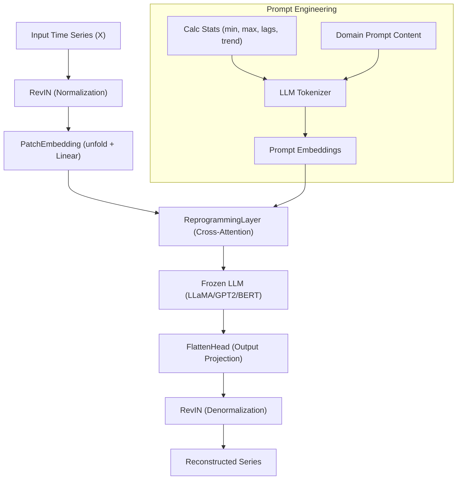
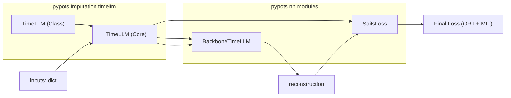

<!-- source: DeepWiki mcp.deepwiki.com · repo WenjieDu/PyPOTS · extra page LLM-Based Imputation (TimeLLM, GPT4TS & MOMENT) · fetched 2026-10-21 -->

# LLM-Based Imputation (TimeLLM, GPT4TS & MOMENT)

Relevant source files

The following files were used as context for generating this wiki page:

- [.github/workflows/linting.yml](.github/workflows/linting.yml)
- [.github/workflows/publish_to_PyPI.yml](.github/workflows/publish_to_PyPI.yml)
- [.github/workflows/testing_ci.yml](.github/workflows/testing_ci.yml)
- [.github/workflows/testing_daily.yml](.github/workflows/testing_daily.yml)
- [pypots/forecasting/gpt4ts/core.py](pypots/forecasting/gpt4ts/core.py)
- [pypots/forecasting/gpt4ts/model.py](pypots/forecasting/gpt4ts/model.py)
- [pypots/forecasting/timellm/core.py](pypots/forecasting/timellm/core.py)
- [pypots/forecasting/timellm/model.py](pypots/forecasting/timellm/model.py)
- [pypots/imputation/gpt4ts/__init__.py](pypots/imputation/gpt4ts/__init__.py)
- [pypots/imputation/gpt4ts/core.py](pypots/imputation/gpt4ts/core.py)
- [pypots/imputation/gpt4ts/model.py](pypots/imputation/gpt4ts/model.py)
- [pypots/imputation/moment/__init__.py](pypots/imputation/moment/__init__.py)
- [pypots/imputation/moment/core.py](pypots/imputation/moment/core.py)
- [pypots/imputation/moment/model.py](pypots/imputation/moment/model.py)
- [pypots/imputation/timellm/__init__.py](pypots/imputation/timellm/__init__.py)
- [pypots/imputation/timellm/core.py](pypots/imputation/timellm/core.py)
- [pypots/imputation/timellm/model.py](pypots/imputation/timellm/model.py)
- [pypots/nn/modules/gpt4ts/__init__.py](pypots/nn/modules/gpt4ts/__init__.py)
- [pypots/nn/modules/gpt4ts/backbone.py](pypots/nn/modules/gpt4ts/backbone.py)
- [pypots/nn/modules/moment/__init__.py](pypots/nn/modules/moment/__init__.py)
- [pypots/nn/modules/moment/backbone.py](pypots/nn/modules/moment/backbone.py)
- [pypots/nn/modules/moment/masking.py](pypots/nn/modules/moment/masking.py)
- [pypots/nn/modules/moment/modules.py](pypots/nn/modules/moment/modules.py)
- [pypots/nn/modules/patchtst/layers.py](pypots/nn/modules/patchtst/layers.py)
- [pypots/nn/modules/timellm/__init__.py](pypots/nn/modules/timellm/__init__.py)
- [pypots/nn/modules/timellm/backbone.py](pypots/nn/modules/timellm/backbone.py)
- [tests/imputation/llms/__init__.py](tests/imputation/llms/__init__.py)
- [tests/imputation/llms/timellm.py](tests/imputation/llms/timellm.py)

This page provides a technical deep dive into the Large Language Model (LLM) adaptation strategies implemented in PyPOTS for time-series imputation. Specifically, it covers **TimeLLM**, **GPT4TS**, and the **MOMENT** foundation model, all of which leverage pre-trained transformer architectures to capture complex temporal dependencies.

## 1. Overview of the Reprogramming Approach

The core philosophy behind LLM-based models in PyPOTS is to treat time-series data as a sequence of tokens that can be understood by a pre-trained LLM (like LLaMA, GPT-2, or BERT). Instead of training these massive models from scratch, PyPOTS uses a "frozen" backbone and trains lightweight adapter layers to map time-series patches into the LLM's latent space.

### Key Components
- **Frozen Backbone**: The LLM weights are kept static to preserve learned general sequence knowledge by setting `requires_grad = False` [pypots/nn/modules/timellm/backbone.py:109-110]().
- **Patching**: Time-series steps are grouped into patches to reduce sequence length and capture local context using `PatchEmbedding` [pypots/nn/modules/patchtst/layers.py:12-47]().
- **Reprogramming/Mapping**: Aligning the patch embeddings with the LLM's word embedding space using a linear `mapping_layer` and a `ReprogrammingLayer` [pypots/nn/modules/timellm/backbone.py:125-126]().

**Sources:** [pypots/imputation/timellm/model.py:24-122](), [pypots/imputation/gpt4ts/model.py:24-109](), [pypots/nn/modules/timellm/backbone.py:38-139]()

---

## 2. TimeLLM Implementation

`TimeLLM` adapts LLMs by using domain-specific prompts and a specialized reprogramming layer to bridge the gap between numerical time series and natural language.

### Data Flow and Architecture
The following diagram illustrates how a time-series sample flows through the `BackboneTimeLLM`.

**TimeLLM Data Flow: Numerical to Latent Space**

**Sources:** [pypots/nn/modules/timellm/backbone.py:149-200](), [pypots/nn/modules/patchtst/layers.py:150-190]()

### Key Classes
1.  **`BackboneTimeLLM`**: The main module managing the LLM lifecycle. It supports `LLaMA`, `GPT2`, and `BERT` [pypots/nn/modules/timellm/backbone.py:38-99]().
2.  **`ReprogrammingLayer`**: Implements cross-attention between the time-series patches and the LLM's word embeddings to "reprogram" the LLM's understanding [pypots/nn/modules/timellm/backbone.py:126]().
3.  **`RevIN`**: Reversible Instance Normalization used to handle non-stationary data by normalizing the input and denormalizing the output [pypots/nn/modules/timellm/backbone.py:128, 150]().

### Prompting Strategy
TimeLLM generates a text-based prompt for every batch [pypots/nn/modules/timellm/backbone.py:163-196](), including:
- **Dataset Description**: Provided via `domain_prompt_content` [pypots/imputation/timellm/model.py:179]().
- **Statistics**: Min, max, median, and trend (upward/downward) [pypots/nn/modules/timellm/backbone.py:157-161]().
- **Lags**: Top-5 lags calculated via Fast Fourier Transform (FFT) in `calc_lags` [pypots/nn/modules/timellm/backbone.py:140-147]().

**Sources:** [pypots/nn/modules/timellm/backbone.py:140-196](), [pypots/imputation/timellm/model.py:124-151]()

---

## 3. GPT4TS Implementation

`GPT4TS` (GPT-2 for Time Series) is a streamlined approach specifically optimized for the GPT-2 architecture, originally proposed by Zhou et al. [pypots/imputation/gpt4ts/model.py:25-26](). It is supported for both imputation [pypots/imputation/gpt4ts/model.py:24]() and forecasting [pypots/forecasting/gpt4ts/model.py:21]().

### Memory-Saving Checkpoint Strategy
One of the most critical features of the PyPOTS implementation of GPT4TS (and TimeLLM) is the `_organize_content_to_save` method. Since the LLM backbone is frozen and weighs several gigabytes, PyPOTS excludes these weights from the saved checkpoint to save disk space.

| Action | Logic | Code Reference |
| :--- | :--- | :--- |
| **State Dict Filtering** | Removes all keys containing "gpt2" or "llm_model" | [pypots/imputation/gpt4ts/model.py:194](), [pypots/imputation/timellm/model.py:221]() |
| **Model Restoration** | Re-downloads/loads the backbone from HuggingFace, then injects trained adapter weights | [pypots/nn/modules/timellm/backbone.py:72-97]() |

**Sources:** [pypots/imputation/gpt4ts/model.py:186-198](), [pypots/imputation/timellm/model.py:215-227]()

---

## 4. MOMENT Foundation Model

PyPOTS includes support for **MOMENT**, a multi-modal time-series foundation model based on the T5 architecture [pypots/nn/modules/moment/backbone.py:180]().

### MOMENT Configuration
MOMENT utilizes a core backbone `BackboneMOMENT` which assembles the model for multiple tasks including imputation [pypots/nn/modules/moment/backbone.py:56]().

- **Backbone Variants**: Supports T5 variants including `t5-small`, `t5-base`, `google/flan-t5-large`, etc [pypots/nn/modules/moment/backbone.py:30-41]().
- **Tuning Modes**: Supports `linear-probing`, `end-to-end`, and `zero-shot` fine-tuning [pypots/nn/modules/moment/backbone.py:43-47]().
- **Normalization**: Features `RevIN` for instance normalization with optional affine parameters [pypots/nn/modules/moment/backbone.py:74]().
- **Patching**: Uses `Patching` and `PatchEmbedding` modules to tokenize time-series data [pypots/nn/modules/moment/backbone.py:75-76]().

**Sources:** [pypots/nn/modules/moment/backbone.py:56-130](), [pypots/nn/modules/moment/modules.py:1-20]()

---

## 5. Imputation Logic & Loss Functions

Both models inherit from task-specific base classes and utilize a `ModelCore` wrapper (`_TimeLLM`, `_GPT4TS`) to handle the forward pass.

### The SAITS Strategy for LLMs
PyPOTS applies the **SAITS** training strategy (Overlapping Reconstruction and Masked Imputation Tasks) to the TimeLLM backbone [pypots/imputation/timellm/core.py:57]().

- **ORT Loss**: Reconstruction loss on the observed values [pypots/imputation/timellm/core.py:85]().
- **MIT Loss**: Reconstruction loss on the values masked by the `indicating_mask` [pypots/imputation/timellm/core.py:85]().

**Entity Mapping: Imputation Workflow**

**Sources:** [pypots/imputation/timellm/core.py:15-93](), [pypots/imputation/timellm/model.py:185-202]()

---

## 6. Technical Specifications

### Patching and Embedding
The `PatchEmbedding` layer transforms the raw time series into patches using `unfold` [pypots/nn/modules/patchtst/layers.py:40]().

| Parameter | Description |
| :--- | :--- |
| `patch_size` | Length of the window for each patch [pypots/nn/modules/patchtst/layers.py:24]() |
| `patch_stride` | Overlap between patches [pypots/nn/modules/patchtst/layers.py:25]() |
| `d_model` | Projection dimension for the LLM input [pypots/nn/modules/patchtst/layers.py:28]() |

### Supported Backbones
PyPOTS currently supports the following LLM types via the `llm_model_type` parameter in `BackboneTimeLLM`:
- **LLaMA**: Loads `huggyllama/llama-7b` [pypots/nn/modules/timellm/backbone.py:71-79]().
- **GPT2**: Loads `openai-community/gpt2` [pypots/nn/modules/timellm/backbone.py:81-88]().
- **BERT**: Loads `google-bert/bert-base-uncased` [pypots/nn/modules/timellm/backbone.py:90-97]().

**Sources:** [pypots/nn/modules/timellm/backbone.py:23-27, 71-97](), [pypots/imputation/timellm/model.py:36-50]()

---

