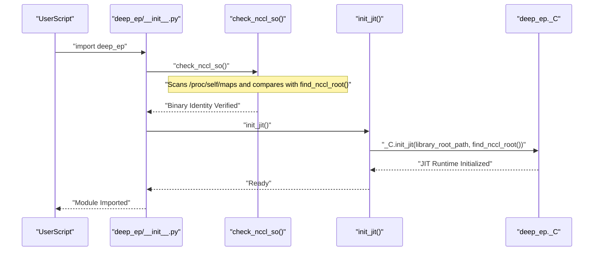

<!-- source: DeepWiki mcp.deepwiki.com · repo deepseek-ai/DeepEP · page 2.1 Installation and Build · fetched 2026-11-11 -->

# Installation and Build

<details>
<summary>Relevant source files</summary>

The following files were used as context for generating this wiki page:

- [.gitmodules](.gitmodules)
- [deep_ep/__init__.py](deep_ep/__init__.py)
- [install.sh](install.sh)
- [setup.py](setup.py)

</details>


## Purpose and Scope
This page details the installation, build procedures, environment configuration, and runtime initialization mechanics for DeepEP. It covers submodule setup for `third-party/deep_jit`, required environment variables (`EP_JIT_CACHE_DIR`, `EP_NCCL_ROOT_DIR`, `EP_NUM_TOPK_IDX_BITS`), NCCL discovery via `find_pkgs.py`, binary-identity validation via `check_nccl_so()` in `deep_ep/__init__.py`, and Just-In-Time (JIT) initialization via `init_jit()`.

Sources: [.gitmodules:1-3](), [setup.py:14-15](), [deep_ep/__init__.py:19-53]()

---

## Submodule Initialization
DeepEP relies on DeepJIT as a Git submodule located at `third-party/deep_jit` to compile specialized CUDA kernels at runtime [.gitmodules:1-3](). Before building or installing the package, ensure submodules are initialized and updated:

```bash
git submodule update --init --recursive
```

Sources: [.gitmodules:1-3]()

---

## Required Environment Variables
DeepEP captures several persistent environment variables at build-time using `setup.py` and embeds them into `deep_ep/envs.py` via `CustomBuildPy.generate_default_envs()` [setup.py:14-16, 43-75](). Additional variables govern runtime caching and numeric configurations.

| Environment Variable | Description | Default / Source |
| :--- | :--- | :--- |
| `EP_JIT_CACHE_DIR` | Persistent storage directory for JIT-compiled kernel binaries. | None [setup.py:14]() |
| `EP_NCCL_ROOT_DIR` | Path to the NCCL installation root directory. | Auto-detected via `find_nccl_root()` [setup.py:15, 78]() |
| `EP_NUM_TOPK_IDX_BITS` | Bit width for `topk_idx` tensor data type (`32` or `64`). | `32` [setup.py:15, 96-98]() |
| `EP_JIT_PRINT_COMPILER_COMMAND` | Enables printing of underlying JIT compiler command lines. | Unset [setup.py:14]() |
| `EP_JIT_CPP_STANDARD` | C++ standard version used during JIT compilation. | Unset [setup.py:14]() |
| `EP_DEFAULT_RDMA_SL` / `EP_OVERRIDE_RDMA_SL` | RDMA Service Level configurations for transport routing. | Unset [setup.py:15]() |
| `EP_SUPPRESS_NCCL_CHECK` | Set to `1` to bypass runtime NCCL binary-identity checks. | `0` [deep_ep/__init__.py:24-25]() |

Sources: [setup.py:14-75](), [deep_ep/__init__.py:24-25]()

---

## Installation Methods
DeepEP provides multiple entry points for installation, ranging from automated shell scripts to direct `pip` invocation.

### 1. Automated Installation Script (`install.sh`)
The `install.sh` script automates cleanup of previous distribution artifacts, wheel creation via `setup.py`, and installation using `pip` [install.sh:1-12]().
```bash
./install.sh
```

### 2. Direct Source Installation (`pip install .`)
To install directly from the source checkout in editable or standard mode:
```bash
pip install .
```

### 3. Manual Wheel Construction
To build a Python wheel explicitly using `setup.py`:
```python
python setup.py bdist_wheel
pip install dist/*.whl
```

Sources: [setup.py:1-140](), [install.sh:1-12]()

---

## Build System Architecture and NCCL Discovery
During the build phase executed by `setup.py`, DeepEP locates the NCCL root directory by invoking `find_pkgs.find_nccl_root()` [setup.py:78] and configures a PyTorch `CUDAExtension` linking against `libnccl` [setup.py:131-138](). The `CustomBuildPy` build command overrides `setuptools.command.build_py.build_py` to generate `deep_ep/envs.py` containing captured persistent environments and copies the `csrc` directory into the wheel for diagnostic error lookup [setup.py:43-75]().

Title: "DeepEP Build Data Flow"
```mermaid
graph TD
    subgraph "NaturalLanguageSpace"
        EnvSetup["Environment Configuration"]
        NCCLDiscovery["NCCL Package Discovery"]
    end

    subgraph "CodeEntitySpace"
        FindPkgs["find_pkgs.find_nccl_root()"]:::func
        SetupPy["setup.py"]:::file
        CustomBuild["CustomBuildPy.generate_default_envs()"]:::class
        CUDAExt["CUDAExtension('deep_ep._C')"]:::class
        GenEnvs["deep_ep/envs.py"]:::file
    end

    EnvSetup --> SetupPy
    SetupPy --> FindPkgs
    FindPkgs --> NCCLDiscovery
    NCCLDiscovery --> CUDAExt
    SetupPy --> CustomBuild
    CustomBuild --> GenEnvs

    classDef func fill:#f9f,stroke:#333,stroke-width:2px;
    classDef class fill:#bbf,stroke:#333,stroke-width:2px;
    classDef file fill:#dfd,stroke:#333,stroke-width:2px;
```
Sources: [setup.py:18-20](), [setup.py:43-78](), [setup.py:131-138]()

---

## NCCL Binary-Identity Validation and JIT Initialization
Upon importing `deep_ep`, package-level initialization executes immediately in `deep_ep/__init__.py` [deep_ep/__init__.py:54-56](). It performs two safety checks before exposing public APIs:

1. **`check_nccl_so()`**: Parses `/proc/self/maps` to identify any loaded `libnccl` instances, resolves the expected library path via `find_nccl_root()`, and performs a strict binary comparison using `filecmp.cmp(..., shallow=False)` [deep_ep/__init__.py:19-42](). If a version discrepancy or duplicate runtime library is detected, execution aborts to prevent memory corruption. This check can be bypassed by setting `EP_SUPPRESS_NCCL_CHECK=1` [deep_ep/__init__.py:24-25]().
2. **`init_jit()`**: Loads the compiled C++ extension `deep_ep._C` and invokes `_C.init_jit(library_root_path, find_nccl_root())` to initialize the JIT compilation runtime [deep_ep/__init__.py:44-51]().

Title: "Runtime Initialization and Validation Sequence"

Sources: [deep_ep/__init__.py:19-56]()

---

