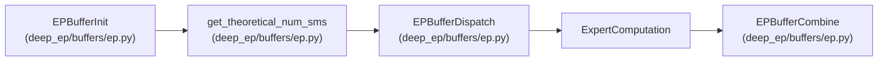
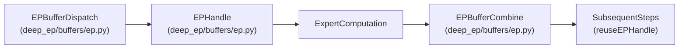
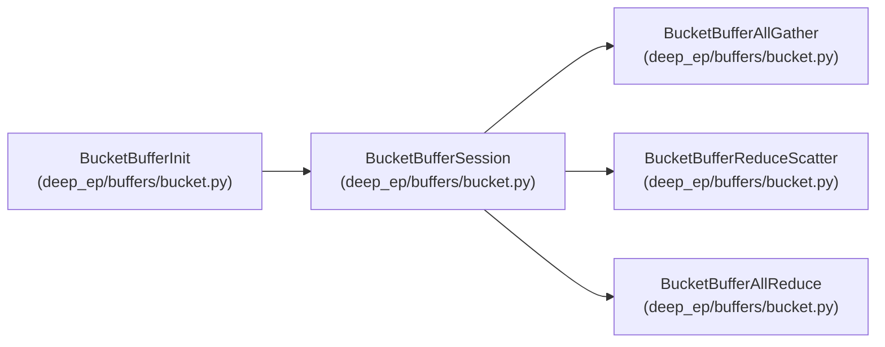

<!-- source: DeepWiki mcp.deepwiki.com · repo deepseek-ai/DeepEP · page 2.2 Quick Start Guide · fetched 2026-11-11 -->

# Quick Start Guide

<details>
<summary>Relevant source files</summary>

The following files were used as context for generating this wiki page:

- [README.md](README.md)

</details>


This page covers the minimal steps needed to get DeepEP running using the `EPBuffer` and `BucketBuffer` interfaces. It demonstrates how to initialize buffers with size hints, run dispatch and combine operations in normal mode, utilize `EPHandle` caching for inference decoding, analytically determine optimal SM counts, and perform group collectives using `BucketBuffer`.

---

## Overview of the Call Sequence

DeepEP unifies expert parallelism communication into the `EPBuffer` class and collective operations into `BucketBuffer`, both sharing the `BufferBase` lifecycle managed via symmetric allocation models [README.md:12-14]().

### Natural Language to Code Entity Space: Normal Mode Call Flow


Sources: [README.md:118-161](), [deep_ep/buffers/ep.py:1-100]()

### Inference Decoding Flow (Handle Caching)


Sources: [README.md:231-259](), [deep_ep/buffers/ep.py:1-100]()

---

## 1. Constructing an EPBuffer and Sizing Hints

The `EPBuffer` class in `deep_ep/buffers/ep.py` is the primary interface for expert parallelism. It manages a contiguous memory region used for both NVLink (scale-up) and RDMA (scale-out) communication via the NCCL Gin backend [README.md:20-30]().

To avoid frequent reallocations, use `get_buffer_size_hint` to check if an existing buffer is sufficient before allocation [README.md:141-146]().

```python
import torch.distributed as dist
from typing import Optional
from deep_ep import EPBuffer

# Communication buffer allocation tracking
_buffer: Optional[EPBuffer] = None
_num_comm_sms: int = 0

def get_buffer(group: dist.ProcessGroup,
               num_max_tokens_per_rank: int,
               hidden: int,
               num_topk: int,
               num_experts: int,
               use_fp8_dispatch: bool = False) -> EPBuffer:
    """Initialize or retrieve the EPBuffer for EP communication."""
    global _buffer, _num_comm_sms

    required_bytes = EPBuffer.get_buffer_size_hint(
        group, num_max_tokens_per_rank, hidden,
        num_topk=num_topk, use_fp8_dispatch=use_fp8_dispatch
    )
    
    if _buffer is None or _buffer.buffer_size < required_bytes:
        _buffer = EPBuffer(
            group,
            num_max_tokens_per_rank=num_max_tokens_per_rank,
            hidden=hidden,
            num_topk=num_topk
        )
        _num_comm_sms = _buffer.get_theoretical_num_sms(num_experts, num_topk)
        
    return _buffer
```

| Parameter | Role | Code Reference |
|---|---|---|
| `num_max_tokens_per_rank` | Global maximum tokens any rank will handle | [deep_ep/buffers/ep.py:1-50]() |
| `hidden` | Hidden dimension size | [deep_ep/buffers/ep.py:1-50]() |
| `num_topk` | Number of experts each token is routed to | [deep_ep/buffers/ep.py:1-50]() |
| `use_fp8_dispatch` | Enable FP8 communication for dispatch | [deep_ep/buffers/ep.py:1-50]() |

Sources: [README.md:118-161](), [deep_ep/buffers/ep.py:1-100]()

---

## 2. Running Dispatch and Combine

Dispatch and combine handle the token routing and reduction phases across expert-parallel ranks [README.md:28-30]().

### Step 1 — Dispatch

The `dispatch` call sends tokens to their assigned experts based on `topk_idx` [deep_ep/buffers/ep.py:50-120]().

```python
# x: [num_tokens, hidden]
# topk_idx: [num_tokens, num_topk]
recv_x, recv_topk_idx, recv_topk_weights, num_recv_tokens_per_expert, handle, event = \
    buffer.dispatch(x, topk_idx=topk_idx, topk_weights=topk_weights, 
                    num_sms=_num_comm_sms)
```

- **Metadata**: `handle` (`EPHandle`) stores routing metadata required for the subsequent `combine` or backward pass [deep_ep/buffers/ep.py:1-50]().
- **Expert Counts**: `num_recv_tokens_per_expert` is a list used to slice `recv_x` for local expert computation [deep_ep/buffers/ep.py:50-120]().

### Step 2 — Combine

After expert processing, `combine` gathers and sums the results back to the source ranks [deep_ep/buffers/ep.py:100-160]().

```python
# recv_x: [num_recv_tokens, hidden] (output from experts)
combined_x, combined_topk_weights, event = \
    buffer.combine(recv_x, handle, num_sms=_num_comm_sms)
```

Sources: [README.md:171-184](), [deep_ep/buffers/ep.py:50-160]()

---

## 3. Inference Decoding: EPHandle Caching

For inference decoding, where token routing (`topk_idx`) remains static across multiple steps or where latency is critical, DeepEP supports `EPHandle` caching to bypass metadata exchanges [README.md:231-233]().

### Caching Pattern

```python
# First step: Compute handle during prefill or initial decoding step
_, _, _, _, handle, _ = buffer.dispatch(x, topk_idx=topk_idx)

# Subsequent steps: Reuse handle for lower latency dispatch
recv_x, _, _, _, _, _ = buffer.dispatch(x, handle=handle)

# Combine also reuses the cached handle
combined_x, _, _ = buffer.combine(recv_x, handle=handle)
```

- When `handle` is passed to `dispatch`, the `topk_idx` argument is bypassed [deep_ep/buffers/ep.py:50-120]().

Sources: [README.md:231-259](), [deep_ep/buffers/ep.py:50-120]()

---

## 4. Resource Allocation and SM Tuning

DeepEP uses analytical formulas to determine optimal resource allocation without manual trial-and-error tuning [README.md:31]().

### Automatic SM Tuning

The method `get_theoretical_num_sms` evaluates underlying interconnect bandwidth (RDMA and NVLink) to compute the minimum SM count needed to saturate communication channels [deep_ep/buffers/ep.py:1-80]().

```python
# Calculate SMs for a specific MoE configuration
num_sms = buffer.get_theoretical_num_sms(
    num_experts=256, 
    num_topk=8, 
    is_dispatch=True
)
```

Sources: [README.md:158-163](), [deep_ep/buffers/ep.py:1-80]()

---

## 5. BucketBuffer Collective Example

`BucketBuffer` supports batched communication primitives (all-gather, reduce-scatter, all-reduce) for context parallelism (CP) and data parallelism (DP) through managed sessions [README.md:14]().

### Natural Language to Code Entity Space: BucketBuffer Session Flow


Sources: [README.md:14](), [deep_ep/buffers/bucket.py:1-100]()

### Collective Usage Pattern

```python
from deep_ep import BucketBuffer

# Initialize BucketBuffer for CP/DP collectives
bucket_buffer = BucketBuffer(group, max_buffer_size=1024 * 1024 * 64)

# Execute collectives within a session context
with bucket_buffer.session() as session:
    # All-gather collective
    output_tensor, event = session.all_gather(input_tensor)
    
    # Reduce-scatter collective
    reduced_tensor, event = session.reduce_scatter(input_tensor)
    
    # All-reduce collective
    all_reduced_tensor, event = session.all_reduce(input_tensor)
```

Sources: [README.md:14](), [deep_ep/buffers/bucket.py:1-120]()

---

## 6. Quick Reference Table

| Feature | API Method / Attribute | Purpose | Code Reference |
|---|---|---|---|
| **Buffer Sizing** | `EPBuffer.get_buffer_size_hint` | Calculate memory requirements prior to allocation | [deep_ep/buffers/ep.py:1-50]() |
| **EP Allocation** | `EPBuffer(...)` | Construct buffer instance and register with NCCL | [deep_ep/buffers/ep.py:1-50]() |
| **Token Routing** | `buffer.dispatch(x, topk_idx, ...)` | Route tokens to target experts | [deep_ep/buffers/ep.py:50-120]() |
| **Token Reduction** | `buffer.combine(x, handle, ...)` | Combine expert outputs back to source ranks | [deep_ep/buffers/ep.py:100-160]() |
| **Latency Opt** | `EPHandle` caching | Reuse routing metadata for inference decoding | [deep_ep/buffers/ep.py:1-50]() |
| **Resource Opt** | `get_theoretical_num_sms` | Compute optimal SM count for peak bandwidth | [deep_ep/buffers/ep.py:1-80]() |
| **Collectives** | `BucketBuffer` session | Run all-gather, reduce-scatter, all-reduce | [deep_ep/buffers/bucket.py:1-120]() |

Sources: [README.md:118-288](), [deep_ep/buffers/ep.py:1-160](), [deep_ep/buffers/bucket.py:1-120]()

---

