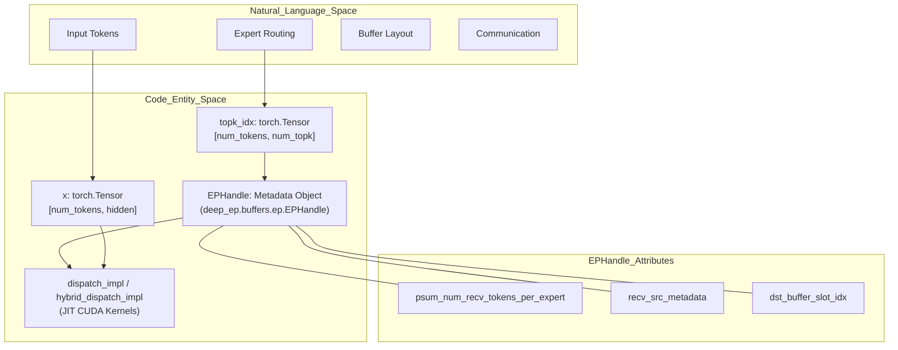
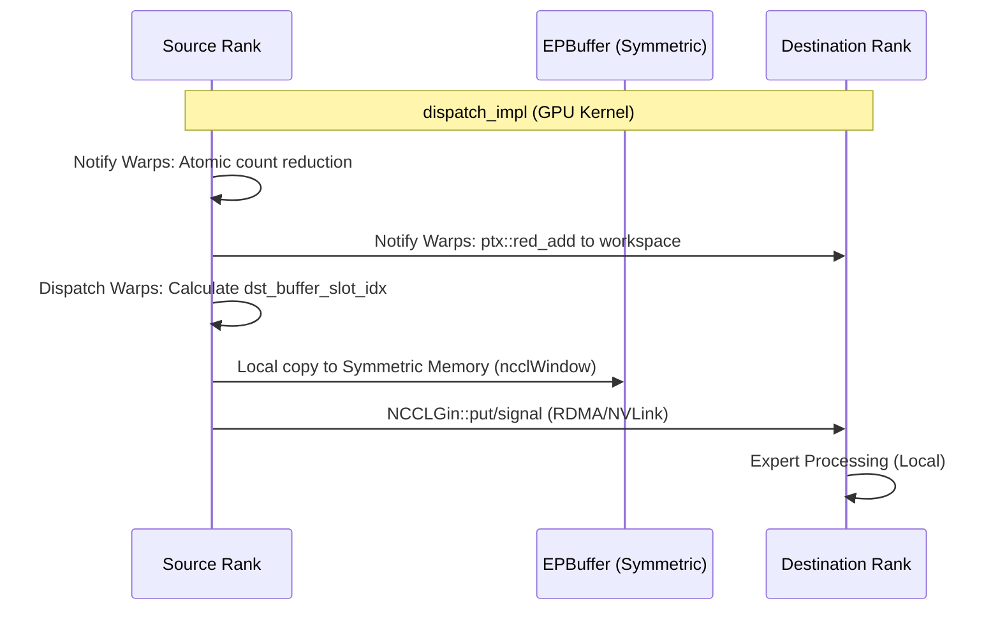
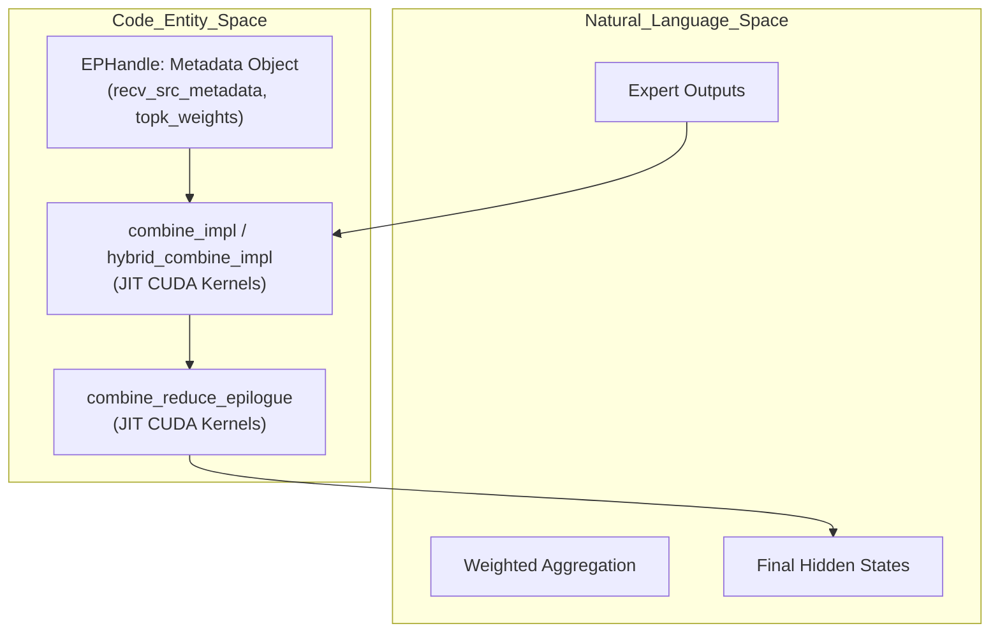

<!-- source: DeepWiki mcp.deepwiki.com · repo deepseek-ai/DeepEP · page 3.1 Dispatch and Combine Operations · fetched 2026-11-11 -->

# Dispatch and Combine Operations

Relevant source files

The following files were used as context for generating this wiki page:

- [README.md](README.md)
- [csrc/indexing/main.cu](csrc/indexing/main.cu)

## Purpose and Scope

This page describes the core expert-parallel (EP) communication operations in DeepEP V2.5. Dispatch routes tokens from source ranks to destination experts across the cluster, while combine reverses this routing to gather processed expert outputs back to their original ranks with weighted aggregation. These operations are managed via the `EPBuffer` interface (`deep_ep/buffers/ep.py`), leveraging the **NCCL Gin** backend for high-throughput and low-latency all-to-all communication [README.md:9-18]().

Key features in V2.5 include the `EPHandle` metadata abstraction, analytical resource allocation, and optimized layout options such as `do_expand`, `expert_alignment`, and deferred epilogues [README.md:11-16]().

Sources: [README.md:9-18](), [README.md:11-16]()

---

## Token Routing and Layout

The dispatch operation routes tokens based on a `topk_idx` tensor. `EPBuffer.dispatch` handles metadata generation internally or reuses a cached `EPHandle`.

### Data Flow: Natural Language to Code Entity Space

The following diagram maps the logical routing process to specific code entities and data structures in the V2.5 implementation.

Token Routing Data Flow

Sources: [README.md:9-18](), [README.md:115-162]()

### Layout Options

V2/V2.5 introduces several layout options to optimize the expert computation phase following dispatch:

1.  **`do_expand`**: Whether the expanding (one-token-per-expert-slot) layout is used. If `True`, one token slot is allocated per expert assignment. If a token is routed to multiple experts on the same rank, it will occupy multiple slots in the received buffer [README.md:11-16]().
2.  **`expert_alignment`**: Aligns the number of tokens received by each local expert to this variable. This is critical for performance in GEMM-based expert implementations that require specific alignment (e.g., 8 or 16) [README.md:11-16]().
3.  **`psum_num_recv_tokens_per_expert`**: Prefix sum of alignment-padded received token counts per local expert. In non-expand mode, this is an inclusive prefix sum. In expand mode, `psum[i]` equals the aligned cumulative count of experts before `i` plus the actual (unaligned) token count of expert `i` [README.md:11-16]().
4.  **`psum_num_recv_tokens_per_scaleup_rank`**: Inclusive prefix sum of deduplicated received token counts per scaleup rank. A token is counted once per rank even if multiple of its top-k experts land on the same rank [README.md:11-16]().

Sources: [README.md:11-16](), [README.md:115-162]()

---

## The Dispatch Operation

The `EPBuffer.dispatch` method performs the all-to-all send. It supports both standard BF16 and FP8 quantized formats [README.md:3-15]().

### Implementation Detail: JIT Kernel Execution

When `dispatch` is called, DeepEP launches a JIT-compiled kernel (`dispatch_impl` in `deep_ep/include/deep_ep/impls/ep/dispatch.cuh` or `hybrid_dispatch.cuh`). These kernels use a multi-role warp architecture:

1.  **Notify Warps**: Ranks exchange counts to determine how many tokens each will receive. They perform atomic additions on shared memory and then do a full-grid reduction using `ptx::red_add` [csrc/indexing/main.cu:15-24]().
2.  **Dispatch/Forward Warps**: Tokens are copied into the `EPBuffer` and sent via NCCL Gin primitives [csrc/indexing/main.cu:15-24]().
3.  **Hybrid Mode**: If `allow_hybrid_mode` is enabled, tokens may be routed hierarchically using RDMA and NVLink to optimize bandwidth [csrc/indexing/main.cu:15-24]().

Dispatch Operation Sequence

Sources: [csrc/indexing/main.cu:15-24](), [README.md:9-36]()

### EPHandle Metadata and Epilogue

The `EPHandle` is the primary metadata carrier in V2/V2.5. It is produced during the first dispatch and contains:
*   `recv_src_metadata`: Source token indices and buffer slot indices [README.md:11-16]().
*   `dst_buffer_slot_idx`: Destination buffer slot indices from dispatch [README.md:11-16]().
*   `num_recv_tokens`: The total number of received tokens [README.md:11-16]().

After the main dispatch kernel, a `dispatch_copy_epilogue_impl` kernel is executed on the receiver side to finalize the layout, supporting deferred epilogues when requested [csrc/indexing/main.cu:15-24]().

Sources: [csrc/indexing/main.cu:15-24](), [README.md:11-16]()

---

## The Combine Operation

Combine reverses the dispatch routing. It gathers the outputs from experts and performs a weighted summation to produce the final hidden states [README.md:3-15]().

### Weighted Aggregation and Kernel Implementation

The combine operation is implemented in `combine_impl` and `hybrid_combine_impl` (`deep_ep/include/deep_ep/impls/ep/combine.cuh`). It uses `topk_weights` and the `src_metadata` from the `EPHandle` to map expert outputs back to their original token indices [csrc/indexing/main.cu:15-24](). 

1.  **TMA Transfers**: The kernel uses Tensor Memory Accelerator (TMA) for efficient data movement [csrc/indexing/main.cu:15-24]().
2.  **Remote Access**: It checks for NVLink accessibility. If accessible, it bypasses RDMA and uses direct symmetric memory pointers [csrc/indexing/main.cu:15-24]().
3.  **Reduction**: The kernel performs local reduction of multiple expert outputs for the same token before sending when applicable [csrc/indexing/main.cu:15-24]().

### Reversing the Layout and Code Entity Mapping

Combine handles the `do_expand` and `expert_alignment` padding automatically by using the metadata stored in the `EPHandle` [README.md:11-16]().

Combine Operation Data Flow

Sources: [csrc/indexing/main.cu:15-24](), [README.md:3-16]()

---

## Handle Caching for Inference

In inference decoding, the routing pattern (which tokens go to which experts) may remain static for multiple steps or across different layers. V2/V2.5 allows **EPHandle caching** to eliminate the overhead of metadata computation [README.md:11-16]().

### Caching Semantics

1.  **First Iteration**: Call `dispatch` with `topk_idx`. It returns `recv_x` and an `EPHandle` [README.md:11-16]().
2.  **Subsequent Iterations**: Pass the cached `EPHandle` back into `dispatch` using the `handle` argument [README.md:11-16]().
3.  **Benefit**: The kernel skips the layout recomputation phases (Notify and metadata generation), directly moving to data transfer. This significantly reduces latency in decoding [README.md:178-193]().

Sources: [README.md:11-16](), [README.md:178-193]()

---

## Summary of Key Metadata

| Attribute | Description | Code Reference |
| :--- | :--- | :--- |
| `topk_idx` | Tensor mapping tokens to expert IDs. | [README.md:11-16]() |
| `EPHandle` | Metadata object produced by dispatch, used by combine. | [README.md:11-16]() |
| `num_recv_tokens_per_expert_list` | Python list of per-expert received token counts (CPU-side). | [README.md:11-16]() |
| `expert_alignment` | Padding factor for expert input buffers. | [README.md:11-16]() |
| `do_expand` | Layout flag for contiguous expert inputs. | [README.md:11-16]() |
| `psum_num_recv_tokens_per_expert` | Aligned prefix sum for expert buffer offsets. | [README.md:11-16]() |

Sources: [README.md:11-16]()

---

