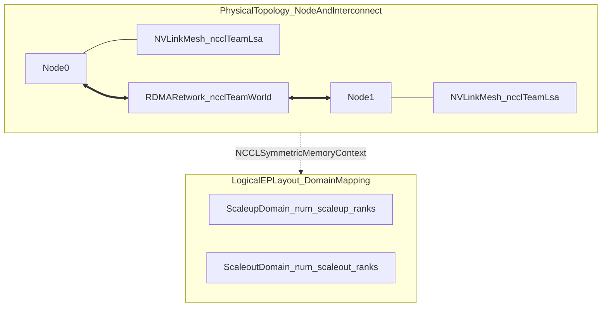
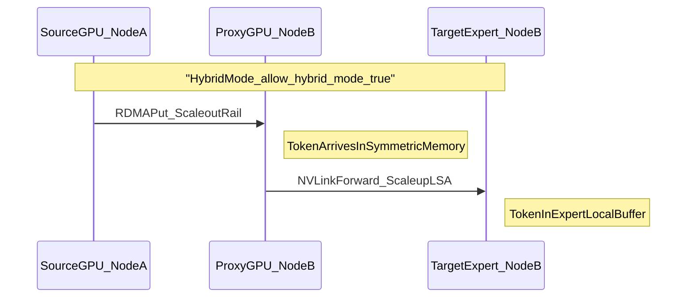
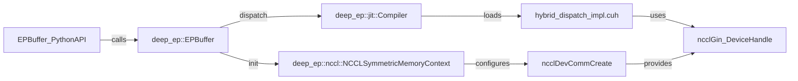

<!-- source: DeepWiki mcp.deepwiki.com · repo deepseek-ai/DeepEP · page 3.2 Communication Modes and Topology · fetched 2026-11-11 -->

# Communication Modes and Topology

Relevant source files

The following files were used as context for generating this wiki page:

- [README.md](README.md)
- [csrc/indexing/main.cu](csrc/indexing/main.cu)

This page details DeepEP's communication modes and network topology modeling. DeepEP V2 and V2.5 replace rigid V1 operational modes with a flexible communication architecture that unifies high-throughput and low-latency paths. It supports scaleout (RDMA) and scaleup (NVLink) domains, hybrid multi-transport routing, and analytical resource allocation via the lightweight **NCCL Gin** backend [README.md:20-35]().

---

## Overview and Architectural Shift

DeepEP V2 and V2.5 unify expert parallelism communication into the `EPBuffer` (previously `ElasticBuffer` in early V2 releases) interface [README.md:11-20](). The architecture shifts away from NVSHMEM toward the NCCL Gin backend, enabling robust hierarchical topologies.

| Feature | DeepEP V1 | DeepEP V2 / V2.5 (Elastic) |
| :--- | :--- | :--- |
| **Backend** | NVSHMEM | NCCL Gin [README.md:18-20]() |
| **Topology** | Flat RDMA or NVLink | Hierarchical Scale-up + Scale-out [README.md:20-30]() |
| **SM Allocation** | Manual via `set_num_sms` | Analytical calculation [README.md:31-31]() |
| **Hybrid Mode** | Supported via separate kernels | Integrated via `allow_hybrid_mode` flag [README.md:32-32]() |
| **Low-Latency** | Pure RDMA (IBGDA) | Integrated into Elastic kernels (low SM usage) [README.md:39-41]() |

Sources: [README.md:11-42]()

---

## Topology Model: Scale-up vs. Scale-out

DeepEP models the cluster as a multi-dimensional grid of GPUs, mapping physical interconnects (NVLink for high-bandwidth intra-node/LSA transfers and RDMA for inter-node scaleout) to logical expert-parallel layouts [README.md:54-55]().

### Physical vs. Logical Domains

DeepEP distinguishes between the physical hardware layout and the logical domain sizes via dedicated query functions:
1. **Physical Domain (`get_physical_domain_size`)**:
   - **RDMA Ranks (`num_rdma_ranks`)**: Number of nodes or independent network planes.
   - **NVLink Ranks (`num_nvl_ranks`)**: Number of GPUs within a single node or LSA (Local Shared Area) domain (`ncclTeamLsa`).
2. **Logical Domain (`get_logical_domain_size`)**:
   - **Scale-out Ranks (`num_scaleout_ranks`)**: Expert-parallel groups across nodes.
   - **Scaleup Ranks (`num_scaleup_ranks`)**: Expert-parallel ranks within the local communication domain.

**Diagram: Physical vs. Logical Mapping**

Sources: [README.md:11-35]()

---

## Communication Modes and Transport Selection

DeepEP supports multiple transport variants controlled by configuration flags such as `allow_hybrid_mode` and environment settings (`EP_OVERRIDE_RDMA_SL`, `NCCL_IB_SL`) [README.md:32-32, 101-102]().

### 1. Direct (Non-Hybrid) Mode
- **When selected**: Intranode-only training, small scale-out domains, or when RDMA bandwidth is not saturated.
- **Mechanism**: Logical scale-up domain encompasses the entire world. Tokens transfer directly between source and destination GPUs without hierarchical intermediate routing [README.md:32-32].

### 2. Hybrid Mode
- **When selected**: Large-scale training (e.g., EP256+) where inter-node RDMA bandwidth is constrained and tokens are grouped by node (e.g., DeepSeek-V3/R1 Group-Limited Gating).
- **Mechanism**:
  1. **Scaleout Phase**: Inter-node token transport via RDMA (`ncclTeamRail`) [README.md:33-33].
  2. **Scaleup Phase**: Intra-node distribution via high-speed NVLink (`ncclTeamLsa`) [README.md:33-33].

**Diagram: Hybrid Dispatch Data Flow**

Sources: [README.md:32-35]()

---

## Rail, LSA, and World Teams

Communication operations leverage hierarchical NCCL teams to scope collectives and point-to-point transfers:
- `ncclTeamWorld`: Spans all ranks across the entire cluster for global coordination and flat communication modes.
- `ncclTeamRail`: Scoped across corresponding GPU indices across different nodes, handling internode scaleout RDMA transfers.
- `ncclTeamLsa` (Local Shared Area): Scoped within a single node or NVLink domain, handling high-speed scaleup transfers.

**Diagram: Code Entity Mapping (Backend to Kernel)**

Sources: [README.md:11-35]()

---

