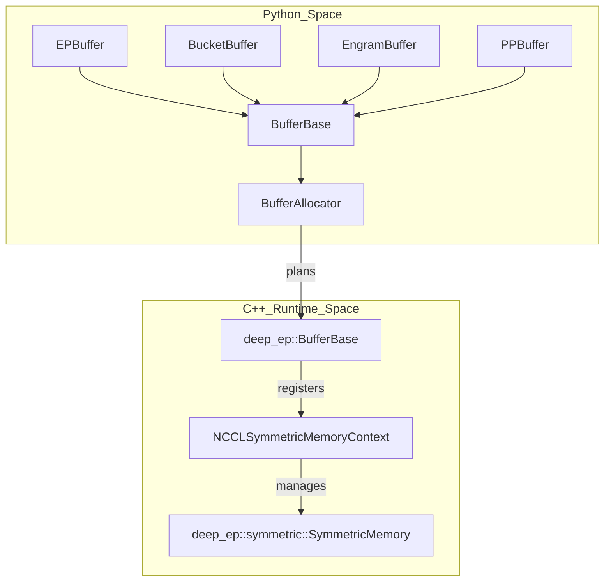
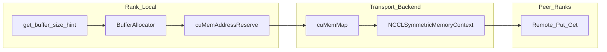

<!-- source: DeepWiki mcp.deepwiki.com · repo deepseek-ai/DeepEP · page 3.3 Memory Model: BufferBase and BufferAllocator · fetched 2026-11-11 -->

# Memory Model: BufferBase and BufferAllocator

Relevant source files

The following files were used as context for generating this wiki page:

- [README.md](README.md)
- [deep_ep/__init__.py](deep_ep/__init__.py)

## Purpose and Scope
This page details the memory architecture introduced in DeepEP V2.5, transitioning from the legacy `ElasticBuffer` to a modular family of specialized buffer classes (`EPBuffer`, `BucketBuffer`, `EngramBuffer`, and `PPBuffer`) built on top of `BufferBase` (`[deep_ep/buffers/base.py]()`, `[csrc/buffers/base.hpp]()`) [README.md:11-12](). It covers symmetric buffer allocation planning via `BufferAllocator` (`[deep_ep/__init__.py:62]`), NCCL symmetric memory windows (`[csrc/kernels/comm/symmetric.hpp]()`, `[csrc/kernels/comm/context.cpp]()`), and buffer size hints.

---

## BufferFamily and BufferBase Lifecycle

In DeepEP V2.5, memory management is refactored from a monolithic elastic buffer into distinct buffer classes that share a common `BufferBase` lifecycle [README.md:11-12]().

### Subclass Specialization
- **`EPBuffer`**: Manages token dispatch, combine, and weight/gradient exchange for expert parallelism (`[deep_ep/buffers/ep.py]()`) [README.md:12-15]().
- **`BucketBuffer`**: Handles batched collectives (all-gather, reduce-scatter, all-reduce) for context and data parallelism (`[deep_ep/buffers/bucket.py]()`) [README.md:12-14]().
- **`EngramBuffer` & `PPBuffer`**: Provide multi-layer GPU/CPU RMA storage and pipeline-parallel send/recv ring buffers (`[deep_ep/buffers/engram.py]()`, `[deep_ep/buffers/pp.py]()`) [README.md:12-17]().

### Lifecycle Management
The `BufferBase` lifecycle coordinates allocation, symmetric registration across ranks, and destruction:
1. **Size Estimation**: Uses static or dynamic size hints (`get_buffer_size_hint`) based on MoE hyperparameters [README.md:107-134]().
2. **Allocation Planning**: Collaborates with `BufferAllocator` to determine exact byte requirements and alignment constraints [README.md:13]().
3. **Registration**: Registers the allocated memory region as a NCCL symmetric memory window via the NCCL Gin backend [README.md:20-26]().
4. **Cleanup**: Ensures safe destruction of CUDA memory allocations and NCCL windows upon decommissioning.

Sources: [README.md:11-26](), [deep_ep/__init__.py:62-67]()

---

## BufferAllocator and Meta-Tensor Planning

`BufferAllocator` (`[deep_ep/buffers/allocator.py]()`) introduces pre-allocation planning for symmetric memory regions [README.md:13]().

### Meta-Tensor Planning Workflow
- **Decoupled Planning**: Instead of allocating memory immediately upon instantiation, `BufferAllocator` allows ranks to collaboratively plan tensor layouts and buffer sizes.
- **Symmetric Constraints**: NCCL symmetric memory requires all participating ranks in a communicator domain to allocate identically sized virtual address windows. `BufferAllocator` verifies and enforces these constraints across ranks before physical mapping.
- **Alignment Enforcement**: Allocations align with hardware requirements retrieved via `get_num_allocation_alignment`, `get_num_rdma_alignment`, and `get_num_tma_alignment` (`[deep_ep/__init__.py:72-75]`).

Sources: [README.md:13](), [deep_ep/__init__.py:62-75]()

---

## NCCL Symmetric Memory Windows and Context

DeepEP replaces legacy NVSHMEM heaps with the lightweight NCCL Gin backend, utilizing symmetric memory windows (`[csrc/kernels/comm/symmetric.hpp]()`, `[csrc/kernels/comm/context.cpp]`) [README.md:18-26]().

### Symmetric Memory Architecture
- **Virtual Memory Stitching**: Utilizes CUDA driver APIs (`lazy_cuMemAddressReserve` and `lazy_cuMemMap`) to establish contiguous virtual address (VA) ranges that can span pure GPU VRAM or hybrid CPU-GPU memory (`[csrc/kernels/backend/symmetric.hpp:145-173]()`) [Existing Page Content].
- **Window Registration**: The `NCCLSymmetricMemoryContext` exposes local memory regions to remote ranks within the NCCL communicator, enabling direct `put` and `get` operations (`[csrc/kernels/comm/symmetric.hpp]`) [Existing Page Content].
- **Access Permissions**: `set_access` grants read/write permissions across peer GPUs and local NUMA nodes (`[csrc/kernels/backend/symmetric.hpp:90-111]()`) [Existing Page Content].

Sources: [README.md:18-26](), [Existing Page Content]

---

## Buffer Size Hints and Alignment

Before allocation, DeepEP calculates memory overhead using analytical size hints (`get_buffer_size_hint`) [README.md:107-134]().

### Sizing Factors
- **Token Capacity**: Maximum tokens per rank (`num_max_tokens_per_rank`) [README.md:125]().
- **Hidden Dimensions**: Feature dimensions (`hidden`) [README.md:126]().
- **Expert Top-K**: Number of selected experts (`num_topk`, `num_experts`) [README.md:127-128]().
- **Workspace Overhead**: Fixed-size control structures, NVL barrier signals, and channel metadata defined in `WorkspaceLayout` (`[deep_ep/include/deep_ep/common/layout.cuh:10-80]()`) [Existing Page Content].

Sources: [README.md:107-134](), [Existing Page Content]

---

## Architecture Diagrams

### Diagram 1: Python Buffer Hierarchy to C++ BufferAllocator & Symmetric Memory

Sources: [README.md:11-15](), [deep_ep/__init__.py:62-67](), [Existing Page Content]

### Diagram 2: Symmetric Memory Allocation Data Flow

Sources: [README.md:13](), [deep_ep/__init__.py:62-67](), [Existing Page Content]

---

