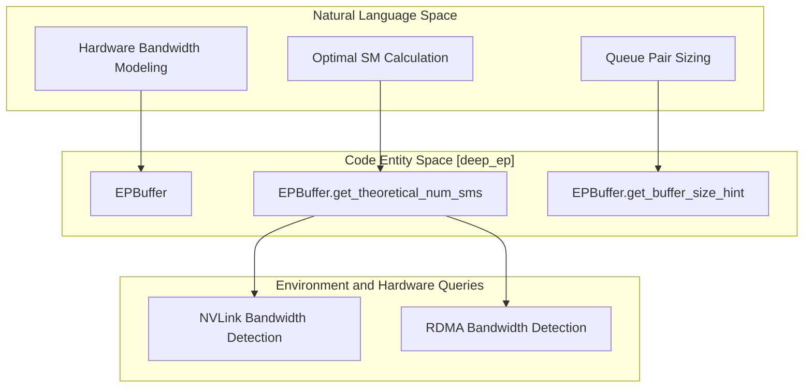
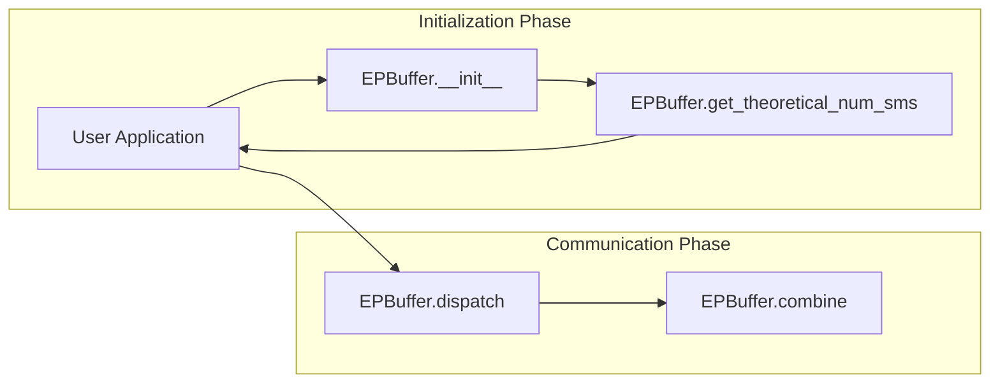

<!-- source: DeepWiki mcp.deepwiki.com · repo deepseek-ai/DeepEP · page 3.4 Analytical Resource Allocation · fetched 2026-11-11 -->

# Analytical Resource Allocation

<details>
<summary>Relevant source files</summary>

The following files were used as context for generating this wiki page:

- [README.md](README.md)

</details>


## Purpose and Scope

DeepEP V2 and V2.5 introduce a significant architectural shift by replacing the manual auto-tuning required in V1 with an **analytical resource allocation** model [README.md:9-20](). In V1, users typically had to manually sweep parameters like `num_sms` or use configuration objects to find optimal performance for a specific topology. 

In the current architecture, the `EPBuffer` interface leverages hardware bandwidth modeling to automatically calculate the optimal number of Streaming Multiprocessors (SMs) and Queue Pairs (QPs) required to saturate physical interconnects (NVLink and RDMA) [README.md:17-31](). This approach ensures that communication kernels consume the minimum necessary GPU resources while maintaining peak throughput, effectively moving from an empirical tuning model to a predictive one [README.md:17-31]().

Sources: [README.md:9-31]()

---

## The Shift from V1 to V2/V2.5

The transition from V1's legacy buffer implementations to V2.5's modular buffer family (`EPBuffer`, `BucketBuffer`, `EngramBuffer`, `PPBuffer`) eliminates the need for manual tuning loops [README.md:11-20](). High-throughput and low-latency APIs are unified into a single `EPBuffer` interface where resource counts are determined by problem geometry and hardware limits [README.md:28-32]().

| Feature | V1 (Legacy) | V2 / V2.5 (Analytical) |
| :--- | :--- | :--- |
| **SM Allocation** | Manual via `set_num_sms` or `Config` | Analytical via `EPBuffer.get_theoretical_num_sms` [README.md:28-32]() |
| **QP Allocation** | Manual `num_qps_per_rank` | Analytical via theoretical QP calculation [README.md:28-32]() |
| **Tuning Method** | Empirical sweep (grid search) | Hardware bandwidth modeling [README.md:17-32]() |
| **Resource Efficiency** | Over-allocated (e.g., 24 SMs) | Optimized (e.g., 4-12 SMs for equivalent performance) [README.md:17-32]() |

Sources: [README.md:11-32]()

---

## Analytical Bandwidth Modeling

The core of resource allocation is the ability to model the relationship between SM count and achieved bandwidth. The library determines the bottleneck (memory, NVLink, or RDMA) and allocates just enough SMs to saturate that bottleneck [README.md:17-32]().

### `get_theoretical_num_sms`

This method calculates the number of SMs required for a specific Expert Parallelism (EP) configuration based on problem geometry and hardware capabilities [README.md:107-113]().

```python
# Analytically calculates the optimal SM count for EP communication
_num_comm_sms = _buffer.get_theoretical_num_sms(num_experts, num_topk)
```

The underlying implementation uses several hardware-specific modeling parameters and environment queries, integrating peak bandwidths retrieved via `nvidia-smi` and `ibstat` for NVLink and RDMA fabrics [README.md:57]().

Sources: [README.md:57](), [README.md:107-113]()

### `get_theoretical_num_qps`

The number of RDMA Queue Pairs (QPs) is calculated to ensure network saturation without causing descriptor exhaustion, supporting the lightweight **NCCL Gin backend** [README.md:25-32]().

Sources: [README.md:25-32]()

---

## Overlap Preferences and Budgeting

### Overlap-with-Compute Preferences

A key preference in resource budgeting is balancing communication throughput with concurrent compute execution (such as Grouped GEMMs):
*   **Conservative Resource Allocation**: Analytical formulas can adjust resource estimates to use fewer SMs and communication channels, leaving maximum headroom for concurrent compute kernels.
*   **Aggressive Communication**: The system may allocate additional SMs and channels to minimize communication latency at the expense of concurrent compute throughput [README.md:28-32]().

Sources: [README.md:28-32]()

---

## Code Entity and Data Flow Maps

### Bridging Natural Language to Code: Resource Allocation Architecture

This diagram maps natural language system concepts to their concrete code entities within the Python API and runtime modules.



Sources: [README.md:57](), [README.md:107-160]()

### Data Flow: Propagation of Analytically Derived SM Counts

This diagram illustrates how calculated resource counts flow from buffer initialization into communication runtime handles.



Sources: [README.md:107-160]()

---

## Performance Comparison

The analytical model demonstrates superior efficiency compared to manual tuning approaches [README.md:41-55]().

| Architecture | Topology | V2/V2.5 SM Count | Achieved Bandwidth Behavior | V1 Comparison |
| :--- | :--- | :--- | :--- | :--- |
| Hopper / SM90 | EP 8 x 2 | Optimized (e.g., 12 SMs) | Saturates RDMA link | ~24 SMs in V1 [README.md:41-55]() |
| Hopper / SM90 | EP 8 x 4 | Optimized (e.g., 6 SMs) | Saturates RDMA link | ~24 SMs in V1 [README.md:41-55]() |
| Hopper / SM100 | EP 8 (NVLink) | 24 (Min) to 64 (Max) | High-throughput NVLink exchange | N/A [README.md:41-55]() |

**Key Takeaway**: V2/V2.5 achieves peak performance while reducing SM consumption by up to **4x** through precise analytical resource allocation [README.md:28-32]().

Sources: [README.md:28-32](), [README.md:41-55]()

---

