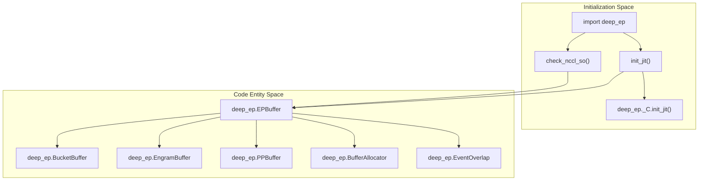
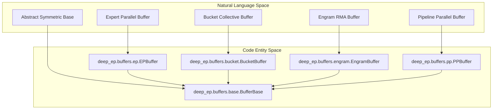

<!-- source: DeepWiki mcp.deepwiki.com · repo deepseek-ai/DeepEP · page 4 Python API Reference · fetched 2026-11-11 -->

# Python API Reference

Relevant source files

The following files were used as context for generating this wiki page:

- [README.md](README.md)
- [deep_ep/__init__.py](deep_ep/__init__.py)

This page documents the complete public Python API of the `deep_ep` package as of V2.5. It covers the exported symbols from `deep_ep/__init__.py`, package initialization (`check_nccl_so` and `init_jit`), and the core buffer class family (`EPBuffer`, `BucketBuffer`, `EngramBuffer`, `PPBuffer`, `BufferAllocator`, and `BufferBase`). 

This is a parent page providing high-level architecture and class descriptions. For detailed parameter lists, methods, and usage guides, please refer to the child pages:
- For expert-parallel communication and handle semantics, see [EPBuffer and EPHandle](#4.1).
- For collective communication and session staging, see [BucketBuffer and Collectives](#4.2).
- For remote memory access and pipeline-parallel buffers, see [EngramBuffer and PPBuffer](#4.3).
- For asynchronous execution, events, and helper utilities, see [Events, Streams and Utilities](#4.4).

---

## Package Initialization and Exported Symbols

Upon importing `deep_ep`, the package validates the runtime NCCL shared library against the linked build via `check_nccl_so()` and initializes the DeepJIT compilation runtime via `init_jit()` [deep_ep/__init__.py:19-56](). It exports a clean public API consisting of buffer classes, memory allocators, event wrappers, and low-level C++ type aliases [deep_ep/__init__.py:59-77]().

### Diagram: Package Initialization and Symbol Mapping

Sources: [deep_ep/__init__.py:1-79]()

The public symbols exposed by `deep_ep/__init__.py` are summarized below:

| Symbol Name | Source Module / Entity | Role / Description |
|---|---|---|
| `EPBuffer`, `EPHandle` | `deep_ep.buffers.ep` | Core expert-parallel communication buffer and routing metadata handle. |
| `BucketBuffer`, `BucketSession` | `deep_ep.buffers.bucket` | Collective communication buffer (all-gather, reduce-scatter, all-reduce) and tensor staging session. |
| `EngramBuffer` | `deep_ep.buffers.engram` | Multi-layer GPU/CPU RMA storage buffer with per-layer fetch/write hooks. |
| `PPBuffer` | `deep_ep.buffers.pp` | Pipeline-parallel send/recv buffer for RDMA-only ring groups. |
| `BufferAllocator` | `deep_ep.buffers.allocator` | Symmetric memory allocation planner used before buffer instantiation. |
| `BufferBase` | `deep_ep.buffers.base` | Abstract base class governing the symmetric allocation lifecycle. |
| `EventOverlap`, `EventHandle` | `deep_ep.utils.event` | CUDA event wrappers for asynchronous communication-compute overlap and graph capture. |
| `topk_idx_t`, alignment APIs | `deep_ep._C` | Low-level C++ type aliases (`topk_idx_t`) and alignment queries (`get_num_tma_alignment`, etc.). |

Sources: [deep_ep/__init__.py:59-77]()

---

## Buffer Class Family Overview

In V2.5, DeepEP refactored its communication primitives into a unified family of buffers (`EPBuffer`, `BucketBuffer`, `EngramBuffer`, and `PPBuffer`), all inheriting from `BufferBase` (`deep_ep/buffers/base.py`) and utilizing symmetric memory windows allocated via `BufferAllocator` (`deep_ep/buffers/allocator.py`).

### Diagram: Buffer Class Hierarchy

Sources: [deep_ep/__init__.py:62-67](), [deep_ep/buffers/base.py]()

### 1. `EPBuffer` and `EPHandle`
`EPBuffer` handles high-throughput and low-latency MoE expert parallel dispatch and combine operations, as well as dynamic redundant expert weight prefetching (`lb_prefetch_weights`) and gradient reduction (`lb_reduce_grads`) [README.md:15-29](). `EPHandle` captures expanded layouts and routing metadata essential for inference caching and deferred epilogues [README.md:16]().
- For full details, see [EPBuffer and EPHandle](#4.1).

### 2. `BucketBuffer` and `BucketSession`
`BucketBuffer` provides batched collective communication primitives—including `all_gather`, `reduce_scatter`, and `all_reduce`—designed for context parallelism (CP) and data parallelism (DP). `BucketSession` manages tensor staging for ordinary PyTorch tensors [README.md:14,35]().
- For full details, see [BucketBuffer and Collectives](#4.2).

### 3. `EngramBuffer` and `PPBuffer`
`EngramBuffer` supports multi-layer GPU/CPU remote memory access (RMA) with write and fetch operations utilizing per-layer hooks. `PPBuffer` handles pipeline-parallel send/recv operations within RDMA-only ring topologies [README.md:17,33-34]().
- For full details, see [EngramBuffer and PPBuffer](#4.3).

### 4. Events, Streams, and Global Utilities
The package provides event wrappers (`EventOverlap`, `EventHandle`) in `deep_ep/utils/event.py` for stream synchronization and overlapping communication with compute. Global topology functions (`get_physical_domain_size`, `get_logical_domain_size`) and communication helpers reside in the `comm` and `utils` modules [deep_ep/__init__.py:60-69]().
- For full details, see [Events, Streams and Utilities](#4.4).

Sources: [README.md:11-35](), [deep_ep/__init__.py:59-70]()

---

