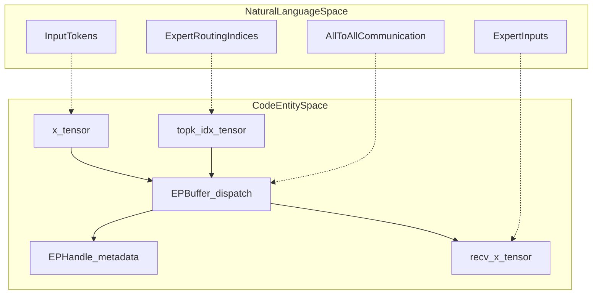
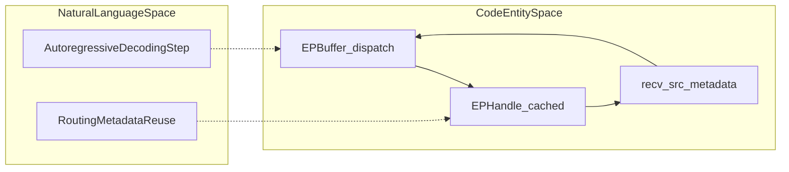

<!-- source: DeepWiki mcp.deepwiki.com · repo deepseek-ai/DeepEP · page 4.1 EPBuffer and EPHandle · fetched 2026-11-11 -->

# EPBuffer and EPHandle

<details>
<summary>Relevant source files</summary>

The following files were used as context for generating this wiki page:

- [README.md](README.md)
- [deep_ep/__init__.py](deep_ep/__init__.py)

</details>


## Purpose and Scope

The `EPBuffer` and `EPHandle` classes (defined in `deep_ep/buffers/ep.py`) provide the primary interface for expert-parallel (EP) communication in DeepEP [README.md:1-29](). In DeepEP V2.5, `ElasticBuffer` was split into specialized buffer classes sharing the common `BufferBase` lifecycle, with `EPBuffer` dedicated specifically to high-throughput and low-latency MoE dispatch, combine, and expert load-balancing operations [README.md:11-15](), [deep_ep/__init__.py:63-64]().

Key capabilities documented in this section include:
- **Unified EP Interface**: Managing token routing, expanded layouts, and expert alignments for training, prefill, and decoding [README.md:28-30]().
- **Expert Load Balancing**: Primitives (`lb_prefetch_weights` and `lb_reduce_grads`) for dynamic redundant experts over NVLink [README.md:15]().
- **Handle Caching Semantics**: Reusing routing metadata via `EPHandle` to optimize inference decoding [README.md:109]().
- **Analytical Resource Management**: Automatic calculation of optimal SM and Queue Pair (QP) counts [README.md:31]().

Sources: [README.md:11-31](), [deep_ep/__init__.py:63-64]()

---

## EPBuffer Initialization and Constructor Arguments

`EPBuffer` initializes communication resources, symmetric memory windows, and context for an expert-parallel process group [README.md:107-110]().

### Constructor: `__init__`

**Signature:**
```python
def __init__(
    self,
    group: dist.ProcessGroup,
    num_bytes: Optional[int] = None,
    num_cpu_bytes: int = 0,
    num_max_tokens_per_rank: int = 0,
    hidden: int = 0,
    num_topk: int = 0,
    use_fp8_dispatch: bool = False,
    deterministic: bool = False,
    allow_hybrid_mode: bool = True,
    allow_multiple_reduction: bool = True,
    prefer_overlap_with_compute: bool = True,
    sl_idx: int = 3,
    num_allocated_qps: int = 0,
    num_cpu_timeout_secs: int = 300,
    num_gpu_timeout_secs: int = 100,
    explicitly_destroy: bool = False
)
```

**Parameters:**
| Parameter | Type | Description |
|-----------|------|-------------|
| `group` | `dist.ProcessGroup` | PyTorch distributed process group used to extract the NCCL communicator [README.md:107-114](). |
| `num_bytes` | `int` | Total buffer size (GPU + CPU). If `None`, calculated automatically from MoE settings [README.md:107-114](). |
| `num_cpu_bytes` | `int` | Portion of `num_bytes` allocated in CPU pinned memory for hybrid storage [README.md:107-114](). |
| `num_max_tokens_per_rank` | `int` | Maximum tokens per rank used for buffer sizing [README.md:107-114](). |
| `hidden` | `int` | Hidden dimension size of the model [README.md:107-114](). |
| `num_topk` | `int` | Number of experts selected per token (`num_topk`) [README.md:107-114](). |
| `use_fp8_dispatch` | `bool` | Whether to use FP8 quantization for token dispatching [README.md:107-114](). |
| `deterministic` | `bool` | Ensure deterministic reduction in combine by sorting received tokens [README.md:107-114](). |
| `allow_hybrid_mode` | `bool` | Enable hierarchical RDMA + NVLink communication [README.md:28-32](). |
| `allow_multiple_reduction` | `bool` | Allow multiple reduction passes for precision control [README.md:1-533](). |
| `prefer_overlap_with_compute` | `bool` | Optimize resource allocation for overlapping communication with compute [README.md:1-533](). |
| `sl_idx` | `int` | RDMA Service Level / Virtual Lane (default 3) [README.md:100-101](). |
| `num_allocated_qps` | `int` | Number of RDMA Queue Pairs to allocate [README.md:1-533](). |
| `explicitly_destroy` | `bool` | If `True`, requires manual `destroy()` call to prevent resource leaks [README.md:1-533](). |

Sources: [README.md:107-114](), [deep_ep/__init__.py:63-64]()

---

## Core Operations: Dispatch and Combine

### Method: `dispatch`

`dispatch` performs all-to-all token routing based on `topk_idx`. It returns the routed token tensor (or list of tensors for FP8) and an `EPHandle` containing routing metadata for the subsequent `combine` operation [README.md:28-30]().

**Data Flow and Code Entity Association:**


Sources: [README.md:28-30](), [deep_ep/__init__.py:64]()

**Signature:**
```python
def dispatch(
    self,
    x: Union[torch.Tensor, List[torch.Tensor]],
    topk_idx: torch.Tensor,
    num_experts: int,
    expert_alignment: int = 1,
    num_sms: int = -1,
    config: Optional[Config] = None,
    previous_event: Optional[EventOverlap] = None,
    async_with_compute_stream: bool = False,
    allocate_on_comm_stream: bool = False,
    handle: Optional[EPHandle] = None
) -> Tuple[Union[torch.Tensor, List[torch.Tensor]], EPHandle]
```

### Method: `combine`

`combine` reverses the token routing performed during dispatch, gathering processed tokens from expert ranks back to their source ranks and applying weighted reduction via `topk_weights` [README.md:28-30]().

**Signature:**
```python
def combine(
    self,
    x: torch.Tensor,
    handle: EPHandle,
    topk_weights: Optional[torch.Tensor] = None,
    num_sms: int = -1,
    config: Optional[Config] = None,
    previous_event: Optional[EventOverlap] = None,
    async_with_compute_stream: bool = False,
    allocate_on_comm_stream: bool = False
) -> torch.Tensor
```

Sources: [README.md:28-30](), [deep_ep/__init__.py:64]()

---

## Expert Load Balancing Primitives

DeepEP V2.5 introduces native support for dynamic redundant experts via NVLink weight prefetching and gradient reduction [README.md:15]().

### Method: `lb_prefetch_weights`
Prefetches expert weights and quantization scales over NVLink prior to expert computation for redundant experts [README.md:15]().
- **Purpose**: Minimizes latency overhead when replicating experts dynamically across ranks for load balancing [README.md:15]().

### Method: `lb_reduce_grads`
Accumulates redundant experts' FP32 gradients back into the original experts during the backward pass [README.md:15]().
- **Purpose**: Ensures correct gradient synchronization across replicated expert nodes [README.md:15]().

Sources: [README.md:11-19](), [deep_ep/__init__.py:64]()

---

## EPHandle Attributes and Caching Semantics

`EPHandle` stores routing metadata generated during `dispatch` [README.md:28-30](). 

**Caching Semantics in Inference Decoding:**
During autoregressive decoding, token routing patterns or sequence lengths often remain stable across consecutive layers or decoding steps. When a cached `EPHandle` is passed back into `dispatch`:
- The kernel bypasses runtime routing metadata calculation [README.md:109]().
- It reuses `recv_src_metadata` from the handle, significantly reducing kernel launch latency [README.md:109]().


Sources: [README.md:107-110](), [deep_ep/__init__.py:64]()

---

## Size Hints and Analytical Resource Allocation

Before constructing an `EPBuffer`, static methods can be used to calculate memory and resource requirements:

| Method | Description |
|--------|-------------|
| `EPBuffer.get_buffer_size_hint` | Calculates total buffer size needed for EP dispatch/combine based on token count, hidden dimensions, and expert count [README.md:107-134](). |
| `EPBuffer.get_theoretical_num_sms` | Determines the optimal number of GPU SMs required to saturate communication bandwidth [README.md:31](). |
| `EPBuffer.get_theoretical_num_qps` | Calculates required RDMA Queue Pairs based on scaleout topology [README.md:31](). |

Sources: [README.md:31](), [README.md:107-134](), [deep_ep/__init__.py:64]()

---

## Lifecycle and Utilities

- **`destroy()`**: Explicitly releases underlying C++ resources, NCCL contexts, and symmetric memory windows [README.md:11-18]().
- **`barrier()`**: Synchronizes all ranks in the process group using the lightweight NCCL Gin barrier [README.md:25-28]().
- **`get_comm_stream()`**: Returns the dedicated CUDA stream used for communication kernels [README.md:1-533]().

Sources: [README.md:15-28](), [deep_ep/__init__.py:64]()

---

