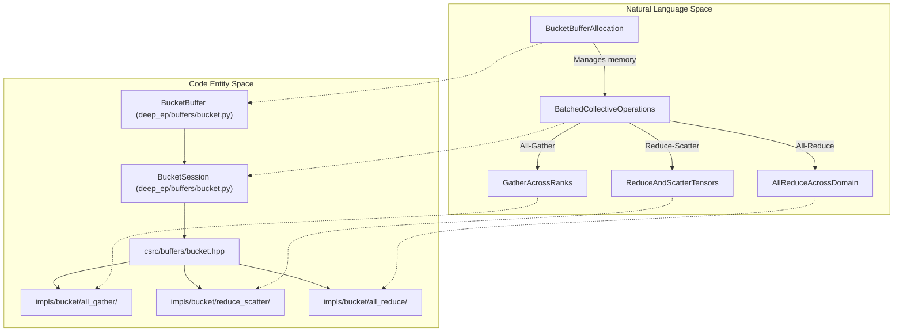
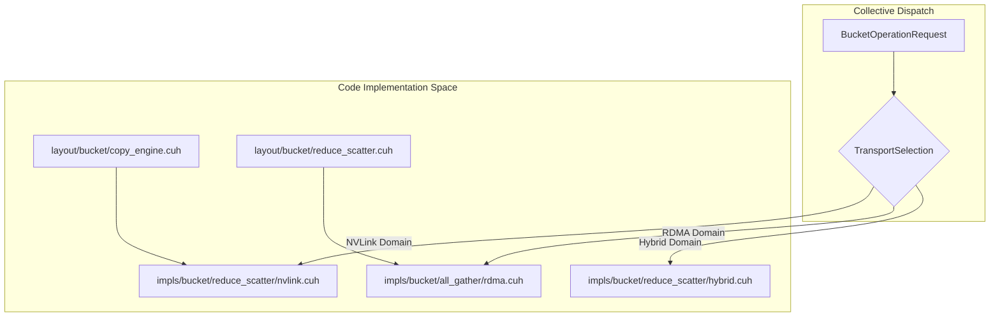

<!-- source: DeepWiki mcp.deepwiki.com · repo deepseek-ai/DeepEP · page 4.2 BucketBuffer and Collectives · fetched 2026-11-11 -->

# BucketBuffer and Collectives

<details>
<summary>Relevant source files</summary>

The following files were used as context for generating this wiki page:

- [README.md](README.md)
- [csrc/indexing/main.cu](csrc/indexing/main.cu)

</details>


## Purpose and Scope
This page details the implementation and usage of `BucketBuffer` and `BucketSession` (`deep_ep/buffers/bucket.py`), which provide high-performance batched collective operations (`all_gather`, `reduce_scatter`, and `all_reduce`) tailored for Context Parallelism (CP) and Data Parallelism (DP). It covers buffer storage requirements, size hints, session staging, and underlying transport mechanics across NVLink, RDMA, and hybrid modes.

Sources: `README.md`, `deep_ep/buffers/bucket.py`, `csrc/buffers/bucket.hpp`

---

## Python API and Buffer Lifecycle
`BucketBuffer` manages symmetric memory allocations for batched bucket collectives, adhering to the `BufferBase` lifecycle model. It works alongside `BucketSession` to stage ordinary PyTorch tensors for communication.

### Key Classes and Functions
- `BucketBuffer`: Manages communication buffers, calculates storage requirements, and exposes collective methods.
- `BucketSession`: Context manager for staging tensors during batched bucket operations.
- `get_buffer_size_hint`: Estimates memory requirements for bucket operations.

```python
# Conceptual usage of BucketBuffer and BucketSession
from deep_ep import BucketBuffer

# Initialize buffer with process group and size hints
bucket_buffer = BucketBuffer(group=dp_group, size_hint=...)
with bucket_buffer.session() as session:
    session.all_gather(tensor_in, tensor_out)
```

Sources: `README.md`, `deep_ep/buffers/bucket.py`, `csrc/buffers/bucket.hpp`

---

## Collective Operations & Transports
`BucketBuffer` supports three primary collective operations across multiple transport domains (NVLink for intra-node, RDMA for inter-node, and hybrid):
1. `all_gather`: Gathers tensors across all ranks in the parallel group.
2. `reduce_scatter`: Reduces tensors and scatters the results across ranks.
3. `all_reduce`: Performs an all-reduce across the collective domain.

### Architecture to Code Mapping
The following diagram links the conceptual collective operations and buffer management to their corresponding Python and C++ code entities.


Sources: `README.md`, `deep_ep/buffers/bucket.py`, `csrc/buffers/bucket.hpp`, `csrc/indexing/main.cu`

---

## Kernel Implementations and Layouts
The header-only CUDA kernel layer implements transport-specific routines for each collective under `deep_ep/include/deep_ep/impls/bucket/` and layout management under `deep_ep/include/deep_ep/layout/bucket/`.

### Transport Subdirectories
- **NVLink (`nvlink.cuh`)**: Optimized intra-node communication utilizing NVLink bandwidth.
- **RDMA (`rdma.cuh`)**: Inter-node communication over RDMA networks.
- **Hybrid (`hybrid.cuh`)**: Combined intra-node and inter-node routing for large-scale deployments.
- **Copy Engine & Layouts (`copy_engine.cuh`, `reduce_scatter.cuh`)**: Memory layout transformations and data movement primitives.

### Transport Kernel Routing

Sources: `csrc/indexing/main.cu`

---

