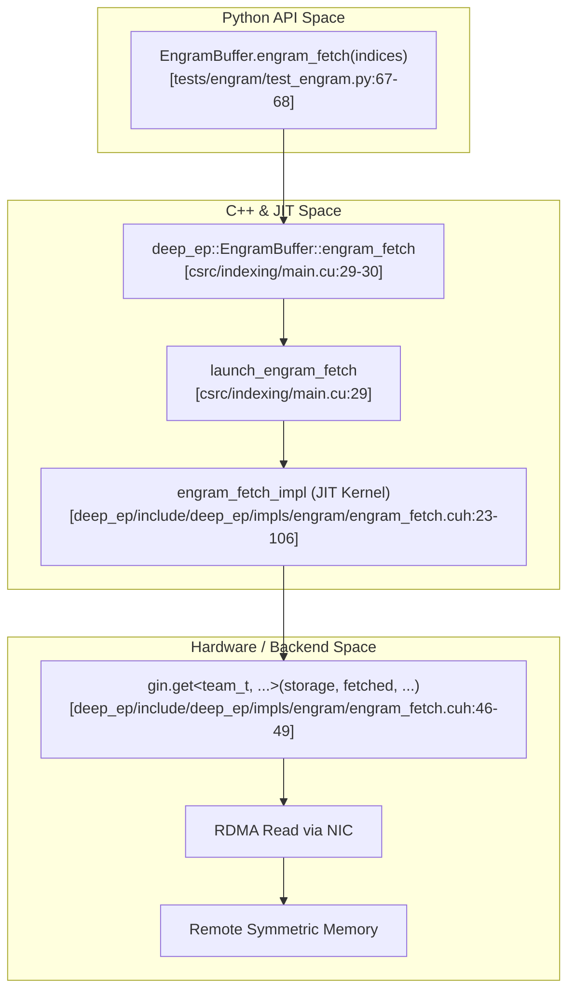
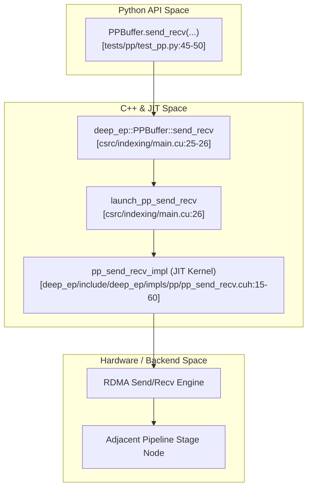

<!-- source: DeepWiki mcp.deepwiki.com · repo deepseek-ai/DeepEP · page 4.3 EngramBuffer and PPBuffer · fetched 2026-11-11 -->

# EngramBuffer and PPBuffer

Relevant source files

The following files were used as context for generating this wiki page:

- [README.md](README.md)
- [csrc/indexing/main.cu](csrc/indexing/main.cu)

## Purpose and Scope

This page covers **EngramBuffer** and **PPBuffer**, two specialized buffer classes in DeepEP V2.5 (succeeding the legacy `ElasticBuffer`) [README.md:11-12](). 
- **EngramBuffer** provides multi-layer GPU or CPU Remote Memory Access (RMA) storage, supporting write and fetch operations with per-layer synchronization hooks via the `ncclGin` backend [README.md:17]().
- **PPBuffer** provides pipeline-parallel (PP) send and receive operations operating within RDMA-only ring groups [README.md:34]().

---

## 1. EngramBuffer Multi-Layer RMA Storage

`EngramBuffer` facilitates direct remote memory read/write operations with near-zero SM overhead by leveraging RDMA `ncclGin` transport [README.md:3, 17, 33](). In V2.5, it supports multi-layer storage distributed across GPU VRAM or CPU system memory, allowing users to issue asynchronous fetches across multiple layers and wait on per-layer hooks [README.md:17]().

### EngramBuffer Data Flow and Code Mapping

The following diagram bridges the high-level natural language concept of multi-layer engram fetching to the precise C++ and CUDA code entities.

Sources: [README.md:17](), [csrc/indexing/main.cu:29-30](), [deep_ep/include/deep_ep/impls/engram/engram_fetch.cuh:23-106]()

### Core Implementation: Fetch and Wait

The underlying JIT-compiled CUDA kernels handle the distributed RMA transfer and synchronization:
* **`engram_fetch_impl`**: Issues warp-level RDMA read requests using `gin.get` with `ncclGinOptFlagsAggregateRequests`, issuing a `flush_async` per peer to commit requests on the queue pair (`QP`) [deep_ep/include/deep_ep/impls/engram/engram_fetch.cuh:46-81]().
* **`engram_fetch_wait_impl`**: Iterates through request descriptors and blocks via `gin.wait` until the per-layer asynchronous transfer completes [deep_ep/include/deep_ep/impls/engram/engram_fetch_wait.cuh:20-28]().

Sources: [README.md:17](), [deep_ep/include/deep_ep/impls/engram/engram_fetch.cuh:23-106](), [deep_ep/include/deep_ep/impls/engram/engram_fetch_wait.cuh:20-28]()

---

## 2. PPBuffer Pipeline-Parallel Transport

`PPBuffer` manages pipeline-parallel point-to-point communications (`send` and `recv`) restricted to RDMA-only ring topologies [README.md:34](). Unlike EP dispatch/combine routines which rely on hybrid NVLink/RDMA fabrics, pipeline parallelism across stages typically flows strictly through internode RDMA channels [README.md:34, 101]().

### PPBuffer Data Flow and Code Mapping

The diagram below connects the high-level pipeline communication request to the underlying CUDA kernel implementation.

Sources: [README.md:34](), [csrc/indexing/main.cu:25-26](), [deep_ep/include/deep_ep/impls/pp/pp_send_recv.cuh:15-60]()

Sources: [README.md:34](), [csrc/indexing/main.cu:25-26](), [deep_ep/include/deep_ep/impls/pp/pp_send_recv.cuh:15-60]()

---

## Summary of Buffer Operations

| Buffer Class | Primary Transport | Key Operations | Synchronization Hook | Source Citation |
|--------------|-------------------|----------------|----------------------|-----------------|
| `EngramBuffer` | RDMA (`ncclGin`) | `engram_write`, `engram_fetch` | Per-layer wait hook | [README.md:17, 33]() |
| `PPBuffer`     | RDMA-only ring    | `send`, `recv` | Stage completion barrier | [README.md:34]() |

Sources: [README.md:17, 33-34]()

---

