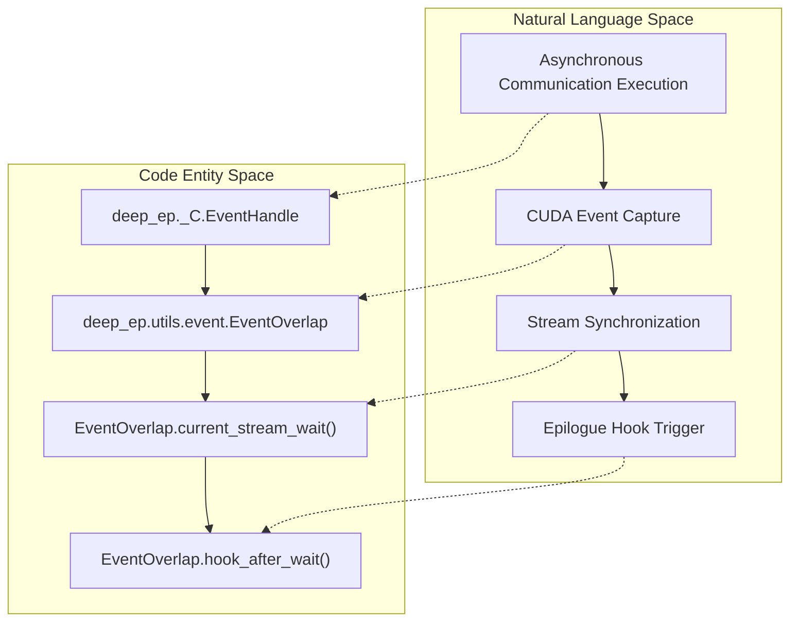
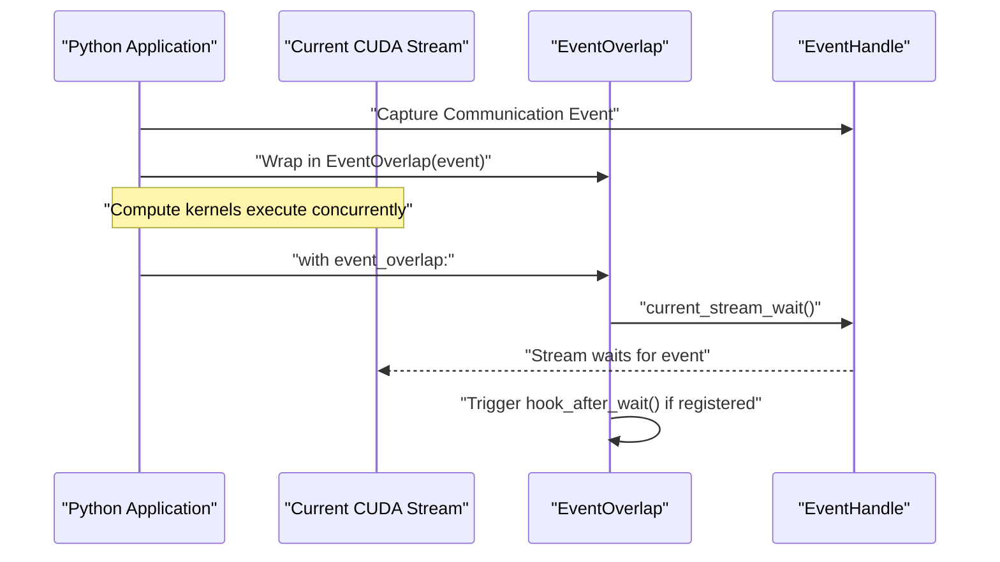
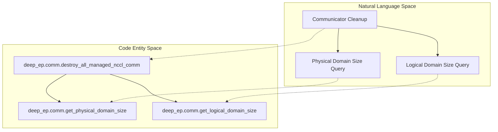
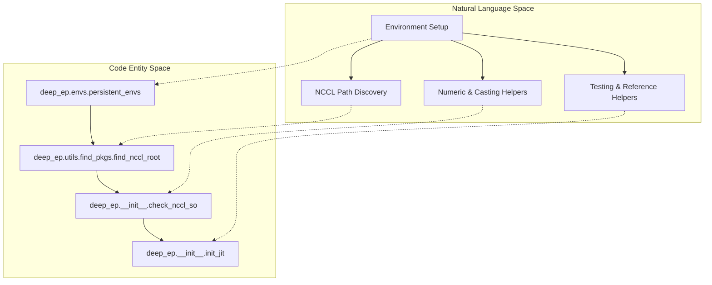

<!-- source: DeepWiki mcp.deepwiki.com · repo deepseek-ai/DeepEP · page 4.4 Events, Streams and Utilities · fetched 2026-11-11 -->

# Events, Streams and Utilities

Relevant source files

The following files were used as context for generating this wiki page:

- [deep_ep/__init__.py](deep_ep/__init__.py)
- [deep_ep/utils/event.py](deep_ep/utils/event.py)

## Purpose and Scope

The `deep_ep.utils.event` module and related helper utilities provide foundational primitives for asynchronous execution, CUDA event management, stream coordination, JIT initialization, NCCL root discovery, and tensor/math helper routines. These components enable seamless overlap of communication and computation, robust environment configuration, and package setup across DeepEP.

Sources: [`deep_ep/__init__.py:1-80`](), [`deep_ep/utils/event.py:1-107`]()

---

## Event Management: `EventOverlap` and `EventHandle`

`EventOverlap` (`deep_ep/utils/event.py`) is a Python wrapper class designed to manage CUDA events (`EventHandle`, bound from `deep_ep._C`) and streamline stream synchronization for communication-computation overlapping [deep_ep/utils/event.py:8-15]().

### Key Classes and Methods

- **`EventHandle`**: A low-level C++ bound CUDA event wrapper imported from `deep_ep._C` [deep_ep/utils/event.py:5-5]().
- **`EventOverlap.__init__`**: Initializes with an optional `EventHandle` and `extra_tensors`, and sets up `hook_after_wait` [deep_ep/utils/event.py:17-38]().
- **`EventOverlap.current_stream_wait`**: Invokes `self.event.current_stream_wait()` on `torch.cuda.current_stream()`, triggers any registered `hook_after_wait`, and optionally releases the event handle [deep_ep/utils/event.py:39-60]().
- **`EventOverlap.wait`**: Alias for `current_stream_wait()` [deep_ep/utils/event.py:62-64]().
- **`EventOverlap.register_hook_after_wait`**: Registers a callback to run after the stream wait completes, used for deterministic sorting or post-processing [deep_ep/utils/event.py:66-72]().
- **Context Manager (`__enter__`/`__exit__`)**: Enables `with event_overlap:` syntax to automatically block the current stream upon exiting the scope [deep_ep/utils/event.py:84-106]().

Asynchronous Execution Sequence:

Sources: [`deep_ep/utils/event.py:1-107`](), [`deep_ep/__init__.py:69-69`]()

---

## Communication Module Utilities

The communication subsystem exposes management functions and helpers under `deep_ep.comm` (imported in `deep_ep/__init__.py`) for domain size queries and communicator lifecycle management [`deep_ep/__init__.py:60-61`]().

- **`destroy_all_managed_nccl_comm`**: Cleans up and destroys all managed NCCL communicators [`deep_ep/__init__.py:61`]().
- **`get_physical_domain_size`**: Queries physical hardware domain dimensions (e.g., scaleup NVLink domain size) [`deep_ep/__init__.py:61`]().
- **`get_logical_domain_size`**: Queries logical domain dimensions for expert parallelism [`deep_ep/__init__.py:61`]().

Sources: [`deep_ep/__init__.py:60-61`]()

---

## Helper Utilities in `deep_ep/utils`

DeepEP incorporates various infrastructure utilities under `deep_ep/utils`:

- **`envs.py`**: Manages persistent environment variables (such as `persistent_envs`) injected at setup time and populated into `os.environ` [`deep_ep/__init__.py:9-16`]().
- **`find_pkgs.py`**: Provides `find_nccl_root()` to locate NCCL installation paths for binary validation and JIT compilation [`deep_ep/__init__.py:6`]().
- **`math.py`**: Supplies numeric scaling and casting helpers (e.g., FP8 scale factors, rounding utilities).
- **`gate.py`, `refs.py`, `semantic.py`**: Provide testing gates, reference implementations, and semantic validation helpers for distributed verification.

Sources: [`deep_ep/__init__.py:1-56`](), [`deep_ep/utils/event.py:1-107`]()

---

