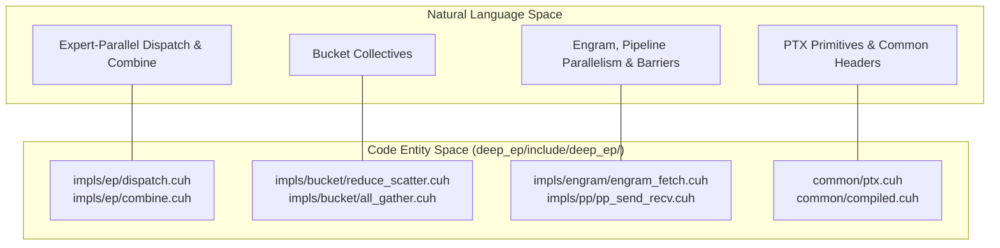
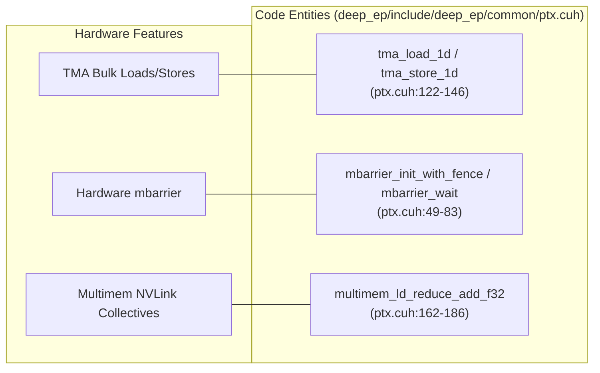

<!-- source: DeepWiki mcp.deepwiki.com · repo deepseek-ai/DeepEP · page 5 Kernel Architecture · fetched 2026-11-11 -->

# Kernel Architecture

Relevant source files

The following files were used as context for generating this wiki page:

- [csrc/indexing/main.cu](csrc/indexing/main.cu)
- [deep_ep/include/deep_ep/common/ptx.cuh](deep_ep/include/deep_ep/common/ptx.cuh)

The kernel architecture of DeepEP is a header-only CUDA layer located in `deep_ep/include/deep_ep/` (`impls/`, `layout/`, `comm/`, and `common/`) [csrc/indexing/main.cu:1-31](). It provides high-performance, JIT-compiled primitives that back each buffer type (`EPBuffer`, `BucketBuffer`, `EngramBuffer`, and `PPBuffer`). By separating kernel definitions into templated header files and leveraging runtime compilation via DeepJIT, DeepEP adapts its token routing, collective operations, and synchronization primitives to specific hardware topologies (NVLink scaleup vs. RDMA scaleout) and MoE configurations without binary bloat.

### Kernel Layer Structure Diagram

The following diagram illustrates the relationship between the natural language subsystem names and the underlying code entities in the header-only kernel layer and indexing translation units.

Sources: [csrc/indexing/main.cu:1-31]()

---

## 5.1 Expert-Parallel Kernels

Expert-parallel kernels manage token routing, dispatch, combine, and weight/gradient prefetching across distributed nodes. Located in `deep_ep/include/deep_ep/impls/ep/` and structured around layouts in `deep_ep/include/deep_ep/layout/ep/`, these kernels utilize specialized warp roles, expert alignment, and deferred epilogues to maximize overlap between communication and computation.

For details, see [Expert-Parallel Kernels](#5.1).

Sources: [csrc/indexing/main.cu:15-24]()

---

## 5.2 Bucket Collective Kernels

Bucket collective kernels provide foundational communication primitives—`reduce_scatter`, `all_gather`, and `all_reduce`—optimized across NVLink, RDMA, and hybrid transports. Located in `deep_ep/include/deep_ep/impls/bucket/`, they interact with copy engines and buffer layouts defined in `deep_ep/include/deep_ep/layout/bucket/` to support Collective Parallelism (CP) and Data Parallelism (DP).

For details, see [Bucket Collective Kernels](#5.2).

Sources: [csrc/indexing/main.cu:4-14]()

---

## 5.3 Engram, PP and Barrier Kernels

Synchronization and specialized domain primitives are implemented across `impls/engram/`, `impls/pp/`, and `impls/comm/`. These include multi-layer GPU/CPU RMA storage fetch routines (`engram_fetch.cuh`, `engram_fetch_wait.cuh`) [csrc/indexing/main.cu:28-30](), pipeline-parallel send/recv operations (`pp_send_recv.cuh`) [csrc/indexing/main.cu:25-27](), and low-level barrier synchronization primitives (`barrier.cuh`) [csrc/indexing/main.cu:1-3]().

For details, see [Engram, PP and Barrier Kernels](#5.3).

Sources: [csrc/indexing/main.cu:1-3,25-30]()

---

## 5.4 PTX Primitives and Common Headers

The foundational hardware-acceleration layer is implemented in `deep_ep/include/deep_ep/common/ptx.cuh`, which wraps low-level PTX instructions such as Tensor Memory Accelerator (TMA), hardware `mbarrier` synchronization, multimem/NVLink collectives, predicated load/stores, and warp-level intrinsics [deep_ep/include/deep_ep/common/ptx.cuh:1-189](). These are accompanied by compilation helpers (`compiled.cuh`) and robust exception handling (`exception.cuh`).

### PTX and Hardware Primitives Map

Sources: [deep_ep/include/deep_ep/common/ptx.cuh:1-189]()

For details, see [PTX Primitives and Common Headers](#5.4).

---

